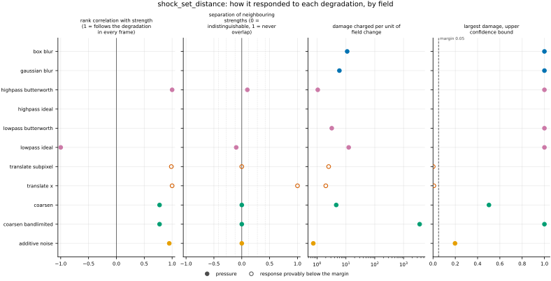
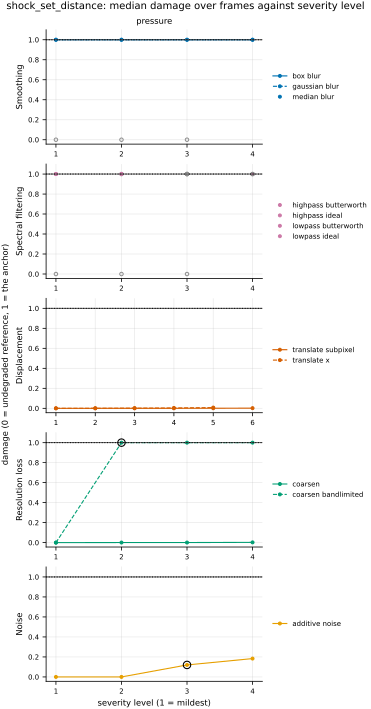

## Definition

The metric runs in two steps: a detector marks the shocked cells of each pressure field, and
a distance between the two marked sets is reported.

**The detector.** Let $p$ be one channel of the pressure. A cell $\mathbf{n}$ is shocked when,
along some spatial axis $j$ with unit step $\mathbf{e}_j$, the pressures of its two
neighbours differ by at least the ratio across a normal shock of Mach number
$M_{\min} = 1.3$:

$$
\max\bigl(p_{\mathbf{n}-\mathbf{e}_j},\, p_{\mathbf{n}+\mathbf{e}_j}\bigr) \;\ge\; R \,
\min\bigl(p_{\mathbf{n}-\mathbf{e}_j},\, p_{\mathbf{n}+\mathbf{e}_j}\bigr),
\qquad
R = \frac{2\gamma M_{\min}^2}{\gamma + 1} - \frac{\gamma - 1}{\gamma + 1}. \tag{1}
$$

This is the pressure half of the shock-zone criterion (iii) of [@schaal2015], Sect. 2.3.2,
$\Delta \log p \ge \log(p_2/p_1)|_{M_{\min}}$, written without the logarithm; $R$ is their
Rankine-Hugoniot pressure ratio, Eq. (2), and $M_{\min} = 1.3$ is the value of the same
section. With $\gamma = 1.4$, the ratio of specific heats of the `sod_shock_tube` dataset, read
from its reader rather than restated, $R = 1.805$.
Schaal and Springel state that a minimum pressure jump "discriminates against tangential
discontinuities and contacts": a contact carries a density jump and no pressure jump, so it is
not flagged. Three choices here are mine, not theirs. The jump is tested along every grid axis
and any axis flags the cell, where they measure it along the shock direction, which needs a
temperature gradient this metric is not given. Their criteria (i) and (ii), on the velocity
divergence and the temperature and density gradients, need fields a metric handed one field
does not receive, so only criterion (iii) is applied. And a non-positive pressure satisfies
Equation (1) automatically, so a cell beside one is flagged: the ratio across it is unbounded
([issue 102](https://github.com/khegazy/pde_metrics/blob/main/issues/102-shock-set-distance-empty-and-non-positive-conventions.md)).

**The distance.** Let $A$ and $B$ be the shocked cells of the reference and of the candidate,
each cell standing for its centre, and $d(x, S) = \min_{y \in S} \lVert x - y \rVert$ the
Euclidean distance from a point to a set at the grid's own spacing ([@yeghiazaryan2018],
Sect. 2.3; it is the minimum inside the directed distances of [@taha2015], Eqs. (49) and
(51)). The registered number is the average symmetric surface distance, "the average of all
the distances from points on the boundary of machine segmented region to the boundary of the
ground truth, and vice versa" ([@yeghiazaryan2018], Sect. 2.3.2, unnumbered in the copy read):

$$
\mathrm{ASSD}(A, B) = \frac{\sum_{a \in A} d(a, B) + \sum_{b \in B} d(b, A)}{|A| + |B|}. \tag{2}
$$

Every flagged cell is a point of the set; no boundary is extracted from the mask, because a
detected shock is already a thin layer (my choice). A sharp jump between two cells flags both
of them, so moving a sharp step by $s \ge 1$ cells gives, from Equation (2),

$$
\mathrm{ASSD} = \Bigl(s - \tfrac{1}{2}\Bigr)\Delta x, \tag{3}
$$

because each flagged cell's nearest partner is $s - 1$ or $s$ cells away. A sharp shock moved by
$s$ cells therefore scores half a cell less than $s$ cells, and the one-dimensional distance
between two shock positions $|x - x'|$ is recovered to within half a cell.

**Empty sets.** Equation (2) is undefined when a set is empty. Two empty sets score $0$: both
fields agree there is no shock (my choice). One empty set scores the length of the domain's
diagonal, $\sqrt{\sum_j (N_j \Delta x_j)^2}$, the worst-possible value that [@maierhein2024],
Suppl. Note 2.3, recommends for an undefined distance, naming the image diagonal; it exceeds
the distance between any two cell centres, so a missed or invented shock always scores worse
than a misplaced one. Both are conventions
([issue 102](https://github.com/khegazy/pde_metrics/blob/main/issues/102-shock-set-distance-empty-and-non-positive-conventions.md)).
Channels, of which pressure has one, are averaged.

**Not registered.** [@taha2015] give three other summaries of the same nearest-point distances:
the Hausdorff distance, the larger of the two directed maxima, Eq. (48), which they call
"generally sensitive to outliers"; its quantile form, which they call "one way to handle
outliers"; and the average distance, the larger of the two directed means, Eq. (50), which they
call "stable and less sensitive to outliers than the HD". [@maierhein2024], Suppl. Note 2.3,
recommends the mean of the two directed means over Equation (2) as its default. For a single
shock in each field all of these are equal; they differ when the detector flags cells away
from the shock. Each would be a sibling bundle importing `surface_distances`.

### Boundary handling

The detector's stencil reaches one cell beyond the domain. There the field is extended by
repeating its edge value, a zero-gradient wall, so an edge cell compares itself with its one
inner neighbour; nothing wraps around. The distance transform measures straight across the
domain and never around it. On a periodic grid this misses a jump that sits exactly on the
seam and overstates the distance between two shocks on either side of it, so the metric is
exact on bounded domains and approximate on periodic ones. It takes no Fourier transform and
does not declare `requires_periodic`, and it runs on the bounded `sod_shock_tube`.

## Performance

<!-- GENERATED performance: written by `python -m fmeval.cards evidence shock_set_distance --results results/shock_set_distance_1793350452`, do not edit -->



Four measured statistics for shock_set_distance, one row per degradation grouped by family and one marker per field. From left: the rank correlation between the metric and the applied strength within a frame, with the line showing the resampling interval; the separation of neighbouring strengths as Cliff's delta, where 0 means the metric cannot tell one strength from the next and the faint ticks at 0.12, 0.28 and 0.42 are Vargha and Delaney's small, medium and large anchors, for scale and not as grades; the damage charged per unit of field change at the harshest strength; and the upper confidence bound on the largest damage, beside the fixed margin of 0.05. A hollow marker is a field and degradation on which that bound lies below the margin, so the response is provably small. A missing marker is a statistic the analysis withheld, as the rank correlation is on an axis the metric is invariant to.



Median damage over frames against severity level for shock_set_distance, one row per family of degradation and one column per field, on one shared scale. The solid grey line is damage 1, the anchor (by default the field's own mean); the dotted black line is the damage assigned to the fake prediction with the right spectrum, where the run included it. The hollow black ring marks the first level at which the metric has moved a tenth of the way to the anchor. Hollow grey markers are strengths excluded for repeating a milder one or for doing nothing. Degradations with three or fewer usable levels are drawn as markers only; points beyond 2 either side are drawn as triangles at the edge. Damage is negative where a degradation moves the metric away from the anchor, as noise raises a single-field quantity the field's mean sets to zero.

**Trend: does the response follow the degradation?**

| test family | field | degradations | rank correlation | fraction of frames in order | weakest gap between neighbouring strengths |
|---|---|---|---|---|---|
| Displacement | pressure | 2 | 0.986 to 1 | 0 to 1 | 0.5 to 1 |
| Resolution loss | pressure | 2 | 0.775 | 0 | 0.5 |
| Smoothing | pressure | 2 | — | — | — |
| Spectral filtering | pressure | 4 | -1 to 1 | 0 to 0.1 | 0.45 to 0.55 |
| Noise | pressure | 1 | 0.949 | 0 | 0.5 |

**Reactivity: how far does it move?**

| test family | field | change from clean at the harshest strength | elasticity | first strength detected |
|---|---|---|---|---|
| Displacement | pressure | — | 1.4 | level — |
| Resolution loss | pressure | — | 6.16 | level 2 |
| Smoothing | pressure | — | — | level — |
| Spectral filtering | pressure | — | — | level — |
| Noise | pressure | — | — | level 3 |
| trap test: fake prediction, right spectrum | pressure | — | — | damage 1 |

**Consistency: how much does it vary from snapshot to snapshot?**

| test family | field | consistency, in the strength's units | snapshots per independent block |
|---|---|---|---|
| Displacement | pressure | 0 | 1 |
| Resolution loss | pressure | 3.91 to 7.11 | 1 |
| Smoothing | pressure | — | 1 |
| Spectral filtering | pressure | 0.316 to 1.64 | 1 |
| Noise | pressure | 0.169 | 1 |

One row per family of degradation and physical field; a cell gives the range over the degradations in that family. **Trend.** The rank correlation is the Spearman correlation between the strength and how far the metric has moved from its value on the undegraded field of the same frame, in the one direction it moves under that degradation, computed inside a single frame. A value of 1 means every strength moved it further than the last in every frame, whichever way it moves; a response that scatters to both sides scores near 0. The fraction of frames in order counts the frames with no exception. The weakest gap is the smallest Mann-Whitney overlap between two neighbouring strengths across frames: 1 means they never overlap, 0.5 that they cannot be told apart. **Reactivity.** The change from clean is the median, at the harshest strength, of the departure from the undegraded value of the same frame over the size of that value: 0.3 means 30%. It does not exist for this metric, whose undegraded value is exactly zero; the damage below is its relative reading. The elasticity is the percentage change of that departure per percentage change in strength over the mildest strengths. First strength detected is the mildest at which the metric has moved a tenth of the way to the anchor; **damage** reads that 0-to-1 scale as a number. A dash means the measurement is not defined there. A metric's reactivity scales with the power it is expressed in: mean squared error's elasticity is twice root-mean-square error's, though the two carry the same information, so compare magnitudes across metrics with that in mind. **Consistency** is how much the response varies from snapshot to snapshot relative to its size, in the strength's units; the snapshots of one trajectory are correlated, and the last column is how many consecutive snapshots one independent block spans.

These tables report what was measured and grade none of the measurements. What the numbers mean for this metric is written in the subsections below, beside the test that produced each number.

**Profile.**

| field | selectivity | charges most for | charges least for | response provably below 0.05 at 90% on | elasticity to a sub-pixel shift, against severity (distance) | compute cost (x cheapest in this run) |
|---|---|---|---|---|---|---|
| pressure | 0.898 | `coarsen_bandlimited` | `additive_noise` | `translate_subpixel` `translate_x` | — | 1 |

One row per physical field. **Selectivity** is how concentrated the metric's response is on a few degradations, measured per unit of field change: 0 means it charges every degradation the same, as mean squared error does by construction, and values toward 1 that one degradation carries most of it. **Charges most and least for** name the two ends of that profile. **Response provably below** lists degradations on which the upper confidence bound of the largest damage lies below the margin -- an equivalence test, so an entry says the response is provably small, not merely not significant; a dash means no degradation met the bound. **Elasticity** is the slope of log damage against log shift over the smallest shifts: 1 means damage grows in proportion to the shift, 2 with its square. **Compute cost** is wall-clock per evaluation over the cheapest metric and field in the same run.

<!-- END GENERATED performance -->

## Intuition

The metric asks where the shocks are, not what values the field takes. A shock is a thin layer
across which the pressure jumps; a prediction can get its strength exactly right and still
place it a few cells off. A cell-by-cell error charges that twice, once where the shock should
be and once where it is. This metric finds the shocks in both fields and reports how far
apart they lie, as a length.

It works in two steps. First, a cell counts as shocked when the pressures on its two sides
differ by a factor of at least 1.805, the pressure jump across the weakest shock the detector
reports, one moving at 1.3 times the speed of sound. A smooth pressure change spread over many
cells never reaches that factor between neighbours, and a contact surface, where only the
density jumps, has no pressure jump at all. Second, every shocked cell in each field is
measured to the nearest shocked cell of the other field, and all of those distances are
averaged.

A worked example on eight cells of unit width, one row each:

```
reference   1    1    1    1    0.1  0.1  0.1  0.1     shocked cells: 4th and 5th
candidate   1    1    1    1    1    1    0.1  0.1     shocked cells: 6th and 7th
```

The jump of a factor ten flags the two cells on either side of it. The reference's shocked
cells are 2 and 1 cells from the nearest shocked candidate cell, and the candidate's are 1 and
2 cells from the reference's, so the result is 6 / 4 = 1.5 cells. Moved by one cell instead,
the two pairs share a cell and the result is 0.5. A candidate with no jump at all would score
the length of the domain, 8 cells.

The metric ignores everything except where the detector fires: the strength of a shock, the
state on either side of it, and every smooth part of the field.

## Reading the output

- **Range and units.** From 0 to the length of the domain's diagonal, in the units of the grid
  spacing: on the unit-length Sod tube, 0 to 1.
- **Direction.** Lower is better; 0 means the two fields have their shocks in the same cells,
  or both have none.
- **What a value means.** Below the diagonal, the value is a distance between shocks that
  both fields have: half a cell less than the shift, for one sharp shock moved by a whole
  number of cells (Equation (3)). Exactly the diagonal means one field has a shock and the
  other has none, which is a different failure from a misplaced shock, and the value should
  be read as a flag rather than as a distance. A value between a few cells and the diagonal
  usually means the detector flagged cells away from any shock, for example in noise.
- **Valid comparisons.** Values on one grid and one domain compare directly. Across grids,
  divide by the spacing, because a shock captured on a coarser grid spans more cells. Across
  domains, the empty-set value changes with the diagonal, so compare only values below it.
- **The damage scale.** The repository's damage 1 is the score of the field's spatial mean,
  which has no shock, so it is the diagonal, and damage is the value as a fraction of the
  diagonal. A shock misplaced by a few cells is therefore a damage of a few thousandths on a
  2048-cell grid, which the harness's equivalence test reads as a provably small response
  although the metric followed the shift exactly. Read the value in cells, not the damage, for
  a misplaced shock.

## Limitations

- **A smeared shock disappears.** The detector compares the two neighbours of a cell only. If
  the log pressure rises linearly across a shock of width $w$ cells, the two neighbours see
  $2/w$ of its jump, so Sod's shock, a pressure ratio of 3.03, is no longer flagged once it is
  wider than $2 \ln 3.03 / \ln 1.805 = 3.8$ cells (my estimate), and the score jumps to the
  diagonal. Schaal and Springel measure the jump
  across the whole shock zone instead [@schaal2015], which would tolerate a wide shock but needs
  the velocity and temperature this metric does not receive.
- **No compression gate.** Without the velocity divergence, any steep enough pressure change
  is flagged, compressive or not, and noise whose cell-to-cell ratio exceeds 1.805 is flagged
  as shocks. A sensor gated on dilatation, as Ducros et al. propose for shock capturing in
  turbulence [@ducros1999], would reject both, but needs the velocity
  ([issue 096](https://github.com/khegazy/pde_metrics/blob/main/issues/096-several-fields-handed-to-one-metric.md)).
- **A fixed equation of state.** The threshold uses $\gamma = 1.4$ whatever the gas. For $\gamma$
  between 1.1 and 2 the ratio $R$ moves only between 1.72 and 1.92, but a dataset of another gas
  shifts the weakest shock reported.
- **One cell decides between a distance and a flag.** The value jumps from the diagonal to an
  ordinary distance as soon as the candidate has a single flagged cell anywhere. A smeared
  shock that the detector misses scores the diagonal, while a harsher degradation that happens
  to leave some cell flagged scores a distance well below it, so it can score better; the
  ideal low-pass filter does this on Sod (Spectral filtering, below).
- **Pooling favours the larger set.** Equation (2) weights each direction by its number of
  points, so a candidate with many spurious detections is scored mostly by how far they lie
  from the true shock, and a missed weak shock beside a strong one barely moves the value.
- **Only one dimension is evidenced.** The distance transform and the detector are written
  for any number of dimensions, but the only dataset with a shock is the one-dimensional Sod
  tube, where each field has one shock. Many shocklets in two or three dimensions, the case
  this metric is meant for, are untested
  ([issue 002](https://github.com/khegazy/pde_metrics/blob/main/issues/002-shocklet-dataset.md)).
  Matching objects between forecast and observation before measuring their distances, as
  weather verification does [@davis2006a], is not done here: every shocked cell is matched to
  the nearest one, whichever shock it belongs to.

## Results

<!-- GENERATED run: written by `python -m fmeval.cards evidence shock_set_distance --results results/shock_set_distance_1793350452`, do not edit -->

Measured on `sod_shock_tube`, frames 0 to 9 (10 frames of an analytic check: evidence that the metric locates and scores a known shock correctly, and nothing about turbulence), on the 2048 analysis grid, seed 20260807, at commit `d9dcb845ee6c`. Run `shock_set_distance_1793350452`.

Every number in this section comes from that one run. Regenerate with `python -m fmeval.cards evidence <name> --results results/shock_set_distance_1793350452`.

<!-- END GENERATED run -->

### Smoothing

[gaussian_blur](../../degradations/gaussian_blur/card.md) ·
[box_blur](../../degradations/box_blur/card.md)

<!-- GENERATED results_smoothing: written by `python -m fmeval.cards evidence shock_set_distance --results results/shock_set_distance_1793350452`, do not edit -->

| degradation | field | strengths | rank correlation | fraction of frames in the right order | weakest gap between neighbouring strengths |
|---|---|---|---|---|---|
| `box_blur` | pressure | 4 | — | — | — |
| `gaussian_blur` | pressure | 4 | — | — | — |

<!-- END GENERATED results_smoothing -->

Every calibrated blur smears Sod's shock beyond the detector's reach, so the candidate has no
shock and every strength of both blurs scores the diagonal, 1, the empty-set convention. The
values are equal across strengths, so no rank correlation is defined. This axis tests only
whether the metric notices that the shock is gone, which it does at the mildest strength; it
says nothing about distance.

### Spectral filtering

[lowpass_ideal](../../degradations/lowpass_ideal/card.md) ·
[highpass_ideal](../../degradations/highpass_ideal/card.md)

<!-- GENERATED results_spectral: written by `python -m fmeval.cards evidence shock_set_distance --results results/shock_set_distance_1793350452`, do not edit -->

| degradation | field | strengths | rank correlation | fraction of frames in the right order | weakest gap between neighbouring strengths |
|---|---|---|---|---|---|
| `highpass_butterworth` | pressure | 2 | 1 | 0.1 | 0.55 |
| `highpass_ideal` | pressure | 1 | — | — | — |
| `lowpass_butterworth` | pressure | 2 | — | — | — |
| `lowpass_ideal` | pressure | 2 | -1 | 0 | 0.45 |

<!-- END GENERATED results_spectral -->

The spectral filters mostly decide between "shock kept" and "shock lost", the two plateaus of
the empty-set convention, and few of their strengths are distinct experiments on Sod's
pressure (the run excludes the repeats). The rank correlation of −1 under `lowpass_ideal` is
that switch running backwards: at its harsher distinct strength some frames have a flagged cell
again and score an ordinary distance, as low as 0.302 in `_generated/fingerprint.json`,
instead of the diagonal the milder strength scores. The metric is not monotone under these
filters, and the declaration `monotone_under_smoothing=False` says so.

### Displacement

[translate_x](../../degradations/translate/card.md) ·
[translate_subpixel](../../degradations/translate_subpixel/card.md)

<!-- GENERATED results_geometric: written by `python -m fmeval.cards evidence shock_set_distance --results results/shock_set_distance_1793350452`, do not edit -->

| degradation | field | strengths | rank correlation | fraction of frames in the right order | weakest gap between neighbouring strengths |
|---|---|---|---|---|---|
| `translate_subpixel` | pressure | 6 | 0.986 | 0 | 0.5 |
| `translate_x` | pressure | 5 | 1 | 1 | 1 |

<!-- END GENERATED results_geometric -->

This is the test the metric is built for, and it follows both translations in every frame. The
whole-cell translation is ranked perfectly, and its values are Equation (3) exactly at every
strength: the largest, 0.00757 in `_generated/fingerprint.json`, is the largest shift less half
a cell in units of the tube's length. The sub-pixel shift is ranked at 0.986 in every frame:
its two smallest shifts leave the flagged cells where they were and score 0, a tie, and from
half a cell on the flagged cells move in whole-cell steps, up to 0.00171 at the largest. The
damage column of the profile reads both axes as provably small, because damage here is a
fraction of the domain's diagonal (Reading the output); that is a statement about the scale,
not a failure to respond.

### Resolution loss

[coarsen](../../degradations/coarsen/card.md)

<!-- GENERATED results_resolution: written by `python -m fmeval.cards evidence shock_set_distance --results results/shock_set_distance_1793350452`, do not edit -->

| degradation | field | strengths | rank correlation | fraction of frames in the right order | weakest gap between neighbouring strengths |
|---|---|---|---|---|---|
| `coarsen` | pressure | 4 | 0.775 | 0 | 0.5 |
| `coarsen_bandlimited` | pressure | 4 | 0.775 | 0 | 0.5 |

<!-- END GENERATED results_resolution -->

Block averaging moves the shock to a block edge, by an amount set by where the block
boundaries fall rather than by the factor alone, so the value rises with ties and the rank
correlation is 0.775 on both. The staircase reconstruction keeps the jump sharp and usually
detectable; the band-limited reconstruction smears it, so from its second strength most frames
lose the shock and score the diagonal, which is why the profile names `coarsen_bandlimited` as
the degradation the metric charges most for.

### Noise

[additive_noise](../../degradations/additive_noise/card.md)

<!-- GENERATED results_stochastic: written by `python -m fmeval.cards evidence shock_set_distance --results results/shock_set_distance_1793350452`, do not edit -->

| degradation | field | strengths | rank correlation | fraction of frames in the right order | weakest gap between neighbouring strengths |
|---|---|---|---|---|---|
| `additive_noise` | pressure | 4 | 0.949 | 0 | 0.5 |

<!-- END GENERATED results_stochastic -->

The two weakest noise amplitudes leave the detector's output unchanged and score 0; the two
strongest create false shocks wherever the noise's cell-to-cell pressure ratio passes the
threshold, and the value rises to at most 0.195. The worst frame's rank correlation is 0.738.
The rise measures the detector's false positives, not a displaced shock. Checked outside this
run by applying the same noise to the exact solution (my own check, not part of the
evidence): the true shock is still flagged at both amplitudes, the false detections at the
weaker one lie almost all in the low-pressure gas ahead of the shock, and at the stronger one
they spread behind the contact as well.

### Trap tests

[gaussian_impostor](../../degradations/gaussian_impostor/card.md) ·
[uncorrelated](../../degradations/random_large_translation/card.md)

<!-- GENERATED results_canaries: written by `python -m fmeval.cards evidence shock_set_distance --results results/shock_set_distance_1793350452`, do not edit -->

| field | damage assigned to the fake prediction | closest real degradation | damage of the reference moved far away | value on the anchor |
|---|---|---|---|---|
| pressure | 1 | `box_blur=171.772` | 0.539 | 1 |

The fake prediction here has exactly the reference field's amplitude spectrum and completely scrambled structure. Damage 1 is what the anchor scores, by default the reference's own spatial mean, a prediction that knows the mean and nothing else. The damage column therefore says how close to useless this metric considers that fake prediction: a low number means the metric was fooled. The third column translates the same number into an ordinary degradation whose damage the fake prediction matches, which is easier to picture. The fourth is the reference moved by a large random offset, the right statistics in the wrong place; where a field's energy sits in its largest scales that copy stays partly correlated with the reference, so it is not the score of an unrelated field.

<!-- END GENERATED results_canaries -->

The fake prediction with the right spectrum scores damage 1 in the median frame: its scrambled
phases spread the jump out, the detector finds no shock, and the empty-set value is charged.
In some frames it does produce a flagged cell, and its value falls as low as 0.0870 in
`_generated/fingerprint.json`, so the metric is not fooled in the median but can be in a single
frame. The reference moved far away scores a damage of 0.539: on a tube with walls that copy is
a mirrored window, whose shock lies elsewhere in the tube, and the metric reports how far.

## References

\bibliography
