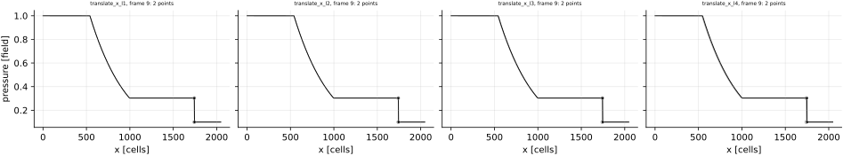
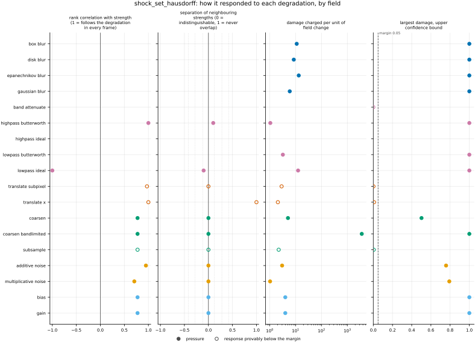
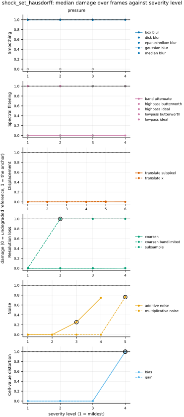

## Definition

The shock sets are those of [shock_set_distance](../../metrics/shock_set_distance/card.md),
found by the same detector: a cell is shocked when, along some grid axis, the pressures of its
two neighbours differ by at least the Rankine-Hugoniot ratio of a Mach 1.3 shock, 1.805 at
$\gamma = 1.4$ (the pressure half of criterion (iii) of [@schaal2015], Sect. 2.3.2; that card's
Equation (1) and the choices stated beside it). Let $A$ and $B$ be the shocked cells of the
reference and of the candidate, each cell standing for its centre, and
$d(x, S) = \min_{y \in S} \lVert x - y \rVert$ the Euclidean distance at the grid's own spacing.
The directed Hausdorff distance is the largest distance from a point of one set to the other set,
and the registered number is the larger of the two directions, [@taha2015], Eqs. (48)-(49):

$$
\mathrm{HD}(A, B) = \max\Bigl( \max_{a \in A} d(a, B),\; \max_{b \in B} d(b, A) \Bigr). \tag{1}
$$

It is also the largest difference over every cell $x$ of the grid between the two sets' distance
maps, $\max_x \lvert d(x, A) - d(x, B) \rvert$, which is Baddeley's Delta at an infinite exponent
and no cutoff ([@spatstatdelta], Details); the weather-verification package SpatialVx computes it
that way, and `test_metric.py` checks the two forms agree. Every flagged cell is a point of the
set, as in `shock_set_distance`. A sharp step moved by $s \ge 1$ cells flags two cells in each
field, and the farther cell of each pair is $s$ cells from the nearer of the other, so

$$
\mathrm{HD} = s\,\Delta x, \tag{2}
$$

half a cell more than `shock_set_distance`'s $s - \tfrac{1}{2}$; `test_metric.py` checks this on
the exact Sod solution.

**Empty sets** are scored as `shock_set_distance` scores them, by the same code: two empty sets
0, one empty set the length of the domain's diagonal, the worst value [@maierhein2024], Suppl.
Note 2.3, recommend for an undefined distance; both are conventions
([issue 102](https://github.com/khegazy/pde_metrics/blob/main/issues/102-shock-set-distance-empty-and-non-positive-conventions.md)).
Channels, of which pressure has one, are averaged, and a field that is NaN or infinite anywhere
scores NaN.

### Boundary handling

As for `shock_set_distance`: the detector extends the field by its edge value, a zero-gradient
wall, and the distance transform measures across the domain and never around it, so the metric
is exact on bounded domains and approximate on periodic ones. It does not declare
`requires_periodic` and runs on the bounded `sod_shock_tube`.

### How its field reports it

- **Medical image segmentation** reports the Hausdorff distance per case beside an overlap score,
  as the worst boundary error, and warns that it is "generally sensitive to outliers" and "not
  recommended" for direct use ([@taha2015], beside Eq. (48)); its 95th-percentile form,
  [shock_set_hausdorff95](../../metrics/shock_set_hausdorff95/card.md), is the usual answer.
  Implementations measure between the borders of the two masks ([@medpy], `hd`); here every
  flagged cell is used, as on `shock_set_distance`'s card, which describes the field's empty-set
  practice and its test sets.
- **Spatial forecast verification** computes it for binary event fields as the limit of
  Baddeley's Delta ([@spatstatdelta]; [@spatialvx], `locmeasures2d`, measure "haus"), beside
  [shock_set_baddeley_delta](../../metrics/shock_set_baddeley_delta/card.md), which it bounds.
  The field's test cases and the scores not built here are on `shock_set_distance`'s card.
- **Shock detection in computational fluid dynamics** reports where the detector fires against
  the exact shock, on blast waves and shock tubes ([@schaal2015], Sect. 3), not a distance
  between two detected sets; `shock_set_distance`'s card says how this repository's Sod run
  stands in for it and which tests are missing.

The metric needs pressure, so it runs only on `sod_shock_tube`, an analytic check; the skip on
every other dataset is derived from the data. The missing experiments are those of
`shock_set_distance`:
[EXP-shock_set_distance-2d-shock-dataset](https://github.com/khegazy/pde_metrics/blob/main/proposals/EXP-shock_set_distance-2d-shock-dataset.md),
[EXP-shock_mask_overlap-geometric-and-perturbed-cases](https://github.com/khegazy/pde_metrics/blob/main/proposals/EXP-shock_mask_overlap-geometric-and-perturbed-cases.md)
and
[EXP-sod_evidence-sod-time-offset](https://github.com/khegazy/pde_metrics/blob/main/proposals/EXP-sod_evidence-sod-time-offset.md).

## Performance

<!-- GENERATED performance: written by `python -m fmeval.cards evidence shock_set_hausdorff --results results/comparison_1793812304`, do not edit -->



*As this metric's own field draws it.* The point set behind shock_set_hausdorff on pressure, one panel per stored variant, on shared axes. Grey rings are the clean level's set of the same frame, the reference's, drawn under every panel. The lines are the field's line-out on this one-dimensional grid against the cell index, the clean level's in grey. Triangles on a panel's edge are points with an infinite coordinate. Only the first 4 of the 5 stored sets are drawn, in time order; every set is in data/error_maps.npz.



Four measured statistics for shock_set_hausdorff, one row per degradation grouped by family and one marker per field. From left: the rank correlation between the metric and the applied strength within a frame, with the line showing the resampling interval; the separation of neighbouring strengths as Cliff's delta, where 0 means the metric cannot tell one strength from the next and the faint ticks at 0.12, 0.28 and 0.42 are Vargha and Delaney's small, medium and large anchors, for scale and not as grades; the damage charged per unit of field change at the harshest strength; and the upper confidence bound on the largest damage, beside the fixed margin of 0.05. A hollow marker is a field and degradation on which that bound lies below the margin, so the response is provably small. A missing marker is a statistic the analysis withheld, as the rank correlation is on an axis the metric is invariant to.



Median damage over frames against severity level for shock_set_hausdorff, one row per family of degradation and one column per field, on one shared scale. The solid grey line is damage 1, the anchor (by default the field's own mean); the dotted black line is the damage assigned to the fake prediction with the right spectrum, where the run included it. The hollow black ring marks the first level at which the metric has moved a tenth of the way to the anchor. Hollow grey markers are strengths excluded for repeating a milder one or for doing nothing. Degradations with three or fewer usable levels are drawn as markers only; points beyond 2 either side are drawn as triangles at the edge. Damage is negative where a degradation moves the metric away from the anchor, as noise raises a single-field quantity the field's mean sets to zero.

**Trend: does the response follow the degradation?**

| test family | field | degradations | rank correlation | fraction of frames in order | weakest gap between neighbouring strengths |
|---|---|---|---|---|---|
| Displacement | pressure | 2 | 0.971 to 1 | 0 to 1 | 0.5 to 1 |
| Cell-value distortion | pressure | 2 | 0.775 | 0 | 0.5 |
| Resolution loss | pressure | 3 | 0.775 | 0 | 0.5 |
| Smoothing | pressure | 4 | — | — | — |
| Spectral filtering | pressure | 5 | -1 to 1 | 0 to 0.1 | 0.45 to 0.55 |
| Noise | pressure | 2 | 0.707 to 0.949 | 0 | 0.5 |

**Reactivity: how far does it move?**

| test family | field | change from clean at the harshest strength | elasticity | first strength detected |
|---|---|---|---|---|
| Displacement | pressure | — | 1 | level — |
| Cell-value distortion | pressure | — | — | level 4 |
| Resolution loss | pressure | — | 5 | level 2 |
| Smoothing | pressure | — | — | level — |
| Spectral filtering | pressure | — | — | level — |
| Noise | pressure | — | — | level 3 |
| trap test: fake prediction, right spectrum | pressure | — | — | damage 1 |

**Consistency: how much does it vary from snapshot to snapshot?**

| test family | field | consistency, in the strength's units | snapshots per independent block |
|---|---|---|---|
| Displacement | pressure | 0 | 1 |
| Cell-value distortion | pressure | 0 | 1 |
| Resolution loss | pressure | 3.91 to 7.11 | 1 |
| Smoothing | pressure | — | 1 |
| Spectral filtering | pressure | 0.316 to 1.64 | 1 |
| Noise | pressure | 0.0473 to 0.197 | 1 |

One row per family of degradation and physical field; a cell gives the range over the degradations in that family. **Trend.** The rank correlation is the Spearman correlation between the strength and how far the metric has moved from its value on the undegraded field of the same frame, in the one direction it moves under that degradation, computed inside a single frame. A value of 1 means every strength moved it further than the last in every frame, whichever way it moves; a response that scatters to both sides scores near 0. The fraction of frames in order counts the frames with no exception. The weakest gap is the smallest Mann-Whitney overlap between two neighbouring strengths across frames: 1 means they never overlap, 0.5 that they cannot be told apart. **Reactivity.** The change from clean is the median, at the harshest strength, of the departure from the undegraded value of the same frame over the size of that value: 0.3 means 30%. It does not exist for this metric, whose undegraded value is exactly zero; the damage below is its relative reading. The elasticity is the percentage change of that departure per percentage change in strength over the mildest strengths. First strength detected is the mildest at which the metric has moved a tenth of the way to the anchor; **damage** reads that 0-to-1 scale as a number. A dash means the measurement is not defined there. A metric's reactivity scales with the power it is expressed in: mean squared error's elasticity is twice root-mean-square error's, though the two carry the same information, so compare magnitudes across metrics with that in mind. **Consistency** is how much the response varies from snapshot to snapshot relative to its size, in the strength's units; the snapshots of one trajectory are correlated, and the last column is how many consecutive snapshots one independent block spans.

These tables report what was measured and grade none of the measurements. What the numbers mean for this metric is written in the subsections below, beside the test that produced each number.

**Profile.**

| field | selectivity | charges most for | charges least for | response provably below 0.05 at 90% on | elasticity to a sub-pixel shift, against severity (distance) | compute cost (x cheapest in this run) |
|---|---|---|---|---|---|---|
| pressure | 0.939 | `coarsen_bandlimited` | `band_attenuate` | `band_attenuate` `subsample` `translate_subpixel` `translate_x` | — | 133 |

One row per physical field. **Selectivity** is how concentrated the metric's response is on a few degradations, measured per unit of field change: 0 means it charges every degradation the same, as mean squared error does by construction, and values toward 1 that one degradation carries most of it. **Charges most and least for** name the two ends of that profile. **Response provably below** lists degradations on which the upper confidence bound of the largest damage lies below the margin -- an equivalence test, so an entry says the response is provably small, not merely not significant; a dash means no degradation met the bound. **Elasticity** is the slope of log damage against log shift over the smallest shifts: 1 means damage grows in proportion to the shift, 2 with its square. **Compute cost** is wall-clock per evaluation over the cheapest metric and field in the same run.

<!-- END GENERATED performance -->

## Intuition

The metric finds the shocks in both fields and reports the worst-placed shocked cell of either:
the largest distance from any shocked cell of one field to the nearest shocked cell of the other.
A displaced shock costs its displacement; a single false detection far from any true shock costs
its whole distance, however right the rest of the field is.

A worked example on sixteen cells of unit width. The reference is a pressure step of a factor
ten, which marks the two cells beside the jump, the 8th and 9th. One candidate moves the step two
cells; another keeps it in place but adds a one-cell spike of ten in the high state, which marks
its two neighbours, the 1st and 3rd cells, as false shocks.

```
reference   1 1 1 1 1 1 1 1 .1 .1 .1 .1 .1 .1 .1 .1     marked: 8th, 9th
moved       1 1 1 1 1 1 1 1  1  1 .1 .1 .1 .1 .1 .1     marked: 10th, 11th
spike       1 10 1 1 1 1 1 1 .1 .1 .1 .1 .1 .1 .1 .1    marked: 1st, 3rd, 8th, 9th

                     this metric   shock_set_distance
moved                2             1.5
spike                7             2
```

For the moved step the farther marked cell of each pair is two cells from the other pair, so the
value is 2, where the average distance is 1.5. For the spike the true shock is matched exactly,
but the false mark in the 1st cell is seven cells from the nearest true one, and the value is 7.

The metric ignores everything but the single worst cell: how many cells are misplaced, the
strength of the shock, and every smooth part of the field.

## Reading the output

- **Range and units.** From 0 to the length of the domain's diagonal, in the units of the grid
  spacing: on the unit-length Sod tube, 0 to 1. NaN when either field is NaN or infinite
  anywhere.
- **Direction.** Lower is better; 0 means the shocks are in the same cells, or neither field has
  one.
- **What a value means.** Below the diagonal, the distance of the worst-placed shocked cell: for
  one sharp shock moved by a whole number of cells, the shift itself (Equation (2)). Exactly the
  diagonal means one field has a shock and the other has none, a flag rather than a distance.
- **Valid comparisons.** Values on one grid and one domain compare directly; across grids divide
  by the spacing, since a shock spans a number of cells; across domains compare only values below
  the diagonal. Read beside `shock_set_distance`: a Hausdorff distance far above the average says
  one outlying cell sets it.
- **The damage scale** is the value as a fraction of the diagonal, as on `shock_set_distance`'s
  card, so a misplaced shock reads as a damage of a few thousandths on 2048 cells.
- **Companions.** `shock_set_hausdorff`, the detected shock cells of one field as rows of (cell
  index along the first grid axis, pressure there), and `shock_set_hausdorff.profile`, the
  pressure itself, stored for the candidate on the frames `report.error_map` names and on their
  clean level, the reference, and drawn together as the line-out figure.

## Limitations

- **One cell sets the value.** A single false detection anywhere, from noise or a spurious
  oscillation, replaces the distance of the true shock by its own; the spike example costs 7
  cells with the shock exactly right.
- **The detector's limits carry over.** A shock smeared over more than about four cells is not
  detected and the value jumps to the diagonal; there is no compression gate; the ratio of specific
  heats is fixed; a gauge pressure gets a number that means nothing. Each is stated on
  `shock_set_distance`'s card.
- **One cell decides between a distance and a flag**, as for `shock_set_distance`: a harsher
  degradation that leaves one flagged cell anywhere scores below the diagonal and so better than a
  milder one that removed the shock.
- **Only one dimension is evidenced.** The only dataset with a shock is the one-dimensional Sod
  tube, with one shock per field
  ([issue 002](https://github.com/khegazy/pde_metrics/blob/main/issues/002-shocklet-dataset.md)).

## Results

<!-- GENERATED run: written by `python -m fmeval.cards evidence shock_set_hausdorff --results results/comparison_1793812304`, do not edit -->

Measured on `sod_shock_tube`, frames 0 to 9 (10 frames of an analytic check: evidence that the metric locates and scores a known shock correctly, and nothing about turbulence), on the 2048 analysis grid, seed 20260807, at commit `adbdc88e4950`. Run `comparison_1793812304`.

Every number in this section comes from that one run. Regenerate with `python -m fmeval.cards evidence <name> --results results/comparison_1793812304`.

<!-- END GENERATED run -->

Each subsection links to the degradations that subsection reports. What those degradations
do, and what their strength numbers mean, is documented on their own pages.

<!-- GENERATED experiments: written by `python -m fmeval.cards catalog`, do not edit -->

**Across the experiments.**

| experiment | what a run on it is evidence of | on this card |
|---|---|---|
| `kinet_re5e4` | developed flow | not applicable: needs pressure, which this dataset does not provide |
| `kinet_re1e6` | developed flow at Re = 1e6, twenty times the Reynolds number of kinet_re5e4, from the same initial condition | not applicable: needs pressure, which this dataset does not provide |
| `synthetic_ensemble` | a calibrated null: evidence that the estimator computes what it claims to compute, and nothing about turbulence | not applicable: needs pressure, which this dataset does not provide |
| `sod_shock_tube` | an analytic check: evidence that the metric locates and scores a known shock correctly, and nothing about turbulence | measured, run `comparison_1793812304`: the main results |
| `forecast_re5e4` | real predictions scored against their targets at each prediction step; who produced the predictions, a trained model or a coarser solver, is not recorded | not applicable: needs pressure, which this dataset does not provide |

One row per dataset a card may cite (`configs/cards/default.yaml`). *Measured* names the run the card cites: the main results are `## Performance` and the subsections below, and every other run has its own subsection headed with its dataset. *Not applicable* gives the reason: one that follows from what the metric declares and what the dataset offers, or one a person wrote on the card (`not_run` in `card.yaml`) because the result would carry no information. *Not yet run* means the metric can run there and the card cites no run on it yet.

<!-- END GENERATED experiments -->

### Smoothing

[gaussian_blur](../../degradations/gaussian_blur/card.md) ·
[box_blur](../../degradations/box_blur/card.md) ·
[median_blur](../../degradations/median_blur/card.md)

<!-- GENERATED results_smoothing: written by `python -m fmeval.cards evidence shock_set_hausdorff --results results/comparison_1793812304`, do not edit -->

| degradation | field | strengths | rank correlation | fraction of frames in the right order | weakest gap between neighbouring strengths |
|---|---|---|---|---|---|
| `box_blur` | pressure | 4 | — | — | — |
| `disk_blur` | pressure | 3 | — | — | — |
| `epanechnikov_blur` | pressure | 3 | — | — | — |
| `gaussian_blur` | pressure | 4 | — | — | — |

<!-- END GENERATED results_smoothing -->

Every blur in the table smears Sod's shock beyond the detector's reach at every calibrated
strength, so the candidate has no shock and every strength scores the diagonal, 1, in every
frame. No rank correlation is defined. The test shows only that the metric flags a lost shock,
at the mildest strength. The median blur left the pressure unchanged at every strength and the
run excluded it as doing nothing.

### Spectral filtering

[lowpass_ideal](../../degradations/lowpass_ideal/card.md) ·
[lowpass_butterworth](../../degradations/lowpass_butterworth/card.md) ·
[highpass_ideal](../../degradations/highpass_ideal/card.md) ·
[highpass_butterworth](../../degradations/highpass_butterworth/card.md)

<!-- GENERATED results_spectral: written by `python -m fmeval.cards evidence shock_set_hausdorff --results results/comparison_1793812304`, do not edit -->

| degradation | field | strengths | rank correlation | fraction of frames in the right order | weakest gap between neighbouring strengths |
|---|---|---|---|---|---|
| `band_attenuate` | pressure | 4 | — | — | — |
| `highpass_butterworth` | pressure | 2 | 1 | 0.1 | 0.55 |
| `highpass_ideal` | pressure | 1 | — | — | — |
| `lowpass_butterworth` | pressure | 2 | — | — | — |
| `lowpass_ideal` | pressure | 2 | -1 | 0 | 0.45 |

<!-- END GENERATED results_spectral -->

The filters switch the detector between finding the shock and losing it, as described on
`shock_set_distance`'s card, and this metric reads the same switch. `band_attenuate` leaves the
shocked cells in place and scores 0 at every strength. The low-pass filters lose the shock and
score 1, except in the first frame, where the harsher distinct strength of `lowpass_ideal` leaves
a flagged cell far from the shock and scores 0.280 while the milder scores the diagonal; that one
frame is the rank correlation of −1, every other frame tying. The rank correlation of 1 under
`highpass_butterworth` likewise comes from the first frame alone. These filters test the
empty-set convention, not the distance.

### Displacement

[translate_x](../../degradations/translate/card.md) ·
[translate_subpixel](../../degradations/translate_subpixel/card.md)

<!-- GENERATED results_geometric: written by `python -m fmeval.cards evidence shock_set_hausdorff --results results/comparison_1793812304`, do not edit -->

| degradation | field | strengths | rank correlation | fraction of frames in the right order | weakest gap between neighbouring strengths |
|---|---|---|---|---|---|
| `translate_subpixel` | pressure | 6 | 0.971 | 0 | 0.5 |
| `translate_x` | pressure | 5 | 1 | 1 | 1 |

<!-- END GENERATED results_geometric -->

This is the test the metric is built for. The whole-cell translation is ranked perfectly in every
frame, and its values are Equation (2) exactly: the shift itself, from 0.000488 at one cell to
0.00781 at sixteen, in units of the tube's length. The elasticity of 1 in the Reactivity table
says the same, a value in proportion to the shift. The sub-pixel shift ranks at 0.971 in every
frame. Its two smallest shifts leave the flagged cells in place and score 0. A shift of half a
cell flags one cell, shared with the reference's pair, and the reference's other cell is one
cell from it, so it scores one cell, the same as a shift of one cell; that tie, which the average
distance of `shock_set_distance` does not have, keeps the rank correlation below 1. The largest
shift scores 0.00195. The profile reads both translations as provably small only because damage
is a fraction of the domain's diagonal (Reading the output).

The first figure under Performance draws the test as a line-out of the last frame: the pressure
translated by 1, 2, 4 and 8 cells over the reference's in grey, the two flagged cells moving with
the step by the shift. With one flagged pair per field, the farther cell of each pair sets the
value.

### Resolution loss

[coarsen](../../degradations/coarsen/card.md) ·
[coarsen_bandlimited](../../degradations/coarsen_bandlimited/card.md)

<!-- GENERATED results_resolution: written by `python -m fmeval.cards evidence shock_set_hausdorff --results results/comparison_1793812304`, do not edit -->

| degradation | field | strengths | rank correlation | fraction of frames in the right order | weakest gap between neighbouring strengths |
|---|---|---|---|---|---|
| `coarsen` | pressure | 4 | 0.775 | 0 | 0.5 |
| `coarsen_bandlimited` | pressure | 4 | 0.775 | 0 | 0.5 |
| `subsample` | pressure | 4 | 0.775 | 0 | 0.5 |

<!-- END GENERATED results_resolution -->

The reductions move the shock to a block edge, by an amount set by where the block boundaries
fall, so in every frame two neighbouring factors score the same; no harsher factor scores below a
milder one in this run's `results.csv`, and the ties hold the rank correlation at 0.775 on all
three. `coarsen` and `subsample` agree at the three mildest factors; at factor 16 `subsample`
keeps a flagged pair, up to 0.00488, while `coarsen` loses the shock in three of the ten frames
and scores the diagonal. The band-limited reconstruction smears the jump, losing the shock in most
frames from its second factor and in all from its third, which is why the Profile names
`coarsen_bandlimited` as the degradation charged most for per unit of field change.

### Noise

[additive_noise](../../degradations/additive_noise/card.md)

<!-- GENERATED results_stochastic: written by `python -m fmeval.cards evidence shock_set_hausdorff --results results/comparison_1793812304`, do not edit -->

| degradation | field | strengths | rank correlation | fraction of frames in the right order | weakest gap between neighbouring strengths |
|---|---|---|---|---|---|
| `additive_noise` | pressure | 4 | 0.949 | 0 | 0.5 |
| `multiplicative_noise` | pressure | 5 | 0.707 | 0 | 0.5 |

<!-- END GENERATED results_stochastic -->

Noise is where this metric parts from the average distance. The two weakest additive amplitudes
leave the detector's output unchanged and score 0; the two strongest flag false shocks wherever
the noise's cell-to-cell pressure ratio passes the threshold, and the value becomes the distance
of the farthest false cell from the true shock, up to 0.843 at the strongest amplitude. That is
the limitation "One cell sets the value" measured: a single outlying detection, not the true
shock, decides the score. Multiplicative noise does the same one amplitude later, scoring 0 at
its three weakest amplitudes and up to 0.849 at the strongest. Ties at the weak amplitudes are
all that hold the rank correlations at 0.949 and 0.707; no frame scores a stronger amplitude
below a weaker one.

### Cell-value distortion

[gain](../../degradations/gain/card.md) ·
[bias](../../degradations/bias/card.md)

<!-- GENERATED results_pointwise: written by `python -m fmeval.cards evidence shock_set_hausdorff`, do not edit -->

Not generated yet. Run `python -m fmeval.cards evidence shock_set_hausdorff`.

<!-- END GENERATED results_pointwise -->

### Trap tests

[gaussian_impostor](../../degradations/gaussian_impostor/card.md) ·
[uncorrelated](../../degradations/random_large_translation/card.md)

<!-- GENERATED results_canaries: written by `python -m fmeval.cards evidence shock_set_hausdorff --results results/comparison_1793812304`, do not edit -->

| field | damage assigned to the fake prediction | closest real degradation | damage of the reference moved far away | value on the anchor |
|---|---|---|---|---|
| pressure | 1 | `bias=0.5` | 0.626 | 1 |

The fake prediction here has exactly the reference field's amplitude spectrum and completely scrambled structure. Damage 1 is what the anchor scores, by default the reference's own spatial mean, a prediction that knows the mean and nothing else. The damage column therefore says how close to useless this metric considers that fake prediction: a low number means the metric was fooled. The third column translates the same number into an ordinary degradation whose damage the fake prediction matches, which is easier to picture. The fourth is the reference moved by a large random offset, the right statistics in the wrong place; where a field's energy sits in its largest scales that copy stays partly correlated with the reference, so it is not the score of an unrelated field.

<!-- END GENERATED results_canaries -->

The fake prediction with the right spectrum scores damage 1 in the median frame: in most frames
the detector finds no shock in it and the empty-set value is charged. In the frames where it does
flag cells, the value falls as low as 0.168, so the metric is not fooled in the median but can be
in a single frame. The reference moved far away scores a damage of 0.626: on a tube with walls
that copy is a mirrored window whose shock lies elsewhere, and the metric reports how far.

### Compared with the other metrics

<!-- GENERATED results_summary: written by `python -m fmeval.cards evidence shock_set_hausdorff --results results/comparison_1793812304`, do not edit -->

| compared with | pressure |
|---|---|
| `shock_set_hausdorff95` | 0.999 |
| `shock_set_baddeley_delta` | 0.998 |
| `shock_set_distance` | 0.998 |
| `shock_set_masd` | 0.998 |
| `nrmse` | 0.694 |
| `rmse` | 0.694 |
| `mse` | 0.694 |
| `vrmse` | 0.693 |
| `max_error` | 0.677 |
| `mae` | 0.64 |
| `shock_mask_overlap` | -0.871 |

Rank correlation over every degradation, computed separately for each physical field on the median value at each combination of degradation and strength, with the undegraded reference excluded. A dash marks a metric that does not run on that field. Two metrics correlating near 1 put the degradations in the same order, but the two may still weight those degradations very differently. A correlation near 1 therefore means the two metrics are redundant for ranking models, not that the two are interchangeable as training losses.

<!-- END GENERATED results_summary -->

On Sod's pressure the other shock-set distances order the degradations almost exactly as this
metric does, the pointwise errors only moderately, and `shock_mask_overlap` strongly in reverse,
which is agreement, since the overlap falls where a distance rises. My reading, not a
measurement: on Sod most degradations either keep the shock in place or lose it, so any metric
built on the same detector sorts them alike, and these correlations say little about how the
distances would differ on many shocks, where the outlier sensitivity of this one matters.

## References

\bibliography
