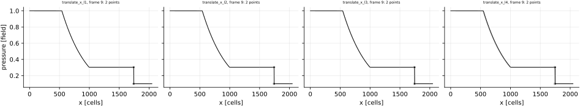
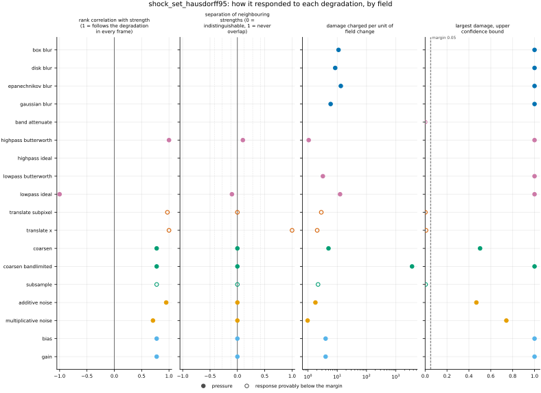
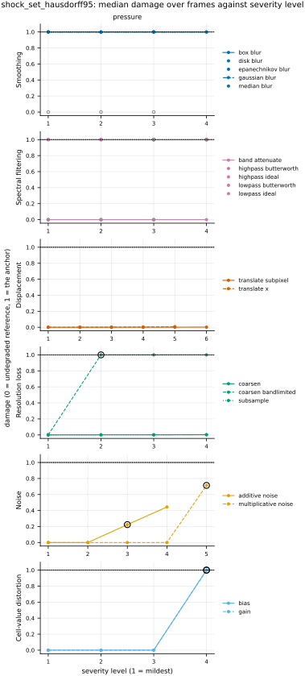

## Definition

The shock sets are those of [shock_set_distance](../../metrics/shock_set_distance/card.md),
found by the same detector (the pressure half of criterion (iii) of [@schaal2015], Sect. 2.3.2, at
Mach 1.3; that card's Equation (1)). With $A$ and $B$ the shocked cells of the reference and of
the candidate, each cell standing for its centre, and $d(x, S) = \min_{y \in S} \lVert x - y \rVert$
the Euclidean distance at the grid's own spacing, the registered number replaces each directed
maximum of the Hausdorff distance by the 95th percentile $P_{95}$ of that direction's distances:

$$
\mathrm{HD}_{95}(A, B) = \max\Bigl( P_{95}\{ d(a, B) : a \in A \},\;
P_{95}\{ d(b, A) : b \in B \} \Bigr). \tag{1}
$$

This is the quantile form of the directed Hausdorff distance that [@taha2015] describe after their
Eq. (49), "one way to handle outliers", at the 95th percentile, the "HD95" of medical
segmentation. The percentile is computed as the Metrics Reloaded code computes it
([@metricsreloadedcode], `measured_hausdorff_distance_perc`, default 95): `np.percentile` of each
direction, which interpolates linearly between the two nearest of the sorted distances, then the
larger of the two. With $n$ distances in a direction sorted as $d_{(0)} \le \dots \le d_{(n-1)}$,
$P_{95}$ is $d_{(i)} + f\,(d_{(i+1)} - d_{(i)})$ with $i + f = 0.95\,(n - 1)$. medpy's `hd95`
[@medpy] instead takes one percentile of both directions' distances pooled, a different number
once the two directions differ (this bundle's test shows 6.5 against 6.7 on the worked example);
the per-direction form is registered because it is the one the quantile Hausdorff distance of
[@taha2015] defines and the one the Metrics Reloaded consortium implements
(`judgements/018`).
Every flagged cell is a point of the set, as in `shock_set_distance`. Since a percentile is at
most the maximum, Equation (1) never exceeds the Hausdorff distance of
[shock_set_hausdorff](../../metrics/shock_set_hausdorff/card.md). With $n \le 21$ distances in a
direction, $0.95\,(n - 1) \ge n - 2$, so $P_{95}$ lies between the two largest, a fraction
$1 - 0.05\,(n - 1)$ of the way to the larger: on the Sod tube, with two flagged cells per direction,
95% of the way, so the metric is nearly the Hausdorff distance.

**Empty sets** are scored as `shock_set_distance` scores them, by the same code: two empty sets
0, one empty set the domain's diagonal; both are conventions
([issue 102](https://github.com/khegazy/pde_metrics/blob/main/issues/102-shock-set-distance-empty-and-non-positive-conventions.md)).
Channels, of which pressure has one, are averaged, and a field that is NaN or infinite anywhere
scores NaN.

### Boundary handling

As for `shock_set_distance`: the detector extends the field by its edge value, a zero-gradient
wall, and the distance transform measures across the domain and never around it, so the metric
is exact on bounded domains and approximate on periodic ones. It does not declare
`requires_periodic` and runs on the bounded `sod_shock_tube`.

### How its field reports it

- **Medical image segmentation** reports HD95 per case, beside an overlap score, as the robust
  replacement of the Hausdorff distance ([@taha2015]; Metrics Reloaded's code sets 95 as its
  default percentile, [@metricsreloadedcode]). The consortium's code takes the percentile per direction and returns NaN when a set is empty
  ([@metricsreloadedcode]); medpy pools the directions [@medpy]. Both measure between mask
  borders; here every flagged cell is used, as on `shock_set_distance`'s card, which describes the
  field's empty-set practice and its test sets.
- **Spatial forecast verification** reports a quantile Hausdorff distance too, the "partial
  Hausdorff distance" of SpatialVx, which takes the larger of the two directions' $k$-th largest
  distance or, for $0 < k < 1$, quantile ([@spatialvx], `locperf`, measure "ph"), the same
  construction as Equation (1). The field's test cases and the scores not built here are on
  `shock_set_distance`'s card.
- **Shock detection in computational fluid dynamics** compares the detector with the exact shock
  rather than two detected sets ([@schaal2015], Sect. 3); see `shock_set_distance`'s card.

The metric needs pressure, so it runs only on `sod_shock_tube`, an analytic check; the skip on
every other dataset is derived from the data. The missing experiments are those of
`shock_set_distance`:
[EXP-shock_set_distance-2d-shock-dataset](https://github.com/khegazy/pde_metrics/blob/main/proposals/EXP-shock_set_distance-2d-shock-dataset.md),
[EXP-shock_mask_overlap-geometric-and-perturbed-cases](https://github.com/khegazy/pde_metrics/blob/main/proposals/EXP-shock_mask_overlap-geometric-and-perturbed-cases.md)
and
[EXP-sod_evidence-sod-time-offset](https://github.com/khegazy/pde_metrics/blob/main/proposals/EXP-sod_evidence-sod-time-offset.md).

## Performance

<!-- GENERATED performance: written by `python -m fmeval.cards evidence shock_set_hausdorff95 --results results/comparison_1793812304`, do not edit -->



*As this metric's own field draws it.* The point set behind shock_set_hausdorff95 on pressure, one panel per stored variant, on shared axes. Grey rings are the clean level's set of the same frame, the reference's, drawn under every panel. The lines are the field's line-out on this one-dimensional grid against the cell index, the clean level's in grey. Triangles on a panel's edge are points with an infinite coordinate. Only the first 4 of the 5 stored sets are drawn, in time order; every set is in data/error_maps.npz.



Four measured statistics for shock_set_hausdorff95, one row per degradation grouped by family and one marker per field. From left: the rank correlation between the metric and the applied strength within a frame, with the line showing the resampling interval; the separation of neighbouring strengths as Cliff's delta, where 0 means the metric cannot tell one strength from the next and the faint ticks at 0.12, 0.28 and 0.42 are Vargha and Delaney's small, medium and large anchors, for scale and not as grades; the damage charged per unit of field change at the harshest strength; and the upper confidence bound on the largest damage, beside the fixed margin of 0.05. A hollow marker is a field and degradation on which that bound lies below the margin, so the response is provably small. A missing marker is a statistic the analysis withheld, as the rank correlation is on an axis the metric is invariant to.



Median damage over frames against severity level for shock_set_hausdorff95, one row per family of degradation and one column per field, on one shared scale. The solid grey line is damage 1, the anchor (by default the field's own mean); the dotted black line is the damage assigned to the fake prediction with the right spectrum, where the run included it. The hollow black ring marks the first level at which the metric has moved a tenth of the way to the anchor. Hollow grey markers are strengths excluded for repeating a milder one or for doing nothing. Degradations with three or fewer usable levels are drawn as markers only; points beyond 2 either side are drawn as triangles at the edge. Damage is negative where a degradation moves the metric away from the anchor, as noise raises a single-field quantity the field's mean sets to zero.

**Trend: does the response follow the degradation?**

| test family | field | degradations | rank correlation | fraction of frames in order | weakest gap between neighbouring strengths |
|---|---|---|---|---|---|
| Displacement | pressure | 2 | 0.971 to 1 | 0 to 1 | 0.5 to 1 |
| Cell-value distortion | pressure | 2 | 0.775 | 0 | 0.5 |
| Resolution loss | pressure | 3 | 0.775 | 0 | 0.5 |
| Smoothing | pressure | 4 | — | — | — |
| Spectral filtering | pressure | 5 | -1 to 1 | 0 to 0.1 | 0.45 to 0.55 |
| Noise | pressure | 2 | 0.707 to 0.949 | 0 | 0.5 |

**Reactivity: how far does it move?**

| test family | field | change from clean at the harshest strength | elasticity | first strength detected |
|---|---|---|---|---|
| Displacement | pressure | — | 1.03 | level — |
| Cell-value distortion | pressure | — | — | level 4 |
| Resolution loss | pressure | — | 5.08 | level 2 |
| Smoothing | pressure | — | — | level — |
| Spectral filtering | pressure | — | — | level — |
| Noise | pressure | — | — | level 3 |
| trap test: fake prediction, right spectrum | pressure | — | — | damage 1 |

**Consistency: how much does it vary from snapshot to snapshot?**

| test family | field | consistency, in the strength's units | snapshots per independent block |
|---|---|---|---|
| Displacement | pressure | 0 | 1 |
| Cell-value distortion | pressure | 0 | 1 |
| Resolution loss | pressure | 3.91 to 7.11 | 1 |
| Smoothing | pressure | — | 1 |
| Spectral filtering | pressure | 0.316 to 1.64 | 1 |
| Noise | pressure | 0.0953 to 0.199 | 1 |

One row per family of degradation and physical field; a cell gives the range over the degradations in that family. **Trend.** The rank correlation is the Spearman correlation between the strength and how far the metric has moved from its value on the undegraded field of the same frame, in the one direction it moves under that degradation, computed inside a single frame. A value of 1 means every strength moved it further than the last in every frame, whichever way it moves; a response that scatters to both sides scores near 0. The fraction of frames in order counts the frames with no exception. The weakest gap is the smallest Mann-Whitney overlap between two neighbouring strengths across frames: 1 means they never overlap, 0.5 that they cannot be told apart. **Reactivity.** The change from clean is the median, at the harshest strength, of the departure from the undegraded value of the same frame over the size of that value: 0.3 means 30%. It does not exist for this metric, whose undegraded value is exactly zero; the damage below is its relative reading. The elasticity is the percentage change of that departure per percentage change in strength over the mildest strengths. First strength detected is the mildest at which the metric has moved a tenth of the way to the anchor; **damage** reads that 0-to-1 scale as a number. A dash means the measurement is not defined there. A metric's reactivity scales with the power it is expressed in: mean squared error's elasticity is twice root-mean-square error's, though the two carry the same information, so compare magnitudes across metrics with that in mind. **Consistency** is how much the response varies from snapshot to snapshot relative to its size, in the strength's units; the snapshots of one trajectory are correlated, and the last column is how many consecutive snapshots one independent block spans.

These tables report what was measured and grade none of the measurements. What the numbers mean for this metric is written in the subsections below, beside the test that produced each number.

**Profile.**

| field | selectivity | charges most for | charges least for | response provably below 0.05 at 90% on | elasticity to a sub-pixel shift, against severity (distance) | compute cost (x cheapest in this run) |
|---|---|---|---|---|---|---|
| pressure | 0.939 | `coarsen_bandlimited` | `band_attenuate` | `band_attenuate` `subsample` `translate_subpixel` `translate_x` | — | 127 |

One row per physical field. **Selectivity** is how concentrated the metric's response is on a few degradations, measured per unit of field change: 0 means it charges every degradation the same, as mean squared error does by construction, and values toward 1 that one degradation carries most of it. **Charges most and least for** name the two ends of that profile. **Response provably below** lists degradations on which the upper confidence bound of the largest damage lies below the margin -- an equivalence test, so an entry says the response is provably small, not merely not significant; a dash means no degradation met the bound. **Elasticity** is the slope of log damage against log shift over the smallest shifts: 1 means damage grows in proportion to the shift, 2 with its square. **Compute cost** is wall-clock per evaluation over the cheapest metric and field in the same run.

<!-- END GENERATED performance -->

## Intuition

The metric finds the shocks in both fields, measures every shocked cell of each field to the
nearest shocked cell of the other, and reports, for the worse of the two fields, the distance that
95 in a hundred of its cells stay within. It is the Hausdorff distance made tolerant of a few
outlying cells, which matters when there are many: with only a handful of shocked cells, as in a
one-dimensional tube, the 95th percentile sits close to the largest distance.

A worked example on sixteen cells of unit width. The reference is a pressure step of a factor
ten, which marks the two cells beside the jump, the 8th and 9th. One candidate moves the step two
cells; another keeps it in place but adds a one-cell spike of ten in the high state, which marks
its two neighbours, the 1st and 3rd cells, as false shocks.

```
reference   1 1 1 1 1 1 1 1 .1 .1 .1 .1 .1 .1 .1 .1     marked: 8th, 9th
moved       1 1 1 1 1 1 1 1  1  1 .1 .1 .1 .1 .1 .1     marked: 10th, 11th
spike       1 10 1 1 1 1 1 1 .1 .1 .1 .1 .1 .1 .1 .1    marked: 1st, 3rd, 8th, 9th

                     this metric   shock_set_hausdorff   shock_set_distance
moved                1.95          2                     1.5
spike                6.7           7                     2
```

For the moved step each field's two distances are 1 and 2, and the 95th percentile between them
is 1.95. For the spike the candidate's four distances are 0, 0, 5 and 7, whose 95th percentile is
6.7: four cells are too few for the percentile to discard the false mark.

The metric ignores the worst twentieth of each field's cells, and with that everything a
Hausdorff distance ignores: how many cells are misplaced, the strength of the shock and every
smooth part of the field.

## Reading the output

- **Range and units.** From 0 to the length of the domain's diagonal, in the units of the grid
  spacing; NaN when either field is NaN or infinite anywhere.
- **Direction.** Lower is better; 0 means the shocks are in the same cells, or neither field has
  one.
- **What a value means.** Below the diagonal, a distance most shocked cells of both fields lie
  within; exactly the diagonal means one field has a shock and the other none, a flag rather than
  a distance. With 21 or fewer shocked cells in a direction the value lies between that
  direction's two largest distances (Definition).
- **Valid comparisons.** As for `shock_set_distance`: on one grid directly, across grids in
  cells, across domains only below the diagonal. HD95 values computed by medpy's pooled form are
  not the same number.
- **The damage scale** is the value as a fraction of the diagonal, as on `shock_set_distance`'s
  card.
- **Companions.** `shock_set_hausdorff95`, the detected shock cells of one field as rows of (cell
  index along the first grid axis, pressure there), and `shock_set_hausdorff95.profile`, the
  pressure itself, stored for the candidate on the frames `report.error_map` names and on their
  clean level, the reference, and drawn together as the line-out figure.

## Limitations

- **Few cells, no robustness.** The percentile discards outliers only when a direction has many
  shocked cells; on a one-dimensional tube with two per shock, one false detection still sets the
  value almost alone (the spike example: 6.7 against the Hausdorff distance's 7).
- **Two implementations, two numbers.** The per-direction and the pooled 95th percentile differ
  whenever the two directions' distances differ; a value quoted from another code may be the
  other one.
- **The detector's limits carry over**: a smeared shock is lost and the value jumps to the
  diagonal, there is no compression gate, the ratio of specific heats is fixed and a gauge pressure
  gets a meaningless number (`shock_set_distance`'s card).
- **Only one dimension is evidenced**, the Sod tube with one shock per field
  ([issue 002](https://github.com/khegazy/pde_metrics/blob/main/issues/002-shocklet-dataset.md)).

## Results

<!-- GENERATED run: written by `python -m fmeval.cards evidence shock_set_hausdorff95 --results results/comparison_1793812304`, do not edit -->

Measured on `sod_shock_tube`, frames 0 to 9 (10 frames of an analytic check: evidence that the metric locates and scores a known shock correctly, and nothing about turbulence), on the 2048 analysis grid, seed 20260807, at commit `adbdc88e4950`. Run `comparison_1793812304`.

Every number in this section comes from that one run. Regenerate with `python -m fmeval.cards evidence <name> --results results/comparison_1793812304`.

<!-- END GENERATED run -->

Each subsection links to the degradations that subsection reports. What those degradations
do, and what their strength numbers mean, is documented on their own pages.

<!-- GENERATED experiments: written by `python -m fmeval.cards catalog`, do not edit -->

**Across the experiments.**

| experiment | what a run on it is evidence of | on this card |
|---|---|---|
| `kinet_re5e4` | developed flow | not applicable: needs pressure, which this dataset does not provide |
| `kinet_re1e6` | developed flow at Re = 1e6, twenty times the Reynolds number of kinet_re5e4, from the same initial condition | not applicable: needs pressure, which this dataset does not provide |
| `synthetic_ensemble` | a calibrated null: evidence that the estimator computes what it claims to compute, and nothing about turbulence | not applicable: needs pressure, which this dataset does not provide |
| `sod_shock_tube` | an analytic check: evidence that the metric locates and scores a known shock correctly, and nothing about turbulence | measured, run `comparison_1793812304`: the main results |
| `forecast_re5e4` | real predictions scored against their targets at each prediction step; who produced the predictions, a trained model or a coarser solver, is not recorded | not applicable: needs pressure, which this dataset does not provide |

One row per dataset a card may cite (`configs/cards/default.yaml`). *Measured* names the run the card cites: the main results are `## Performance` and the subsections below, and every other run has its own subsection headed with its dataset. *Not applicable* gives the reason: one that follows from what the metric declares and what the dataset offers, or one a person wrote on the card (`not_run` in `card.yaml`) because the result would carry no information. *Not yet run* means the metric can run there and the card cites no run on it yet.

<!-- END GENERATED experiments -->

### Smoothing

[gaussian_blur](../../degradations/gaussian_blur/card.md) ·
[box_blur](../../degradations/box_blur/card.md) ·
[median_blur](../../degradations/median_blur/card.md)

<!-- GENERATED results_smoothing: written by `python -m fmeval.cards evidence shock_set_hausdorff95 --results results/comparison_1793812304`, do not edit -->

| degradation | field | strengths | rank correlation | fraction of frames in the right order | weakest gap between neighbouring strengths |
|---|---|---|---|---|---|
| `box_blur` | pressure | 4 | — | — | — |
| `disk_blur` | pressure | 3 | — | — | — |
| `epanechnikov_blur` | pressure | 3 | — | — | — |
| `gaussian_blur` | pressure | 4 | — | — | — |

<!-- END GENERATED results_smoothing -->

### Spectral filtering

[lowpass_ideal](../../degradations/lowpass_ideal/card.md) ·
[lowpass_butterworth](../../degradations/lowpass_butterworth/card.md) ·
[highpass_ideal](../../degradations/highpass_ideal/card.md) ·
[highpass_butterworth](../../degradations/highpass_butterworth/card.md)

<!-- GENERATED results_spectral: written by `python -m fmeval.cards evidence shock_set_hausdorff95 --results results/comparison_1793812304`, do not edit -->

| degradation | field | strengths | rank correlation | fraction of frames in the right order | weakest gap between neighbouring strengths |
|---|---|---|---|---|---|
| `band_attenuate` | pressure | 4 | — | — | — |
| `highpass_butterworth` | pressure | 2 | 1 | 0.1 | 0.55 |
| `highpass_ideal` | pressure | 1 | — | — | — |
| `lowpass_butterworth` | pressure | 2 | — | — | — |
| `lowpass_ideal` | pressure | 2 | -1 | 0 | 0.45 |

<!-- END GENERATED results_spectral -->

### Displacement

[translate_x](../../degradations/translate/card.md) ·
[translate_subpixel](../../degradations/translate_subpixel/card.md)

<!-- GENERATED results_geometric: written by `python -m fmeval.cards evidence shock_set_hausdorff95 --results results/comparison_1793812304`, do not edit -->

| degradation | field | strengths | rank correlation | fraction of frames in the right order | weakest gap between neighbouring strengths |
|---|---|---|---|---|---|
| `translate_subpixel` | pressure | 6 | 0.971 | 0 | 0.5 |
| `translate_x` | pressure | 5 | 1 | 1 | 1 |

<!-- END GENERATED results_geometric -->

### Resolution loss

[coarsen](../../degradations/coarsen/card.md) ·
[coarsen_bandlimited](../../degradations/coarsen_bandlimited/card.md)

<!-- GENERATED results_resolution: written by `python -m fmeval.cards evidence shock_set_hausdorff95 --results results/comparison_1793812304`, do not edit -->

| degradation | field | strengths | rank correlation | fraction of frames in the right order | weakest gap between neighbouring strengths |
|---|---|---|---|---|---|
| `coarsen` | pressure | 4 | 0.775 | 0 | 0.5 |
| `coarsen_bandlimited` | pressure | 4 | 0.775 | 0 | 0.5 |
| `subsample` | pressure | 4 | 0.775 | 0 | 0.5 |

<!-- END GENERATED results_resolution -->

### Noise

[additive_noise](../../degradations/additive_noise/card.md)

<!-- GENERATED results_stochastic: written by `python -m fmeval.cards evidence shock_set_hausdorff95 --results results/comparison_1793812304`, do not edit -->

| degradation | field | strengths | rank correlation | fraction of frames in the right order | weakest gap between neighbouring strengths |
|---|---|---|---|---|---|
| `additive_noise` | pressure | 4 | 0.949 | 0 | 0.5 |
| `multiplicative_noise` | pressure | 5 | 0.707 | 0 | 0.5 |

<!-- END GENERATED results_stochastic -->

### Trap tests

[gaussian_impostor](../../degradations/gaussian_impostor/card.md) ·
[uncorrelated](../../degradations/random_large_translation/card.md)

<!-- GENERATED results_canaries: written by `python -m fmeval.cards evidence shock_set_hausdorff95 --results results/comparison_1793812304`, do not edit -->

| field | damage assigned to the fake prediction | closest real degradation | damage of the reference moved far away | value on the anchor |
|---|---|---|---|---|
| pressure | 1 | `bias=0.5` | 0.626 | 1 |

The fake prediction here has exactly the reference field's amplitude spectrum and completely scrambled structure. Damage 1 is what the anchor scores, by default the reference's own spatial mean, a prediction that knows the mean and nothing else. The damage column therefore says how close to useless this metric considers that fake prediction: a low number means the metric was fooled. The third column translates the same number into an ordinary degradation whose damage the fake prediction matches, which is easier to picture. The fourth is the reference moved by a large random offset, the right statistics in the wrong place; where a field's energy sits in its largest scales that copy stays partly correlated with the reference, so it is not the score of an unrelated field.

<!-- END GENERATED results_canaries -->

### Compared with the other metrics

<!-- GENERATED results_summary: written by `python -m fmeval.cards evidence shock_set_hausdorff95 --results results/comparison_1793812304`, do not edit -->

| compared with | pressure |
|---|---|
| `shock_set_hausdorff` | 0.999 |
| `shock_set_baddeley_delta` | 0.999 |
| `shock_set_distance` | 0.999 |
| `shock_set_masd` | 0.999 |
| `nrmse` | 0.696 |
| `rmse` | 0.696 |
| `mse` | 0.696 |
| `vrmse` | 0.696 |
| `max_error` | 0.679 |
| `mae` | 0.642 |
| `shock_mask_overlap` | -0.877 |

Rank correlation over every degradation, computed separately for each physical field on the median value at each combination of degradation and strength, with the undegraded reference excluded. A dash marks a metric that does not run on that field. Two metrics correlating near 1 put the degradations in the same order, but the two may still weight those degradations very differently. A correlation near 1 therefore means the two metrics are redundant for ranking models, not that the two are interchangeable as training losses.

<!-- END GENERATED results_summary -->

## References

\bibliography
