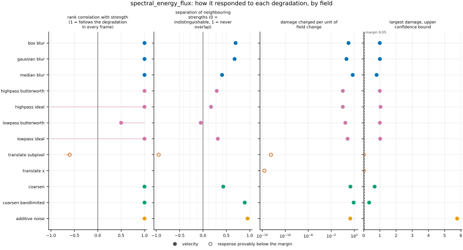
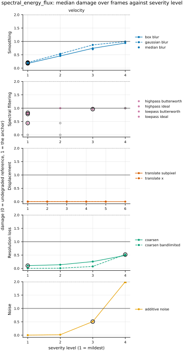

## Definition

Let $\mathbf{u}$ be the velocity on a periodic grid of $M$ cells with $D$ spatial axes, one
component per axis, $\hat{\mathbf{u}}(\mathbf{k})$ its discrete Fourier transform, and
$\mathbf{u}^{<K}$ the velocity keeping only the modes with $\mathrm{rint}(|\mathbf{k}|) \le K$,
$|\mathbf{k}|$ in cycles across the domain: the sharp spectral filter of [@aluie2013], Equation
(21). The spectral energy flux through $K$ is the rate at which the nonlinear terms move kinetic
energy out of those modes. It is computed as the domain average of the compressible
"unsubtracted flux" of [@aluie2013], Section 4.1 (an unnumbered display), at uniform density:

$$
\Pi(K) = \bigl\langle \mathbf{u}^{<K} \cdot \nabla \cdot (\mathbf{u}\mathbf{u}) \bigr\rangle
- \tfrac12 \bigl\langle |\mathbf{u}^{<K}|^2 \, \nabla \cdot \mathbf{u}^{<K} \bigr\rangle ,
\qquad \bigl[\nabla \cdot (\mathbf{u}\mathbf{u})\bigr]_i = \sum_j \partial_j (u_i u_j) \tag{1}
$$

where the angle brackets are the domain average. The first term is the momentum nonlinearity
and the second the nonlinearity of the continuity equation. Its average equals that of the
deformation work of [@aluie2013], Equation (14), since the two differ by a total gradient there,
and it vanishes once every mode is kept, so the curve is a pure exchange between scales. For a
divergence-free velocity the second term is zero and
$\nabla \cdot (\mathbf{u}\mathbf{u}) = (\mathbf{u} \cdot \nabla)\mathbf{u}$, so Equation (1) is
the incompressible flux $\langle \mathbf{u}^{<K} \cdot (\mathbf{u} \cdot \nabla) \mathbf{u}
\rangle$ of [@alexakis2018], Section 2.3, Equations (16) and (18), the idea page's form. With a
divergent velocity the incompressible form would not vanish over all modes: it would leave
$-\langle (\nabla \cdot \mathbf{u}) |\mathbf{u}|^2 \rangle / 2$, a residual that is not a
transfer.

Positive $\Pi$ is energy leaving the modes inside $K$ for smaller scales and negative $\Pi$
energy arriving from them; in two dimensions energy moves toward large scales, so $\Pi < 0$ is
the expected sign over the inverse-cascade range ([@alexakis2018], Equations (21)–(22) and
Section 3.2.1, after [@kraichnan1967]). Nothing in this metric depends on that sign. Equation
(1) is the curve, the metric's companion, sampled at the octaves $K = 1, 2, 4, \dots$ up to
half the smallest side of the grid: eight coordinates, 1 to 128, on a $256^2$ grid. The number
registered is

$$
F(\mathbf{u}_{\text{ref}}, \mathbf{u}_{\text{cand}}) =
\frac{\bigl( \sum_K \bigl[ \Pi_{\text{cand}}(K) - \Pi_{\text{ref}}(K) \bigr]^2 \bigr)^{1/2}}
{\bigl( \sum_K \Pi_{\text{ref}}(K)^2 \bigr)^{1/2}} \tag{2}
$$

the L2 distance between the two curves over the octaves, divided by the reference's norm, as
`spectrum_l2` divides for the energy spectrum. No source reduces the flux curve to one number:
the octave sampling and Equation (2) are this repository's conventions, recorded in
`issues/105`. Because $\Pi$ is cumulative, the value at each octave counts every mode inside it;
the sampling weighs each octave of scale once. The shells beyond $N/2$, which exist only in the
corners of a square grid, enter only through the flux out of the last octave.

The number is NaN when the reference's curve is no larger than floating-point round-off, which
this metric bounds by machine epsilon times the largest speed of the reference cubed times
$\pi$ over the smallest grid spacing (the highest wavenumber of the grid). The bound is the
building agent's, not a source's. A uniform velocity falls below it, and so does a steady flow whose advection is
a pure gradient, such as the Taylor–Green vortex.

Discretisation: the gradients are spectral derivatives on the analysis grid's spacing (the
repository's one gradient operator, also used to recompute vorticity), which give the Nyquist
mode a zero derivative. The products are formed in physical space without dealiasing. The first
term of Equation (1) is Parseval's co-spectrum
$\mathrm{Re}[\hat{\mathbf{u}}^{*} \cdot \widehat{\nabla \cdot (\mathbf{u}\mathbf{u})}] / M^2$,
binned into `spectrum_l2`'s unit shells and summed up to $K$; the second is formed from the
filtered velocity at each $K$. $\Pi(K)$ is the flux through $|\mathbf{k}| = K + \tfrac12$.

**Compressibility.** In compressible flow the coarse-grained budget of the large-scale kinetic
energy moves energy across scales through deformation work and baropycnal work, the latter
needing the pressure gradient and the small-scale mass flux; a third term, pressure dilatation,
exchanges kinetic with internal energy ([@aluie2013], Equations (13)–(15) and Sections
4.1–4.3; [@aluie2011], Equations (3)–(5)). This metric reads the velocity alone: it takes the
density as uniform in Equation (1), and omits baropycnal work and pressure dilatation
(`judgements/003`). The transfer it keeps includes that carried by the velocity's compressive
modes. In three-dimensional simulations at an rms Mach number of 0.43, pressure dilatation acts
mainly at large scales and the kinetic-energy flux is close to constant beyond a transitional
range [@aluieli2012], Figures 2–3; that evidence is three-dimensional.


### Boundary handling

Periodic wrap on every axis: Equation (1) takes Fourier transforms and spectral derivatives. The
metric therefore declares `requires_periodic`, and the harness does not run it on a dataset with
a non-periodic axis.

## Performance

<!-- GENERATED performance: written by `python -m fmeval.cards evidence spectral_energy_flux --results results/spectral_energy_flux_1793355291`, do not edit -->



Four measured statistics for spectral_energy_flux, one row per degradation grouped by family and one marker per field. From left: the rank correlation between the metric and the applied strength within a frame, with the line showing the resampling interval; the separation of neighbouring strengths as Cliff's delta, where 0 means the metric cannot tell one strength from the next and the faint ticks at 0.12, 0.28 and 0.42 are Vargha and Delaney's small, medium and large anchors, for scale and not as grades; the damage charged per unit of field change at the harshest strength; and the upper confidence bound on the largest damage, beside the fixed margin of 0.05. A hollow marker is a field and degradation on which that bound lies below the margin, so the response is provably small. A missing marker is a statistic the analysis withheld, as the rank correlation is on an axis the metric is invariant to.



Median damage over frames against severity level for spectral_energy_flux, one row per family of degradation and one column per field, on one shared scale. The solid grey line is damage 1, the anchor (by default the field's own mean); the dotted black line is the damage assigned to the fake prediction with the right spectrum, where the run included it. The hollow black ring marks the first level at which the metric has moved a tenth of the way to the anchor. Hollow grey markers are strengths excluded for repeating a milder one or for doing nothing. Degradations with three or fewer usable levels are drawn as markers only; points beyond 2 either side are drawn as triangles at the edge. Damage is negative where a degradation moves the metric away from the anchor, as noise raises a single-field quantity the field's mean sets to zero.

**Trend: does the response follow the degradation?**

| test family | field | degradations | rank correlation | fraction of frames in order | weakest gap between neighbouring strengths |
|---|---|---|---|---|---|
| Displacement | velocity | 2 | -0.714 | 0 | 0.0223 |
| Resolution loss | velocity | 2 | 1 | 0.988 to 0.994 | 0.641 to 0.947 |
| Smoothing | velocity | 3 | 1 | 0.901 to 0.919 | 0.703 to 0.888 |
| Spectral filtering | velocity | 4 | 1 | 0.627 to 0.776 | 0.596 to 0.776 |
| Noise | velocity | 1 | 1 | 1 | 0.956 |

**Reactivity: how far does it move?**

| test family | field | change from clean at the harshest strength | elasticity | first strength detected |
|---|---|---|---|---|
| Displacement | velocity | — | 1.17 | level — |
| Resolution loss | velocity | — | 0.655 to 3.97 | level 1 |
| Smoothing | velocity | — | 0.887 to 1.03 | level 1 |
| Spectral filtering | velocity | — | 0.144 to 1.08 | level 1 |
| Noise | velocity | — | 1.26 | level 3 |
| trap test: fake prediction, right spectrum | velocity | — | — | damage 2.35 |

**Consistency: how much does it vary from snapshot to snapshot?**

| test family | field | consistency, in the strength's units | snapshots per independent block |
|---|---|---|---|
| Displacement | velocity | 0.808 | 1 to 20 |
| Resolution loss | velocity | 5.24 to 7.06 | 20 to 21 |
| Smoothing | velocity | 0.0638 to 0.142 | 21 |
| Spectral filtering | velocity | 0.162 to 0.348 | 21 |
| Noise | velocity | 0.0436 | 1 |

One row per family of degradation and physical field; a cell gives the range over the degradations in that family. **Trend.** The rank correlation is the Spearman correlation between the strength and how far the metric has moved from its value on the undegraded field of the same frame, in the one direction it moves under that degradation, computed inside a single frame. A value of 1 means every strength moved it further than the last in every frame, whichever way it moves; a response that scatters to both sides scores near 0. The fraction of frames in order counts the frames with no exception. The weakest gap is the smallest Mann-Whitney overlap between two neighbouring strengths across frames: 1 means they never overlap, 0.5 that they cannot be told apart. **Reactivity.** The change from clean is the median, at the harshest strength, of the departure from the undegraded value of the same frame over the size of that value: 0.3 means 30%. It does not exist for this metric, whose undegraded value is exactly zero; the damage below is its relative reading. The elasticity is the percentage change of that departure per percentage change in strength over the mildest strengths. First strength detected is the mildest at which the metric has moved a tenth of the way to the anchor; **damage** reads that 0-to-1 scale as a number. A dash means the measurement is not defined there. A metric's reactivity scales with the power it is expressed in: mean squared error's elasticity is twice root-mean-square error's, though the two carry the same information, so compare magnitudes across metrics with that in mind. **Consistency** is how much the response varies from snapshot to snapshot relative to its size, in the strength's units; the snapshots of one trajectory are correlated, and the last column is how many consecutive snapshots one independent block spans.

These tables report what was measured and grade none of the measurements. What the numbers mean for this metric is written in the subsections below, beside the test that produced each number.

**Profile.**

| field | selectivity | charges most for | charges least for | response provably below 0.05 at 90% on | elasticity to a sub-pixel shift, against severity (distance) | compute cost (x cheapest in this run) |
|---|---|---|---|---|---|---|
| velocity | 0.726 | `coarsen_bandlimited` | `translate_x` | `translate_subpixel` `translate_x` | 1.17 | 1 |

One row per physical field. **Selectivity** is how concentrated the metric's response is on a few degradations, measured per unit of field change: 0 means it charges every degradation the same, as mean squared error does by construction, and values toward 1 that one degradation carries most of it. **Charges most and least for** name the two ends of that profile. **Response provably below** lists degradations on which the upper confidence bound of the largest damage lies below the margin -- an equivalence test, so an entry says the response is provably small, not merely not significant; a dash means no degradation met the bound. **Elasticity** is the slope of log damage against log shift over the smallest shifts: 1 means damage grows in proportion to the shift, 2 with its square. **Compute cost** is wall-clock per evaluation over the cheapest metric and field in the same run.

<!-- END GENERATED performance -->

## Intuition

In a turbulent flow the motion at each size of eddy feeds energy into other sizes. This
metric measures that traffic: for each octave of size, how fast kinetic energy is carried past
it, from larger eddies to smaller ones or the other way, and it reports how far a prediction's
traffic is from the reference's. A prediction can have exactly the right amount of energy at
every size and still carry the wrong traffic between sizes: a field with the right spectrum and
randomised structure carries none on average over many random draws, and in any one draw
whatever its random alignment happens to give. This metric sees that and an energy-spectrum
comparison does not.

The traffic comes from the flow carrying itself along: the velocity times its own rate of
change in space, plus a correction for the fluid being squeezed or spread where the flow
converges or diverges, which keeps the traffic a pure exchange that creates no energy.
Multiplying two waves makes waves of their sum and difference sizes, so three sizes interact at
a time, and the net rate at which those interactions move energy out of everything larger than
a given size is the flux through that size. Because it is a product of three velocities, it
depends on how the waves line up, not only on how strong each one is.

A worked example: along a row of eight cells, the reference's velocity is one wave spanning the
whole row plus an equally strong wave of half that length. The two exchange energy, and the
flux through the largest size is -0.393: energy flowing into the long wave from the short one.
A candidate with the short wave at half strength moves energy at half the rate, -0.196, so the
gap is half the reference's flux and the metric returns 0.5.

```
cell                      1      2      3      4      5      6      7      8
reference velocity     0.00   1.71   1.00  -0.29   0.00   0.29  -1.00  -1.71
candidate velocity     0.00   1.21   1.00   0.21   0.00  -0.21  -1.00  -1.21

flux through the largest size:   reference -0.393   candidate -0.196   result 0.5
```

(The velocity points along the row and does not vary across it; the grid is eight cells by
four.)

It ignores where in the domain the energy moves, and the energy itself at each size: a field
can match the flux while getting the spectrum wrong.

## Reading the output

Dimensionless, from 0 upward; lower is better and 0 means the two curves coincide at every
octave. A value of 1 is what a candidate that carries no flux at all scores, so values near 1
mean the prediction's energy transfer is as far from the reference's as no transfer; values
above 1 mean it carries flux of the wrong sign or of larger size. Comparisons are valid between
predictions of the same reference on the same analysis grid. Values on different grids sample
different octaves and are not comparable, and the number is undefined (NaN) for a reference
whose flux is round-off, such as a uniform velocity or a steady Taylor–Green vortex.

The companion is the curve of Equation (1): a `coordinate` column holding the octave wavenumber
in cycles across the domain and a value column holding $\Pi$ there, in velocity cubed per unit
length, stored for the candidate on every result row in `companions.csv`; on the clean level it
is the reference's curve. Read a candidate's curve against the reference's to see at which
octaves the transfer departs and in which direction.

## Limitations

- **A reference with a very small flux.** The NaN bound of the Definition is fixed, not tuned to
  any field: a reference whose genuine flux lies below machine epsilon times its largest speed
  cubed times the grid's highest wavenumber is treated as carrying none.
- **Not the full compressible flux.** At larger Mach number the velocity-only flux misses
  density weighting, baropycnal work and the exchange with internal energy, so a prediction
  with the right total transfer can score badly, and the reverse (`judgements/003`). The
  transfer it keeps includes that through the velocity's compressive modes, so a prediction
  that gets the divergence wrong is charged here as well.
- **No reference-free reading.** The constancy of the flux across an inertial range, and its sign,
  are three-dimensional, forced-turbulence expectations; on two-dimensional or decaying flow
  neither gives a target, so the metric only compares against a reference.
- **Aliasing and the Nyquist mode.** The products are formed without dealiasing, and the spectral
  derivative gives the Nyquist mode a zero derivative. On a field with energy at the grid scale
  (noise, a coarsened staircase) the high octaves therefore include aliased transfer and miss the
  Nyquist mode's, which a coarse or noisy candidate inflates.
- **Few octaves at the largest scales.** The flux through octave 1 depends on the handful of modes
  in the first shell; on fields whose energy sits there, small changes in those modes move the
  number by a large fraction.

## Results

<!-- GENERATED run: written by `python -m fmeval.cards evidence spectral_energy_flux --results results/spectral_energy_flux_1793355291`, do not edit -->

Measured on `kinet_re5e4`, frames 2000 to 10000 (161 frames of developed flow), on the 256 analysis grid, seed 20260807, at commit `24929662abcd`. Run `spectral_energy_flux_1793355291`.

Every number in this section comes from that one run. Regenerate with `python -m fmeval.cards evidence <name> --results results/spectral_energy_flux_1793355291`.

<!-- END GENERATED run -->

### Smoothing

[gaussian_blur](../../degradations/gaussian_blur/card.md) ·
[box_blur](../../degradations/box_blur/card.md) ·
[median_blur](../../degradations/median_blur/card.md)

<!-- GENERATED results_smoothing: written by `python -m fmeval.cards evidence spectral_energy_flux --results results/spectral_energy_flux_1793355291`, do not edit -->

| degradation | field | strengths | rank correlation | fraction of frames in the right order | weakest gap between neighbouring strengths |
|---|---|---|---|---|---|
| `box_blur` | velocity | 4 | 1 | 0.919 | 0.817 |
| `gaussian_blur` | velocity | 4 | 1 | 0.907 | 0.888 |
| `median_blur` | velocity | 3 | 1 | 0.901 | 0.703 |

<!-- END GENERATED results_smoothing -->

All three blurs rank their strengths in the typical frame (rank correlation 1), but only 0.901 to
0.919 of frames have every strength in order: in about one frame in ten a wider blur scores below
a narrower one. The largest damage on `gaussian_blur` is 1.43 in the fingerprint, above the 1
that a flux-free velocity scores, so in some frames the blurred velocity's flux is farther from
the reference's than no flux at all, by a reversed sign or a larger size at some octave.

### Spectral filtering

[lowpass_ideal](../../degradations/lowpass_ideal/card.md) ·
[lowpass_butterworth](../../degradations/lowpass_butterworth/card.md) ·
[highpass_ideal](../../degradations/highpass_ideal/card.md) ·
[highpass_butterworth](../../degradations/highpass_butterworth/card.md)

<!-- GENERATED results_spectral: written by `python -m fmeval.cards evidence spectral_energy_flux --results results/spectral_energy_flux_1793355291`, do not edit -->

| degradation | field | strengths | rank correlation | fraction of frames in the right order | weakest gap between neighbouring strengths |
|---|---|---|---|---|---|
| `highpass_butterworth` | velocity | 3 | 1 | 0.677 | 0.665 |
| `highpass_ideal` | velocity | 2 | 1 | 0.627 | 0.596 |
| `lowpass_butterworth` | velocity | 3 | 1 | 0.739 | 0.745 |
| `lowpass_ideal` | velocity | 2 | 1 | 0.776 | 0.776 |

<!-- END GENERATED results_spectral -->

The spectral filters keep only two or three distinct strengths on the velocity, and they have the
fewest frames in order of any family, 0.627 to 0.776. At the harshest strength both low-pass
filters change the flux by the whole reference value at every octave (1 in the curve table
below): the velocity's energy sits in the first few shells, so even the mildest cutoff deletes
most of the triads that carry the transfer. On `highpass_ideal` the pre-registered response is
not supported: with two strengths the lower end of the rank-correlation interval in the
fingerprint is −1, though the typical frame ranks them in order.

### Displacement

[translate_x](../../degradations/translate/card.md) ·
[translate_subpixel](../../degradations/translate_subpixel/card.md)

<!-- GENERATED results_geometric: written by `python -m fmeval.cards evidence spectral_energy_flux --results results/spectral_energy_flux_1793355291`, do not edit -->

| degradation | field | strengths | rank correlation | fraction of frames in the right order | weakest gap between neighbouring strengths |
|---|---|---|---|---|---|
| `translate_subpixel` | velocity | 6 | -0.714 | 0 | 0.0223 |
| `translate_x` | velocity | 5 | — | — | — |

<!-- END GENERATED results_geometric -->

The flux does not depend on where the flow sits, and the run confirms it: `translate_x` scores 0
at every strength and both displacements are provably below the 0.05 margin (Profile, above).
The largest damage of `translate_subpixel` is 1.75e-06, consistent with the sub-pixel shift
changing the highest mode (`issues/041`); its negative rank correlation orders values far below
the margin.

### Resolution loss

[coarsen](../../degradations/coarsen/card.md) ·
[coarsen_bandlimited](../../degradations/coarsen_bandlimited/card.md)

<!-- GENERATED results_resolution: written by `python -m fmeval.cards evidence spectral_energy_flux --results results/spectral_energy_flux_1793355291`, do not edit -->

| degradation | field | strengths | rank correlation | fraction of frames in the right order | weakest gap between neighbouring strengths |
|---|---|---|---|---|---|
| `coarsen` | velocity | 4 | 1 | 0.988 | 0.641 |
| `coarsen_bandlimited` | velocity | 4 | 1 | 0.994 | 0.947 |

<!-- END GENERATED results_resolution -->

Coarsening is where the metric is most consistently ordered apart from noise: 0.988 and 0.994 of
frames in order. `coarsen_bandlimited` is the degradation it charges most for (Profile). The
staircase `coarsen` separates its neighbouring strengths less well (weakest gap 0.641 against
0.947), and its curve moves in both directions across octaves: the change from clean is negative
at octaves 16 and 32 and positive elsewhere (curve table below).

### Noise

[additive_noise](../../degradations/additive_noise/card.md)

<!-- GENERATED results_stochastic: written by `python -m fmeval.cards evidence spectral_energy_flux --results results/spectral_energy_flux_1793355291`, do not edit -->

| degradation | field | strengths | rank correlation | fraction of frames in the right order | weakest gap between neighbouring strengths |
|---|---|---|---|---|---|
| `additive_noise` | velocity | 4 | 1 | 1 | 0.956 |

<!-- END GENERATED results_stochastic -->

Noise is ordered in every frame. It is also where the metric is least bounded: the largest damage
is 155 in the fingerprint, because noise gradients are largest at the grid scale and the noisy
velocity carries transfer at the high octaves many times the reference's (a change of 5.2 to
6.94 times the clean value at octaves 16 and 32, curve table below).

### Trap tests

[gaussian_impostor](../../degradations/gaussian_impostor/card.md) ·
[uncorrelated](../../degradations/random_large_translation/card.md)

<!-- GENERATED results_canaries: written by `python -m fmeval.cards evidence spectral_energy_flux --results results/spectral_energy_flux_1793355291`, do not edit -->

| field | damage assigned to the fake prediction | closest real degradation | damage of the reference moved far away | value on the anchor |
|---|---|---|---|---|
| velocity | 2.35 | `lowpass_ideal=1.26389` | 2.59e-15 | 1 |

The fake prediction here has exactly the reference field's amplitude spectrum and completely scrambled structure. Damage 1 is what the anchor scores, by default the reference's own spatial mean, a prediction that knows the mean and nothing else. The damage column therefore says how close to useless this metric considers that fake prediction: a low number means the metric was fooled. The third column translates the same number into an ordinary degradation whose damage the fake prediction matches, which is easier to picture. The fourth is the reference moved by a large random offset, the right statistics in the wrong place; where a field's energy sits in its largest scales that copy stays partly correlated with the reference, so it is not the score of an unrelated field.

<!-- END GENERATED results_canaries -->

The metric is not fooled by the fake prediction with the right spectrum: it assigns it damage
2.35, more than the 1 of a velocity carrying no flux, so the scrambled field moves energy across
the octaves at a rate and in a direction unrelated to the reference's. The reference moved far
away scores 2.59e-15, because a translation leaves the flux unchanged.

### The curve behind the number

<!-- GENERATED results_companion: written by `python -m fmeval.cards evidence spectral_energy_flux --results results/spectral_energy_flux_1793355291`, do not edit -->

**velocity, rank correlation, at each coordinate.**

| degradation | 1 | 2 | 4 | 8 | 16 | 32 | 64 | 128 | dominance |
|---|---|---|---|---|---|---|---|---|---|
| `additive_noise` | 0.2 | 0.2 | 0.2 | 0.2 | 0.2 | 0.2 | 0.2 | 0.2 | 0.0186 |
| `box_blur` | 0.4 | 1 | 0.4 | -0.2 | 0.8 | 1 | 1 | 1 | 0.13 |
| `coarsen` | 1 | 1 | 1 | 0.8 | 0.4 | 0.8 | -0.2 | 1 | 0 |
| `coarsen_bandlimited` | 0.4 | 0.8 | 0.4 | 0.4 | 0.4 | 0.2 | 0.2 | 0.2 | 0.342 |
| `gaussian_blur` | 0.4 | 0.8 | 0.4 | -0.2 | 0.8 | 1 | 1 | 1 | 0.118 |
| `highpass_butterworth` | 0.5 | 1 | 0.5 | 0.5 | 0.5 | 0.5 | 0.5 | 0.5 | 0.13 |
| `highpass_ideal` | — | 1 | 1 | 1 | -1 | 1 | 1 | 1 | 0.199 |
| `lowpass_butterworth` | -0.5 | 0.5 | 0.5 | 0.5 | 0.5 | 0.5 | 0.5 | 0.5 | 0.236 |
| `lowpass_ideal` | 1 | -1 | 1 | 1 | 1 | 1 | 1 | 1 | 0.267 |
| `median_blur` | 1 | 1 | 0.5 | 0.5 | 0.5 | -0.5 | -0.5 | -0.5 | 0 |
| `translate_subpixel` | 0.714 | -0.714 | -0.714 | -0.6 | 0.0857 | 0.429 | -0.714 | -0.6 | 0.155 |
| `translate_x` | — | — | — | — | — | — | — | — | — |

**velocity, change from clean at the harshest strength, at each coordinate.**

| degradation | 1 | 2 | 4 | 8 | 16 | 32 | 64 | 128 |
|---|---|---|---|---|---|---|---|---|
| `additive_noise` | -0.135 | 0.134 | 1.2 | 2.09 | 5.2 | 6.94 | 6.14 | 4.68 |
| `box_blur` | 0.895 | 0.949 | 0.905 | 0.824 | 0.757 | 0.767 | 0.779 | 0.782 |
| `coarsen` | 0.343 | 0.367 | 0.546 | 0.327 | -0.229 | -0.195 | 0.00356 | 0.802 |
| `coarsen_bandlimited` | 0.105 | 0.132 | 0.316 | 0.121 | 0.133 | 0.133 | 0.142 | 0.143 |
| `gaussian_blur` | 0.986 | 0.995 | 0.988 | 0.978 | 0.969 | 0.969 | 0.971 | 0.972 |
| `highpass_butterworth` | 1 | 0.998 | 0.925 | 0.845 | 0.862 | 0.982 | 0.98 | 0.98 |
| `highpass_ideal` | 1 | 1 | 0.907 | 0.868 | 0.818 | 0.983 | 0.988 | 0.988 |
| `lowpass_butterworth` | 1 | 1 | 1 | 1 | 1 | 1 | 1 | 1 |
| `lowpass_ideal` | 1 | 1 | 1 | 1 | 1 | 1 | 1 | 1 |
| `median_blur` | 0.445 | 0.623 | 0.626 | 0.396 | 0.0311 | -0.042 | -0.0274 | -0.0268 |
| `translate_subpixel` | 0 | -1.41e-16 | -1.28e-16 | -1.14e-16 | 0 | 1.77e-16 | 0 | -1.42e-16 |
| `translate_x` | 0 | -1.42e-16 | -3.78e-16 | -7.83e-16 | -7.89e-16 | -7.06e-16 | -6.45e-16 | -7.34e-16 |

Each coordinate of the curve read as a metric of its own, with the same statistics as the tables above and no resampling interval. Neighbouring coordinates are strongly correlated, so a row localises the evidence and does not multiply it. **Dominance** is the fraction of frames in which, for the weakest pair of neighbouring strengths, the harsher strength's curve has moved at least as far as the milder one's at every coordinate, each in its own direction: near 1, any summary that grows with every coordinate's departure orders those strengths the same way, so the choice of summary cannot change the trend. None of these numbers enters the tables above.

<!-- END GENERATED results_companion -->

Octave by octave the curve follows the degradations less cleanly than the number does: several
rows reverse sign at some octaves (`median_blur` at 32 to 128, `highpass_ideal` at 16), and the
dominance is low on every degradation, 0 to 0.342. In most frames, then, the harsher strength's
curve has not moved further at every octave, and the registered summary, a repository convention
(`issues/105`), decides the order of neighbouring strengths. A different summary could order
them differently. The reference's own curve, the clean rows of the run's `companions.csv`, is
negative at the low octaves in most frames but not in all, so the direction of transfer through
a given octave changes along this decaying trajectory; no sign test could have been fixed for it.

## References

\bibliography
