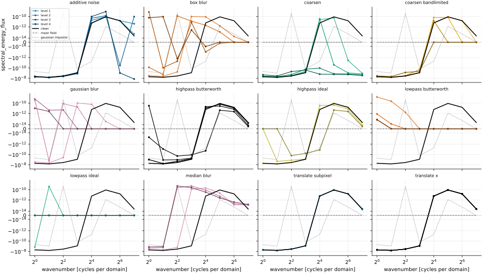
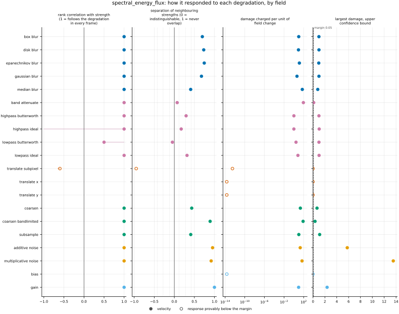
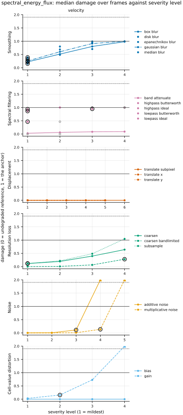
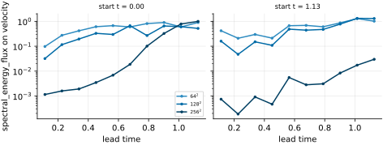

## Definition

Let $\mathbf{u}$ be the velocity on a periodic grid of $M$ cells with $D$ spatial axes, one
component per axis, $\hat{\mathbf{u}}(\mathbf{k})$ its discrete Fourier transform, and
$\mathbf{u}^{<K}$ the velocity keeping only the modes with $\mathrm{rint}(|\mathbf{k}|) \le K$,
$|\mathbf{k}|$ in cycles across the domain: the sharp spectral filter of [@aluie2013], Equation
(21). The spectral energy flux through $K$ is the rate at which the nonlinear terms move kinetic
energy out of those modes. It is computed as the domain average of the compressible
"unsubtracted flux" of [@aluie2013], Section 4.1 (an unnumbered display), at uniform density:

$$
\Pi(K) = \bigl\langle \mathbf{u}^{<K} \cdot \nabla \cdot (\mathbf{u}\mathbf{u}) \bigr\rangle
- \tfrac12 \bigl\langle |\mathbf{u}^{<K}|^2 \, \nabla \cdot \mathbf{u}^{<K} \bigr\rangle ,
\qquad \bigl[\nabla \cdot (\mathbf{u}\mathbf{u})\bigr]_i = \sum_j \partial_j (u_i u_j) \tag{1}
$$

where the angle brackets are the domain average. The first term is the momentum nonlinearity
and the second the nonlinearity of the continuity equation. Its average equals that of the
deformation work of [@aluie2013], Equation (14), since the two differ by a total gradient there,
and it vanishes once every mode is kept, so the curve is a pure exchange between scales. For a
divergence-free velocity the second term is zero and
$\nabla \cdot (\mathbf{u}\mathbf{u}) = (\mathbf{u} \cdot \nabla)\mathbf{u}$, so Equation (1) is
the incompressible flux $\langle \mathbf{u}^{<K} \cdot (\mathbf{u} \cdot \nabla) \mathbf{u}
\rangle$ of [@alexakis2018], Section 2.3, Equations (16) and (18), the idea page's form. With a
divergent velocity the incompressible form would not vanish over all modes: it would leave
$-\langle (\nabla \cdot \mathbf{u}) |\mathbf{u}|^2 \rangle / 2$, a residual that is not a
transfer.

Positive $\Pi$ is energy leaving the modes inside $K$ for smaller scales and negative $\Pi$
energy arriving from them; in two dimensions energy moves toward large scales, so $\Pi < 0$ is
the expected sign over the inverse-cascade range ([@alexakis2018], Equations (21)–(22) and
Section 3.2.1, after [@kraichnan1967]). Nothing in this metric depends on that sign. Equation
(1) at every shell $K = 1, 2, \dots$ up to half the smallest side of the grid, 128 on a $256^2$
grid, is the metric's curve companion. The number registered samples it at the octaves
$K = 1, 2, 4, \dots$, eight of them on a $256^2$ grid:

$$
F(\mathbf{u}_{\text{ref}}, \mathbf{u}_{\text{cand}}) =
\frac{\bigl( \sum_K \bigl[ \Pi_{\text{cand}}(K) - \Pi_{\text{ref}}(K) \bigr]^2 \bigr)^{1/2}}
{\bigl( \sum_K \Pi_{\text{ref}}(K)^2 \bigr)^{1/2}} \tag{2}
$$

the L2 distance between the two curves over the octaves, divided by the reference's norm, as
`spectrum_l2` divides for the energy spectrum. No source reduces the flux curve to one number:
the octave sampling and Equation (2) are this repository's conventions, recorded in
`issues/105`. Because $\Pi$ is cumulative, the value at each octave counts every mode inside it;
the sampling weighs each octave of scale once. The shells beyond $N/2$, which exist only in the
corners of a square grid, enter only through the flux out of the last shell.

The number is NaN when the reference's curve is no larger than floating-point round-off, which
this metric bounds by machine epsilon times the largest speed of the reference cubed times
$\pi$ over the smallest grid spacing (the highest wavenumber of the grid). The bound is the
building agent's, not a source's. A uniform velocity falls below it, and so does a steady flow whose advection is
a pure gradient, such as the Taylor–Green vortex.

Discretisation: the gradients are spectral derivatives on the analysis grid's spacing (the
repository's one gradient operator, also used to recompute vorticity), which give the Nyquist
mode a zero derivative. The products are formed in physical space without dealiasing. The first
term of Equation (1) is Parseval's co-spectrum
$\mathrm{Re}[\hat{\mathbf{u}}^{*} \cdot \widehat{\nabla \cdot (\mathbf{u}\mathbf{u})}] / M^2$,
binned into `spectrum_l2`'s unit shells and summed up to $K$; the second is formed from the
filtered velocity and its divergence at each $K$, each the inverse of the velocity's real
half-spectrum masked to the shells up to $K$. $\Pi(K)$ is the flux through
$|\mathbf{k}| = K + \tfrac12$.

**Compressibility.** In compressible flow the coarse-grained budget of the large-scale kinetic
energy moves energy across scales through deformation work and baropycnal work, the latter
needing the pressure gradient and the small-scale mass flux; a third term, pressure dilatation,
exchanges kinetic with internal energy ([@aluie2013], Equations (13)–(15) and Sections
4.1–4.3; [@aluie2011], Equations (3)–(5)). This metric reads the velocity alone: it takes the
density as uniform in Equation (1), and omits baropycnal work and pressure dilatation
(`judgements/003`). The transfer it keeps includes that carried by the velocity's compressive
modes. In three-dimensional simulations at an rms Mach number of 0.43, pressure dilatation acts
mainly at large scales and the kinetic-energy flux is close to constant beyond a transitional
range [@aluieli2012], Figures 2–3; that evidence is three-dimensional.


### Boundary handling

Periodic wrap on every axis: Equation (1) takes Fourier transforms and spectral derivatives. The
metric therefore declares `requires_periodic`, and the harness does not run it on a dataset with
a non-periodic axis.

### How its field reports it

The flux is a turbulence quantity, and turbulence reports it as a curve, never as a distance
between two curves.

- **The object.** $\Pi(k)$, the sum of the shell-to-shell transfer $T(k')$ over $k' < k$
  ([@alexakis2018], Equation (13) for $T$, Equation (16) for the low-pass velocity
  $\mathbf{u}^{<k}$, Equation (18) for $\Pi$), positive for a direct cascade and negative for an
  inverse one (Equations (21)–(22)). For compressible flow the cross-scale transfer is the
  deformation work and the baropycnal work of a filtered budget ([@aluie2013], Equations (13)–(15)
  and the sharp filter of Equation (21); [@aluie2011], Equations (3)–(5)).
- **The figure.** $\Pi(k)$ against $k$ on a logarithmic wavenumber axis and a linear flux axis,
  normalised by the energy injection rate $\epsilon_{in}$ of the forcing, with the zero line
  drawn so a change of direction is visible: "lin-log plot of the fluxes" ([@alexakis2018],
  Figs. 20 and 31, the latter with $\Pi$ changing sign at the forcing scale; [@boffetta2012],
  Fig. 11b–c, $\Pi_E(k)/\epsilon_I$ and the enstrophy flux, and the inset of Fig. 5c). The
  compressible kinetic-energy flux of a filtered budget is drawn the same way against the
  inverse filter scale, unnormalised, with the conversion, inertial and dissipation ranges
  marked ([@aluieli2012], Fig. 3). [@aluie2013] defines the flux and draws none.
- **What is read off.** The plateau: a flux constant across an inertial range and equal to the
  injection or dissipation rate, and its sign, the direction of the cascade ([@alexakis2018],
  Equations (21)–(22); [@boffetta2012], Fig. 11b). No source read for this card reduces a
  comparison of two flux curves to one number.
- **The experiment.** Forced, statistically stationary turbulence, in which $\epsilon_{in}$ is
  set by the forcing and an inertial range exists on either side of the forcing scale.

**What this bundle reports, and how it differs.** The curve is the field's object at every
shell up to $N/2$, drawn against a logarithmic wavenumber axis with the zero line. Two
differences follow from the data. The flux is not divided by an injection rate, because
`kinet_re5e4` is unforced and decaying and has none, so the curve keeps its units. And the flux
axis is symmetric-logarithmic rather than linear: linear within six decades of the largest
magnitude drawn and logarithmic beyond, because the curves of one figure span several decades
from the smoothed candidates to the noisy ones (the per-octave table under "The curve behind
the number" gives the change from clean at each octave). The velocity-only form at uniform density
is `judgements/003`. The registered number, the relative L2 distance over the octaves, is the
repository's convention (`issues/105`).

**The experiments here.** Forced stationary turbulence does not exist here:
[EXP-spectral_energy_flux-forced-2d-compressible-flux-loop](https://github.com/khegazy/pde_metrics/blob/main/proposals/EXP-spectral_energy_flux-forced-2d-compressible-flux-loop.md)
writes up the two-dimensional compressible case, whose flux changes sign across the forcing
scale, and
[EXP-increment_flatness-isotropic-3d-turbulence-cutouts](https://github.com/khegazy/pde_metrics/blob/main/proposals/EXP-increment_flatness-isotropic-3d-turbulence-cutouts.md)
the three-dimensional one with a constant flux.
[EXP-spectral_energy_flux-graded-phase-randomisation](https://github.com/khegazy/pde_metrics/blob/main/proposals/EXP-spectral_energy_flux-graded-phase-randomisation.md)
is an ordinal axis with a predicted response for a triple correlation such as this one. The
metric runs on the degradation ladder on `kinet_re5e4`, on the forecasts of `forecast_re5e4`
against their targets and on the Reynolds ladder. It cannot run on `synthetic_ensemble`, which
has no velocity, or on `sod_shock_tube`, whose walls rule out a periodic transform.

## Performance

<!-- GENERATED performance: written by `python -m fmeval.cards evidence spectral_energy_flux --results results/comparison_1793846511 --results results/comparison_1793811840 --results results/comparison_1793846600`, do not edit -->



*As this metric's own field draws it.* The dense curve behind spectral_energy_flux on velocity, at every coordinate the curve returns, on the frames and ladder entries report.error_map stored: the median over those frames at every stored strength, the clean curve in black, the anchor dashed and the impostor dotted where stored. Axes as the field draws them: log x, symlog y; a symlog axis is linear within 6 decades of its largest magnitude and carries its zero line. Values are the literature's own, untransformed.



Four measured statistics for spectral_energy_flux, one row per degradation grouped by family and one marker per field. From left: the rank correlation between the metric and the applied strength within a frame, with the line showing the resampling interval; the separation of neighbouring strengths as Cliff's delta, where 0 means the metric cannot tell one strength from the next and the faint ticks at 0.12, 0.28 and 0.42 are Vargha and Delaney's small, medium and large anchors, for scale and not as grades; the damage charged per unit of field change at the harshest strength; and the upper confidence bound on the largest damage, beside the fixed margin of 0.05. A hollow marker is a field and degradation on which that bound lies below the margin, so the response is provably small. A missing marker is a statistic the analysis withheld, as the rank correlation is on an axis the metric is invariant to.



Median damage over frames against severity level for spectral_energy_flux, one row per family of degradation and one column per field, on one shared scale. The solid grey line is damage 1, the anchor (by default the field's own mean); the dotted black line is the damage assigned to the fake prediction with the right spectrum, where the run included it. The hollow black ring marks the first level at which the metric has moved a tenth of the way to the anchor. Hollow grey markers are strengths excluded for repeating a milder one or for doing nothing. Degradations with three or fewer usable levels are drawn as markers only; points beyond 2 either side are drawn as triangles at the edge. Damage is negative where a degradation moves the metric away from the anchor, as noise raises a single-field quantity the field's mean sets to zero.

**Trend: does the response follow the degradation?**

| test family | field | degradations | rank correlation | fraction of frames in order | weakest gap between neighbouring strengths |
|---|---|---|---|---|---|
| Displacement | velocity | 3 | -0.6 | 0 | 0.0253 |
| Cell-value distortion | velocity | 2 | 1 | 1 | 1 |
| Resolution loss | velocity | 3 | 1 | 0.969 to 0.994 | 0.705 to 0.946 |
| Smoothing | velocity | 5 | 1 | 0.839 to 0.975 | 0.704 to 0.873 |
| Spectral filtering | velocity | 5 | 0.5 to 1 | 0.46 to 0.988 | 0.476 to 0.658 |
| Noise | velocity | 2 | 1 | 1 | 0.959 to 0.977 |

**Reactivity: how far does it move?**

| test family | field | change from clean at the harshest strength | elasticity | first strength detected |
|---|---|---|---|---|
| Displacement | velocity | — | 1.29 | level — |
| Cell-value distortion | velocity | — | 1.06 | level 2 |
| Resolution loss | velocity | — | 0.898 to 4.32 | level 1 |
| Smoothing | velocity | — | 0.671 to 1.19 | level 1 |
| Spectral filtering | velocity | — | 0.0853 to 1 | level 1 |
| Noise | velocity | — | 1.03 to 1.14 | level 3 |
| trap test: fake prediction, right spectrum | velocity | — | — | damage 1.9 |

**Consistency: how much does it vary from snapshot to snapshot?**

| test family | field | consistency, in the strength's units | snapshots per independent block |
|---|---|---|---|
| Displacement | velocity | 0.859 | 19 to 21 |
| Cell-value distortion | velocity | 0.153 | 3 to 21 |
| Resolution loss | velocity | 4.59 to 4.78 | 21 to 22 |
| Smoothing | velocity | 0.0536 to 0.112 | 21 |
| Spectral filtering | velocity | 0.15 to 0.75 | 21 to 22 |
| Noise | velocity | 0.0482 to 0.0738 | 1 |

One row per family of degradation and physical field; a cell gives the range over the degradations in that family. **Trend.** The rank correlation is the Spearman correlation between the strength and how far the metric has moved from its value on the undegraded field of the same frame, in the one direction it moves under that degradation, computed inside a single frame. A value of 1 means every strength moved it further than the last in every frame, whichever way it moves; a response that scatters to both sides scores near 0. The fraction of frames in order counts the frames with no exception. The weakest gap is the smallest Mann-Whitney overlap between two neighbouring strengths across frames: 1 means they never overlap, 0.5 that they cannot be told apart. **Reactivity.** The change from clean is the median, at the harshest strength, of the departure from the undegraded value of the same frame over the size of that value: 0.3 means 30%. It does not exist for this metric, whose undegraded value is exactly zero; the damage below is its relative reading. The elasticity is the percentage change of that departure per percentage change in strength over the mildest strengths. First strength detected is the mildest at which the metric has moved a tenth of the way to the anchor; **damage** reads that 0-to-1 scale as a number. A dash means the measurement is not defined there. A metric's reactivity scales with the power it is expressed in: mean squared error's elasticity is twice root-mean-square error's, though the two carry the same information, so compare magnitudes across metrics with that in mind. **Consistency** is how much the response varies from snapshot to snapshot relative to its size, in the strength's units; the snapshots of one trajectory are correlated, and the last column is how many consecutive snapshots one independent block spans.

These tables report what was measured and grade none of the measurements. What the numbers mean for this metric is written in the subsections below, beside the test that produced each number.

**Profile.**

| field | selectivity | charges most for | charges least for | response provably below 0.05 at 90% on | elasticity to a sub-pixel shift, against severity (distance) | compute cost (x cheapest in this run) |
|---|---|---|---|---|---|---|
| velocity | 0.653 | `band_attenuate` | `translate_x` | `bias` `translate_subpixel` `translate_x` `translate_y` | 1.29 | 1.61e+03 |

One row per physical field. **Selectivity** is how concentrated the metric's response is on a few degradations, measured per unit of field change: 0 means it charges every degradation the same, as mean squared error does by construction, and values toward 1 that one degradation carries most of it. **Charges most and least for** name the two ends of that profile. **Response provably below** lists degradations on which the upper confidence bound of the largest damage lies below the margin -- an equivalence test, so an entry says the response is provably small, not merely not significant; a dash means no degradation met the bound. **Elasticity** is the slope of log damage against log shift over the smallest shifts: 1 means damage grows in proportion to the shift, 2 with its square. **Compute cost** is wall-clock per evaluation over the cheapest metric and field in the same run.

<!-- END GENERATED performance -->

## Intuition

In a turbulent flow the motion at each size of eddy feeds energy into other sizes. This
metric measures that traffic: for each octave of size, how fast kinetic energy is carried past
it, from larger eddies to smaller ones or the other way, and it reports how far a prediction's
traffic is from the reference's. A prediction can have exactly the right amount of energy at
every size and still carry the wrong traffic between sizes: a field with the right spectrum and
randomised structure carries none on average over many random draws, and in any one draw
whatever its random alignment happens to give. This metric sees that and an energy-spectrum
comparison does not.

The traffic comes from the flow carrying itself along: the velocity times its own rate of
change in space, plus a correction for the fluid being squeezed or spread where the flow
converges or diverges, which keeps the traffic a pure exchange that creates no energy.
Multiplying two waves makes waves of their sum and difference sizes, so three sizes interact at
a time, and the net rate at which those interactions move energy out of everything larger than
a given size is the flux through that size. Because it is a product of three velocities, it
depends on how the waves line up, not only on how strong each one is.

A worked example: along a row of eight cells, the reference's velocity is one wave spanning the
whole row plus an equally strong wave of half that length. The two exchange energy, and the
flux through the largest size is -0.393: energy flowing into the long wave from the short one.
A candidate with the short wave at half strength moves energy at half the rate, -0.196, so the
gap is half the reference's flux and the metric returns 0.5.

```
cell                      1      2      3      4      5      6      7      8
reference velocity     0.00   1.71   1.00  -0.29   0.00   0.29  -1.00  -1.71
candidate velocity     0.00   1.21   1.00   0.21   0.00  -0.21  -1.00  -1.21

flux through the largest size:   reference -0.393   candidate -0.196   result 0.5
```

(The velocity points along the row and does not vary across it; the grid is eight cells by
four.)

It ignores where in the domain the energy moves, and the energy itself at each size: a field
can match the flux while getting the spectrum wrong.

## Reading the output

Dimensionless, from 0 upward; lower is better and 0 means the two curves coincide at every
octave. A value of 1 is what a candidate that carries no flux at all scores, so values near 1
mean the prediction's energy transfer is as far from the reference's as no transfer; values
above 1 mean it carries flux of the wrong sign or of larger size. Comparisons are valid between
predictions of the same reference on the same analysis grid. Values on different grids sample
different octaves and are not comparable, and the number is undefined (NaN) for a reference
whose flux is round-off, such as a uniform velocity or a steady Taylor–Green vortex.

The companion is the curve of Equation (1): a `coordinate` column holding the wavenumber $K$
in cycles across the domain and a value column holding $\Pi(K)$ there, in velocity cubed per
unit length, for the candidate; on the clean level it is the reference's curve. The whole curve,
every shell up to $N/2$, is stored on the frames and ladder entries `report.error_map` names and
drawn in Performance; `companions.csv` and the per-coordinate tables hold its octaves, the
coordinates the number is computed from. Read a candidate's curve against the reference's to
see at which scales the transfer departs and in which direction.

## Limitations

- **A reference with a very small flux.** The NaN bound of the Definition is fixed, not tuned to
  any field: a reference whose genuine flux lies below machine epsilon times its largest speed
  cubed times the grid's highest wavenumber is treated as carrying none.
- **Not the full compressible flux.** At larger Mach number the velocity-only flux misses
  density weighting, baropycnal work and the exchange with internal energy, so a prediction
  with the right total transfer can score badly, and the reverse (`judgements/003`). The
  transfer it keeps includes that through the velocity's compressive modes, so a prediction
  that gets the divergence wrong is charged here as well.
- **No reference-free reading.** The constancy of the flux across an inertial range, and its sign,
  are three-dimensional, forced-turbulence expectations; on two-dimensional or decaying flow
  neither gives a target, so the metric only compares against a reference.
- **Aliasing and the Nyquist mode.** The products are formed without dealiasing, and the spectral
  derivative gives the Nyquist mode a zero derivative. On a field with energy at the grid scale
  (noise, a coarsened staircase) the high octaves therefore include aliased transfer and miss the
  Nyquist mode's, which a coarse or noisy candidate inflates.
- **Few octaves at the largest scales.** The flux through octave 1 depends on the handful of modes
  in the first shell; on fields whose energy sits there, small changes in those modes move the
  number by a large fraction.

## Results

<!-- GENERATED run: written by `python -m fmeval.cards evidence spectral_energy_flux --results results/comparison_1793846511 --results results/comparison_1793811840 --results results/comparison_1793846600`, do not edit -->

Measured on `kinet_re5e4`, frames 2000 to 10000 (161 frames of developed flow), on the 256 analysis grid, seed 20260807, at commit `adbdc88e4950`. Run `comparison_1793846511`.

Every number in this section comes from that run, except in the subsections headed with another experiment and in a figure whose caption names another run, each of which names its own run. Regenerate with `python -m fmeval.cards evidence <name> --results results/comparison_1793846511 --results results/comparison_1793811840 --results results/comparison_1793846600`.

<!-- END GENERATED run -->

<!-- GENERATED experiments: written by `python -m fmeval.cards catalog`, do not edit -->

**Across the experiments.**

| experiment | what a run on it is evidence of | on this card |
|---|---|---|
| `kinet_re5e4` | developed flow | measured, run `comparison_1793846511`: the main results |
| `kinet_re1e6` | developed flow at Re = 1e6, twenty times the Reynolds number of kinet_re5e4, from the same initial condition | measured, run `comparison_1793846600`: under *On `kinet_re1e6`* |
| `synthetic_ensemble` | a calibrated null: evidence that the estimator computes what it claims to compute, and nothing about turbulence | not applicable: needs velocity, which this dataset does not provide |
| `sod_shock_tube` | an analytic check: evidence that the metric locates and scores a known shock correctly, and nothing about turbulence | not applicable: needs a periodic domain, and this dataset is not periodic |
| `forecast_re5e4` | real predictions scored against their targets at each prediction step; who produced the predictions, a trained model or a coarser solver, is not recorded | measured, run `comparison_1793811840`: under *On `forecast_re5e4`* |

One row per dataset a card may cite (`configs/cards/default.yaml`). *Measured* names the run the card cites: the main results are `## Performance` and the subsections below, and every other run has its own subsection headed with its dataset. *Not applicable* gives the reason: one that follows from what the metric declares and what the dataset offers, or one a person wrote on the card (`not_run` in `card.yaml`) because the result would carry no information. *Not yet run* means the metric can run there and the card cites no run on it yet.

<!-- END GENERATED experiments -->

### Smoothing

[gaussian_blur](../../degradations/gaussian_blur/card.md) ·
[box_blur](../../degradations/box_blur/card.md) ·
[median_blur](../../degradations/median_blur/card.md)

<!-- GENERATED results_smoothing: written by `python -m fmeval.cards evidence spectral_energy_flux --results results/comparison_1793846511 --results results/comparison_1793811840 --results results/comparison_1793846600`, do not edit -->

| degradation | field | strengths | rank correlation | fraction of frames in the right order | weakest gap between neighbouring strengths |
|---|---|---|---|---|---|
| `box_blur` | velocity | 4 | 1 | 0.913 | 0.849 |
| `disk_blur` | velocity | 3 | 1 | 0.901 | 0.867 |
| `epanechnikov_blur` | velocity | 3 | 1 | 0.975 | 0.873 |
| `gaussian_blur` | velocity | 4 | 1 | 0.839 | 0.838 |
| `median_blur` | velocity | 3 | 1 | 0.957 | 0.704 |

<!-- END GENERATED results_smoothing -->

All five blurs rank their strengths in the typical frame (rank correlation 1), and 0.839 to
0.975 of frames have every strength in order. Every blur reaches a largest damage above the 1
that a flux-free velocity scores: 1.36 for `gaussian_blur` and `epanechnikov_blur`, 1.42 for
`box_blur`, 1.44 for `disk_blur` and 1.58 for `median_blur`. In those frames the blurred
velocity's flux is farther from the reference's than no flux at all, by a reversed sign or a
larger size at some octave. At the harshest width the per-octave table below shows the flux of
the Gaussian, box, disk and Epanechnikov blurs all but removed at every octave, a change from
clean of size 0.889 to 1.

### Spectral filtering

[lowpass_ideal](../../degradations/lowpass_ideal/card.md) ·
[lowpass_butterworth](../../degradations/lowpass_butterworth/card.md) ·
[highpass_ideal](../../degradations/highpass_ideal/card.md) ·
[highpass_butterworth](../../degradations/highpass_butterworth/card.md)

<!-- GENERATED results_spectral: written by `python -m fmeval.cards evidence spectral_energy_flux --results results/comparison_1793846511 --results results/comparison_1793811840 --results results/comparison_1793846600`, do not edit -->

| degradation | field | strengths | rank correlation | fraction of frames in the right order | weakest gap between neighbouring strengths |
|---|---|---|---|---|---|
| `band_attenuate` | velocity | 4 | 1 | 0.988 | 0.535 |
| `highpass_butterworth` | velocity | 3 | 1 | 0.671 | 0.647 |
| `highpass_ideal` | velocity | 2 | 1 | 0.602 | 0.586 |
| `lowpass_butterworth` | velocity | 3 | 0.5 | 0.46 | 0.476 |
| `lowpass_ideal` | velocity | 2 | 1 | 0.658 | 0.658 |

<!-- END GENERATED results_spectral -->

`band_attenuate` keeps four strengths, is in order in 0.988 of frames and is the degradation the
metric charges most for per unit of field change (Profile), with a largest damage of 0.413. The
other four filters keep only two or three distinct strengths on the velocity, and 0.46 to 0.671
of frames have them in order. Their largest damages all exceed 1, from 1.24 for
`highpass_butterworth` to 2.02 for `lowpass_ideal`. At the harshest strength both low-pass
filters leave no flux at any octave: the change from clean has size 1 at every octave in the
per-octave table below. The velocity's energy sits in the first few shells (`spectrum_l2`'s
card, Limitations), so by our reading even a mild cutoff deletes most of the triads that carry
the transfer, and the later strengths have little left to remove. `lowpass_butterworth` has a
typical rank correlation of 0.5. `highpass_ideal` has two strengths, and the lower end of its
rank-correlation interval in the fingerprint is -1, though the typical frame ranks them in order.

### Displacement

[translate_x](../../degradations/translate/card.md) ·
[translate_subpixel](../../degradations/translate_subpixel/card.md)

<!-- GENERATED results_geometric: written by `python -m fmeval.cards evidence spectral_energy_flux --results results/comparison_1793846511 --results results/comparison_1793811840 --results results/comparison_1793846600`, do not edit -->

| degradation | field | strengths | rank correlation | fraction of frames in the right order | weakest gap between neighbouring strengths |
|---|---|---|---|---|---|
| `translate_subpixel` | velocity | 6 | -0.6 | 0 | 0.0253 |
| `translate_x` | velocity | 5 | — | — | — |
| `translate_y` | velocity | 5 | — | — | — |

<!-- END GENERATED results_geometric -->

The flux does not depend on where the flow sits, and the run shows it: the largest damage of
`translate_x` and `translate_y` is 8.59e-14 and 7.75e-14, round-off, and all three displacements
are among the degradations with a provably small response (Profile, above). The largest damage of
`translate_subpixel` is 3.28e-06, consistent with the sub-pixel shift dropping part of the grid's
highest mode (`issues/041`); its negative rank correlation, -0.6, orders values far below the
margin.

### Resolution loss

[coarsen](../../degradations/coarsen/card.md) ·
[coarsen_bandlimited](../../degradations/coarsen_bandlimited/card.md)

<!-- GENERATED results_resolution: written by `python -m fmeval.cards evidence spectral_energy_flux --results results/comparison_1793846511 --results results/comparison_1793811840 --results results/comparison_1793846600`, do not edit -->

| degradation | field | strengths | rank correlation | fraction of frames in the right order | weakest gap between neighbouring strengths |
|---|---|---|---|---|---|
| `coarsen` | velocity | 4 | 1 | 0.969 | 0.717 |
| `coarsen_bandlimited` | velocity | 4 | 1 | 0.994 | 0.946 |
| `subsample` | velocity | 4 | 1 | 0.969 | 0.705 |

<!-- END GENERATED results_resolution -->

All three resolution axes are ordered in 0.969 to 0.994 of frames. `coarsen` and `subsample`
separate their neighbouring strengths less well than `coarsen_bandlimited` (weakest gap 0.717
and 0.705 against 0.946) and reach larger damages, 3.66 and 6.78 against 1.21. Both add flux of
the opposite sign at the high octaves, many times the reference's small flux there: the change
from clean runs from -6.64 at octave 16 to -1.3e+05 at octave 128 under `coarsen`, and from
-12.5 to -2.22e+05 under `subsample`, in the per-octave table below. Part of that high-octave
flux is aliased (Limitations). `coarsen_bandlimited` instead removes the flux from octave 16 up
(a change of -1 there).

### Noise

[additive_noise](../../degradations/additive_noise/card.md)

<!-- GENERATED results_stochastic: written by `python -m fmeval.cards evidence spectral_energy_flux --results results/comparison_1793846511 --results results/comparison_1793811840 --results results/comparison_1793846600`, do not edit -->

| degradation | field | strengths | rank correlation | fraction of frames in the right order | weakest gap between neighbouring strengths |
|---|---|---|---|---|---|
| `additive_noise` | velocity | 4 | 1 | 1 | 0.977 |
| `multiplicative_noise` | velocity | 5 | 1 | 1 | 0.959 |

<!-- END GENERATED results_stochastic -->

Noise is ordered in every frame. It is also where the metric is least bounded: the largest damage
is 54.0 under additive noise and 115 under multiplicative noise. The noisy velocity carries flux
at the highest octave that dwarfs the reference's (a change of -4.83e+05 and -8.48e+05 times the
clean value at octave 128 in the per-octave table below), while under additive noise octaves 1
to 4 move by at most 0.017 of theirs. Noise puts energy at the grid scale, where the products are
formed without dealiasing, so part of that flux is aliased rather than transferred
(Limitations).

### Cell-value distortion

[gain](../../degradations/gain/card.md) ·
[bias](../../degradations/bias/card.md)

<!-- GENERATED results_pointwise: written by `python -m fmeval.cards evidence spectral_energy_flux --results results/comparison_1793846511 --results results/comparison_1793811840 --results results/comparison_1793846600`, do not edit -->

| degradation | field | strengths | rank correlation | fraction of frames in the right order | weakest gap between neighbouring strengths |
|---|---|---|---|---|---|
| `bias` | velocity | 4 | — | — | — |
| `gain` | velocity | 4 | 1 | 1 | 1 |

<!-- END GENERATED results_pointwise -->

### Trap tests

[gaussian_impostor](../../degradations/gaussian_impostor/card.md) ·
[uncorrelated](../../degradations/random_large_translation/card.md)

<!-- GENERATED results_canaries: written by `python -m fmeval.cards evidence spectral_energy_flux --results results/comparison_1793846511 --results results/comparison_1793811840 --results results/comparison_1793846600`, do not edit -->

| field | damage assigned to the fake prediction | closest real degradation | damage of the reference moved far away | value on the anchor |
|---|---|---|---|---|
| velocity | 1.9 | `gain=0.5` | 4.06e-15 | 1 |

The fake prediction here has exactly the reference field's amplitude spectrum and completely scrambled structure. Damage 1 is what the anchor scores, by default the reference's own spatial mean, a prediction that knows the mean and nothing else. The damage column therefore says how close to useless this metric considers that fake prediction: a low number means the metric was fooled. The third column translates the same number into an ordinary degradation whose damage the fake prediction matches, which is easier to picture. The fourth is the reference moved by a large random offset, the right statistics in the wrong place; where a field's energy sits in its largest scales that copy stays partly correlated with the reference, so it is not the score of an unrelated field.

<!-- END GENERATED results_canaries -->

The metric is not fooled by the fake prediction with the right spectrum: it assigns it damage
1.9, more than the 1 of a velocity carrying no flux. Each random draw carries a flux of its own,
zero only on average over draws, unrelated to the reference's in size and direction. The fake
prediction randomises each velocity component's phases separately, so it is also strongly
divergent, and part of its flux passes through compressive modes the reference barely has. In
the flux figure of Performance its dotted curve does not follow the reference's. The reference
moved far away scores 4.06e-15, because a translation leaves the flux unchanged.

### Compared with the other metrics

<!-- GENERATED results_summary: written by `python -m fmeval.cards evidence spectral_energy_flux --results results/comparison_1793846511 --results results/comparison_1793811840 --results results/comparison_1793846600`, do not edit -->

| compared with | velocity |
|---|---|
| `increment_w1_by_separation` | 0.925 |
| `spectrum_l2` | 0.896 |
| `energy_distance` | 0.866 |
| `tail_exceedance` | 0.859 |
| `increment_w1` | 0.859 |
| `max_error_channel_mean` | 0.447 |
| `nrmse` | 0.414 |
| `vrmse` | 0.414 |
| `rmse_channel_mean` | 0.41 |
| `max_error` | 0.406 |
| `rmse` | 0.399 |
| `mse` | 0.399 |
| `mae` | 0.384 |
| `h1_relative` | 0.363 |
| `h1_seminorm` | 0.334 |
| `h_minus_one` | 0.318 |
| `tail_index` | -0.152 |
| `increment_flatness` | -0.429 |
| `kinetic_energy` | -0.572 |

Rank correlation over every degradation, computed separately for each physical field on the median value at each combination of degradation and strength, with the undegraded reference excluded. A dash marks a metric that does not run on that field. A metric with a target value enters by its distance from the target. Two metrics correlating near 1 put the degradations in the same order, but the two may still weight those degradations very differently. A correlation near 1 therefore means the two metrics are redundant for ranking models, not that the two are interchangeable as training losses.

<!-- END GENERATED results_summary -->

### The curve behind the number

<!-- GENERATED results_companion: written by `python -m fmeval.cards evidence spectral_energy_flux --results results/comparison_1793846511 --results results/comparison_1793811840 --results results/comparison_1793846600`, do not edit -->

**velocity, rank correlation, at each coordinate.**

| degradation | 1 | 2 | 4 | 8 | 16 | 32 | 64 | 128 | dominance |
|---|---|---|---|---|---|---|---|---|---|
| `additive_noise` | 0.2 | 0.2 | 0.2 | 0.2 | 0.2 | 0.2 | 0.2 | 0.2 | 0 |
| `band_attenuate` | 1 | 1 | 1 | 1 | 0.8 | 1 | 1 | 1 | 0.398 |
| `bias` | — | — | — | — | — | — | — | — | — |
| `box_blur` | 0.8 | 0.8 | 0.2 | -0.8 | 0.8 | 0.8 | 0.8 | 1 | 0 |
| `coarsen` | 1 | 1 | 1 | 0.8 | 0.2 | 0.8 | 1 | 0.8 | 0.13 |
| `coarsen_bandlimited` | 1 | 1 | 1 | 0.8 | 0.2 | 0.8 | 0.4 | — | 0 |
| `disk_blur` | 0.5 | 0.5 | -0.5 | -1 | 0.5 | 1 | 0.5 | — | 0 |
| `epanechnikov_blur` | 0.5 | 1 | 0.5 | -0.5 | 1 | 0.5 | -0.5 | — | 0 |
| `gain` | 1 | 1 | 1 | 1 | 1 | 1 | 1 | 1 | 0.193 |
| `gaussian_blur` | 0.4 | 0.8 | 0.2 | -0.8 | 0.8 | 0.8 | — | — | 0 |
| `highpass_butterworth` | 0.5 | 1 | 1 | 0.5 | 0.5 | 1 | 1 | 1 | 0.0435 |
| `highpass_ideal` | — | 1 | 1 | 1 | -1 | 1 | 1 | 1 | 0.137 |
| `lowpass_butterworth` | -0.5 | -1 | -0.5 | -1 | — | — | — | — | 0.0497 |
| `lowpass_ideal` | 1 | -1 | — | — | — | — | — | — | 0.168 |
| `median_blur` | 1 | 1 | 1 | 0.5 | -0.5 | 0.5 | -0.5 | 0.5 | 0 |
| `multiplicative_noise` | 0.3 | 0.3 | 0 | 0.1 | 0 | 0 | 0 | 0.1 | 0 |
| `subsample` | 0.2 | 0.2 | 0.2 | 0.4 | 1 | 1 | 1 | 1 | 0.0745 |
| `translate_subpixel` | 0.698 | -0.657 | -0.6 | -0.543 | -0.0857 | 0.543 | -0.486 | -0.6 | 0.248 |
| `translate_x` | — | — | — | — | — | — | — | — | — |
| `translate_y` | — | — | — | — | — | — | — | — | — |

**velocity, change from clean at the harshest strength, at each coordinate.**

| degradation | 1 | 2 | 4 | 8 | 16 | 32 | 64 | 128 |
|---|---|---|---|---|---|---|---|---|
| `additive_noise` | -0.00373 | 0.017 | 0.00822 | -0.0698 | -0.197 | 3.43 | -32.9 | -4.83e+05 |
| `band_attenuate` | 0.0677 | 0.0582 | 0.212 | 0.713 | -1 | -1.06 | -0.532 | -0.147 |
| `bias` | -2.08e-15 | -9.18e-16 | -2.97e-15 | -1.3e-14 | -7.53e-14 | -2.1e-13 | -1.31e-12 | -9e-10 |
| `box_blur` | 0.932 | 0.961 | 0.997 | 1 | -0.999 | -1 | -1 | -1 |
| `coarsen` | 0.29 | 0.327 | 0.587 | 0.6 | -6.64 | -24.2 | -149 | -1.3e+05 |
| `coarsen_bandlimited` | 0.134 | 0.159 | 0.539 | 0.469 | -1 | -1 | -1 | -1 |
| `disk_blur` | 0.94 | 0.986 | 0.995 | 0.999 | -1 | -1 | -1 | -1 |
| `epanechnikov_blur` | 0.916 | 0.889 | 0.999 | 1 | -0.999 | -1 | -1 | -1 |
| `gain` | -2.37 | -2.37 | -2.37 | -2.37 | 2.37 | 2.37 | 2.37 | 2.37 |
| `gaussian_blur` | 0.99 | 0.999 | 1 | 1 | -1 | -1 | -1 | -1 |
| `highpass_butterworth` | 1 | 0.998 | 0.92 | 0.869 | -0.195 | -0.882 | -0.786 | -0.661 |
| `highpass_ideal` | 1 | 1 | 0.891 | 0.866 | 0.226 | -0.847 | -0.792 | -0.662 |
| `lowpass_butterworth` | 1 | 1 | 1 | 1 | -1 | -1 | -1 | -1 |
| `lowpass_ideal` | 1 | 1 | 1 | 1 | -1 | -1 | -1 | -1 |
| `median_blur` | 0.432 | 0.544 | 0.929 | 1.14 | 1 | -0.712 | -0.961 | 5.61 |
| `multiplicative_noise` | 0.19 | -0.0663 | 0.0976 | 0.566 | 1.04 | 0.367 | 235 | -8.48e+05 |
| `subsample` | 0.0643 | 0.0342 | -0.191 | -1.79 | -12.5 | -42.9 | -327 | -2.22e+05 |
| `translate_subpixel` | 0 | -3.62e-16 | -2.12e-16 | -6.36e-16 | -5.96e-16 | 0 | -8.3e-14 | -3.96e-11 |
| `translate_x` | 1.46e-16 | 4.07e-16 | 0 | 0 | 6.42e-15 | 0 | -6.25e-14 | -2.51e-11 |
| `translate_y` | 0 | 2.04e-16 | 6.56e-16 | 1.67e-15 | 1.46e-14 | 4.05e-14 | 3.66e-13 | 2.04e-10 |

Each coordinate of the curve read as a metric of its own, with the same statistics as the tables above and no resampling interval. Neighbouring coordinates are strongly correlated, so a row localises the evidence and does not multiply it. **Dominance** is the fraction of frames in which, for the weakest pair of neighbouring strengths, the harsher strength's curve has moved at least as far as the milder one's at every coordinate, each in its own direction: near 1, any summary that grows with every coordinate's departure orders those strengths the same way, so the choice of summary cannot change the trend. None of these numbers enters the tables above.

<!-- END GENERATED results_companion -->

Octave by octave, the curve follows the degradations less cleanly than the number does. Several
rows reverse sign at some octaves: `box_blur` and `gaussian_blur` at octave 8, `disk_blur` at 4
and 8, `epanechnikov_blur` at 8 and 64, `median_blur` at 16 and 64, `highpass_ideal` at 16,
`lowpass_ideal` at 2 and `lowpass_butterworth` from 1 to 8. Dominance is 0.398 on
`band_attenuate`, at most 0.248 on every other degradation, and 0 on every blur and both noises.
In most frames, then, the harsher strength's curve has not moved further at every octave, and
the registered summary decides the order of neighbouring strengths. That summary is a
repository convention (`issues/105`), and a different one could order them differently.

The field reads a flux curve for its sign and for a plateau (see "How its field reports it").
The reference's value at each octave, as the fingerprint records it, is negative through
octaves 1 to 8 (-5.03e-09 at octave 1, -8.41e-10 at octave 8) and positive from octave 16 up
(5.85e-12 at 16, 8.73e-11 at 32), so energy moves toward large scales through the low octaves and
toward small scales through the high ones, and the positive part is smaller in size. The curve
has no plateau. In the flux figure of Performance, the reference's curve, a median over the few
frames that figure stores, changes sign several times below octave 32. By our reading, the sign
through a given octave varies from frame to frame along this decaying trajectory, so no sign
test could have been fixed for it.

### On `forecast_re5e4`

<!-- GENERATED results_on_forecast_re5e4: written by `python -m fmeval.cards evidence spectral_energy_flux --results results/comparison_1793846511 --results results/comparison_1793811840 --results results/comparison_1793846600`, do not edit -->

**Real predictions scored against their targets at each prediction step; who produced the predictions, a trained model or a coarser solver, is not recorded.**

Measured on `forecast_re5e4`, frames 0 to 59 (60 frames of real predictions scored against their targets at each prediction step; who produced the predictions, a trained model or a coarser solver, is not recorded), on the 64 analysis grid, seed 20260807, at commit `adbdc88e4950`. Run `comparison_1793811840`.

[mean_field](../../degradations/mean_field/card.md)



spectral_energy_flux on velocity against lead time, the physical time since the forecast started, one panel per start and one line per run, darker the finer the run's grid. Each point is one prediction step of one forecast.

**velocity, spectral_energy_flux on the prediction, at each lead time.**

| lead time | 64², start 0 | 128², start 0 | 256², start 0 | 64², start 1.13 | 128², start 1.13 | 256², start 1.13 |
|---|---|---|---|---|---|---|
| 0.1128 | 0.0977 | 0.0319 | 0.00115 | 0.418 | 0.16 | 0.000744 |
| 0.2255 | 0.275 | 0.116 | 0.0016 | 0.209 | 0.0472 | 0.000188 |
| 0.3383 | 0.417 | 0.195 | 0.00192 | 0.297 | 0.15 | 0.000916 |
| 0.4511 | 0.608 | 0.33 | 0.00347 | 0.211 | 0.108 | 0.000467 |
| 0.5638 | 0.67 | 0.297 | 0.00685 | 0.667 | 0.485 | 0.00552 |
| 0.6766 | 0.597 | 0.667 | 0.0186 | 0.687 | 0.442 | 0.00281 |
| 0.7893 | 0.813 | 0.268 | 0.101 | 0.605 | 0.473 | 0.00309 |
| 0.9021 | 0.895 | 0.651 | 0.325 | 0.869 | 0.774 | 0.00838 |
| 1.015 | 0.595 | 0.609 | 0.783 | 1.28 | 1.32 | 0.0173 |
| 1.128 | 0.894 | 0.52 | 0.996 | 1.02 | 1.3 | 0.0299 |

**velocity, spectral_energy_flux damage, at each lead time.**

| lead time | 64², start 0 | 128², start 0 | 256², start 0 | 64², start 1.13 | 128², start 1.13 | 256², start 1.13 |
|---|---|---|---|---|---|---|
| 0.1128 | 0.0977 | 0.0319 | 0.00115 | 0.418 | 0.16 | 0.000744 |
| 0.2255 | 0.275 | 0.116 | 0.0016 | 0.209 | 0.0472 | 0.000188 |
| 0.3383 | 0.417 | 0.195 | 0.00192 | 0.297 | 0.15 | 0.000916 |
| 0.4511 | 0.608 | 0.33 | 0.00347 | 0.211 | 0.108 | 0.000467 |
| 0.5638 | 0.67 | 0.297 | 0.00685 | 0.667 | 0.485 | 0.00552 |
| 0.6766 | 0.597 | 0.667 | 0.0186 | 0.687 | 0.442 | 0.00281 |
| 0.7893 | 0.813 | 0.268 | 0.101 | 0.605 | 0.473 | 0.00309 |
| 0.9021 | 0.895 | 0.651 | 0.325 | 0.869 | 0.774 | 0.00838 |
| 1.015 | 0.595 | 0.609 | 0.783 | 1.28 | 1.32 | 0.0173 |
| 1.128 | 0.894 | 0.52 | 0.996 | 1.02 | 1.3 | 0.0299 |

Every prediction of every forecast, nothing pooled: a cell is one prediction step of one forecast, a row the lead time (the physical time since the forecast started) and a column the forecast, named by its run's native grid and its starting time (`64², start 0` is `F-906861_64_Re_50k_from_256_to_64/forecast_t0-0`; `128², start 0` is `F-906861_64_Re_50k_from_256_to128/forecast_t0-0`; `256², start 0` is `F-906861_64/forecast_t0-0`; `64², start 1.13` is `F-906861_64_Re_50k_from_256_to_64/forecast_t0-1250`; `128², start 1.13` is `F-906861_64_Re_50k_from_256_to128/forecast_t0-2500`; `256², start 1.13` is `F-906861_64/forecast_t0-5000`). **Damage** is the prediction's departure from the target as a fraction of the anchor's in the same frame, by default the target's own spatial mean, so each step is scaled by its own target. A dash means no value there.

<!-- END GENERATED results_on_forecast_re5e4 -->

The field reads a flux curve for its sign and its plateau and has no use of it for verifying
forecasts (see "How its field reports it"). This card stores the forecasts' flux only through
the number, so it reads the number at each step, for its distance from no skill, its growth
along the rollout and the order of the runs (our summary, as the pointwise cards read their
forecast figures). The damage equals the value at every step, because the anchor carries no
flux and scores 1.

- **Distance from no skill.** The coarse forecasts reach damage near or above 1, a flux as far
  from the target's as none at all. The 64² forecast from start 0 reaches 0.895. From start
  1.13, the 64² forecast reads 1.28 and 1.02 at leads 1.015 and 1.128, and the 128² forecast
  1.32 and 1.3. The 256² forecast from
  start 1.13 stays at or below 0.0299. From start 0 it rises from 0.00115 to 0.996.
- **Growth.** The damage grows along each rollout overall but not step by step: the 64²
  forecast from start 0 reads 0.813, 0.895, 0.595 and 0.894 over its last four steps.
- **Order.** Through the first half of each rollout the coarser forecasts score higher (64²
  above 128² above 256²). The order does not hold at every lead time. From start 0, 128² is
  above 64² at leads 0.6766 and 1.015, and 256² is above both at 1.015 and 1.128. From start
  1.13, 128² is above 64² at the last two steps.

Beside `spectrum_l2` on the same forecasts, whose velocity damage stays small at every step
(its card), the flux departs from the target's much further than the energy spectrum does.

### On `kinet_re1e6`

<!-- GENERATED results_on_kinet_re1e6: written by `python -m fmeval.cards evidence spectral_energy_flux --results results/comparison_1793846511 --results results/comparison_1793811840 --results results/comparison_1793846600`, do not edit -->

**Developed flow at Re = 1e6, twenty times the Reynolds number of kinet_re5e4, from the same initial condition.**

Measured on `kinet_re1e6`, frames 2000 to 10000 (161 frames of developed flow at Re = 1e6, twenty times the Reynolds number of kinet_re5e4, from the same initial condition), on the 128 analysis grid, seed 20260807, at commit `adbdc88e4950`. Run `comparison_1793846600`.

[additive_noise](../../degradations/additive_noise/card.md) ·
[band_attenuate](../../degradations/band_attenuate/card.md) ·
[bias](../../degradations/bias/card.md) ·
[box_blur](../../degradations/box_blur/card.md) ·
[coarsen](../../degradations/coarsen/card.md) ·
[coarsen_bandlimited](../../degradations/coarsen_bandlimited/card.md) ·
[disk_blur](../../degradations/disk_blur/card.md) ·
[epanechnikov_blur](../../degradations/epanechnikov_blur/card.md) ·
[gain](../../degradations/gain/card.md) ·
[gaussian_blur](../../degradations/gaussian_blur/card.md) ·
[gaussian_impostor](../../degradations/gaussian_impostor/card.md) ·
[highpass_butterworth](../../degradations/highpass_butterworth/card.md) ·
[highpass_ideal](../../degradations/highpass_ideal/card.md) ·
[lowpass_butterworth](../../degradations/lowpass_butterworth/card.md) ·
[lowpass_ideal](../../degradations/lowpass_ideal/card.md) ·
[mean_field](../../degradations/mean_field/card.md) ·
[median_blur](../../degradations/median_blur/card.md) ·
[multiplicative_noise](../../degradations/multiplicative_noise/card.md) ·
[subsample](../../degradations/subsample/card.md) ·
[translate_subpixel](../../degradations/translate_subpixel/card.md) ·
[translate_x](../../degradations/translate/card.md) ·
[translate_y](../../degradations/translate/card.md) ·
[uncorrelated](../../degradations/random_large_translation/card.md)

**Smoothing.**

| degradation | field | strengths | rank correlation | fraction of frames in the right order | weakest gap between neighbouring strengths |
|---|---|---|---|---|---|
| `box_blur` | velocity | 4 | 1 | 0.907 | 0.832 |
| `disk_blur` | velocity | 3 | 1 | 0.894 | 0.864 |
| `epanechnikov_blur` | velocity | 3 | 1 | 0.963 | 0.867 |
| `gaussian_blur` | velocity | 4 | 1 | 0.839 | 0.838 |
| `median_blur` | velocity | 3 | 1 | 0.988 | 0.714 |

**Spectral filtering.**

| degradation | field | strengths | rank correlation | fraction of frames in the right order | weakest gap between neighbouring strengths |
|---|---|---|---|---|---|
| `band_attenuate` | velocity | 4 | 1 | 1 | 0.542 |
| `highpass_butterworth` | velocity | 3 | 1 | 0.683 | 0.666 |
| `highpass_ideal` | velocity | 2 | 1 | 0.571 | 0.585 |
| `lowpass_butterworth` | velocity | 3 | 1 | 0.534 | 0.565 |
| `lowpass_ideal` | velocity | 3 | 0.5 | 0.155 | 0.267 |

**Displacement.**

| degradation | field | strengths | rank correlation | fraction of frames in the right order | weakest gap between neighbouring strengths |
|---|---|---|---|---|---|
| `translate_subpixel` | velocity | 6 | -0.657 | 0 | 0 |
| `translate_x` | velocity | 5 | — | — | — |
| `translate_y` | velocity | 5 | — | — | — |

**Resolution loss.**

| degradation | field | strengths | rank correlation | fraction of frames in the right order | weakest gap between neighbouring strengths |
|---|---|---|---|---|---|
| `coarsen` | velocity | 4 | 1 | 0.77 | 0.645 |
| `coarsen_bandlimited` | velocity | 4 | 1 | 0.913 | 0.815 |
| `subsample` | velocity | 4 | 1 | 0.602 | 0.568 |

**Noise.**

| degradation | field | strengths | rank correlation | fraction of frames in the right order | weakest gap between neighbouring strengths |
|---|---|---|---|---|---|
| `additive_noise` | velocity | 4 | 1 | 1 | 0.969 |
| `multiplicative_noise` | velocity | 5 | 1 | 1 | 0.962 |

**Cell-value distortion.**

| degradation | field | strengths | rank correlation | fraction of frames in the right order | weakest gap between neighbouring strengths |
|---|---|---|---|---|---|
| `bias` | velocity | 4 | — | — | — |
| `gain` | velocity | 4 | 1 | 1 | 1 |

**Trap tests.**

| field | damage assigned to the fake prediction | closest real degradation | damage of the reference moved far away | value on the anchor |
|---|---|---|---|---|
| velocity | 1.97 | `gain=0.5` | 4.11e-15 | 1 |

The fake prediction here has exactly the reference field's amplitude spectrum and completely scrambled structure. Damage 1 is what the anchor scores, by default the reference's own spatial mean, a prediction that knows the mean and nothing else. The damage column therefore says how close to useless this metric considers that fake prediction: a low number means the metric was fooled. The third column translates the same number into an ordinary degradation whose damage the fake prediction matches, which is easier to picture. The fourth is the reference moved by a large random offset, the right statistics in the wrong place; where a field's energy sits in its largest scales that copy stays partly correlated with the reference, so it is not the score of an unrelated field.

<!-- END GENERATED results_on_kinet_re1e6 -->

Values on different grids sample different octaves and are not comparable (Reading the output);
this run is on the 128 analysis grid and kinet_re5e4's on the 256 one, so across the two runs
only the orderings are read here. The blurs behave as on kinet_re5e4: rank correlation 1, 0.839
to 0.988 of frames in order, and largest damages above 1, from 1.32 to 1.46. The resolution axes
are in order in fewer frames, 0.602 to 0.913. `lowpass_ideal` keeps three strengths here and has
the fewest frames in order apart from the displacements: a rank correlation of 0.5, 0.155 of
frames in order and a weakest gap of 0.267. `lowpass_butterworth` ranks its strengths (rank
correlation 1, 0.534 of frames in order). Noise is in order in every frame, with largest damages
of 55.8 and 186.

`translate_subpixel` reaches a largest damage of 0.0108, against round-off for the whole-cell
translations (at most 1.07e-13), with a rank correlation of -0.657 and no frame in order. By our
reading this is the Nyquist mode the fractional shift drops (`issues/041`), which carries more of
the flux on this grid at this Reynolds number, as `spectrum_l2` records for its spectrum on the
same run; the issue measured kinet_re5e4 at 256 only. The trap is unchanged in kind: the fake
prediction scores 1.97, farther from the reference than no flux, and the reference moved far
away scores 4.11e-15.

## References

\bibliography
