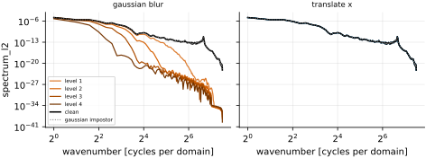
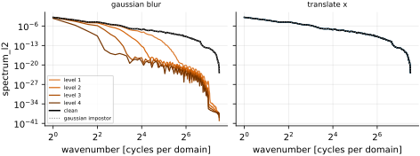
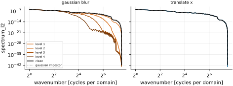
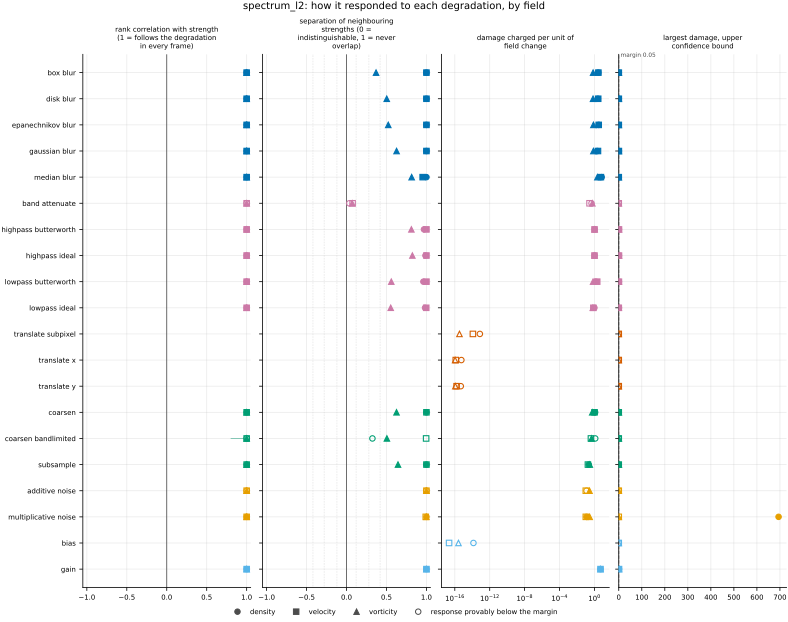
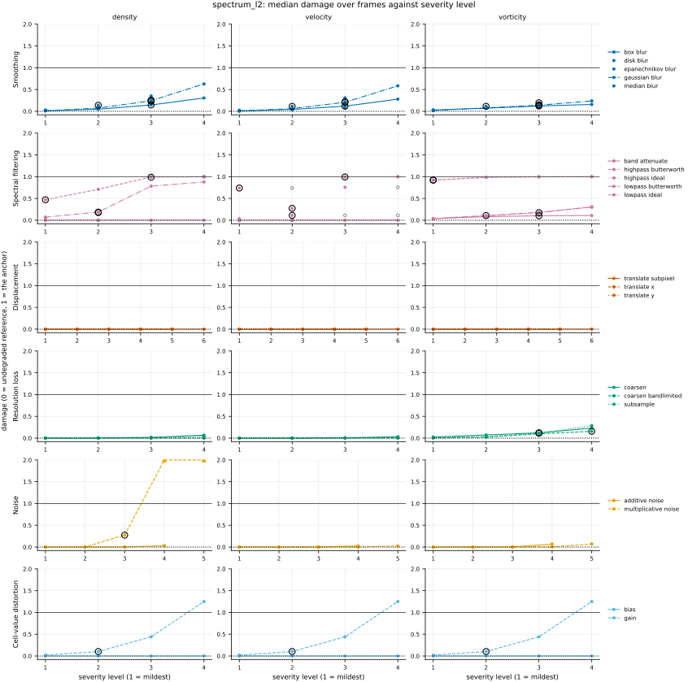
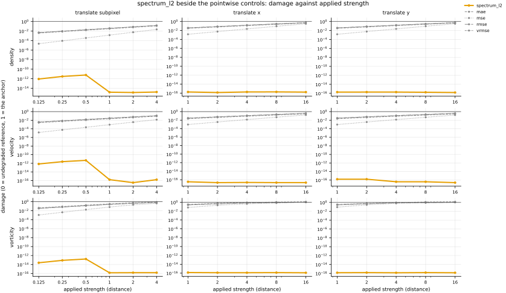
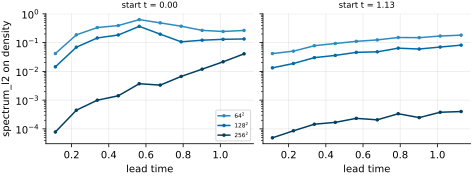
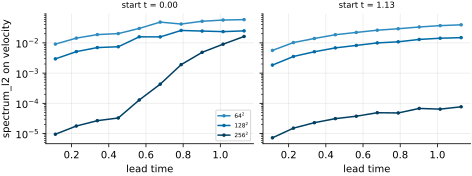
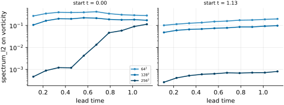

## Definition

Remove the spatial mean of each channel, transform, and sum the squared moduli into
unit-width shells of wavevector magnitude. Writing $\hat{f}^{(c)}_{\mathbf{m}}$ for the
transform of the mean-removed channel $c$ divided by the number of cells $M$, and
$|\mathbf{m}|$ for the magnitude of mode $\mathbf{m}$ in integer wavenumber units (cycles
across the domain), the energy spectrum is

$$
E_f(k) = \frac12 \sum_{c=1}^{C} \; \sum_{\mathrm{rint}(|\mathbf{m}|) = k}
\bigl| \hat{f}^{(c)}_{\mathbf{m}} \bigr|^2 \tag{1}
$$

where $k = 1, 2, \ldots$ and shell $k$ collects every mode with
$k - \tfrac12 \le |\mathbf{m}| < k + \tfrac12$. By Parseval's theorem the shells sum to half the
mean square of the fluctuation, $\sum_k E_f(k) = \tfrac12 \langle |f'|^2 \rangle$: for velocity
the kinetic energy per unit mass, $E = \tfrac12 \langle u^2 \rangle = \int E(k)\,dk$, of
[@boffetta2012], Equation (3), p. 430, whose isotropic spectrum is the shell average Equation
(1) discretises (see also [@alexakis2018], Equation (11), and [@pope2000], Chapter 6). For
vorticity the same sum is the enstrophy. On the 256 by 256 analysis grid there are 181 shells,
running to the corner mode at $|\mathbf{m}| = 181.02$. The metric is the L2 distance between
the reference's and the candidate's spectra, normalised by the reference's:

$$
S(f, g) = \frac{\bigl( \sum_{k} [ E_f(k) - E_g(k) ]^2 \bigr)^{1/2}}
{\bigl( \sum_{k} E_f(k)^2 \bigr)^{1/2}} \tag{2}
$$

and is NaN when the reference has no fluctuation energy, since Equation (2) then divides by
zero and there is no scale against which a difference could be relative. The constant
$\tfrac12$ and the division by $M$ cancel in Equation (2); they make Equation (1) the field's own
quantity. No source reduces two spectra to Equation (2): it is this repository's summary, and
on linear values it is decided by the few most energetic shells (`issues/136`).

The spectrum $E(k)$ at every shell is the metric's curve companion, the object its field draws.
It is stored for the candidate on the frames `report.error_map` names, and the analysis reads
it at the octave shells $k = 1, 2, 4, \ldots, 128$, each as a metric of its own.

Three points about Equation (1) are choices, not consequences.

The spatial mean is removed, so the $k = 0$ shell carries no energy and is left out. On this
data that is load-bearing rather than cosmetic: density's fluctuation is a few thousandths of
its mean of $1$, so its mean is two to three orders of magnitude larger than any fluctuation,
and a spectrum retaining it would compare two means and ignore the flow entirely.

The shells are unit-width bands. The magnitude $|\mathbf{m}|$ is the repository's one
definition, from `fmeval/wavenumbers.py`, and only the grouping is chosen here; grouping a
shared magnitude into shells cannot put a mode on two sides of one cutoff. Grouping modes by
their exact magnitude instead would give 5924 shells of a median 8 modes on this grid and make
Equation (2) nearly a mode-by-mode comparison. Every mode is kept, including the corners beyond
$|\mathbf{m}| = 128$, whose shells the square grid only partly fills, so the spectrum sums to
the field's fluctuation energy exactly. The spectrum falls across those corner shells because
they are incomplete, not because the field holds less energy there, and the figure draws them
as they are. [@alexakis2018], Equation (11), bins $k \le |\mathbf{m}| < k + 1$ instead of
rounding; on unit shells the two differ by half a shell in where each mode is counted.

The normalisation in Equation (2) is taken from the reference, which makes the metric
dimensionless and scale-free — multiplying both fields by a constant scales both spectra by
its square, and the ratio is unchanged — but also asymmetric. Swapping the arguments changes
the value, as it does for [nrmse](../../metrics/nrmse/card.md).

Equation (2) is a function of the moduli $|\hat{f}_{\mathbf{m}}|$ alone. Every phase is
discarded, and that is the metric's defining property rather than an approximation.

### Boundary handling

Periodic on every axis, inherited from the discrete Fourier transform in Equation (1). The
shells are in cycles across the domain, so they are circles in physical wavenumber only when
the domain is square; the analysis grid here is 256 by 256 with equal spacing, and on a
rectangular domain Equation (1) would group modes of different physical wavelength. The
shells depend only on the grid's shape and not on its spacing, so unlike
[h_minus_one](../../metrics/h_minus_one/card.md) this metric reads no length from the analysis grid and
its value is unchanged by a rescaling of the cell size.

It therefore declares `requires_periodic`, and the harness does not run it on a dataset with a
non-periodic axis, such as the Sod shock tube; it reports why in the run log.

### How its field reports it

Two fields compare energy spectra: turbulence, where the spectrum is a central object, and
machine-learned surrogates of fluid and weather models, which compare a prediction's spectrum
with the reference's.

- **Turbulence** computes the shell-summed spectrum $E(k)$ normalised so that it integrates to
  the kinetic energy ([@boffetta2012], Equation (3), p. 430; [@alexakis2018], Equation (11)).
  It draws $E(k)$ on log-log axes with the theoretical power laws overlaid: $k^{-5/3}$ and
  $k^{-3}$ for forced two-dimensional turbulence ([@boffetta2012], Equations (12)–(13),
  p. 431, and Fig. 11a), and $\kappa^{-5/3}$ for three-dimensional turbulence ([@pope2000],
  Figs. 6.13–6.14). It often also draws the spectrum compensated by the expected power law,
  $\epsilon^{-2/3} k^{5/3} E(k)$ or $k^3 E(k)$, on a linear axis, where an inertial range shows
  as a plateau ([@pope2000], Figs. 6.15 and 6.17; [@boffetta2012], Fig. 5a inset and Fig. 8).
  The numbers it reports beside the figure are the slope and the constant read off that plateau
  (the Kolmogorov constant $C = 6.0 \pm 0.4$ in [@boffetta2012], Fig. 5a), not a distance
  between two spectra. Its experiment is forced, statistically stationary turbulence with an
  inertial range.
- **Machine-learned surrogates** draw the prediction's spectrum over the reference's on log-log
  axes: [@kochkov2021], Fig. 2c, scaled by $k^5$, against a $2048^2$ reference simulation;
  [@rasp2024], Section 5.3 and Fig. 10, at lead times from 12 hours to 10 days against the
  ERA5 reanalysis, with no spectral score. Where a number is reported it is one of several
  forms: the absolute error of the $k^5$-scaled spectrum, without a stated formula
  ([@kochkov2021], Fig. 5); the root-mean-square error of the logarithm of the spectrum
  ([@stachenfeld2022], Section 5 and Fig. 2c–d); or the L2 distance between log spectra, used as
  the ground distance of a Wasserstein distance between samples ([@lienen2024], Section 6.3,
  Equation (7)). The binned spectral error of [@ohana2024], Appendix E.3, is not a comparison
  of spectra: it filters the difference of the two fields into three bands, so it sees phase,
  and is a band-limited pointwise error.

**What this bundle reports, and how it differs.** The curve companion is the field's object,
Equation (1), with the field's normalisation, at every shell. The figure draws it on log-log
axes, the reference's (the clean level) in black under each degraded curve, as both fields draw
it. It is not compensated: compensating presumes an inertial range and its exponent, which
`kinet_re5e4`, two-dimensional, unforced and decaying, has not established. The corner shells
beyond $k = 128$ are drawn as they are and fall off because they are incomplete (Definition).
The registered number, a linear relative L2 over shells, comes from no source (`issues/136`).
No source found reports a linear one; the logarithmic form of [@stachenfeld2022] and
[@lienen2024] is not built as a sibling, because a logarithm is undefined on the shells that
the anchor and the sharp low-pass filters empty, and no source says what to do there
(`issues/137`, `judgements/016`).

**The experiments here.** The field's experiment, forced stationary turbulence with an inertial
range, does not exist here:
[EXP-spectral_energy_flux-forced-2d-compressible-flux-loop](https://github.com/khegazy/pde_metrics/blob/main/proposals/EXP-spectral_energy_flux-forced-2d-compressible-flux-loop.md)
writes up the nearest one, forced two-dimensional compressible turbulence, and
[EXP-increment_flatness-isotropic-3d-turbulence-cutouts](https://github.com/khegazy/pde_metrics/blob/main/proposals/EXP-increment_flatness-isotropic-3d-turbulence-cutouts.md)
the three-dimensional one. The surrogates' test bed, rollouts of a model from many initial conditions,
is
[EXP-nrmse-rollouts-over-many-initial-conditions](https://github.com/khegazy/pde_metrics/blob/main/proposals/EXP-nrmse-rollouts-over-many-initial-conditions.md).
[EXP-spectral_energy_flux-graded-phase-randomisation](https://github.com/khegazy/pde_metrics/blob/main/proposals/EXP-spectral_energy_flux-graded-phase-randomisation.md)
is an axis this metric is blind to by construction, a null for it. The metric runs on the
degradation ladder on `kinet_re5e4`, on the forecasts of `forecast_re5e4` against their targets
and on the Reynolds ladder. It is not run on `synthetic_ensemble`, whose every axis leaves the
member mean's spectrum unchanged (reason under Results), or on `sod_shock_tube`, whose walls
rule out a periodic spectrum.

## Performance

<!-- GENERATED performance: written by `python -m fmeval.cards evidence spectrum_l2 --results results/comparison_1793846511 --results results/comparison_1793811840 --results results/comparison_1793846600`, do not edit -->



*As this metric's own field draws it.* The dense curve behind spectrum_l2 on density, at every coordinate the curve returns, on the frames and ladder entries report.error_map stored: the median over those frames at every stored strength, the clean curve in black, the anchor dashed and the impostor dotted where stored. Axes as the field draws them: log x, log y. Values are the literature's own, untransformed.



*As this metric's own field draws it.* The dense curve behind spectrum_l2 on velocity, at every coordinate the curve returns, on the frames and ladder entries report.error_map stored: the median over those frames at every stored strength, the clean curve in black, the anchor dashed and the impostor dotted where stored. Axes as the field draws them: log x, log y. Values are the literature's own, untransformed.



*As this metric's own field draws it.* The dense curve behind spectrum_l2 on vorticity, at every coordinate the curve returns, on the frames and ladder entries report.error_map stored: the median over those frames at every stored strength, the clean curve in black, the anchor dashed and the impostor dotted where stored. Axes as the field draws them: log x, log y. Values are the literature's own, untransformed.



Four measured statistics for spectrum_l2, one row per degradation grouped by family and one marker per field. From left: the rank correlation between the metric and the applied strength within a frame, with the line showing the resampling interval; the separation of neighbouring strengths as Cliff's delta, where 0 means the metric cannot tell one strength from the next and the faint ticks at 0.12, 0.28 and 0.42 are Vargha and Delaney's small, medium and large anchors, for scale and not as grades; the damage charged per unit of field change at the harshest strength; and the upper confidence bound on the largest damage, beside the fixed margin of 0.05. A hollow marker is a field and degradation on which that bound lies below the margin, so the response is provably small. A missing marker is a statistic the analysis withheld, as the rank correlation is on an axis the metric is invariant to.



Median damage over frames against severity level for spectrum_l2, one row per family of degradation and one column per field, on one shared scale. The solid grey line is damage 1, the anchor (by default the field's own mean); the dotted black line is the damage assigned to the fake prediction with the right spectrum, where the run included it. The hollow black ring marks the first level at which the metric has moved a tenth of the way to the anchor. Hollow grey markers are strengths excluded for repeating a milder one or for doing nothing. Degradations with three or fewer usable levels are drawn as markers only; points beyond 2 either side are drawn as triangles at the edge. Damage is negative where a degradation moves the metric away from the anchor, as noise raises a single-field quantity the field's mean sets to zero.

**Trend: does the response follow the degradation?**

| test family | field | degradations | rank correlation | fraction of frames in order | weakest gap between neighbouring strengths |
|---|---|---|---|---|---|
| Displacement | density | 3 | — | — | — |
| Displacement | velocity | 3 | — | — | — |
| Displacement | vorticity | 3 | — | — | — |
| Cell-value distortion | density | 2 | 1 | 1 | 1 |
| Cell-value distortion | velocity | 2 | 1 | 1 | 1 |
| Cell-value distortion | vorticity | 2 | 1 | 1 | 1 |
| Resolution loss | density | 3 | 1 | 0.522 to 1 | 0.662 to 1 |
| Resolution loss | velocity | 3 | 1 | 1 | 0.998 to 1 |
| Resolution loss | vorticity | 3 | 1 | 1 | 0.753 to 0.822 |
| Smoothing | density | 5 | 1 | 1 | 1 |
| Smoothing | velocity | 5 | 1 | 1 | 0.976 to 1 |
| Smoothing | vorticity | 5 | 1 | 1 | 0.685 to 0.908 |
| Spectral filtering | density | 5 | 1 | 1 | 0.518 to 0.994 |
| Spectral filtering | velocity | 5 | 1 | 1 | 0.538 to 1 |
| Spectral filtering | vorticity | 5 | 1 | 1 | 0.536 to 0.912 |
| Noise | density | 2 | 1 | 1 | 1 |
| Noise | velocity | 2 | 1 | 1 | 0.996 to 1 |
| Noise | vorticity | 2 | 1 | 1 | 1 |

**Reactivity: how far does it move?**

| test family | field | change from clean at the harshest strength | elasticity | first strength detected |
|---|---|---|---|---|
| Displacement | density | — | — | level — |
| Displacement | velocity | — | — | level — |
| Displacement | vorticity | — | — | level — |
| Cell-value distortion | density | — | 1.03 | level 2 |
| Cell-value distortion | velocity | — | 1.03 | level 2 |
| Cell-value distortion | vorticity | — | 1.03 | level 2 |
| Resolution loss | density | — | 2 to 2.3 | level — |
| Resolution loss | velocity | — | 2.03 to 4.74 | level — |
| Resolution loss | vorticity | — | 1.14 to 3.13 | level 3 |
| Smoothing | density | — | 1.77 to 1.88 | level 2 |
| Smoothing | velocity | — | 1.82 to 1.99 | level 2 |
| Smoothing | vorticity | — | 1 to 1.78 | level 2 |
| Spectral filtering | density | — | 0.72 to 14.3 | level 1 |
| Spectral filtering | velocity | — | 0.407 to 1.77 | level 1 |
| Spectral filtering | vorticity | — | 0.117 to 0.937 | level 1 |
| Noise | density | — | 1.14 to 1.64 | level 3 |
| Noise | velocity | — | 1.03 to 1.18 | level — |
| Noise | vorticity | — | 0.979 to 1.09 | level — |
| trap test: fake prediction, right spectrum | density | — | — | damage 2.75e-15 |
| trap test: fake prediction, right spectrum | velocity | — | — | damage 1.62e-16 |
| trap test: fake prediction, right spectrum | vorticity | — | — | damage 2.01e-16 |

**Consistency: how much does it vary from snapshot to snapshot?**

| test family | field | consistency, in the strength's units | snapshots per independent block |
|---|---|---|---|
| Displacement | density | — | 1 to 20 |
| Displacement | velocity | — | 3 to 21 |
| Displacement | vorticity | — | 1 to 17 |
| Cell-value distortion | density | 0.0448 | 1 to 21 |
| Cell-value distortion | velocity | 1.34e-16 | 1 |
| Cell-value distortion | vorticity | 7.72e-17 | 1 |
| Resolution loss | density | 0.948 to 2.84 | 17 to 19 |
| Resolution loss | velocity | 0.41 to 2.98 | 7 to 22 |
| Resolution loss | vorticity | 1.8 to 2.55 | 22 |
| Smoothing | density | 0.0137 to 0.0283 | 20 |
| Smoothing | velocity | 0.000434 to 0.0112 | 17 to 22 |
| Smoothing | vorticity | 0.0237 to 0.0533 | 22 |
| Spectral filtering | density | 0.0366 to 0.203 | 17 to 21 |
| Spectral filtering | velocity | 0.00324 to 0.181 | 18 to 22 |
| Spectral filtering | vorticity | 0.0524 to 0.178 | 22 |
| Noise | density | 0.000121 to 0.0305 | 1 to 20 |
| Noise | velocity | 0.00714 to 0.00813 | 1 |
| Noise | vorticity | 0.0178 to 0.0184 | 1 to 22 |

One row per family of degradation and physical field; a cell gives the range over the degradations in that family. **Trend.** The rank correlation is the Spearman correlation between the strength and how far the metric has moved from its value on the undegraded field of the same frame, in the one direction it moves under that degradation, computed inside a single frame. A value of 1 means every strength moved it further than the last in every frame, whichever way it moves; a response that scatters to both sides scores near 0. The fraction of frames in order counts the frames with no exception. The weakest gap is the smallest Mann-Whitney overlap between two neighbouring strengths across frames: 1 means they never overlap, 0.5 that they cannot be told apart. **Reactivity.** The change from clean is the median, at the harshest strength, of the departure from the undegraded value of the same frame over the size of that value: 0.3 means 30%. It does not exist for this metric, whose undegraded value is exactly zero; the damage below is its relative reading. The elasticity is the percentage change of that departure per percentage change in strength over the mildest strengths. First strength detected is the mildest at which the metric has moved a tenth of the way to the anchor; **damage** reads that 0-to-1 scale as a number. A dash means the measurement is not defined there. A metric's reactivity scales with the power it is expressed in: mean squared error's elasticity is twice root-mean-square error's, though the two carry the same information, so compare magnitudes across metrics with that in mind. **Consistency** is how much the response varies from snapshot to snapshot relative to its size, in the strength's units; the snapshots of one trajectory are correlated, and the last column is how many consecutive snapshots one independent block spans.

These tables report what was measured and grade none of the measurements. What the numbers mean for this metric is written in the subsections below, beside the test that produced each number.

**Profile.**

| field | selectivity | charges most for | charges least for | response provably below 0.05 at 90% on | elasticity to a sub-pixel shift, against severity (distance) | compute cost (x cheapest in this run) |
|---|---|---|---|---|---|---|
| density | 0.574 | `median_blur` | `translate_y` | `additive_noise` `band_attenuate` `bias` `coarsen_bandlimited` `translate_subpixel` `translate_x` `translate_y` | — | 22.4 |
| velocity | 0.568 | `median_blur` | `bias` | `additive_noise` `band_attenuate` `bias` `coarsen` `coarsen_bandlimited` `multiplicative_noise` `subsample` `translate_subpixel` `translate_x` `translate_y` | — | 37 |
| vorticity | 0.644 | `gain` | `translate_x` | `bias` `translate_subpixel` `translate_x` `translate_y` | — | 22.5 |

One row per physical field. **Selectivity** is how concentrated the metric's response is on a few degradations, measured per unit of field change: 0 means it charges every degradation the same, as mean squared error does by construction, and values toward 1 that one degradation carries most of it. **Charges most and least for** name the two ends of that profile. **Response provably below** lists degradations on which the upper confidence bound of the largest damage lies below the margin -- an equivalence test, so an entry says the response is provably small, not merely not significant; a dash means no degradation met the bound. **Elasticity** is the slope of log damage against log shift over the smallest shifts: 1 means damage grows in proportion to the shift, 2 with its square. **Compute cost** is wall-clock per evaluation over the cheapest metric and field in the same run.

<!-- END GENERATED performance -->

## Intuition

Any field can be broken into waves of different wavelengths. The energy spectrum says how
much of the field's total variation sits at each wavelength — how much is large sweeping
structure and how much is fine detail — and says nothing at all about where any of it is or
how it is arranged. This metric compares two such profiles and reports how different they
are, as a fraction of the reference's own size.

What it reveals is a prediction that has the wrong balance of scales: one that is too smooth
has lost energy at short wavelengths, one that is noisy has gained it there, and either shows
up here directly and in proportion. What it cannot reveal is anything about arrangement. Two
fields can have exactly the same profile of energy against wavelength and look completely
unrelated, because the information distinguishing them lives entirely in the alignment of the
waves rather than in their sizes.

That blindness is deliberate and is the reason this metric is in the repository. The
evaluation includes a fake prediction built to have the reference's exact energy profile with
its wave alignments randomised — a field that is obviously wrong to look at and that this
metric scores as perfect, exactly as it scores the reference itself. A suite in which every
metric shrugs that fake off is not a reassuring suite; it means the trap has nothing to
catch, and this metric is something for it to catch. On the run recorded under Results the
trap scores that fake prediction at damage 0, to round-off, on every field.

A worked example, four cells by four cells. On the left, a reference holding a single wave.
On the right, a prediction that is simply flat. The prediction has none of the reference's
energy, so the two profiles differ by the whole of the reference's, and the relative distance
is exactly one.

```
reference        candidate        spectrum_l2
 1  1  1  1      0 0 0 0
 0  0  0  0      0 0 0 0              1.0
-1 -1 -1 -1      0 0 0 0
 0  0  0  0      0 0 0 0
```

Now replace the flat prediction with the same wave shifted along the vertical axis by one
cell — a field that disagrees with the reference by one unit in every single cell.

```
reference        candidate        spectrum_l2    rms error
 1  1  1  1      0  0  0  0
 0  0  0  0      1  1  1  1           0.0          1.0
-1 -1 -1 -1      0  0  0  0
 0  0  0  0     -1 -1 -1 -1
```

This metric returns zero, because shifting a wave changes only its alignment and not its
size. The cell-by-cell root-mean-square error is 1, larger than the wave's own typical size
of 0.71.

What it ignores: where everything is. Position, arrangement, and the alignment of one scale
against another are all invisible to it.

## Reading the output

Dimensionless, zero and unbounded above. Lower is better. Zero means the two energy profiles
coincide, which is much weaker than the two fields coinciding. One is the value a prediction
with no fluctuation at all receives, so values approaching one mean the candidate has lost
most of its energy, and values above one mean it has more energy than the reference rather
than less. The damage anchor, the field's own spatial mean, is such a prediction, so the
damage this metric reports equals its raw value.

Because Equation (2) cancels any overall scaling, values are comparable across fields of
completely different magnitude, which is unusual here — density and vorticity can be read on
the same axis. Comparison across analysis-grid resolutions is not valid: the set of shells in
Equation (1) is fixed by the grid, so a finer grid contributes shells a coarser one does not
have.

The comparison that matters most is against a phase-sensitive metric on the same pair of
fields. A large value here means the balance of scales is wrong. A small value here says
almost nothing on its own, and should be read only as "the balance of scales is not the
problem".

The companion `spectrum_l2` is the curve behind the number: a `coordinate` column holding the
shell $k$ in cycles across the domain and a value holding $E(k)$ of Equation (1) there, in the
field's units squared, for the candidate (on the clean level, the reference). One value of it
is the energy per unit mass in that shell for velocity, the enstrophy in it for vorticity, and
half the variance in it for density; summed over shells it is half the fluctuation's mean
square. The whole curve is stored on the frames and ladder entries `report.error_map` names and
drawn in Performance. The tables read it at the octave shells 1, 2, 4, ..., 128 only, because
each coordinate the analysis reads costs seconds per field and a column on the card; the
octaves span the grid's scales evenly in the logarithm, as the figure's axis does. A worked
example by hand, from `test_metric.py`: on a 4 by 4 grid, one wave across the domain of
amplitude 1 plus the grid-scale alternation of amplitude 0.5 along the other axis has
$E = 0.25$ in shell 1, $0.125$ in shell 2 and nothing in shell 3, summing to 0.375, half its
mean square of 0.75; the wave alone scores $1/\sqrt 5 = 0.447$ against it, because it lacks
shell 2.

## Limitations

The metric assigns zero to fields that are not remotely alike, and this is not an edge case
but the common case for any prediction that has the right statistics and the wrong structure.
A translated copy and a phase-randomised impostor both score perfectly. Used alone it would
certify a useless model. The blindness is to phase specifically, not to arrangement in
general: shuffling the cells at random spreads a smooth field's energy evenly over every
wavenumber, and `test_metric.py` measures that at about 1, as far from the reference as a
flat prediction. `AGENTS.md` states
the general principle this instantiates: matching a spectrum is a weak constraint, and the
two-point correlation is the Fourier transform of this quantity, so running both is
not two independent checks.

A second, quieter failure comes from the linear normalisation in Equation (2). The sum is
dominated by whichever shells hold the most energy, and on this data that is a handful of very
low wavenumbers: on frames 2000, 6000 and 10000 of `kinet_re5e4`, shells 1 to 3 hold more than
99.7% of the denominator of Equation (2) for density and velocity, and every shell from 16 up
less than 5e-7 of it (`issues/136`, which shows the computation). It follows from Equation (2)
that a prediction that loses everything above shell 16 on those fields while keeping the
largest scales scores below about 7e-4, because the shells it ruined contributed little to the
norm in the first place. Vorticity, whose spectrum weighs the small scales more, is less
affected. The per-shell tables under "The curve behind the number" show what the number does
not; a logarithmic comparison would weigh the scales evenly and is not what this computes.

Third, a shell is blind to where inside it the energy sits. That is the purpose of shell
averaging, and it matters most at the lowest shells, which are the widest relative to their
wavenumber and hold the fewest modes. On this data it is not a corner case: shell 1 holds
both the axis modes at $|\mathbf{m}| = 1$ and the diagonal modes at $\sqrt 2$, and 69% of
density's fluctuation energy sits in the diagonal ones against 3e-5 in the axis ones
(`CLAUDE.md`, finding 5). A prediction that moved that energy from the diagonal modes to the
axis modes would score zero here; `test_metric.py` checks exactly that case.

## Results

<!-- GENERATED run: written by `python -m fmeval.cards evidence spectrum_l2 --results results/comparison_1793846511 --results results/comparison_1793811840 --results results/comparison_1793846600`, do not edit -->

Measured on `kinet_re5e4`, frames 2000 to 10000 (161 frames of developed flow), on the 256 analysis grid, seed 20260807, at commit `adbdc88e4950`. Run `comparison_1793846511`.

Every number in this section comes from that run, except in the subsections headed with another experiment and in a figure whose caption names another run, each of which names its own run. Regenerate with `python -m fmeval.cards evidence <name> --results results/comparison_1793846511 --results results/comparison_1793811840 --results results/comparison_1793846600`.

<!-- END GENERATED run -->

<!-- GENERATED experiments: written by `python -m fmeval.cards catalog`, do not edit -->

**Across the experiments.**

| experiment | what a run on it is evidence of | on this card |
|---|---|---|
| `kinet_re5e4` | developed flow | measured, run `comparison_1793846511`: the main results |
| `kinet_re1e6` | developed flow at Re = 1e6, twenty times the Reynolds number of kinet_re5e4, from the same initial condition | measured, run `comparison_1793846600`: under *On `kinet_re1e6`* |
| `synthetic_ensemble` | a calibrated null: evidence that the estimator computes what it claims to compute, and nothing about turbulence | not applicable: every axis there leaves the member mean's spectrum unchanged (dispersion scales members about their mean; a uniform bias leaves every fluctuation unchanged) |
| `sod_shock_tube` | an analytic check: evidence that the metric locates and scores a known shock correctly, and nothing about turbulence | not applicable: needs a periodic domain, and this dataset is not periodic |
| `forecast_re5e4` | real predictions scored against their targets at each prediction step; who produced the predictions, a trained model or a coarser solver, is not recorded | measured, run `comparison_1793811840`: under *On `forecast_re5e4`* |

One row per dataset a card may cite (`configs/cards/default.yaml`). *Measured* names the run the card cites: the main results are `## Performance` and the subsections below, and every other run has its own subsection headed with its dataset. *Not applicable* gives the reason: one that follows from what the metric declares and what the dataset offers, or one a person wrote on the card (`not_run` in `card.yaml`) because the result would carry no information. *Not yet run* means the metric can run there and the card cites no run on it yet.

<!-- END GENERATED experiments -->

### Smoothing

[gaussian_blur](../../degradations/gaussian_blur/card.md) ·
[box_blur](../../degradations/box_blur/card.md)

<!-- GENERATED results_smoothing: written by `python -m fmeval.cards evidence spectrum_l2 --results results/comparison_1793846511 --results results/comparison_1793811840 --results results/comparison_1793846600`, do not edit -->

| degradation | field | strengths | rank correlation | fraction of frames in the right order | weakest gap between neighbouring strengths |
|---|---|---|---|---|---|
| `box_blur` | density | 4 | 1 | 1 | 1 |
| `box_blur` | velocity | 4 | 1 | 1 | 1 |
| `box_blur` | vorticity | 4 | 1 | 1 | 0.685 |
| `disk_blur` | density | 3 | 1 | 1 | 1 |
| `disk_blur` | velocity | 3 | 1 | 1 | 1 |
| `disk_blur` | vorticity | 3 | 1 | 1 | 0.752 |
| `epanechnikov_blur` | density | 3 | 1 | 1 | 1 |
| `epanechnikov_blur` | velocity | 3 | 1 | 1 | 1 |
| `epanechnikov_blur` | vorticity | 3 | 1 | 1 | 0.761 |
| `gaussian_blur` | density | 4 | 1 | 1 | 1 |
| `gaussian_blur` | velocity | 4 | 1 | 1 | 1 |
| `gaussian_blur` | vorticity | 4 | 1 | 1 | 0.813 |
| `median_blur` | density | 3 | 1 | 1 | 1 |
| `median_blur` | velocity | 3 | 1 | 1 | 0.976 |
| `median_blur` | vorticity | 3 | 1 | 1 | 0.908 |

<!-- END GENERATED results_smoothing -->

Every smoothing axis is ordered in every frame on all three fields (rank correlation 1, every
frame in order). By our reading this follows from Equation (2) for an operator whose loss in
every shell grows with its strength. The median blur is not such an operator everywhere: at its
harshest strength it raises density's shells 16 and 32, by 0.693 and 0.799 of their clean
energy (the per-shell tables under "The curve behind the number"), and it is still ordered.
The size of the response is set by where the removed energy sat. Writing
$r(\kappa) = 1 - E_g(\kappa)/E_f(\kappa)$ for the fraction a candidate removes from shell
$\kappa$, Equation (2) is exactly
$S = \bigl(\sum_\kappa r(\kappa)^2 E_f(\kappa)^2 / \sum_\kappa E_f(\kappa)^2\bigr)^{1/2}$,
an average of the per-shell losses weighted by the *square* of each shell's energy. The largest
damage of `gaussian_blur`, over every frame and strength, is 0.696 on density, 0.594 on velocity
and 0.521 on vorticity. On density and velocity the harshest blur reaches the most energetic
shell: shell 1 loses 0.604 and 0.578 of its energy. On vorticity shell 1 loses only 0.0256, and
the response comes from shells 8 and up, which hold a larger share of vorticity's spectrum than
of the other fields' (the reference spectra under "The curve behind the number"). The weakest
separation in the family, 0.685 on `box_blur` applied to vorticity, is on that field.

### Spectral filtering

[lowpass_ideal](../../degradations/lowpass_ideal/card.md) ·
[highpass_ideal](../../degradations/highpass_ideal/card.md)

<!-- GENERATED results_spectral: written by `python -m fmeval.cards evidence spectrum_l2 --results results/comparison_1793846511 --results results/comparison_1793811840 --results results/comparison_1793846600`, do not edit -->

| degradation | field | strengths | rank correlation | fraction of frames in the right order | weakest gap between neighbouring strengths |
|---|---|---|---|---|---|
| `band_attenuate` | density | 4 | 1 | 1 | 0.518 |
| `band_attenuate` | velocity | 4 | 1 | 1 | 0.538 |
| `band_attenuate` | vorticity | 4 | 1 | 1 | 0.536 |
| `highpass_butterworth` | density | 4 | 1 | 1 | 0.985 |
| `highpass_butterworth` | velocity | 3 | 1 | 1 | 1 |
| `highpass_butterworth` | vorticity | 4 | 1 | 1 | 0.906 |
| `highpass_ideal` | density | 3 | 1 | 1 | 0.994 |
| `highpass_ideal` | velocity | 2 | 1 | 1 | 1 |
| `highpass_ideal` | vorticity | 4 | 1 | 1 | 0.912 |
| `lowpass_butterworth` | density | 4 | 1 | 1 | 0.981 |
| `lowpass_butterworth` | velocity | 3 | 1 | 1 | 1 |
| `lowpass_butterworth` | vorticity | 4 | 1 | 1 | 0.78 |
| `lowpass_ideal` | density | 3 | 1 | 1 | 0.991 |
| `lowpass_ideal` | velocity | 2 | 1 | 1 | 0.999 |
| `lowpass_ideal` | vorticity | 4 | 1 | 1 | 0.777 |

<!-- END GENERATED results_spectral -->

Ordered in every frame on every field, and this is the family where the energy-squared
weighting is most visible. Both high-pass filters empty shells 1 and 2 at their harshest
strength (a change from clean of -1 in the per-shell tables, on every field) and reach a largest
damage of 1, the value of a flat prediction, on every field. `band_attenuate` removes up to all
of shell 32 and about half of shells 16 and 64 (-0.523, -1 and -0.499 on density) and reaches
at most 0.000123 on density, 0.000707 on velocity and 0.192 on vorticity. On velocity,
`lowpass_ideal` empties every octave shell from 2 up while keeping shell 1 (-0.00959) and
reaches at most 0.123. Energy lost at the largest scales costs far more here than energy lost
at small scales, which is the Limitations point measured.

### Displacement

[translate_x](../../degradations/translate/card.md) ·
[translate_subpixel](../../degradations/translate_subpixel/card.md)

<!-- GENERATED results_geometric: written by `python -m fmeval.cards evidence spectrum_l2 --results results/comparison_1793846511 --results results/comparison_1793811840 --results results/comparison_1793846600`, do not edit -->

| degradation | field | strengths | rank correlation | fraction of frames in the right order | weakest gap between neighbouring strengths |
|---|---|---|---|---|---|
| `translate_subpixel` | density | 6 | — | — | — |
| `translate_subpixel` | velocity | 6 | — | — | — |
| `translate_subpixel` | vorticity | 6 | — | — | — |
| `translate_x` | density | 5 | — | — | — |
| `translate_x` | velocity | 5 | — | — | — |
| `translate_x` | vorticity | 5 | — | — | — |
| `translate_y` | density | 5 | — | — | — |
| `translate_y` | velocity | 5 | — | — | — |
| `translate_y` | vorticity | 5 | — | — | — |

<!-- END GENERATED results_geometric -->

Blind, as the definition requires. A whole-cell translation leaves every Fourier amplitude
unchanged: the largest damage of `translate_x` is 8.8e-16, 4.84e-16 and 4.62e-16 on density,
velocity and vorticity, round-off. The Fourier-shift interpolation of `translate_subpixel`
reaches at most 7.86e-11, 7.08e-11 and 9.52e-13, consistent with the fractional shift dropping
part of the grid's Nyquist mode (`issues/041`). Every ordering statistic in the table is
withheld on all three axes, because a ranking of those values is a ranking of the last bits of
floating-point arithmetic.

### Resolution loss

[coarsen](../../degradations/coarsen/card.md) ·
[coarsen_bandlimited](../../degradations/coarsen_bandlimited/card.md)

<!-- GENERATED results_resolution: written by `python -m fmeval.cards evidence spectrum_l2 --results results/comparison_1793846511 --results results/comparison_1793811840 --results results/comparison_1793846600`, do not edit -->

| degradation | field | strengths | rank correlation | fraction of frames in the right order | weakest gap between neighbouring strengths |
|---|---|---|---|---|---|
| `coarsen` | density | 4 | 1 | 1 | 1 |
| `coarsen` | velocity | 4 | 1 | 1 | 1 |
| `coarsen` | vorticity | 4 | 1 | 1 | 0.813 |
| `coarsen_bandlimited` | density | 4 | 1 | 0.522 | 0.662 |
| `coarsen_bandlimited` | velocity | 4 | 1 | 1 | 0.998 |
| `coarsen_bandlimited` | vorticity | 4 | 1 | 1 | 0.753 |
| `subsample` | density | 4 | 1 | 1 | 1 |
| `subsample` | velocity | 4 | 1 | 1 | 1 |
| `subsample` | vorticity | 4 | 1 | 1 | 0.822 |

<!-- END GENERATED results_resolution -->

All three axes have rank correlation 1 on every field, and every frame is in order except under
`coarsen_bandlimited` on density. Under `coarsen` the largest damage is 0.119 on density, 0.0426
on velocity and 0.455 on vorticity. In this family no strength's median reaches a tenth of the
way to the anchor on density or velocity (no first strength detected in the reactivity table),
and on vorticity the third does. The per-shell tables show the mechanism: block averaging lowers
the low shells and adds energy to the high ones, by 3.07, 73.2 and 113 times the clean energy at
shells 16, 32 and 64 of density, because the staircase's block edges put energy at small
scales, and those shells weigh little in Equation (2). `subsample` does the same and reaches at
most 0.0968, 0.0329 and 0.912.

`coarsen_bandlimited` empties the shells from 16 up instead (-1 in the per-shell tables) and
reaches at most 0.0147 on density, 0.00895 on velocity and 0.514 on vorticity, more than
`coarsen` on vorticity, whose spectrum gives the high shells more weight. Density is in the
right order in only 0.522 of frames under the band-limited operator, whose mildest factors
leave the value near round-off (its smallest value is 9.17e-10); `issues/039` records this
density pattern, which the pointwise metrics and `h1_seminorm` show as well.

### Noise

[additive_noise](../../degradations/additive_noise/card.md)

<!-- GENERATED results_stochastic: written by `python -m fmeval.cards evidence spectrum_l2 --results results/comparison_1793846511 --results results/comparison_1793811840 --results results/comparison_1793846600`, do not edit -->

| degradation | field | strengths | rank correlation | fraction of frames in the right order | weakest gap between neighbouring strengths |
|---|---|---|---|---|---|
| `additive_noise` | density | 4 | 1 | 1 | 1 |
| `additive_noise` | velocity | 4 | 1 | 1 | 1 |
| `additive_noise` | vorticity | 4 | 1 | 1 | 1 |
| `multiplicative_noise` | density | 5 | 1 | 1 | 1 |
| `multiplicative_noise` | velocity | 5 | 1 | 1 | 0.996 |
| `multiplicative_noise` | vorticity | 5 | 1 | 1 | 1 |

<!-- END GENERATED results_stochastic -->

Ordered in every frame, with neighbouring strengths separated in nearly every frame (weakest
gap 0.996 to 1). Additive noise reaches a largest damage of only 0.0406 on density, 0.0274 on
velocity and 0.0865 on vorticity, and the profile lists it among the degradations with a
provably small response on density and velocity. The per-shell tables show why: at its
harshest strength it raises density's shells 16, 32 and 64 by 45.9, 3.65e+03 and 3.07e+04 times
their clean energy, while shells 1 to 4 move by at most 0.00201 of theirs. White noise adds
energy to each shell in proportion to the number of modes in it, so most of it lands in the
high shells, where the energy-squared weight described under Smoothing is smallest.
Multiplicative noise on density is the exception, with a largest damage of 6.45e+03 and shell 1
raised by 1.11 times its clean energy. By our reading, noise proportional to the local value
scales with density's mean of about 1, two to three orders of magnitude larger than its
fluctuation (Definition), so it adds far more energy than the fluctuation holds.

### Cell-value distortion

[gain](../../degradations/gain/card.md) ·
[bias](../../degradations/bias/card.md)

<!-- GENERATED results_pointwise: written by `python -m fmeval.cards evidence spectrum_l2 --results results/comparison_1793846511 --results results/comparison_1793811840 --results results/comparison_1793846600`, do not edit -->

| degradation | field | strengths | rank correlation | fraction of frames in the right order | weakest gap between neighbouring strengths |
|---|---|---|---|---|---|
| `bias` | density | 4 | — | — | — |
| `bias` | velocity | 4 | — | — | — |
| `bias` | vorticity | 4 | — | — | — |
| `gain` | density | 4 | 1 | 1 | 1 |
| `gain` | velocity | 4 | 1 | 1 | 1 |
| `gain` | vorticity | 4 | 1 | 1 | 1 |

<!-- END GENERATED results_pointwise -->

`gain` is ordered in every frame on every field, with a largest damage of 1.25 on all three
fields. By our reading this is Equation (2) evaluated exactly: a gain of strength $a$
multiplies every shell's energy by $(1+a)^2$, so $S = (1+a)^2 - 1$ whatever the field or frame,
which is 1.25 at the harshest strength, 0.5, and 0.0201 at the mildest, 0.01, the smallest value
the run recorded on the axis. The metric is scale-free only when both fields are scaled
together (Definition); scaling the candidate alone is what it charges. `bias` leaves every
fluctuation unchanged, and Equation (1) removes the mean before the transform, so its largest
damage is 4.33e-14 on density, 4.9e-16 on velocity and 3.15e-16 on vorticity, round-off, and
every ordering statistic is withheld. On `kinet_re1e6` the two axes do the same: `gain` reaches
1.25 on every field and `bias` at most 4.32e-14.

### Trap tests

[gaussian_impostor](../../degradations/gaussian_impostor/card.md) ·
[uncorrelated](../../degradations/random_large_translation/card.md)

<!-- GENERATED results_canaries: written by `python -m fmeval.cards evidence spectrum_l2 --results results/comparison_1793846511 --results results/comparison_1793811840 --results results/comparison_1793846600`, do not edit -->

| field | damage assigned to the fake prediction | closest real degradation | damage of the reference moved far away | value on the anchor |
|---|---|---|---|---|
| density | 2.75e-15 | `bias=0.5` | 1.81e-16 | 1 |
| velocity | 1.62e-16 | `translate_subpixel=1` | 1.61e-16 | 1 |
| vorticity | 2.01e-16 | `translate_subpixel=2` | 1.59e-16 | 1 |

The fake prediction here has exactly the reference field's amplitude spectrum and completely scrambled structure. Damage 1 is what the anchor scores, by default the reference's own spatial mean, a prediction that knows the mean and nothing else. The damage column therefore says how close to useless this metric considers that fake prediction: a low number means the metric was fooled. The third column translates the same number into an ordinary degradation whose damage the fake prediction matches, which is easier to picture. The fourth is the reference moved by a large random offset, the right statistics in the wrong place; where a field's energy sits in its largest scales that copy stays partly correlated with the reference, so it is not the score of an unrelated field.

<!-- END GENERATED results_canaries -->

The trap catches this metric, as it was built to. The fake prediction has the reference's
exact Fourier amplitudes, and the metric scored it at damage 2.75e-15, 1.62e-16 and 2.01e-16 on
density, velocity and vorticity: zero to round-off, indistinguishable from the undegraded
reference. In the spectrum figures of Performance its dotted curve lies on the reference's.
The reference moved far away scores 1.59e-16 to 1.81e-16, round-off as well, because a
translation changes no Fourier amplitude.

### Compared with the other metrics

<!-- GENERATED results_summary: written by `python -m fmeval.cards evidence spectrum_l2 --results results/comparison_1793846511 --results results/comparison_1793811840 --results results/comparison_1793846600`, do not edit -->

| compared with | density | velocity | vorticity |
|---|---|---|---|
| `persistence_distance` | 0.914 | — | 0.88 |
| `spectral_energy_flux` | — | 0.896 | — |
| `increment_w1_by_separation` | 0.881 | 0.823 | 0.856 |
| `tail_exceedance` | 0.844 | 0.773 | 0.727 |
| `energy_distance` | 0.8 | 0.737 | 0.714 |
| `increment_w1` | 0.805 | 0.732 | 0.732 |
| `max_error` | 0.324 | 0.336 | 0.187 |
| `max_error_channel_mean` | 0.324 | 0.374 | 0.187 |
| `h_minus_one` | 0.246 | 0.401 | 0.284 |
| `nrmse` | 0.26 | 0.374 | 0.172 |
| `mse` | 0.26 | 0.361 | 0.171 |
| `vrmse` | 0.26 | 0.374 | 0.171 |
| `rmse` | 0.26 | 0.361 | 0.171 |
| `rmse_channel_mean` | 0.26 | 0.37 | 0.171 |
| `h1_relative` | 0.24 | 0.263 | -0.0648 |
| `wasserstein` | 0.239 | — | — |
| `h1_seminorm` | 0.23 | 0.227 | -0.0731 |
| `mae` | 0.218 | 0.349 | 0.134 |
| `tail_index` | -0.126 | -0.209 | -0.352 |
| `increment_flatness` | -0.327 | -0.326 | 0.435 |
| `palinstrophy` | — | — | -0.466 |
| `kinetic_energy` | — | -0.673 | — |
| `enstrophy` | — | — | -0.723 |

Rank correlation over every degradation, computed separately for each physical field on the median value at each combination of degradation and strength, with the undegraded reference excluded. A dash marks a metric that does not run on that field. A metric with a target value enters by its distance from the target. Two metrics correlating near 1 put the degradations in the same order, but the two may still weight those degradations very differently. A correlation near 1 therefore means the two metrics are redundant for ranking models, not that the two are interchangeable as training losses.

<!-- END GENERATED results_summary -->

Its closest correlates in the table are the metrics that compare distributions or spectra
rather than cell values: `persistence_distance` on density and vorticity, `spectral_energy_flux`
on velocity, then `increment_w1_by_separation`, `tail_exceedance`, `energy_distance` and
`increment_w1`. Its correlation with the pointwise family (`mae`, `mse`, `rmse`, `nrmse`,
`vrmse`, the channel means and `max_error`) is weak and positive on every field, so it orders
the ladder differently from them. By our reading, the negative correlations with `enstrophy`,
`palinstrophy` and `kinetic_energy` are orientation rather than disagreement: those are
single-field raw values that fall under the smoothing and filtering axes as this metric's
damage rises.

### Damage beside the other metrics

<!-- GENERATED results_damage_by_level: written by `python -m fmeval.cards evidence spectrum_l2 --results results/comparison_1793846511 --results results/comparison_1793811840 --results results/comparison_1793846600`, do not edit -->



Median damage over frames against the applied strength, log-log, for spectrum_l2 (bold, in colour) and the pointwise controls mae, mse, rmse, vrmse (thin, grey), one column per displacement degradation and one row per field. The grey line is damage 1, the anchor (by default the field's own mean). Parallel lines charge in the same proportion at every strength; a steeper line charges relatively more for the larger shifts, which is what decides whether two metrics are interchangeable as training losses. These are the same numbers as the table beneath.

**Displacement, density, `translate_subpixel`** (strength: distance).

| metric | 0.125 | 0.25 | 0.5 | 1 | 2 | 4 |
|---|---|---|---|---|---|---|
| `spectrum_l2` | 8.69e-13 | 2.97e-12 | 5.93e-12 | 1.48e-15 | 1.27e-15 | 1.61e-15 |
| `mae` | 0.00383 | 0.00767 | 0.0153 | 0.0306 | 0.061 | 0.121 |
| `mse` | 2.17e-05 | 8.68e-05 | 0.000347 | 0.00138 | 0.00551 | 0.0219 |
| `rmse` | 0.00466 | 0.00931 | 0.0186 | 0.0372 | 0.0743 | 0.148 |
| `vrmse` | 0.00463 | 0.00926 | 0.0185 | 0.037 | 0.0738 | 0.147 |

**Displacement, density, `translate_x`** (strength: distance).

| metric | 1 | 2 | 4 | 8 | 16 |
|---|---|---|---|---|---|
| `spectrum_l2` | 1.83e-16 | 1.38e-16 | 1.85e-16 | 1.89e-16 | 1.7e-16 |
| `mae` | 0.0306 | 0.061 | 0.121 | 0.24 | 0.469 |
| `mse` | 0.00138 | 0.00551 | 0.0219 | 0.0849 | 0.307 |
| `rmse` | 0.0372 | 0.0743 | 0.148 | 0.291 | 0.555 |
| `vrmse` | 0.037 | 0.0738 | 0.147 | 0.29 | 0.55 |

**Displacement, density, `translate_y`** (strength: distance).

| metric | 1 | 2 | 4 | 8 | 16 |
|---|---|---|---|---|---|
| `spectrum_l2` | 1.88e-16 | 1.9e-16 | 1.9e-16 | 1.72e-16 | 1.52e-16 |
| `mae` | 0.031 | 0.0616 | 0.122 | 0.244 | 0.476 |
| `mse` | 0.00142 | 0.00565 | 0.0224 | 0.0869 | 0.316 |
| `rmse` | 0.0377 | 0.0752 | 0.15 | 0.295 | 0.562 |
| `vrmse` | 0.0376 | 0.075 | 0.149 | 0.294 | 0.56 |

**Displacement, velocity, `translate_subpixel`** (strength: distance).

| metric | 0.125 | 0.25 | 0.5 | 1 | 2 | 4 |
|---|---|---|---|---|---|---|
| `spectrum_l2` | 7.06e-13 | 2.41e-12 | 4.82e-12 | 1.61e-16 | 3.27e-17 | 1.61e-16 |
| `mae` | 0.00279 | 0.00559 | 0.0112 | 0.0223 | 0.0441 | 0.0859 |
| `mse` | 1.45e-05 | 5.81e-05 | 0.000232 | 0.000924 | 0.0036 | 0.0136 |
| `rmse` | 0.00381 | 0.00762 | 0.0152 | 0.0304 | 0.06 | 0.117 |
| `vrmse` | 0.00365 | 0.00729 | 0.0146 | 0.029 | 0.0574 | 0.111 |

**Displacement, velocity, `translate_x`** (strength: distance).

| metric | 1 | 2 | 4 | 8 | 16 |
|---|---|---|---|---|---|
| `spectrum_l2` | 3.31e-17 | 2.08e-17 | 2.31e-17 | 2.12e-17 | 2.12e-17 |
| `mae` | 0.0223 | 0.0441 | 0.0859 | 0.163 | 0.31 |
| `mse` | 0.000924 | 0.0036 | 0.0136 | 0.0489 | 0.165 |
| `rmse` | 0.0304 | 0.06 | 0.117 | 0.221 | 0.406 |
| `vrmse` | 0.029 | 0.0574 | 0.111 | 0.209 | 0.383 |

**Displacement, velocity, `translate_y`** (strength: distance).

| metric | 1 | 2 | 4 | 8 | 16 |
|---|---|---|---|---|---|
| `spectrum_l2` | 1.6e-16 | 1.6e-16 | 4.04e-17 | 4.03e-17 | 2.54e-17 |
| `mae` | 0.0223 | 0.0442 | 0.0856 | 0.16 | 0.295 |
| `mse` | 0.000935 | 0.00366 | 0.0138 | 0.0473 | 0.158 |
| `rmse` | 0.0306 | 0.0605 | 0.117 | 0.218 | 0.397 |
| `vrmse` | 0.0303 | 0.0599 | 0.115 | 0.212 | 0.384 |

**Displacement, vorticity, `translate_subpixel`** (strength: distance).

| metric | 0.125 | 0.25 | 0.5 | 1 | 2 | 4 |
|---|---|---|---|---|---|---|
| `spectrum_l2` | 2.5e-14 | 8.54e-14 | 1.71e-13 | 1.46e-16 | 1.54e-16 | 1.53e-16 |
| `mae` | 0.0428 | 0.0854 | 0.169 | 0.328 | 0.582 | 0.86 |
| `mse` | 0.00112 | 0.00448 | 0.0176 | 0.066 | 0.21 | 0.44 |
| `rmse` | 0.0335 | 0.0669 | 0.133 | 0.257 | 0.458 | 0.663 |
| `vrmse` | 0.0329 | 0.0656 | 0.13 | 0.253 | 0.455 | 0.671 |

**Displacement, vorticity, `translate_x`** (strength: distance).

| metric | 1 | 2 | 4 | 8 | 16 |
|---|---|---|---|---|---|
| `spectrum_l2` | 1.35e-16 | 1.25e-16 | 1.24e-16 | 1.3e-16 | 1.2e-16 |
| `mae` | 0.328 | 0.582 | 0.86 | 1.1 | 1.31 |
| `mse` | 0.066 | 0.21 | 0.44 | 0.679 | 1.1 |
| `rmse` | 0.257 | 0.458 | 0.663 | 0.824 | 1.05 |
| `vrmse` | 0.253 | 0.455 | 0.671 | 0.832 | 1.05 |

**Displacement, vorticity, `translate_y`** (strength: distance).

| metric | 1 | 2 | 4 | 8 | 16 |
|---|---|---|---|---|---|
| `spectrum_l2` | 1.38e-16 | 1.45e-16 | 1.33e-16 | 1.46e-16 | 1.35e-16 |
| `mae` | 0.333 | 0.603 | 0.93 | 1.25 | 1.43 |
| `mse` | 0.0858 | 0.283 | 0.628 | 0.849 | 1.17 |
| `rmse` | 0.293 | 0.532 | 0.793 | 0.922 | 1.08 |
| `vrmse` | 0.268 | 0.495 | 0.793 | 0.927 | 1.08 |

Median damage over frames at every strength, this metric in the first row and the pointwise controls beneath it, all on the same 0-to-1 scale where 0 is the undegraded reference and 1 the anchor (by default the field's own mean); a dash means no damage scale on that field. The rank correlations under *Compared with the other metrics* say whether two metrics put the strengths in the same order; this table says how much each one charges for the same strength, which decides whether two metrics are interchangeable as training losses.

<!-- END GENERATED results_damage_by_level -->

On every displacement, at every strength and on every field, this metric's damage is round-off,
many orders of magnitude below the pointwise controls, whose damage grows with the shift. A
translation leaves the amplitude spectrum unchanged except for the part of the Nyquist mode a
fractional shift drops (`issues/041`), which puts the fractional strengths a few orders of
magnitude above the whole-cell ones, still near round-off. On displacement, then, this metric
charges nothing of what the pointwise controls charge, and there is no proportion between the
two to compare.

### The curve behind the number

<!-- GENERATED results_companion: written by `python -m fmeval.cards evidence spectrum_l2 --results results/comparison_1793846511 --results results/comparison_1793811840 --results results/comparison_1793846600`, do not edit -->

**density, rank correlation, at each coordinate.**

| degradation | 1 | 2 | 4 | 8 | 16 | 32 | 64 | 128 | dominance |
|---|---|---|---|---|---|---|---|---|---|
| `additive_noise` | 0.2 | 0.2 | 0.2 | 0.8 | 1 | 1 | 1 | 1 | 0.0497 |
| `band_attenuate` | — | — | — | — | 1 | 1 | — | — | 1 |
| `bias` | — | — | — | — | — | — | — | — | — |
| `box_blur` | 1 | 1 | 1 | 0.8 | 1 | — | — | — | 0 |
| `coarsen` | 1 | 1 | 1 | 1 | 0.2 | 0.8 | 1 | 1 | 0 |
| `coarsen_bandlimited` | 0.4 | 0.4 | 0.4 | 0.8 | 0.8 | 0.738 | -0.775 | — | 0.0497 |
| `disk_blur` | 1 | 1 | 1 | 0.5 | 1 | — | — | — | 0 |
| `epanechnikov_blur` | 1 | 1 | 1 | 1 | 1 | — | — | — | 1 |
| `gain` | 1 | 1 | 1 | 1 | 1 | 1 | 1 | — | 1 |
| `gaussian_blur` | 1 | 1 | 1 | 1 | 1 | — | — | — | 1 |
| `highpass_butterworth` | 1 | 1 | 1 | 1 | — | — | — | — | 1 |
| `highpass_ideal` | 0.866 | 0.866 | 1 | — | — | — | — | — | 1 |
| `lowpass_butterworth` | 1 | 1 | 1 | 1 | — | — | — | — | 1 |
| `lowpass_ideal` | 0.866 | 0.866 | 0.866 | — | — | — | — | — | 1 |
| `median_blur` | 1 | 1 | 1 | 1 | 0.5 | 0.5 | -1 | — | 0.304 |
| `multiplicative_noise` | 0.6 | 0.7 | 0.9 | 1 | 1 | 1 | 1 | 1 | 0.0994 |
| `subsample` | 1 | 1 | 1 | 0.4 | 0.4 | 0.8 | 1 | 1 | 0 |
| `translate_subpixel` | — | — | — | — | — | — | — | — | — |
| `translate_x` | — | — | — | — | — | — | — | — | — |
| `translate_y` | — | — | — | — | — | — | — | — | — |

**density, change from clean at the harshest strength, at each coordinate.**

| degradation | 1 | 2 | 4 | 8 | 16 | 32 | 64 | 128 |
|---|---|---|---|---|---|---|---|---|
| `additive_noise` | -0.00105 | 7.93e-05 | 0.00201 | 0.102 | 45.9 | 3.65e+03 | 3.07e+04 | — |
| `band_attenuate` | 1.13e-16 | -3.92e-16 | 1.38e-15 | -1.74e-15 | -0.523 | -1 | -0.499 | — |
| `bias` | -1.12e-15 | 0 | 1.23e-15 | 8.37e-15 | 4.51e-15 | 2.5e-16 | 2.82e-14 | — |
| `box_blur` | -0.265 | -0.478 | -0.976 | -0.99 | -0.999 | -1 | -1 | — |
| `coarsen` | -0.0499 | -0.0977 | -0.378 | -0.924 | 3.07 | 73.2 | 113 | — |
| `coarsen_bandlimited` | 8.86e-05 | 0.000162 | -0.00208 | -0.63 | -1 | -1 | -1 | — |
| `disk_blur` | -0.312 | -0.539 | -0.996 | -0.999 | -1 | -1 | -1 | — |
| `epanechnikov_blur` | -0.217 | -0.393 | -0.925 | -0.997 | -1 | -1 | -1 | — |
| `gain` | 1.25 | 1.25 | 1.25 | 1.25 | 1.25 | 1.25 | 1.25 | — |
| `gaussian_blur` | -0.604 | -0.844 | -1 | -1 | -1 | -1 | -1 | — |
| `highpass_butterworth` | -1 | -1 | -0.771 | -0.016 | -5.8e-05 | -2.22e-07 | -8.65e-10 | — |
| `highpass_ideal` | -1 | -1 | -0.59 | 1.49e-15 | 6.8e-15 | -5.99e-14 | -6.89e-14 | — |
| `lowpass_butterworth` | -0.87 | -0.999 | -1 | -1 | -1 | -1 | -1 | — |
| `lowpass_ideal` | -1 | -1 | -1 | -1 | -1 | -1 | -1 | — |
| `median_blur` | -0.218 | -0.36 | -0.611 | -0.766 | 0.693 | 0.799 | -0.106 | — |
| `multiplicative_noise` | 1.11 | 7.88 | 76.8 | 2.15e+03 | 1.1e+06 | 9.32e+07 | 7.4e+08 | — |
| `subsample` | -0.0307 | -0.0616 | -0.227 | -0.0236 | 10.1 | 113 | 156 | — |
| `translate_subpixel` | 1.33e-15 | -9.03e-16 | 5.64e-16 | -3.15e-15 | 1.82e-14 | -1.24e-13 | -8.95e-14 | — |
| `translate_x` | 0 | 0 | 0 | 0 | 0 | 0 | 0 | — |
| `translate_y` | 0 | 0 | 0 | 0 | -1.22e-16 | 3.49e-16 | 0 | — |

**velocity, rank correlation, at each coordinate.**

| degradation | 1 | 2 | 4 | 8 | 16 | 32 | 64 | 128 | dominance |
|---|---|---|---|---|---|---|---|---|---|
| `additive_noise` | 0.2 | 0.2 | 0.2 | 0.8 | 1 | 1 | 1 | 1 | 0.0124 |
| `band_attenuate` | — | — | — | — | 1 | 1 | 1 | — | 1 |
| `bias` | — | — | — | — | — | — | — | — | — |
| `box_blur` | 1 | 1 | 1 | 1 | 1 | 1 | 1 | — | 0.727 |
| `coarsen` | 1 | 1 | 1 | 1 | 0.8 | 0.2 | 1 | 1 | 0.0186 |
| `coarsen_bandlimited` | 0.4 | 0.4 | 0.4 | 0.4 | 0.4 | 0.738 | 0.775 | — | 0 |
| `disk_blur` | 1 | 1 | 1 | 1 | 0.5 | 1 | 0.5 | — | 0.0435 |
| `epanechnikov_blur` | 1 | 1 | 1 | 0.5 | 1 | 1 | — | — | 0.0559 |
| `gain` | 1 | 1 | 1 | 1 | 1 | 1 | 1 | 1 | 1 |
| `gaussian_blur` | 1 | 1 | 1 | 1 | 1 | 0.8 | — | — | 1 |
| `highpass_butterworth` | 1 | 1 | 1 | 1 | 1 | 1 | — | — | 1 |
| `highpass_ideal` | — | 1 | 1 | — | — | — | — | — | 1 |
| `lowpass_butterworth` | 1 | 1 | 1 | 1 | — | — | — | — | 1 |
| `lowpass_ideal` | 1 | 1 | — | — | — | — | — | — | 1 |
| `median_blur` | 1 | 1 | 1 | 1 | 1 | 1 | 1 | -1 | 0.0435 |
| `multiplicative_noise` | 0 | 0 | 0.1 | 0.6 | 0.9 | 0.9 | 1 | 1 | 0.0248 |
| `subsample` | 1 | 1 | 1 | 1 | 1 | -0.2 | 1 | 1 | 0.0248 |
| `translate_subpixel` | — | — | — | — | — | — | — | 0.6 | — |
| `translate_x` | — | — | — | — | — | — | — | — | — |
| `translate_y` | — | — | — | — | — | — | — | — | — |

**velocity, change from clean at the harshest strength, at each coordinate.**

| degradation | 1 | 2 | 4 | 8 | 16 | 32 | 64 | 128 |
|---|---|---|---|---|---|---|---|---|
| `additive_noise` | -0.00012 | 0.00223 | 0.00519 | 0.112 | 2.79 | 63.5 | 3.75e+03 | 3.27e+07 |
| `band_attenuate` | 0 | 0 | 0 | 0 | -0.502 | -1 | -0.513 | -3.27e-14 |
| `bias` | 0 | 0 | 0 | 0 | 0 | 0 | 1.21e-16 | 9.1e-15 |
| `box_blur` | -0.266 | -0.814 | -0.992 | -0.997 | -1 | -1 | -1 | -1 |
| `coarsen` | -0.0257 | -0.122 | -0.321 | -0.7 | -0.716 | -0.327 | 4.47 | 1.01e+04 |
| `coarsen_bandlimited` | -0.000198 | -0.00199 | -0.00753 | 0.0705 | -1 | -1 | -1 | -1 |
| `disk_blur` | -0.295 | -0.867 | -0.991 | -0.998 | -1 | -1 | -1 | -1 |
| `epanechnikov_blur` | -0.205 | -0.702 | -0.987 | -1 | -1 | -1 | -1 | -1 |
| `gain` | 1.25 | 1.25 | 1.25 | 1.25 | 1.25 | 1.25 | 1.25 | 1.25 |
| `gaussian_blur` | -0.578 | -0.986 | -1 | -1 | -1 | -1 | -1 | -1 |
| `highpass_butterworth` | -1 | -1 | -0.822 | -0.00842 | -3.36e-05 | -1.26e-07 | -4.89e-10 | -1.9e-12 |
| `highpass_ideal` | -1 | -1 | -0.601 | 0 | 0 | 0 | 0 | -2.47e-15 |
| `lowpass_butterworth` | -0.752 | -1 | -1 | -1 | -1 | -1 | -1 | -1 |
| `lowpass_ideal` | -0.00959 | -1 | -1 | -1 | -1 | -1 | -1 | -1 |
| `median_blur` | -0.063 | -0.311 | -0.513 | -0.844 | -0.935 | -0.973 | -0.893 | 224 |
| `multiplicative_noise` | -0.00014 | -0.00182 | 0.00558 | 0.104 | 2.72 | 59.5 | 3.85e+03 | 3.3e+07 |
| `subsample` | -0.0141 | -0.0601 | -0.15 | -0.482 | -0.55 | -0.0543 | 6.54 | 1.28e+04 |
| `translate_subpixel` | 0 | 0 | 0 | 0 | 0 | 0 | -1.52e-16 | -4.84e-15 |
| `translate_x` | 0 | 0 | 0 | 0 | 0 | 0 | 0 | 3.13e-16 |
| `translate_y` | 0 | 0 | 0 | 0 | 0 | 0 | 1.5e-16 | 1.21e-15 |

**vorticity, rank correlation, at each coordinate.**

| degradation | 1 | 2 | 4 | 8 | 16 | 32 | 64 | 128 | dominance |
|---|---|---|---|---|---|---|---|---|---|
| `additive_noise` | 0.2 | 0.2 | 0.2 | 0.4 | 0.4 | 0.8 | 1 | 1 | 0.0124 |
| `band_attenuate` | — | — | — | — | 1 | 1 | 1 | — | 1 |
| `bias` | — | — | — | — | — | — | — | — | — |
| `box_blur` | 1 | 1 | 1 | 1 | 1 | 0.8 | 1 | 1 | 0 |
| `coarsen` | 1 | 1 | 1 | 1 | 1 | 1 | 1 | -1 | 0 |
| `coarsen_bandlimited` | 0.2 | 0.2 | 0.4 | 0.4 | 0.4 | 0.738 | 0.775 | — | 0 |
| `disk_blur` | 1 | 1 | 1 | 1 | 1 | 0.5 | 1 | 1 | 0 |
| `epanechnikov_blur` | 1 | 1 | 1 | 1 | 1 | 1 | 1 | 1 | 1 |
| `gain` | 1 | 1 | 1 | 1 | 1 | 1 | 1 | 1 | 1 |
| `gaussian_blur` | 1 | 1 | 1 | 1 | 1 | 1 | 1 | 1 | 1 |
| `highpass_butterworth` | 0.949 | 0.949 | 1 | 1 | 1 | 1 | 1 | 1 | 1 |
| `highpass_ideal` | — | — | 0.775 | 0.949 | 0.894 | 0.775 | — | — | 1 |
| `lowpass_butterworth` | 1 | 1 | 1 | 1 | 1 | 1 | 1 | — | 1 |
| `lowpass_ideal` | — | — | — | 0.949 | 0.894 | 0.775 | — | — | 1 |
| `median_blur` | 1 | 1 | 1 | 1 | 1 | 1 | 1 | -1 | 0 |
| `multiplicative_noise` | 0 | 0 | 0 | 0 | 0.4 | 0.6 | 0.9 | 1 | 0 |
| `subsample` | 0.2 | 0.2 | 0.4 | 0.2 | 0.4 | 1 | 1 | -0.8 | 0 |
| `translate_subpixel` | — | — | — | — | — | — | — | — | — |
| `translate_x` | — | — | — | — | — | — | — | — | — |
| `translate_y` | — | — | — | — | — | — | — | — | — |

**vorticity, change from clean at the harshest strength, at each coordinate.**

| degradation | 1 | 2 | 4 | 8 | 16 | 32 | 64 | 128 |
|---|---|---|---|---|---|---|---|---|
| `additive_noise` | -0.00105 | -0.00152 | -0.00147 | 0.00888 | 0.039 | 0.203 | 3.03 | 6.55e+03 |
| `band_attenuate` | 0 | 0 | 0 | 0 | -0.516 | -1 | -0.509 | -3.66e-16 |
| `bias` | 0 | 0 | 0 | 0 | 0 | 0 | 0 | 0 |
| `box_blur` | -0.00856 | -0.0414 | -0.12 | -0.43 | -0.931 | -0.988 | -1 | -1 |
| `coarsen` | -0.0261 | -0.117 | -0.296 | -0.83 | -0.965 | -0.986 | -0.975 | 10.3 |
| `coarsen_bandlimited` | -0.000328 | 0.00402 | 0.0352 | -0.288 | -1 | -1 | -1 | -1 |
| `disk_blur` | -0.0104 | -0.05 | -0.144 | -0.499 | -0.975 | -0.997 | -0.999 | -1 |
| `epanechnikov_blur` | -0.00673 | -0.0327 | -0.0951 | -0.353 | -0.852 | -0.997 | -1 | -1 |
| `gain` | 1.25 | 1.25 | 1.25 | 1.25 | 1.25 | 1.25 | 1.25 | 1.25 |
| `gaussian_blur` | -0.0256 | -0.12 | -0.317 | -0.803 | -0.998 | -1 | -1 | -1 |
| `highpass_butterworth` | -1 | -1 | -1 | -1 | -1 | -0.988 | -0.0619 | -0.000253 |
| `highpass_ideal` | -1 | -1 | -1 | -1 | -1 | -1 | 0 | 0 |
| `lowpass_butterworth` | -1.05e-05 | -0.0051 | -0.322 | -1 | -1 | -1 | -1 | -1 |
| `lowpass_ideal` | 0 | 0 | 0 | -1 | -1 | -1 | -1 | -1 |
| `median_blur` | -0.21 | 0.0478 | 0.0391 | -0.202 | -0.519 | -0.806 | -0.913 | 14.6 |
| `multiplicative_noise` | -0.00278 | -0.00405 | -0.000789 | 0.00445 | 0.0354 | 0.226 | 2.97 | 6.52e+03 |
| `subsample` | -0.059 | -0.107 | -0.13 | 0.137 | -0.865 | -0.94 | -0.902 | 35.3 |
| `translate_subpixel` | 0 | 0 | 0 | 0 | 0 | 0 | 0 | 1.19e-16 |
| `translate_x` | 0 | 0 | 0 | 0 | 0 | 0 | 0 | -1.27e-16 |
| `translate_y` | 0 | 0 | 0 | 0 | 0 | 0 | 0 | 0 |

Each coordinate of the curve read as a metric of its own, with the same statistics as the tables above and no resampling interval. Neighbouring coordinates are strongly correlated, so a row localises the evidence and does not multiply it. **Dominance** is the fraction of frames in which, for the weakest pair of neighbouring strengths, the harsher strength's curve has moved at least as far as the milder one's at every coordinate, each in its own direction: near 1, any summary that grows with every coordinate's departure orders those strengths the same way, so the choice of summary cannot change the trend. None of these numbers enters the tables above.

<!-- END GENERATED results_companion -->

The field-standard figures in Performance draw $E(k)$ on log-log axes. The reference's spectrum
falls steeply with the shell. At the octave shells, as the fingerprint records the reference's
value, density's falls from 1.55e-05 at shell 1 to 3.91e-12 at shell 32, velocity's from 0.00134
to 1.93e-08, and vorticity's only from 8.17e-07 to 1.19e-08. By our reading, that is why the
energy-squared weight of Equation (2) discounts small-scale damage least on vorticity. No
power law is drawn over the spectra and none is read: the card does not compensate the spectrum
(see "How its field reports it"). The fake prediction's dotted curve lies on the reference's, and
each strength of the Gaussian blur falls below the reference from the high shells down.

Read shell by shell, the tables show where each operator acts. The blurs and low-pass filters
lower the shells they reach. The high-pass filters empty shells 1 and 2 on every field. Noise
raises the high shells by orders of magnitude and changes shells 1 to 4 by at most 0.00519 of
their clean energy. `coarsen` and `subsample` lower the low shells and raise the high ones, so
their direction changes along the curve. Dominance is 1 for the Gaussian blur and for both
low-pass and both high-pass filters on every field: there, any summary that grows with each
shell's departure orders their strengths as Equation (2) does. It is 0 to 0.0186 for `coarsen`,
0 for `box_blur` and `disk_blur` on density and vorticity, and 0.0124 to 0.0497 for additive
noise. There, the order of neighbouring strengths can depend on how the shells are summarised
(`issues/136`).

### On `forecast_re5e4`

<!-- GENERATED results_on_forecast_re5e4: written by `python -m fmeval.cards evidence spectrum_l2 --results results/comparison_1793846511 --results results/comparison_1793811840 --results results/comparison_1793846600`, do not edit -->

**Real predictions scored against their targets at each prediction step; who produced the predictions, a trained model or a coarser solver, is not recorded.**

Measured on `forecast_re5e4`, frames 0 to 59 (60 frames of real predictions scored against their targets at each prediction step; who produced the predictions, a trained model or a coarser solver, is not recorded), on the 64 analysis grid, seed 20260807, at commit `adbdc88e4950`. Run `comparison_1793811840`.

[mean_field](../../degradations/mean_field/card.md)



spectrum_l2 on density against lead time, the physical time since the forecast started, one panel per start and one line per run, darker the finer the run's grid. Each point is one prediction step of one forecast.



spectrum_l2 on velocity against lead time, the physical time since the forecast started, one panel per start and one line per run, darker the finer the run's grid. Each point is one prediction step of one forecast.



spectrum_l2 on vorticity against lead time, the physical time since the forecast started, one panel per start and one line per run, darker the finer the run's grid. Each point is one prediction step of one forecast.

**density, spectrum_l2 on the prediction, at each lead time.**

| lead time | 64², start 0 | 128², start 0 | 256², start 0 | 64², start 1.13 | 128², start 1.13 | 256², start 1.13 |
|---|---|---|---|---|---|---|
| 0.1128 | 0.0417 | 0.0144 | 7.79e-05 | 0.0417 | 0.0133 | 4.89e-05 |
| 0.2255 | 0.186 | 0.0694 | 0.000446 | 0.0505 | 0.0188 | 8.58e-05 |
| 0.3383 | 0.334 | 0.145 | 0.000997 | 0.078 | 0.03 | 0.000145 |
| 0.4511 | 0.392 | 0.185 | 0.00141 | 0.0934 | 0.036 | 0.000169 |
| 0.5638 | 0.631 | 0.368 | 0.00372 | 0.111 | 0.0459 | 0.000233 |
| 0.6766 | 0.486 | 0.197 | 0.00333 | 0.124 | 0.0478 | 0.000206 |
| 0.7893 | 0.372 | 0.107 | 0.00668 | 0.151 | 0.0642 | 0.000336 |
| 0.9021 | 0.267 | 0.121 | 0.0119 | 0.149 | 0.0599 | 0.000247 |
| 1.015 | 0.244 | 0.13 | 0.0215 | 0.17 | 0.0702 | 0.000379 |
| 1.128 | 0.265 | 0.134 | 0.0408 | 0.182 | 0.0818 | 0.000401 |

**density, spectrum_l2 damage, at each lead time.**

| lead time | 64², start 0 | 128², start 0 | 256², start 0 | 64², start 1.13 | 128², start 1.13 | 256², start 1.13 |
|---|---|---|---|---|---|---|
| 0.1128 | 0.0417 | 0.0144 | 7.79e-05 | 0.0417 | 0.0133 | 4.89e-05 |
| 0.2255 | 0.186 | 0.0694 | 0.000446 | 0.0505 | 0.0188 | 8.58e-05 |
| 0.3383 | 0.334 | 0.145 | 0.000997 | 0.078 | 0.03 | 0.000145 |
| 0.4511 | 0.392 | 0.185 | 0.00141 | 0.0934 | 0.036 | 0.000169 |
| 0.5638 | 0.631 | 0.368 | 0.00372 | 0.111 | 0.0459 | 0.000233 |
| 0.6766 | 0.486 | 0.197 | 0.00333 | 0.124 | 0.0478 | 0.000206 |
| 0.7893 | 0.372 | 0.107 | 0.00668 | 0.151 | 0.0642 | 0.000336 |
| 0.9021 | 0.267 | 0.121 | 0.0119 | 0.149 | 0.0599 | 0.000247 |
| 1.015 | 0.244 | 0.13 | 0.0215 | 0.17 | 0.0702 | 0.000379 |
| 1.128 | 0.265 | 0.134 | 0.0408 | 0.182 | 0.0818 | 0.000401 |

**velocity, spectrum_l2 on the prediction, at each lead time.**

| lead time | 64², start 0 | 128², start 0 | 256², start 0 | 64², start 1.13 | 128², start 1.13 | 256², start 1.13 |
|---|---|---|---|---|---|---|
| 0.1128 | 0.0091 | 0.00296 | 9.54e-06 | 0.00563 | 0.00184 | 7.26e-06 |
| 0.2255 | 0.0143 | 0.00514 | 1.78e-05 | 0.0102 | 0.00354 | 1.52e-05 |
| 0.3383 | 0.0187 | 0.00698 | 2.68e-05 | 0.014 | 0.00508 | 2.29e-05 |
| 0.4511 | 0.0203 | 0.00743 | 3.29e-05 | 0.0186 | 0.00682 | 3.12e-05 |
| 0.5638 | 0.03 | 0.0158 | 0.000129 | 0.0221 | 0.00822 | 3.76e-05 |
| 0.6766 | 0.0485 | 0.0157 | 0.000431 | 0.0262 | 0.00996 | 4.9e-05 |
| 0.7893 | 0.0419 | 0.0257 | 0.00191 | 0.0293 | 0.0108 | 4.82e-05 |
| 0.9021 | 0.0517 | 0.0245 | 0.00487 | 0.0334 | 0.013 | 6.79e-05 |
| 1.015 | 0.0568 | 0.0235 | 0.00905 | 0.0371 | 0.0142 | 6.45e-05 |
| 1.128 | 0.0587 | 0.0249 | 0.0163 | 0.0395 | 0.0149 | 7.69e-05 |

**velocity, spectrum_l2 damage, at each lead time.**

| lead time | 64², start 0 | 128², start 0 | 256², start 0 | 64², start 1.13 | 128², start 1.13 | 256², start 1.13 |
|---|---|---|---|---|---|---|
| 0.1128 | 0.0091 | 0.00296 | 9.54e-06 | 0.00563 | 0.00184 | 7.26e-06 |
| 0.2255 | 0.0143 | 0.00514 | 1.78e-05 | 0.0102 | 0.00354 | 1.52e-05 |
| 0.3383 | 0.0187 | 0.00698 | 2.68e-05 | 0.014 | 0.00508 | 2.29e-05 |
| 0.4511 | 0.0203 | 0.00743 | 3.29e-05 | 0.0186 | 0.00682 | 3.12e-05 |
| 0.5638 | 0.03 | 0.0158 | 0.000129 | 0.0221 | 0.00822 | 3.76e-05 |
| 0.6766 | 0.0485 | 0.0157 | 0.000431 | 0.0262 | 0.00996 | 4.9e-05 |
| 0.7893 | 0.0419 | 0.0257 | 0.00191 | 0.0293 | 0.0108 | 4.82e-05 |
| 0.9021 | 0.0517 | 0.0245 | 0.00487 | 0.0334 | 0.013 | 6.79e-05 |
| 1.015 | 0.0568 | 0.0235 | 0.00905 | 0.0371 | 0.0142 | 6.45e-05 |
| 1.128 | 0.0587 | 0.0249 | 0.0163 | 0.0395 | 0.0149 | 7.69e-05 |

**vorticity, spectrum_l2 on the prediction, at each lead time.**

| lead time | 64², start 0 | 128², start 0 | 256², start 0 | 64², start 1.13 | 128², start 1.13 | 256², start 1.13 |
|---|---|---|---|---|---|---|
| 0.1128 | 0.271 | 0.106 | 0.000464 | 0.102 | 0.0483 | 0.00026 |
| 0.2255 | 0.349 | 0.163 | 0.000881 | 0.115 | 0.06 | 0.000408 |
| 0.3383 | 0.398 | 0.203 | 0.0012 | 0.126 | 0.0662 | 0.000518 |
| 0.4511 | 0.391 | 0.2 | 0.00118 | 0.135 | 0.0691 | 0.000595 |
| 0.5638 | 0.397 | 0.223 | 0.0042 | 0.15 | 0.0745 | 0.000632 |
| 0.6766 | 0.423 | 0.215 | 0.0133 | 0.159 | 0.0777 | 0.000698 |
| 0.7893 | 0.346 | 0.189 | 0.0466 | 0.174 | 0.0855 | 0.000678 |
| 0.9021 | 0.308 | 0.18 | 0.0582 | 0.177 | 0.0856 | 0.000708 |
| 1.015 | 0.293 | 0.185 | 0.0899 | 0.189 | 0.0931 | 0.000712 |
| 1.128 | 0.284 | 0.172 | 0.114 | 0.199 | 0.0977 | 0.000806 |

**vorticity, spectrum_l2 damage, at each lead time.**

| lead time | 64², start 0 | 128², start 0 | 256², start 0 | 64², start 1.13 | 128², start 1.13 | 256², start 1.13 |
|---|---|---|---|---|---|---|
| 0.1128 | 0.271 | 0.106 | 0.000464 | 0.102 | 0.0483 | 0.00026 |
| 0.2255 | 0.349 | 0.163 | 0.000881 | 0.115 | 0.06 | 0.000408 |
| 0.3383 | 0.398 | 0.203 | 0.0012 | 0.126 | 0.0662 | 0.000518 |
| 0.4511 | 0.391 | 0.2 | 0.00118 | 0.135 | 0.0691 | 0.000595 |
| 0.5638 | 0.397 | 0.223 | 0.0042 | 0.15 | 0.0745 | 0.000632 |
| 0.6766 | 0.423 | 0.215 | 0.0133 | 0.159 | 0.0777 | 0.000698 |
| 0.7893 | 0.346 | 0.189 | 0.0466 | 0.174 | 0.0855 | 0.000678 |
| 0.9021 | 0.308 | 0.18 | 0.0582 | 0.177 | 0.0856 | 0.000708 |
| 1.015 | 0.293 | 0.185 | 0.0899 | 0.189 | 0.0931 | 0.000712 |
| 1.128 | 0.284 | 0.172 | 0.114 | 0.199 | 0.0977 | 0.000806 |

Every prediction of every forecast, nothing pooled: a cell is one prediction step of one forecast, a row the lead time (the physical time since the forecast started) and a column the forecast, named by its run's native grid and its starting time (`64², start 0` is `F-906861_64_Re_50k_from_256_to_64/forecast_t0-0`; `128², start 0` is `F-906861_64_Re_50k_from_256_to128/forecast_t0-0`; `256², start 0` is `F-906861_64/forecast_t0-0`; `64², start 1.13` is `F-906861_64_Re_50k_from_256_to_64/forecast_t0-1250`; `128², start 1.13` is `F-906861_64_Re_50k_from_256_to128/forecast_t0-2500`; `256², start 1.13` is `F-906861_64/forecast_t0-5000`). **Damage** is the prediction's departure from the target as a fraction of the anchor's in the same frame, by default the target's own spatial mean, so each step is scaled by its own target. A dash means no value there.

<!-- END GENERATED results_on_forecast_re5e4 -->

The surrogate literature draws each forecast's spectrum over its target's at several lead
times ([@rasp2024], Fig. 10; [@kochkov2021], Fig. 2c). This card stores the forecasts' spectra
only through the number, so it reads the number at each step, for its growth along the rollout,
the order of the runs and its distance from no skill (our summary of how such a figure is read,
as the pointwise cards read theirs). The damage equals the value at every step, because the
anchor scores 1 (Reading the output).

- **Order.** At every lead time, from both starts and on every field, the forecast on the
  finest native grid scores lowest and the one on the coarsest highest: 64² above 128² above
  256².
- **Growth.** From start 1.13 the damage grows along every rollout, with small reversals
  (density at 64²: 0.151 at lead 0.7893, then 0.149). From start 0 the 256² forecast grows by
  orders of magnitude, from 7.79e-05 to 0.0408 on density, from 9.54e-06 to 0.0163 on velocity
  and from 0.000464 to 0.114 on vorticity. The 64² and 128² forecasts from start 0 peak
  mid-rollout on density (0.631 and 0.368 at lead 0.5638) and on vorticity, and then fall.
- **Distance from no skill.** The largest damage over every step is 0.631 on density, 0.0587 on
  velocity and 0.423 on vorticity, all below the 1 of a flat prediction. Velocity's spectrum
  stays closest to its target's.

### On `kinet_re1e6`

<!-- GENERATED results_on_kinet_re1e6: written by `python -m fmeval.cards evidence spectrum_l2 --results results/comparison_1793846511 --results results/comparison_1793811840 --results results/comparison_1793846600`, do not edit -->

**Developed flow at Re = 1e6, twenty times the Reynolds number of kinet_re5e4, from the same initial condition.**

Measured on `kinet_re1e6`, frames 2000 to 10000 (161 frames of developed flow at Re = 1e6, twenty times the Reynolds number of kinet_re5e4, from the same initial condition), on the 128 analysis grid, seed 20260807, at commit `adbdc88e4950`. Run `comparison_1793846600`.

[additive_noise](../../degradations/additive_noise/card.md) ·
[band_attenuate](../../degradations/band_attenuate/card.md) ·
[bias](../../degradations/bias/card.md) ·
[box_blur](../../degradations/box_blur/card.md) ·
[coarsen](../../degradations/coarsen/card.md) ·
[coarsen_bandlimited](../../degradations/coarsen_bandlimited/card.md) ·
[disk_blur](../../degradations/disk_blur/card.md) ·
[epanechnikov_blur](../../degradations/epanechnikov_blur/card.md) ·
[gain](../../degradations/gain/card.md) ·
[gaussian_blur](../../degradations/gaussian_blur/card.md) ·
[gaussian_impostor](../../degradations/gaussian_impostor/card.md) ·
[highpass_butterworth](../../degradations/highpass_butterworth/card.md) ·
[highpass_ideal](../../degradations/highpass_ideal/card.md) ·
[lowpass_butterworth](../../degradations/lowpass_butterworth/card.md) ·
[lowpass_ideal](../../degradations/lowpass_ideal/card.md) ·
[mean_field](../../degradations/mean_field/card.md) ·
[median_blur](../../degradations/median_blur/card.md) ·
[multiplicative_noise](../../degradations/multiplicative_noise/card.md) ·
[subsample](../../degradations/subsample/card.md) ·
[translate_subpixel](../../degradations/translate_subpixel/card.md) ·
[translate_x](../../degradations/translate/card.md) ·
[translate_y](../../degradations/translate/card.md) ·
[uncorrelated](../../degradations/random_large_translation/card.md)

**Smoothing.**

| degradation | field | strengths | rank correlation | fraction of frames in the right order | weakest gap between neighbouring strengths |
|---|---|---|---|---|---|
| `box_blur` | density | 4 | 1 | 1 | 1 |
| `box_blur` | velocity | 4 | 1 | 1 | 1 |
| `box_blur` | vorticity | 2 | 1 | 1 | 0.807 |
| `disk_blur` | density | 3 | 1 | 1 | 1 |
| `disk_blur` | velocity | 3 | 1 | 1 | 1 |
| `disk_blur` | vorticity | 2 | 1 | 1 | 0.777 |
| `epanechnikov_blur` | density | 3 | 1 | 1 | 1 |
| `epanechnikov_blur` | velocity | 3 | 1 | 1 | 1 |
| `epanechnikov_blur` | vorticity | 2 | 1 | 1 | 0.838 |
| `gaussian_blur` | density | 4 | 1 | 1 | 1 |
| `gaussian_blur` | velocity | 4 | 1 | 1 | 1 |
| `gaussian_blur` | vorticity | 4 | 1 | 1 | 0.842 |
| `median_blur` | density | 3 | 1 | 1 | 1 |
| `median_blur` | velocity | 3 | 1 | 1 | 0.978 |
| `median_blur` | vorticity | 1 | — | — | — |

**Spectral filtering.**

| degradation | field | strengths | rank correlation | fraction of frames in the right order | weakest gap between neighbouring strengths |
|---|---|---|---|---|---|
| `band_attenuate` | density | 4 | 1 | 1 | 0.523 |
| `band_attenuate` | velocity | 4 | 1 | 1 | 0.539 |
| `band_attenuate` | vorticity | 4 | 1 | 1 | 0.545 |
| `highpass_butterworth` | density | 4 | 1 | 1 | 0.985 |
| `highpass_butterworth` | velocity | 3 | 1 | 1 | 1 |
| `highpass_butterworth` | vorticity | 4 | 1 | 1 | 0.937 |
| `highpass_ideal` | density | 3 | 1 | 1 | 0.991 |
| `highpass_ideal` | velocity | 2 | 1 | 1 | 1 |
| `highpass_ideal` | vorticity | 4 | 1 | 1 | 0.933 |
| `lowpass_butterworth` | density | 4 | 1 | 1 | 0.997 |
| `lowpass_butterworth` | velocity | 3 | 1 | 1 | 1 |
| `lowpass_butterworth` | vorticity | 4 | 1 | 1 | 0.802 |
| `lowpass_ideal` | density | 3 | 1 | 1 | 0.999 |
| `lowpass_ideal` | velocity | 3 | 1 | 1 | 0.573 |
| `lowpass_ideal` | vorticity | 4 | 1 | 1 | 0.783 |

**Displacement.**

| degradation | field | strengths | rank correlation | fraction of frames in the right order | weakest gap between neighbouring strengths |
|---|---|---|---|---|---|
| `translate_subpixel` | density | 6 | — | — | — |
| `translate_subpixel` | velocity | 6 | -0.714 | 0 | 0.00621 |
| `translate_subpixel` | vorticity | 6 | -0.714 | 0 | 0 |
| `translate_x` | density | 5 | — | — | — |
| `translate_x` | velocity | 5 | — | — | — |
| `translate_x` | vorticity | 5 | — | — | — |
| `translate_y` | density | 5 | — | — | — |
| `translate_y` | velocity | 5 | — | — | — |
| `translate_y` | vorticity | 5 | — | — | — |

**Resolution loss.**

| degradation | field | strengths | rank correlation | fraction of frames in the right order | weakest gap between neighbouring strengths |
|---|---|---|---|---|---|
| `coarsen` | density | 4 | 1 | 1 | 1 |
| `coarsen` | velocity | 4 | 1 | 1 | 1 |
| `coarsen` | vorticity | 4 | 1 | 1 | 0.943 |
| `coarsen_bandlimited` | density | 4 | 1 | 1 | 1 |
| `coarsen_bandlimited` | velocity | 4 | 1 | 1 | 1 |
| `coarsen_bandlimited` | vorticity | 4 | 1 | 1 | 0.796 |
| `subsample` | density | 4 | 1 | 1 | 1 |
| `subsample` | velocity | 4 | 1 | 1 | 1 |
| `subsample` | vorticity | 4 | 1 | 0.981 | 0.973 |

**Noise.**

| degradation | field | strengths | rank correlation | fraction of frames in the right order | weakest gap between neighbouring strengths |
|---|---|---|---|---|---|
| `additive_noise` | density | 4 | 1 | 1 | 1 |
| `additive_noise` | velocity | 4 | 1 | 1 | 1 |
| `additive_noise` | vorticity | 4 | 1 | 1 | 1 |
| `multiplicative_noise` | density | 5 | 1 | 1 | 1 |
| `multiplicative_noise` | velocity | 5 | 1 | 0.988 | 0.999 |
| `multiplicative_noise` | vorticity | 5 | 1 | 1 | 1 |

**Cell-value distortion.**

| degradation | field | strengths | rank correlation | fraction of frames in the right order | weakest gap between neighbouring strengths |
|---|---|---|---|---|---|
| `bias` | density | 4 | — | — | — |
| `bias` | velocity | 4 | — | — | — |
| `bias` | vorticity | 4 | — | — | — |
| `gain` | density | 4 | 1 | 1 | 1 |
| `gain` | velocity | 4 | 1 | 1 | 1 |
| `gain` | vorticity | 4 | 1 | 1 | 1 |

**Trap tests.**

| field | damage assigned to the fake prediction | closest real degradation | damage of the reference moved far away | value on the anchor |
|---|---|---|---|---|
| density | 3.43e-15 | `translate_subpixel=2` | 1.82e-16 | 1 |
| velocity | 1.65e-16 | `translate_subpixel=1` | 1.61e-16 | 1 |
| vorticity | 2.26e-16 | `translate_subpixel=1` | 1.9e-16 | 1 |

The fake prediction here has exactly the reference field's amplitude spectrum and completely scrambled structure. Damage 1 is what the anchor scores, by default the reference's own spatial mean, a prediction that knows the mean and nothing else. The damage column therefore says how close to useless this metric considers that fake prediction: a low number means the metric was fooled. The third column translates the same number into an ordinary degradation whose damage the fake prediction matches, which is easier to picture. The fourth is the reference moved by a large random offset, the right statistics in the wrong place; where a field's energy sits in its largest scales that copy stays partly correlated with the reference, so it is not the score of an unrelated field.

<!-- END GENERATED results_on_kinet_re1e6 -->

This run is on the 128 analysis grid and kinet_re5e4's on the 256 one, and values on different
grids are not comparable (Reading the output), so across the two runs only the orderings are
read here. They hold as on kinet_re5e4. Every smoothing, filtering, resolution, noise and
`gain` axis has rank correlation 1 on every field, with every frame in order except `subsample`
on vorticity (0.981) and `multiplicative_noise` on velocity (0.988). `median_blur` on vorticity
keeps one usable strength and is not ranked.

The displacements differ. `translate_x` and `translate_y` stay at round-off. `translate_subpixel`
on velocity and vorticity does not: its largest damage is 7.69e-07 and 0.00024, and its rank
correlation is -0.714 with no frame in order. A negative correlation is what the pattern of
kinet_re5e4's "Damage beside the other metrics" table gives: the fractional strengths move the
value and the whole-cell strengths, which are exact shifts, return it to round-off. By our reading it is the Nyquist mode the fractional shift drops
(`issues/041`), which holds more of the spectrum on this grid at this Reynolds number; the issue
measured kinet_re5e4 at 256 only. The trap scores the fake prediction at 3.43e-15, 1.65e-16 and
2.26e-16 and the far-moved reference at 1.61e-16 to 1.9e-16, round-off as on kinet_re5e4. On
velocity, `coarsen` and `subsample` reach a largest damage of 0.13 and 0.149, and they are not
among the degradations with a provably small response, as they were on kinet_re5e4. This test
cannot separate the change of grid from the change of Reynolds number.

## References

\bibliography
