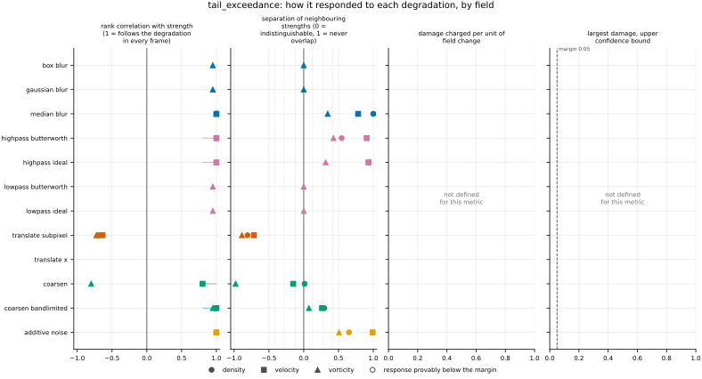
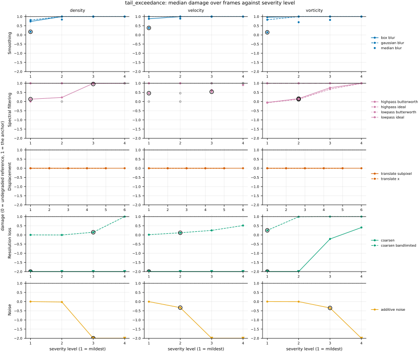

## Definition

Let $f$ be one channel of the reference and $g$ the same channel of the prediction, on a
periodic grid of $n$ cells, and $\mathbf{e}_j$ the unit step along spatial axis $j$. The
one-cell increment is the one `increment_flatness` defines,

$$
(\delta_j f)_{\mathbf{m}} = f_{\mathbf{m} + \mathbf{e}_j} - f_{\mathbf{m}} \tag{1}
$$

The reference's $n$ absolute increments along axis $j$, sorted from largest to smallest, are
$X_{(1)} \ge X_{(2)} \ge \dots \ge X_{(n)}$, and the threshold at order $k$ is the $k$-th
largest of them,

$$
a_j^{(c)}(k) = X_{(k)}, \qquad
k(\theta) = \min\bigl(\lceil n^{\theta} \rceil,\; n - 1\bigr), \qquad
\theta \in \{0.1, 0.2, \dots, 0.9\} \tag{2}
$$

the orders of `tail_index`, computed by the same function. The event is an increment at least
that large, and each field's count of events is

$$
N_j^{(c)}(h) = \#\bigl\{\mathbf{m} : \lvert (\delta_j h)_{\mathbf{m}} \rvert \ge a_j^{(c)}(k)\bigr\},
\qquad h \in \{f, g\} \tag{3}
$$

The reference has $k$ events per pair when its $k$-th and $(k+1)$-th largest differ, and more
when they tie. The value at each $\theta$ is the frequency bias of the event, the prediction's
count over the reference's, with the counts of every channel-and-axis pair in the set $A$ of pairs
whose threshold is positive summed first,

$$
B(\theta) = \frac{\sum_{(c,j) \in A} N_j^{(c)}(g)}{\sum_{(c,j) \in A} N_j^{(c)}(f)} \tag{4}
$$

The frequency bias is the verification score defined as "(hits + false alarms) / (hits +
misses)", forecast events over observed events, with perfect score 1, below 1 meaning the event is
under-forecast and above 1 over-forecast [@jwgfvr], section "Frequency bias (bias score)"; the
page numbers no equations. Here the reference stands in for the observation and the prediction for
the forecast. A threshold set by a percentile of a reference sample, against which another sample's
exceedances are counted, is the construction of the percentile-based climate-extremes indices,
such as TX90p, "the percentage of days when TX > 90th percentile" of a base period [@etccdi],
item 13; those indices use a strict inequality, and the non-strict one of Equation (3) is this
bundle's choice, explained below. The reported value is $B(\tfrac{1}{2})$, at
$k = \lceil \sqrt{n} \rceil$, the largest $\sqrt{n}$ that `tail_index` reads. Clauset, Shalizi
and Newman [@clauset2009], Section 3.5, mention keeping the largest $\sqrt{n}$ observations as an
alternative way of choosing a tail sample, "quite common in the quantitative finance literature",
and say that their own Kolmogorov-Smirnov method of Section 3.3 gives estimates at least as good;
the rule is used here as a fixed level, not as their recommendation; on the 256 by 256 analysis grid that is $k = 256$ of $n = 65536$
increments per axis. It is NaN when $A$ is empty, as on a constant reference.

**Choices made here, not by a source.** That the quantity counted is the one-cell increment follows
`tail_index` and `increment_flatness`, whose precedent is the increment statistics Granero-Belinchón
and Cabeza Gallucci [@granero2024] use as physics criteria; both signs are pooled into one tail.
That the threshold is the reference's own order statistic, rather than a multiple of its
increment rms or of `ctx.fluctuation_rms`, is this bundle's choice (`judgements/005`): it fixes the
reference's event rate at $k/n$ on every field and frame, with no assumption about the shape of the
distribution. That $B(\tfrac{1}{2})$ is the number registered for the panel, rather than another
point of the curve or a summary of all of it, is a convention with no source (`issues/118`). The
counts are summed over pairs before the ratio, as a verification contingency table is summed over
cases, which, with no ties at the threshold, equals the mean over pairs of each pair's ratio,
since every pair's reference count is then $k$.

**Why the $k$-th largest and $\ge$.** A threshold estimated from the reference sample is exceeded
at a different rate inside that sample than outside it: Zhang, Hegerl, Zwiers and Kenyon
[@zhang2005] describe this for percentile indices, where sampling error in the threshold inflates
the rate outside the base period, and correct it with a bootstrap. This bundle does not bootstrap;
it chooses the order statistic so that the expected rate outside the sample is nearly the rate
inside it. The derivation that follows is this bundle's, not theirs.
For a continuous distribution $F$ and $n$ independent reference values, $F(X_{(k)})$ follows a
$\mathrm{Beta}(n-k+1, k)$ distribution, so a new value reaches $X_{(k)}$ with probability
$\mathbb{E}[1 - F(X_{(k)})] = k/(n+1)$, and an independent prediction with the reference's
distribution has an expected frequency bias of

$$
\mathbb{E}\,B = \frac{n}{k} \cdot \frac{k}{n+1} = \frac{n}{n+1} \tag{5}
$$

within $1/(n+1)$ of the target. With the $(k+1)$-th largest and a strict inequality the same
calculation gives $n(k+1)/\bigl((n+1)k\bigr)$, about $(k+1)/k$, which is 1.25 at the curve's first
point on the 256 by 256 grid, where $k = 4$. Equation (5) assumes the reference's $n$ values are
independent; the one-cell increments of a real field are correlated, and for them the expectation
is not established. A test in `test_metric.py` checks Equation (5) at $k = 2$ on samples whose
increments are independent up to their zero sum.

**The curve behind the number** is Equation (4) at every $\theta$ of Equation (2). Small $\theta$
reads the few largest increments; large $\theta$ lowers the threshold into the body of the
distribution, where the count is no longer about extremes.

### Boundary handling

Periodic wrap on every axis: the increment of the last cell along an axis is taken against the
first, as in `increment_flatness`. A pair whose reference threshold is exactly zero, an axis along
which the reference is constant, is left out of both sums in Equation (4); that rule is
discontinuous, as `issues/103` records for `tail_index`. A field holding NaN or an infinity is
refused with an error rather than scored, because a NaN fails every comparison and would lower a
count silently. The metric declares `requires_periodic`, so the harness does not run it on a
dataset with a non-periodic axis, such as the Sod shock tube.

## Performance

<!-- GENERATED performance: written by `python -m fmeval.cards evidence tail_exceedance --results results/tail_exceedance_1793494833`, do not edit -->



Four measured statistics for tail_exceedance, one row per degradation grouped by family and one marker per field. From left: the rank correlation between the metric and the applied strength within a frame, with the line showing the resampling interval; the separation of neighbouring strengths as Cliff's delta, where 0 means the metric cannot tell one strength from the next and the faint ticks at 0.12, 0.28 and 0.42 are Vargha and Delaney's small, medium and large anchors, for scale and not as grades; the damage charged per unit of field change at the harshest strength; and the upper confidence bound on the largest damage, beside the fixed margin of 0.05. A hollow marker is a field and degradation on which that bound lies below the margin, so the response is provably small. A missing marker is a statistic the analysis withheld, as the rank correlation is on an axis the metric is invariant to.



Median damage over frames against severity level for tail_exceedance, one row per family of degradation and one column per field, on one shared scale. The solid grey line is damage 1, the anchor (by default the field's own mean); the dotted black line is the damage assigned to the fake prediction with the right spectrum, where the run included it. The hollow black ring marks the first level at which the metric has moved a tenth of the way to the anchor. Hollow grey markers are strengths excluded for repeating a milder one or for doing nothing. Degradations with three or fewer usable levels are drawn as markers only; points beyond 2 either side are drawn as triangles at the edge. Damage is negative where a degradation moves the metric away from the anchor, as noise raises a single-field quantity the field's mean sets to zero.

**Trend: does the response follow the degradation?**

| test family | field | degradations | rank correlation | fraction of frames in order | weakest gap between neighbouring strengths |
|---|---|---|---|---|---|
| Displacement | density | 2 | -0.698 | 0 | 0.0958 |
| Displacement | velocity | 2 | -0.638 | 0 | 0.142 |
| Displacement | vorticity | 2 | -0.725 | 0 | 0.0557 |
| Resolution loss | density | 2 | 0.8 to 1 | 0.385 to 0.634 | 0.506 to 0.647 |
| Resolution loss | velocity | 2 | 0.8 to 1 | 0.304 to 0.559 | 0.424 to 0.632 |
| Resolution loss | vorticity | 2 | -0.8 to 0.949 | 0 to 0.0745 | 0.0104 to 0.537 |
| Smoothing | density | 3 | 1 | 1 | 1 |
| Smoothing | velocity | 3 | 1 | 1 | 0.891 |
| Smoothing | vorticity | 3 | 0.949 to 1 | 0 to 1 | 0.5 to 0.672 |
| Spectral filtering | density | 4 | 1 | 0.571 to 0.975 | 0.773 to 0.968 |
| Spectral filtering | velocity | 4 | 1 | 0.969 to 1 | 0.952 to 0.965 |
| Spectral filtering | vorticity | 4 | 0.949 to 1 | 0 to 0.584 | 0.5 to 0.713 |
| Noise | density | 1 | 1 | 0.826 | 0.825 |
| Noise | velocity | 1 | 1 | 0.994 | 0.995 |
| Noise | vorticity | 1 | 1 | 0.739 | 0.754 |

**Reactivity: how far does it move?**

| test family | field | change from clean at the harshest strength | elasticity | first strength detected |
|---|---|---|---|---|
| Displacement | density | -0.00195 to 0 | 0.167 | level — |
| Displacement | velocity | -0.00195 to 0 | 0.208 | level — |
| Displacement | vorticity | -0.00195 to 0 | 0.313 | level — |
| Resolution loss | density | -1 to 5.44 | 0.252 to 1.88 | level 1 |
| Resolution loss | velocity | -0.515 to 9.3 | 0.23 to 1.93 | level 1 |
| Resolution loss | vorticity | -1 to -0.406 | -0.907 | level 1 |
| Smoothing | density | -1 | — | level 1 |
| Smoothing | velocity | -1 | — | level 1 |
| Smoothing | vorticity | -1 to -0.818 | 1.92 | level 1 |
| Spectral filtering | density | -1 | 4.83 | level 1 |
| Spectral filtering | velocity | -1 to -0.901 | 1.39 | level 1 |
| Spectral filtering | vorticity | -1 to -0.992 | 3.58 to 4.16 | level 2 |
| Noise | density | 194 | 1.39 | level 3 |
| Noise | velocity | 216 | 1.41 | level 2 |
| Noise | vorticity | 27.2 | 0.941 | level 3 |
| trap test: fake prediction, right spectrum | density | — | — | damage 1 |
| trap test: fake prediction, right spectrum | velocity | — | — | damage 1 |
| trap test: fake prediction, right spectrum | vorticity | — | — | damage 1 |

**Consistency: how much does it vary from snapshot to snapshot?**

| test family | field | consistency, in the strength's units | snapshots per independent block |
|---|---|---|---|
| Displacement | density | 0.918 | — |
| Displacement | velocity | 1.79 | — |
| Displacement | vorticity | 1.02 | — |
| Resolution loss | density | 2.26 to 3.4 | — |
| Resolution loss | velocity | 3.14 to 5.55 | — |
| Resolution loss | vorticity | 1.49 to 1.6 | — |
| Smoothing | density | 0.0143 | — |
| Smoothing | velocity | 0.0414 | — |
| Smoothing | vorticity | 0.0145 to 0.0807 | — |
| Spectral filtering | density | 0.0833 to 0.109 | — |
| Spectral filtering | velocity | 0.0456 to 0.187 | — |
| Spectral filtering | vorticity | 0.0264 to 0.0721 | — |
| Noise | density | 0.0105 | — |
| Noise | velocity | 0.00444 | — |
| Noise | vorticity | 0.0716 | — |

One row per family of degradation and physical field; a cell gives the range over the degradations in that family. **Trend.** The rank correlation is the Spearman correlation between the strength and how far the metric has moved from its value on the undegraded field of the same frame, in the one direction it moves under that degradation, computed inside a single frame. A value of 1 means every strength moved it further than the last in every frame, whichever way it moves; a response that scatters to both sides scores near 0. The fraction of frames in order counts the frames with no exception. The weakest gap is the smallest Mann-Whitney overlap between two neighbouring strengths across frames: 1 means they never overlap, 0.5 that they cannot be told apart. **Reactivity.** The change from clean is the median, at the harshest strength, of the departure from the undegraded value of the same frame over the size of that value: 0.3 means 30%. The elasticity is the percentage change of that departure per percentage change in strength over the mildest strengths. First strength detected is the mildest at which the metric has moved a tenth of the way to the anchor; **damage** reads that 0-to-1 scale as a number. A dash means the measurement is not defined there. A metric's reactivity scales with the power it is expressed in: mean squared error's elasticity is twice root-mean-square error's, though the two carry the same information, so compare magnitudes across metrics with that in mind. **Consistency** is how much the response varies from snapshot to snapshot relative to its size, in the strength's units; the snapshots of one trajectory are correlated, and the last column is how many consecutive snapshots one independent block spans.

These tables report what was measured and grade none of the measurements. What the numbers mean for this metric is written in the subsections below, beside the test that produced each number.

**Profile.**

| field | selectivity | charges most for | charges least for | response provably below 0.05 at 90% on | elasticity to a sub-pixel shift, against severity (distance) | compute cost (x cheapest in this run) |
|---|---|---|---|---|---|---|
| density | — | — | — | — | 0.167 | 1.03 |
| velocity | — | — | — | — | 0.208 | 2.04 |
| vorticity | — | — | — | — | 0.313 | 1 |

One row per physical field. **Selectivity** is how concentrated the metric's response is on a few degradations, measured per unit of field change: 0 means it charges every degradation the same, as mean squared error does by construction, and values toward 1 that one degradation carries most of it. **Charges most and least for** name the two ends of that profile. **Response provably below** lists degradations on which the upper confidence bound of the largest damage lies below the margin -- an equivalence test, so an entry says the response is provably small, not merely not significant; a dash means no degradation met the bound. **Elasticity** is the slope of log damage against log shift over the smallest shifts: 1 means damage grows in proportion to the shift, 2 with its square. **Compute cost** is wall-clock per evaluation over the cheapest metric and field in the same run.

<!-- END GENERATED performance -->

## Intuition

This metric asks whether a prediction has as many extreme jumps between neighbouring cells as the
reference has. It takes the reference's neighbour-to-neighbour differences, finds the size of the
largest few, as many as the square root of the number of cells, and calls any difference at least
that large an extreme event. It then counts the events in the prediction and divides by the count
in the reference. One means the prediction has the right number of extreme jumps; less than one
means too few, which is what smoothing does to sharp structures; more than one means too many,
which is what noise does. The threshold comes from the reference alone, so it is the same for every
prediction of that reference.

A worked example, four cells by four cells. The reference is a sawtooth down each column: the
values 0, 3, 2, 1, wrapping back to 0, so going down a column the field jumps up by 3 once and
steps down by 1 three times. In the first prediction two columns have their jump cut to 2; the
second prediction is the reference tripled.

```
reference        first prediction     second prediction
0 0 0 0          0 0 0 0              0 0 0 0
3 3 3 3          3 3 2 2              9 9 9 9
2 2 2 2          2 2 2 2              6 6 6 6
1 1 1 1          1 1 1 1              3 3 3 3

                 0.5                  4
```

Sixteen cells means the four largest steps set the threshold: the reference's four jumps of 3, so
an event is a step of at least 3, and the reference has four. The first prediction keeps two jumps
of 3, so it scores two over four, 0.5. The tripled prediction has steps of 9 and 3, all sixteen at
least 3, so it scores sixteen over four, 4. Along the rows the reference is constant, so that
direction has no extreme steps and is left out.

What it ignores: where the extreme jumps are, how large they are beyond the threshold, and
everything about the smaller jumps.

## Reading the output

Dimensionless, zero or positive, and unbounded above; at most $n/k$, 256 on the 256 by 256 grid.
The target is 1: the analysis orders the value by its distance from 1 on a logarithmic scale, so
0.5 and 2 are equally far from right. Below 1 the prediction has fewer increments as large as the
reference's extreme ones, above 1 more. The prediction that is the reference itself scores exactly
1. When the reference's increments are independent values, an independent draw from their
distribution scores $n/(n+1)$ on average (Equation (5)), with a spread across draws that grows as
$k$ shrinks; for a real field, whose increments are correlated, that expectation is not
established.

Because the threshold and the counts scale together, multiplying both fields by one constant
changes nothing, and a prediction can be compared with a reference of any magnitude. Values are
comparable across predictions of the same reference. Values at different analysis-grid
resolutions are not comparable: the increment is one cell long, and $k$ is set by the number of
cells.

The companion is the curve `tail_exceedance[theta]`: Equation (4) at $k = \lceil n^{\theta}
\rceil$ for $\theta$ from 0.1 to 0.9. Small $\theta$ is a rarer event, larger $\theta$ a commoner
one, and on 256 by 256 $\theta = 0.9$ counts about a third of all increments.

## Limitations

The value saturates. Once a prediction has no increment as large as the reference's $\sqrt{n}$-th
largest, it scores 0 however much further it is smoothed, and on the distance-from-1 scale that is
infinitely far: two predictions both at 0 cannot be ranked against each other, and a mild blur and
a total one are scored alike. On the evidence run, on density and velocity, the Gaussian and box
blurs leave the value at 0 from their second strength in every frame and both low-pass filters
at every strength, so the registered number cannot tell any blur strength beyond the first, nor
any low-pass strength, from another, and the analysis withholds those axes' rank correlation
(Results, "Smoothing" and "Spectral filtering"). The stored curve at larger $\theta$ is where such
predictions are still told apart.

A value above 1 does not mean the prediction is more intermittent or more turbulent. Anything that
puts more one-cell jumps above the reference's extreme level raises it: noise, and also a
blocky reconstruction whose block edges concentrate the change between blocks into single-cell
jumps. Below 1 does not mean smoother everywhere either, only fewer extreme jumps.

It is not monotone under smoothing in general, which the decorator declares and the contract test
checks. Spreading one tall, isolated jump over several cells can put each of them above a low
threshold, so blur can raise the count before it lowers it: a 16-cell spike of height 8 on faint
noise scores 1, 1, 2, 3, 3.5 and then 0 as the blur widens (`test_metric.py`).

The counts are piecewise constant in the prediction, so the metric has no useful gradient and is
not a training loss. A pair along which the reference is exactly constant is left out, but the same
pair with round-off variation is not and then sets a round-off threshold that almost any prediction
exceeds everywhere; the rule is discontinuous, as `issues/103` records for `tail_index`. Ties in
the reference at its threshold make the reference's count larger than $k$, which only matters for
fields with repeated increment values, such as a staircase.

## Results

<!-- GENERATED run: written by `python -m fmeval.cards evidence tail_exceedance --results results/tail_exceedance_1793494833`, do not edit -->

Measured on `kinet_re5e4`, frames 2000 to 10000 (161 frames of developed flow), on the 256 analysis grid, seed 20260807, at commit `d981914e726d`. Run `tail_exceedance_1793494833`.

Every number in this section comes from that one run. Regenerate with `python -m fmeval.cards evidence <name> --results results/tail_exceedance_1793494833`.

<!-- END GENERATED run -->

### Smoothing

[gaussian_blur](../../degradations/gaussian_blur/card.md) ·
[box_blur](../../degradations/box_blur/card.md) ·
[median_blur](../../degradations/median_blur/card.md)

<!-- GENERATED results_smoothing: written by `python -m fmeval.cards evidence tail_exceedance --results results/tail_exceedance_1793494833`, do not edit -->

| degradation | field | strengths | rank correlation | fraction of frames in the right order | weakest gap between neighbouring strengths |
|---|---|---|---|---|---|
| `box_blur` | density | 4 | — | — | — |
| `box_blur` | velocity | 4 | — | — | — |
| `box_blur` | vorticity | 4 | 0.949 | 0 | 0.5 |
| `gaussian_blur` | density | 4 | — | — | — |
| `gaussian_blur` | velocity | 4 | — | — | — |
| `gaussian_blur` | vorticity | 4 | 0.949 | 0 | 0.5 |
| `median_blur` | density | 3 | 1 | 1 | 1 |
| `median_blur` | velocity | 3 | 1 | 1 | 0.891 |
| `median_blur` | vorticity | 3 | 1 | 1 | 0.672 |

<!-- END GENERATED results_smoothing -->

All three smoothing axes were declared before the run, with the value falling. It falls on every
field. The harshest strength of each takes the median to 0, a change from clean of -1 in the
Performance tables, except the median blur on vorticity, which leaves a change of -0.818. The
median blur is followed in every frame on every field (rank correlation 1, every frame in
order). The Gaussian and box blurs are not graded at the registered point: on density and
velocity the value is already 0 from the second strength in every frame, and the analysis, which
places a value of 0 infinitely far from the target, then treats each frame's single finite point as
no ordering at all and withholds the rank correlation (the dashes). On vorticity the second
strength still leaves a few events in a minority of frames. Only in those frames is a rank
correlation defined, and there the pattern is always two finite points and two ties at 0, whose
rank correlation is 0.949 whatever the finite values are; so 0.949 records the tie pattern of the
frames that have one, not a grading of the axis, and no frame is strictly in order. The
analysis reports a direction of +1 on every axis of a metric with a target, because it orders by
distance from the target; the fall declared as -1 is the raw value's.

### Spectral filtering

[lowpass_ideal](../../degradations/lowpass_ideal/card.md) ·
[highpass_ideal](../../degradations/highpass_ideal/card.md)

<!-- GENERATED results_spectral: written by `python -m fmeval.cards evidence tail_exceedance --results results/tail_exceedance_1793494833`, do not edit -->

| degradation | field | strengths | rank correlation | fraction of frames in the right order | weakest gap between neighbouring strengths |
|---|---|---|---|---|---|
| `highpass_butterworth` | density | 4 | 1 | 0.571 | 0.773 |
| `highpass_butterworth` | velocity | 3 | 1 | 1 | 0.952 |
| `highpass_butterworth` | vorticity | 4 | 1 | 0.584 | 0.713 |
| `highpass_ideal` | density | 3 | 1 | 0.975 | 0.968 |
| `highpass_ideal` | velocity | 2 | 1 | 0.969 | 0.965 |
| `highpass_ideal` | vorticity | 4 | 1 | 0.553 | 0.658 |
| `lowpass_butterworth` | density | 4 | — | — | — |
| `lowpass_butterworth` | velocity | 3 | — | — | — |
| `lowpass_butterworth` | vorticity | 4 | 0.949 | 0 | 0.5 |
| `lowpass_ideal` | density | 3 | — | — | — |
| `lowpass_ideal` | velocity | 2 | — | — | — |
| `lowpass_ideal` | vorticity | 4 | 0.949 | 0 | 0.5 |

<!-- END GENERATED results_spectral -->

The low-pass filters remove the extremes outright: the value is 0 at every strength on density and
velocity, so their rows are withheld for the same reason as the blurs', and on vorticity it reaches
0 by the harshest strength (rank correlation 0.949). The high-pass filters also lower the value,
and they are followed with a rank correlation of 1 on every field, with 0.553 to 1 of frames in
order: removing the large scales takes away the part of the largest one-cell jumps those scales
carried.

### Displacement

[translate_x](../../degradations/translate/card.md) ·
[translate_subpixel](../../degradations/translate_subpixel/card.md)

<!-- GENERATED results_geometric: written by `python -m fmeval.cards evidence tail_exceedance --results results/tail_exceedance_1793494833`, do not edit -->

| degradation | field | strengths | rank correlation | fraction of frames in the right order | weakest gap between neighbouring strengths |
|---|---|---|---|---|---|
| `translate_subpixel` | density | 6 | -0.698 | 0 | 0.0958 |
| `translate_subpixel` | velocity | 6 | -0.638 | 0 | 0.142 |
| `translate_subpixel` | vorticity | 6 | -0.725 | 0 | 0.0557 |
| `translate_x` | density | 5 | — | — | — |
| `translate_x` | velocity | 5 | — | — | — |
| `translate_x` | vorticity | 5 | — | — | — |

<!-- END GENERATED results_geometric -->

An integer translation moves the increments without changing their sizes, so `translate_x` leaves
the value at exactly 1 at every strength and its rows are withheld; this was declared as the blind
axis. The analysis computes its equivalence bound, the "response provably below" column, only from
a damage scale it does not build for a metric with a target, so `translate_x` is not listed there
although the value never moves. `translate_subpixel` gives a negative rank correlation, -0.638 to
-0.725: a fractional shift interpolates between cells and moves the count slightly away from 1,
while its harshest strengths are whole cells, which return it to within -0.00195 of 1 (the
remainder is the Fourier shift's treatment of the grid's highest mode, `issues/041`).

### Resolution loss

[coarsen](../../degradations/coarsen/card.md) ·
[coarsen_bandlimited](../../degradations/coarsen_bandlimited/card.md)

<!-- GENERATED results_resolution: written by `python -m fmeval.cards evidence tail_exceedance --results results/tail_exceedance_1793494833`, do not edit -->

| degradation | field | strengths | rank correlation | fraction of frames in the right order | weakest gap between neighbouring strengths |
|---|---|---|---|---|---|
| `coarsen` | density | 4 | 0.8 | 0.385 | 0.506 |
| `coarsen` | velocity | 4 | 0.8 | 0.304 | 0.424 |
| `coarsen` | vorticity | 4 | -0.8 | 0 | 0.0104 |
| `coarsen_bandlimited` | density | 4 | 1 | 0.634 | 0.647 |
| `coarsen_bandlimited` | velocity | 4 | 1 | 0.559 | 0.632 |
| `coarsen_bandlimited` | vorticity | 4 | 0.949 | 0.0745 | 0.537 |

<!-- END GENERATED results_resolution -->

`coarsen` raises the value far above 1 on density and velocity: at the harshest strength it
exceeds its clean value of 1 by 5.44 and 9.3 times that value (the 0.5 column of the curve tables
below, a change from clean): a block reconstruction
concentrates the change between blocks into one-cell jumps at block edges, and many of those reach
the reference's extreme level. A value above 1 therefore does not mean a more intermittent field.
On vorticity it first rises above 1 and then falls below, to a change of -0.406, so its distance
from 1 shrinks with the factor and the rank correlation is -0.8. `coarsen_bandlimited` lowers the
value and is followed on density and velocity (rank correlation 1) and on vorticity (0.949).

### Noise

[additive_noise](../../degradations/additive_noise/card.md)

<!-- GENERATED results_stochastic: written by `python -m fmeval.cards evidence tail_exceedance --results results/tail_exceedance_1793494833`, do not edit -->

| degradation | field | strengths | rank correlation | fraction of frames in the right order | weakest gap between neighbouring strengths |
|---|---|---|---|---|---|
| `additive_noise` | density | 4 | 1 | 0.826 | 0.825 |
| `additive_noise` | velocity | 4 | 1 | 0.994 | 0.995 |
| `additive_noise` | vorticity | 4 | 1 | 0.739 | 0.754 |

<!-- END GENERATED results_stochastic -->

This axis was declared before the run, with the value rising, and it rises on every field, with a
rank correlation of 1 and its interval at 1. At the harshest strength the value exceeds its clean value of 1 by
194, 216 and 27.2 times that value on density, velocity and vorticity (the reactivity table), below
the ceiling of $n/k$ that a prediction with every increment above the threshold would reach. The mildest strength barely
moves it, so 0.739 to 0.994 of frames are strictly in order: there a few counts scatter on either
side of 1.

### Trap tests

[gaussian_impostor](../../degradations/gaussian_impostor/card.md) ·
[uncorrelated](../../degradations/random_large_translation/card.md)

<!-- GENERATED results_canaries: written by `python -m fmeval.cards evidence tail_exceedance --results results/tail_exceedance_1793494833`, do not edit -->

| field | damage assigned to the fake prediction | closest real degradation | damage of the reference moved far away | value on the anchor |
|---|---|---|---|---|
| density | 1 | `box_blur=19.4199` | 0 | 0 |
| velocity | 1 | `box_blur=26.428` | 0 | 0 |
| vorticity | 1 | `box_blur=4.55404` | 0 | 0 |

The fake prediction here has exactly the reference field's amplitude spectrum and completely scrambled structure. Damage 1 is what the anchor scores, by default the reference's own spatial mean, a prediction that knows the mean and nothing else. The damage column therefore says how close to useless this metric considers that fake prediction: a low number means the metric was fooled. The third column translates the same number into an ordinary degradation whose damage the fake prediction matches, which is easier to picture. The fourth is the reference moved by a large random offset, the right statistics in the wrong place; where a field's energy sits in its largest scales that copy stays partly correlated with the reference, so it is not the score of an unrelated field.

<!-- END GENERATED results_canaries -->

The fake prediction with the right spectrum is not mistaken for the reference: its median value is
0 on every field, the anchor's value, so it is assigned damage 1. With the reference's spectrum but
no intermittency, its increments are close to Gaussian with the reference's variance, and almost
none reaches the reference's square-root-of-n-th largest increment. The reference moved far away
keeps every increment's size, scores exactly 1 and is assigned damage 0: the metric does not see
position at all.

### Compared with the other metrics

<!-- GENERATED results_summary: written by `python -m fmeval.cards evidence tail_exceedance --results results/tail_exceedance_1793494833`, do not edit -->

No measurements for this test in the recorded run.

<!-- END GENERATED results_summary -->

The evidence run held this metric alone, so there is no cross-metric correlation to read.

### Damage beside the other metrics

<!-- GENERATED results_damage_by_level: written by `python -m fmeval.cards evidence tail_exceedance --results results/tail_exceedance_1793494833`, do not edit -->

Only one metric in the recorded run; there is nothing to place this one beside.

<!-- END GENERATED results_damage_by_level -->

The evidence run held this metric alone, so there is nothing to place it beside.

### The curve behind the number

<!-- GENERATED results_companion: written by `python -m fmeval.cards evidence tail_exceedance --results results/tail_exceedance_1793494833`, do not edit -->

**density, rank correlation, at each coordinate.**

| degradation | 0.1 | 0.2 | 0.3 | 0.4 | 0.5 | 0.6 | 0.7 | 0.8 | 0.9 | dominance |
|---|---|---|---|---|---|---|---|---|---|---|
| `additive_noise` | 1 | 1 | 1 | 1 | 1 | 1 | 1 | 1 | 1 | 0.752 |
| `box_blur` | — | — | — | — | — | 0.949 | 1 | 1 | 0.8 | 0.385 |
| `coarsen` | 0.8 | 0.8 | 0.8 | 0.8 | 0.8 | 0.4 | -0.4 | 0.8 | 1 | 0 |
| `coarsen_bandlimited` | 0.949 | 0.949 | 0.949 | 1 | 1 | 1 | 1 | 1 | 0.8 | 0.0124 |
| `gaussian_blur` | — | — | — | — | — | — | 0.949 | 1 | 1 | 0.429 |
| `highpass_butterworth` | 0.949 | 0.949 | 0.949 | 0.949 | 1 | 1 | 1 | 1 | 1 | 0.907 |
| `highpass_ideal` | — | — | — | 1 | 1 | 1 | 1 | 1 | 1 | 0.901 |
| `lowpass_butterworth` | — | — | — | — | — | — | — | 0.949 | 1 | 0 |
| `lowpass_ideal` | — | — | — | — | — | — | — | 1 | 1 | 0 |
| `median_blur` | 1 | 1 | 1 | 1 | 1 | 1 | 1 | 1 | 1 | 1 |
| `translate_subpixel` | -0.522 | -0.577 | -0.541 | -0.698 | -0.698 | -0.698 | -0.759 | -0.698 | -0.759 | 0 |
| `translate_x` | — | — | — | — | — | — | — | — | — | — |

**density, change from clean at the harshest strength, at each coordinate.**

| degradation | 0.1 | 0.2 | 0.3 | 0.4 | 0.5 | 0.6 | 0.7 | 0.8 | 0.9 |
|---|---|---|---|---|---|---|---|---|---|
| `additive_noise` | 1.19e+04 | 4.77e+03 | 1.71e+03 | 570 | 194 | 67.7 | 23.9 | 7.72 | 1.97 |
| `box_blur` | -1 | -1 | -1 | -1 | -1 | -1 | -1 | -0.359 | -0.0671 |
| `coarsen` | 343 | 138 | 50.1 | 16.5 | 5.44 | 1.51 | 0.0608 | -0.53 | -0.826 |
| `coarsen_bandlimited` | -1 | -1 | -1 | -1 | -1 | -0.151 | 0.12 | -0.102 | -0.0306 |
| `gaussian_blur` | -1 | -1 | -1 | -1 | -1 | -1 | -1 | -1 | -0.244 |
| `highpass_butterworth` | -1 | -1 | -1 | -1 | -1 | -0.972 | -0.666 | -0.77 | -0.779 |
| `highpass_ideal` | -1 | -1 | -1 | -1 | -1 | -0.943 | -0.646 | -0.763 | -0.652 |
| `lowpass_butterworth` | -1 | -1 | -1 | -1 | -1 | -1 | -1 | -1 | -1 |
| `lowpass_ideal` | -1 | -1 | -1 | -1 | -1 | -1 | -1 | -1 | -1 |
| `median_blur` | -1 | -1 | -1 | -1 | -1 | -0.995 | -0.489 | -0.136 | -0.0582 |
| `translate_subpixel` | -0.125 | -0.05 | -0.0179 | -0.00588 | -0.00195 | -0.000644 | -0.000212 | -7.01e-05 | -2.31e-05 |
| `translate_x` | 0 | 0 | 0 | 0 | 0 | 0 | 0 | 0 | 0 |

**velocity, rank correlation, at each coordinate.**

| degradation | 0.1 | 0.2 | 0.3 | 0.4 | 0.5 | 0.6 | 0.7 | 0.8 | 0.9 | dominance |
|---|---|---|---|---|---|---|---|---|---|---|
| `additive_noise` | 1 | 1 | 1 | 1 | 1 | 1 | 1 | 1 | 1 | 0.981 |
| `box_blur` | — | — | — | — | — | — | 0.949 | 1 | 1 | 0.752 |
| `coarsen` | 1 | 1 | 1 | 1 | 0.8 | 0.8 | -0.4 | 0.4 | 1 | 0 |
| `coarsen_bandlimited` | 0.8 | 0.8 | 0.8 | 0.4 | 1 | 1 | 1 | 1 | 1 | 0.0186 |
| `gaussian_blur` | — | — | — | — | — | — | 0.949 | 1 | 1 | 0.764 |
| `highpass_butterworth` | 1 | 1 | 1 | 1 | 1 | 1 | 1 | 1 | 1 | 0.634 |
| `highpass_ideal` | 1 | 1 | 1 | 1 | 1 | 1 | 1 | 1 | 1 | 0.77 |
| `lowpass_butterworth` | — | — | — | — | — | — | — | 1 | 1 | 1 |
| `lowpass_ideal` | — | — | — | — | — | — | — | -1 | 1 | 0.988 |
| `median_blur` | 1 | 1 | 1 | 1 | 1 | 1 | 1 | 1 | 1 | 0.988 |
| `translate_subpixel` | -0.181 | -0.353 | -0.464 | -0.618 | -0.638 | -0.714 | -0.725 | -0.754 | -0.754 | 0 |
| `translate_x` | — | — | — | — | — | — | — | — | — | — |

**velocity, change from clean at the harshest strength, at each coordinate.**

| degradation | 0.1 | 0.2 | 0.3 | 0.4 | 0.5 | 0.6 | 0.7 | 0.8 | 0.9 |
|---|---|---|---|---|---|---|---|---|---|
| `additive_noise` | 1.35e+04 | 5.39e+03 | 1.94e+03 | 643 | 216 | 72.5 | 24.6 | 7.79 | 1.97 |
| `box_blur` | -1 | -1 | -1 | -1 | -1 | -1 | -1 | -1 | -0.682 |
| `coarsen` | 595 | 239 | 86.3 | 28.6 | 9.3 | 2.74 | 0.396 | -0.503 | -0.821 |
| `coarsen_bandlimited` | 9.06 | 3.67 | 1.05 | -0.0618 | -0.515 | -0.608 | -0.329 | -0.304 | -0.0728 |
| `gaussian_blur` | -1 | -1 | -1 | -1 | -1 | -1 | -1 | -1 | -0.973 |
| `highpass_butterworth` | -1 | -1 | -1 | -0.971 | -0.92 | -0.748 | -0.385 | -0.353 | -0.517 |
| `highpass_ideal` | -1 | -1 | -1 | -0.95 | -0.901 | -0.72 | -0.332 | -0.32 | -0.498 |
| `lowpass_butterworth` | -1 | -1 | -1 | -1 | -1 | -1 | -1 | -1 | -1 |
| `lowpass_ideal` | -1 | -1 | -1 | -1 | -1 | -1 | -1 | -1 | -0.337 |
| `median_blur` | -1 | -1 | -1 | -1 | -1 | -0.95 | -0.677 | -0.572 | -0.302 |
| `translate_subpixel` | -0.0625 | -0.05 | -0.0179 | -0.00294 | -0.00195 | -0.000322 | -0.000106 | -3.51e-05 | -2.31e-05 |
| `translate_x` | 0 | 0 | 0 | 0 | 0 | 0 | 0 | 0 | 0 |

**vorticity, rank correlation, at each coordinate.**

| degradation | 0.1 | 0.2 | 0.3 | 0.4 | 0.5 | 0.6 | 0.7 | 0.8 | 0.9 | dominance |
|---|---|---|---|---|---|---|---|---|---|---|
| `additive_noise` | 0.949 | 1 | 1 | 1 | 1 | 1 | 1 | 1 | 1 | 0.0373 |
| `box_blur` | — | — | — | — | 0.949 | 0.949 | 1 | 1 | 0.8 | 0.497 |
| `coarsen` | -0.8 | -0.8 | -0.8 | -1 | -0.8 | 0.2 | 0.8 | 1 | 1 | 0 |
| `coarsen_bandlimited` | — | 0.949 | 0.949 | 0.949 | 0.949 | 0.949 | 1 | 1 | 0.8 | 0.267 |
| `gaussian_blur` | — | — | — | — | 0.949 | 0.949 | 0.949 | 1 | 1 | 0.59 |
| `highpass_butterworth` | 0.738 | 0.8 | 0.8 | 0.949 | 1 | 1 | 1 | 1 | 0.4 | 0.329 |
| `highpass_ideal` | 0.738 | 0.8 | 0.8 | 0.8 | 1 | 1 | 1 | 1 | 0.8 | 0.199 |
| `lowpass_butterworth` | — | — | — | — | 0.949 | 0.949 | 0.949 | 1 | 1 | 0.696 |
| `lowpass_ideal` | — | — | — | — | 0.949 | 0.949 | 0.949 | 0.949 | 1 | 0.839 |
| `median_blur` | 1 | 1 | 1 | 1 | 1 | 1 | 1 | 1 | 1 | 0.863 |
| `translate_subpixel` | -0.577 | -0.667 | -0.676 | -0.706 | -0.725 | -0.754 | -0.754 | -0.754 | -0.754 | 0 |
| `translate_x` | — | — | — | — | — | — | — | — | — | — |

**vorticity, change from clean at the harshest strength, at each coordinate.**

| degradation | 0.1 | 0.2 | 0.3 | 0.4 | 0.5 | 0.6 | 0.7 | 0.8 | 0.9 |
|---|---|---|---|---|---|---|---|---|---|
| `additive_noise` | 491 | 241 | 118 | 55.8 | 27.2 | 14.9 | 8.31 | 4.74 | 1.73 |
| `box_blur` | -1 | -1 | -1 | -1 | -1 | -1 | -1 | -0.967 | -0.824 |
| `coarsen` | 31 | 11.8 | 3.57 | 0.6 | -0.406 | -0.773 | -0.881 | -0.879 | -0.892 |
| `coarsen_bandlimited` | -1 | -1 | -1 | -1 | -1 | -1 | -1 | -0.976 | -0.841 |
| `gaussian_blur` | -1 | -1 | -1 | -1 | -1 | -1 | -1 | -1 | -0.901 |
| `highpass_butterworth` | -1 | -1 | -1 | -1 | -1 | -0.981 | -0.927 | -0.621 | -0.0882 |
| `highpass_ideal` | -1 | -1 | -1 | -1 | -0.992 | -0.962 | -0.875 | -0.519 | 0.181 |
| `lowpass_butterworth` | -1 | -1 | -1 | -1 | -1 | -1 | -1 | -1 | -0.929 |
| `lowpass_ideal` | -1 | -1 | -1 | -1 | -1 | -1 | -1 | -1 | -0.946 |
| `median_blur` | -1 | -0.85 | -0.804 | -0.776 | -0.818 | -0.857 | -0.856 | -0.776 | -0.52 |
| `translate_subpixel` | -0.125 | -0.05 | -0.0179 | -0.00588 | -0.00195 | -0.000644 | -0.000212 | -7.01e-05 | -2.31e-05 |
| `translate_x` | 0 | 0 | 0 | 0 | 0 | 0 | 0 | 0 | 0 |

Each coordinate of the curve read as a metric of its own, with the same statistics as the tables above and no resampling interval. Neighbouring coordinates are strongly correlated, so a row localises the evidence and does not multiply it. **Dominance** is the fraction of frames in which, for the weakest pair of neighbouring strengths, the harsher strength's curve has moved at least as far as the milder one's at every coordinate, each in its own direction: near 1, any summary that grows with every coordinate's departure orders those strengths the same way, so the choice of summary cannot change the trend. None of these numbers enters the tables above.

<!-- END GENERATED results_companion -->

The registered number is the column 0.5. The curve shows where the saturation of the blurs and
low-pass filters ends. At the larger orders, a lower threshold, the Gaussian and box blurs are
graded again, with rank correlations of 0.8 to 1 from 0.6 or 0.7 upward on density and velocity
and from 0.5 upward on vorticity, where the dashes stop. The low-pass filters are graded only at
0.8 and 0.9 on density and velocity, and not consistently there (`lowpass_ideal` on velocity reads
-1 at 0.8). Additive noise raises every order on every field, most
at the smallest orders, the rarest events. The direction of `coarsen` changes along the curve: it
raises the rare-event orders and lowers the common ones on every field, which is the block-edge
mechanism of the Resolution loss reading seen at every threshold. Dominance is 1 for the median
blur on density and 0.988 on velocity, so there any summary of the curve would order its strengths
as the registered point does; for the Gaussian blur it is 0.429, 0.764 and 0.59, and for noise on
vorticity 0.0373, so there the registered point alone does not stand for the curve (`issues/118`).

## References

\bibliography
