## Definition

Let $f$ be one channel of the reference and $g$ the same channel of the prediction, on a
periodic grid of $n$ cells, and $\mathbf{e}_j$ the unit step along spatial axis $j$. The
one-cell increment is the one `increment_flatness` defines,

$$
(\delta_j f)_{\mathbf{m}} = f_{\mathbf{m} + \mathbf{e}_j} - f_{\mathbf{m}} \tag{1}
$$

read on the channel-and-axis pairs every increment metric reads (`increment_samples`): every
channel along every axis for a scalar field, and for velocity only the longitudinal pairs,
component $j$ along axis $j$. The reference's $n$ absolute increments along one pair, sorted from largest to smallest, are
$X_{(1)} \ge X_{(2)} \ge \dots \ge X_{(n)}$, and the threshold at order $k$ is the $k$-th
largest of them,

$$
a_j^{(c)}(k) = X_{(k)}, \qquad
k(\theta) = \min\bigl(\lceil n^{\theta} \rceil,\; n - 1\bigr), \qquad
\theta \in \{0.1, 0.2, \dots, 0.9\} \tag{2}
$$

the orders of `tail_index`, computed by the same function. The event is an increment at least
that large, and each field's count of events is

$$
N_j^{(c)}(h) = \#\bigl\{\mathbf{m} : \lvert (\delta_j h)_{\mathbf{m}} \rvert \ge a_j^{(c)}(k)\bigr\},
\qquad h \in \{f, g\} \tag{3}
$$

The reference has $k$ events per pair when its $k$-th and $(k+1)$-th largest differ, and more
when they tie. The value at each $\theta$ is the frequency bias of the event, the prediction's
count over the reference's, with the counts of every channel-and-axis pair in the set $A$ of pairs
whose threshold is positive summed first,

$$
B(\theta) = \frac{\sum_{(c,j) \in A} N_j^{(c)}(g)}{\sum_{(c,j) \in A} N_j^{(c)}(f)} \tag{4}
$$

The frequency bias is the verification score defined as "(hits + false alarms) / (hits +
misses)", forecast events over observed events, with perfect score 1, below 1 meaning the event is
under-forecast and above 1 over-forecast [@jwgfvr], section "Frequency bias (bias score)"; the
page numbers no equations. Here the reference stands in for the observation and the prediction for
the forecast. A threshold set by a percentile of a reference sample, against which another sample's
exceedances are counted, is the construction of the percentile-based climate-extremes indices,
such as TX90p, "the percentage of days when TX > 90th percentile" of a base period [@etccdi],
item 13; those indices use a strict inequality, and the non-strict one of Equation (3) is this
bundle's choice, explained below. The reported value is $B(\tfrac{1}{2})$, at
$k = \lceil \sqrt{n} \rceil$, the largest $\sqrt{n}$ that `tail_index` reads. Clauset, Shalizi
and Newman [@clauset2009], Section 3.5, mention keeping the largest $\sqrt{n}$ observations as an
alternative way of choosing a tail sample, "quite common in the quantitative finance literature",
and say that their own Kolmogorov-Smirnov method of Section 3.3 gives estimates at least as good;
the rule is used here as a fixed level, not as their recommendation; on the 256 by 256 analysis grid that is $k = 256$ of $n = 65536$
increments per axis. It is NaN when $A$ is empty, as on a constant reference.

**Choices made here, not by a source.** That the quantity counted is the one-cell increment follows
`tail_index` and `increment_flatness`, whose precedent is the increment statistics Granero-Belinchón
and Cabeza Gallucci [@granero2024] use as physics criteria; both signs are pooled into one tail.
That the threshold is the reference's own order statistic, rather than a multiple of its
increment rms or of `ctx.fluctuation_rms`, is this bundle's choice (`judgements/005`): it fixes the
reference's event rate at $k/n$ on every field and frame, with no assumption about the shape of the
distribution. That $B(\tfrac{1}{2})$ is the number registered for the panel, rather than another
point of the curve or a summary of all of it, is a convention with no source (`issues/118`). The
counts are summed over pairs before the ratio, as a verification contingency table is summed over
cases, which, with no ties at the threshold, equals the mean over pairs of each pair's ratio,
since every pair's reference count is then $k$.

**Why the $k$-th largest and $\ge$.** A threshold estimated from the reference sample is exceeded
at a different rate inside that sample than outside it: Zhang, Hegerl, Zwiers and Kenyon
[@zhang2005] describe this for percentile indices, where sampling error in the threshold inflates
the rate outside the base period, and correct it with a bootstrap. This bundle does not bootstrap;
it chooses the order statistic so that the expected rate outside the sample is nearly the rate
inside it. The derivation that follows is this bundle's, not theirs.
For a continuous distribution $F$ and $n$ independent reference values, $F(X_{(k)})$ follows a
$\mathrm{Beta}(n-k+1, k)$ distribution, so a new value reaches $X_{(k)}$ with probability
$\mathbb{E}[1 - F(X_{(k)})] = k/(n+1)$, and an independent prediction with the reference's
distribution has an expected frequency bias of

$$
\mathbb{E}\,B = \frac{n}{k} \cdot \frac{k}{n+1} = \frac{n}{n+1} \tag{5}
$$

within $1/(n+1)$ of the target. With the $(k+1)$-th largest and a strict inequality the same
calculation gives $n(k+1)/\bigl((n+1)k\bigr)$, about $(k+1)/k$, which is 1.25 at the curve's first
point on the 256 by 256 grid, where $k = 4$. Equation (5) assumes the reference's $n$ values are
independent; the one-cell increments of a real field are correlated, and for them the expectation
is not established. A test in `test_metric.py` checks Equation (5) at $k = 2$ on samples whose
increments are independent up to their zero sum.

**The curves behind the number.** `tail_exceedance` is Equation (4) at every $\theta$ of
Equation (2). Small $\theta$ reads the few largest increments; large $\theta$ lowers the
threshold into the body of the distribution, where the count is no longer about extremes.
`tail_exceedance.percentile` is the same ratio with the threshold stated as the reference
percentile $p$ it is, the form its field states thresholds in (next subsection):

$$
k(p) = \Bigl\lceil \frac{n\,(100 - p)}{100} \Bigr\rceil, \qquad
p \in \{90, 91, \dots, 99,\; 99.1, \dots, 99.9,\; 99.91, \dots, 99.99\} \tag{6}
$$

computed exactly in integers, so the reference has $(100 - p)$% of its increments at or above
its threshold (more only on ties). The 28 thresholds take the reference's exceedance fraction
through one to nine times each of 1%, 0.1% and 0.01%; on the 256 by 256 grid $p = 99.99$ is
$k = 7$ and $p = 90$ is $k = 6554$. The analysis reads it at 90, 95 and 99, the percentiles of
the ETCCDI indices; the grid between them is this bundle's choice. The registered point
$\theta = 1/2$ is $p = 100\,(1 - 256/65536) = 99.61$ on that grid, between the stored 99.6 and
99.7. Both curves are drawn with the frequency bias on a symmetric-log axis, which shows 0 and
values of several thousand together; the percentile curve is stored whole on the frames
`report.error_map` names.

### Boundary handling

Periodic wrap on every axis: the increment of the last cell along an axis is taken against the
first, as in `increment_flatness`. A pair whose reference threshold is exactly zero, an axis along
which the reference is constant, is left out of both sums in Equation (4); that rule is
discontinuous, as `issues/103` records for `tail_index`. A field holding NaN or an infinity is
refused with an error rather than scored, because a NaN fails every comparison and would lower a
count silently. The metric declares `requires_periodic`, so the harness does not run it on a
dataset with a non-periodic axis, such as the Sod shock tube.

### How its field reports it

Two fields count exceedances of a threshold: forecast verification, which scores a forecast of a
yes-or-no event against observations, and climate-extremes monitoring, which counts exceedances
of a base period's percentile.

- **Forecast verification.** The object is the frequency bias, forecast events over observed
  events, perfect at 1 [@jwgfvr], section "Frequency bias (bias score)"; this bundle reports it
  raw, with that target. It is computed per threshold, and the figure is the score against the
  threshold: the WWRP/WGNE recommendations [@wwrp2004] rate the bias "highly recommended"
  (Section 4) and ask for "scores ... as a function of rain threshold" (Section 5(c)), at fixed
  amounts (1 to 50 mm per day, Section 2). The curves above are that figure, with the
  threshold read as a reference percentile because the increments of different fields share no
  units. For rare events the field reports the bias beside a score of association that does not
  degenerate as the event gets rarer, the symmetric extremal dependence index (SEDI) of Ferro and
  Stephenson (2011, Weather Forecast. 26(5), 699-713, not readable here; described in [@jwgfvr],
  section "Methods for rare events", and [@magnusson2014], Section 2). SEDI pairs forecast and
  observed events cell by cell, which a count does not; it is
  [proposals/MTR-tail_exceedance-paired-extreme-events.md](https://github.com/khegazy/pde_metrics/blob/main/proposals/MTR-tail_exceedance-paired-extreme-events.md).
  Ferro and Stephenson's recommendation, as [@magnusson2014], Section 2, reports it, is to
  calibrate a forecast to a frequency bias of 1 before computing SEDI, so the bias is the first
  thing a verifier of extremes checks.
- **Climate-extremes indices.** ETCCDI [@etccdi] counts the percentage of days beyond a
  calendar-day percentile of the 1961-1990 base period: the 10th or 90th for temperature (items
  10 to 13, TN10p to TX90p) and the 95th or 99th of wet days for precipitation totals (items 25
  and 26). The threshold of this bundle is the same construction, a percentile of a reference
  sample, with the reference frame in the place of the base period and the threshold taken from
  the same sample it is counted in; Zhang et al. [@zhang2005] show that an in-sample threshold is
  exceeded at a different rate than an out-of-sample one, which Equation (5) addresses for this
  bundle. None of the indices is a ratio of one dataset's count to another's; each dataset is
  counted against its own base period.
- **No fixed-percentile number is registered as a sibling.** No source read fixes one percentile
  at which a frequency bias is the field's standard number: the verification recommendations
  draw the bias across thresholds [@wwrp2004], the ETCCDI indices use different percentiles for
  different variables and are not biases [@etccdi], and the one fixed-percentile frequency bias
  found, the 98th percentile of ECMWF's Technical Memorandum 731 [@magnusson2014], Section 5 and
  Figure 8, is a research choice. The percentiles of the indices, 90, 95 and 99, are the analysed
  coordinates of `tail_exceedance.percentile`, so their values sit in the per-coordinate tables
  beside the registered number (`judgements/014`).
- **The experiments** of both fields are long records: a verification sample of many forecasts,
  and a base period of decades against which later years are counted. Here the reference
  trajectory of kinet decays, so no base period is stationary; the experiment is
  [proposals/EXP-tail_exceedance-base-period-climatology.md](https://github.com/khegazy/pde_metrics/blob/main/proposals/EXP-tail_exceedance-base-period-climatology.md).
  A degradation with a known effect on the count is missing too:
  [proposals/EXP-tail_index-pareto-spike-injection.md](https://github.com/khegazy/pde_metrics/blob/main/proposals/EXP-tail_index-pareto-spike-injection.md)
  and
  [proposals/EXP-energy_distance-tail-only-degradation.md](https://github.com/khegazy/pde_metrics/blob/main/proposals/EXP-energy_distance-tail-only-degradation.md);
  and the increments of developed three-dimensional turbulence,
  [proposals/EXP-increment_flatness-isotropic-3d-turbulence-cutouts.md](https://github.com/khegazy/pde_metrics/blob/main/proposals/EXP-increment_flatness-isotropic-3d-turbulence-cutouts.md).
  The real forecasts of `forecast_re5e4`, scored against their targets, are the experiment here
  closest to the field's own.

## Performance

<!-- GENERATED performance: written by `python -m fmeval.cards evidence tail_exceedance --results results/comparison_1793829127 --results results/comparison_1793811840 --results results/comparison_1793829231`, do not edit -->

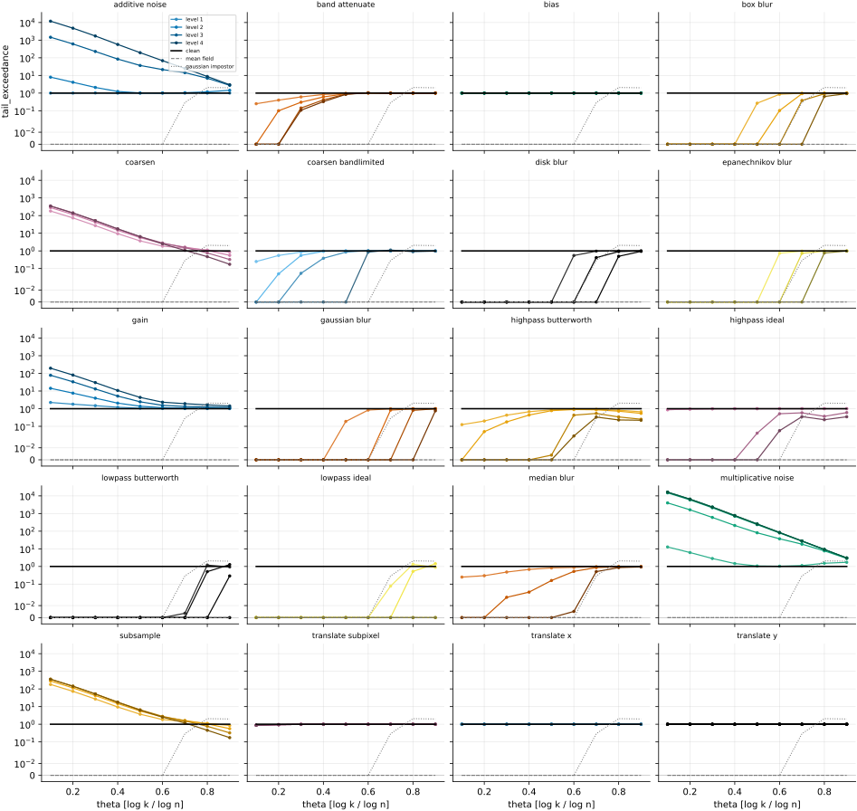

*As this metric's own field draws it.* The curve behind tail_exceedance on density: the median over frames at every strength of every degradation, the clean curve in black, the anchor dashed and the impostor dotted. Axes as the field draws them: linear x, symlog y; a symlog axis is linear within 6 decades of its largest magnitude and carries its zero line. Values are the literature's own, untransformed.

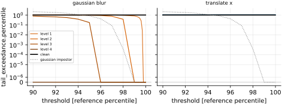

*As this metric's own field draws it.* The dense curve behind tail_exceedance.percentile on density, at every coordinate the curve returns, on the frames and ladder entries report.error_map stored: the median over those frames at every stored strength, the clean curve in black, the anchor dashed and the impostor dotted where stored. Axes as the field draws them: linear x, symlog y; a symlog axis is linear within 6 decades of its largest magnitude and carries its zero line. Values are the literature's own, untransformed.

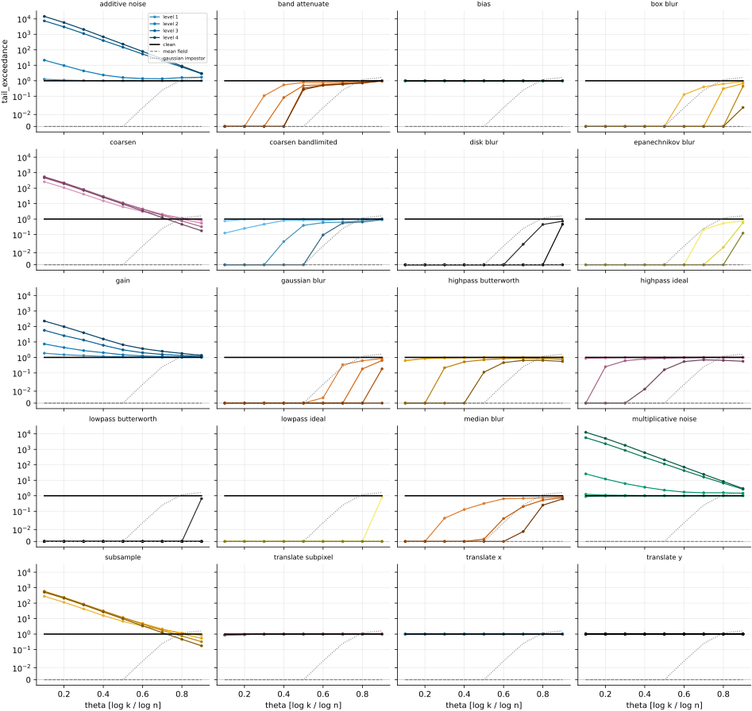

*As this metric's own field draws it.* The curve behind tail_exceedance on velocity: the median over frames at every strength of every degradation, the clean curve in black, the anchor dashed and the impostor dotted. Axes as the field draws them: linear x, symlog y; a symlog axis is linear within 6 decades of its largest magnitude and carries its zero line. Values are the literature's own, untransformed.

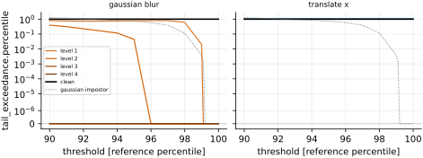

*As this metric's own field draws it.* The dense curve behind tail_exceedance.percentile on velocity, at every coordinate the curve returns, on the frames and ladder entries report.error_map stored: the median over those frames at every stored strength, the clean curve in black, the anchor dashed and the impostor dotted where stored. Axes as the field draws them: linear x, symlog y; a symlog axis is linear within 6 decades of its largest magnitude and carries its zero line. Values are the literature's own, untransformed.

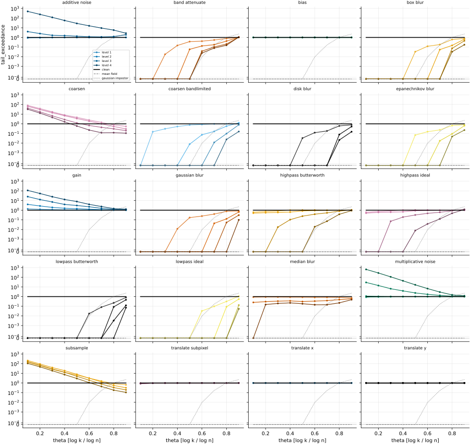

*As this metric's own field draws it.* The curve behind tail_exceedance on vorticity: the median over frames at every strength of every degradation, the clean curve in black, the anchor dashed and the impostor dotted. Axes as the field draws them: linear x, symlog y; a symlog axis is linear within 6 decades of its largest magnitude and carries its zero line. Values are the literature's own, untransformed.

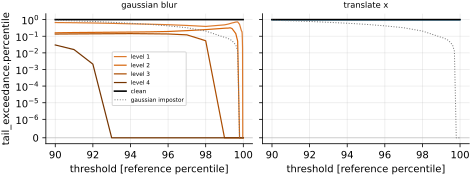

*As this metric's own field draws it.* The dense curve behind tail_exceedance.percentile on vorticity, at every coordinate the curve returns, on the frames and ladder entries report.error_map stored: the median over those frames at every stored strength, the clean curve in black, the anchor dashed and the impostor dotted where stored. Axes as the field draws them: linear x, symlog y; a symlog axis is linear within 6 decades of its largest magnitude and carries its zero line. Values are the literature's own, untransformed.

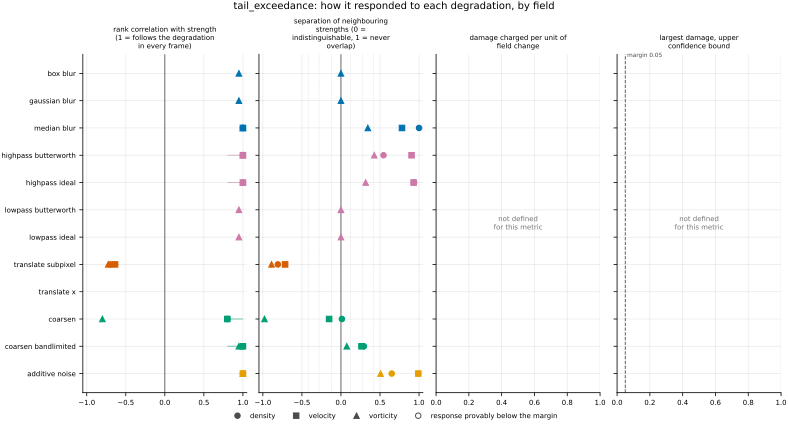

Four measured statistics for tail_exceedance, one row per degradation grouped by family and one marker per field. From left: the rank correlation between the metric and the applied strength within a frame, with the line showing the resampling interval; the separation of neighbouring strengths as Cliff's delta, where 0 means the metric cannot tell one strength from the next and the faint ticks at 0.12, 0.28 and 0.42 are Vargha and Delaney's small, medium and large anchors, for scale and not as grades; the damage charged per unit of field change at the harshest strength; and the upper confidence bound on the largest damage, beside the fixed margin of 0.05. A hollow marker is a field and degradation on which that bound lies below the margin, so the response is provably small. A missing marker is a statistic the analysis withheld, as the rank correlation is on an axis the metric is invariant to.

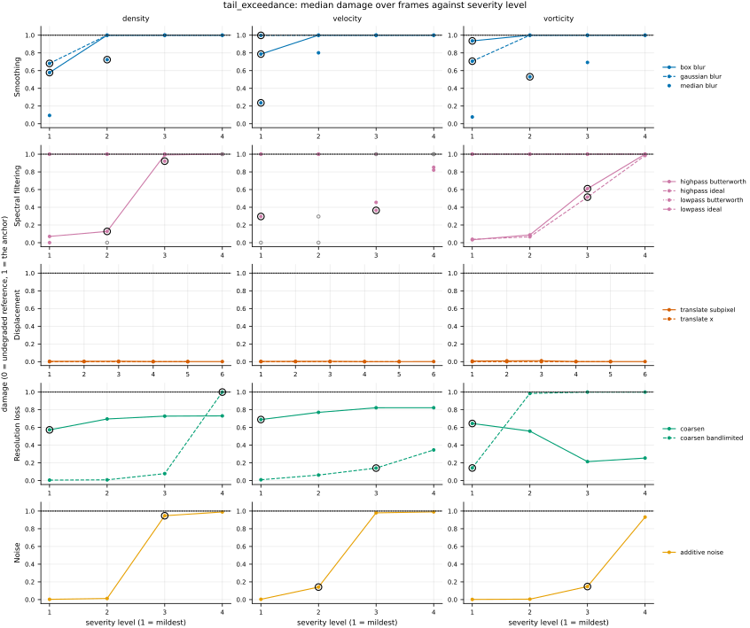

Median damage over frames against severity level for tail_exceedance, one row per family of degradation and one column per field, on one shared scale. The solid grey line is damage 1, the anchor (by default the field's own mean); the dotted black line is the damage assigned to the fake prediction with the right spectrum, where the run included it. The hollow black ring marks the first level at which the metric has moved a tenth of the way to the anchor. Hollow grey markers are strengths excluded for repeating a milder one or for doing nothing. Degradations with three or fewer usable levels are drawn as markers only; points beyond 2 either side are drawn as triangles at the edge. Damage is negative where a degradation moves the metric away from the anchor, as noise raises a single-field quantity the field's mean sets to zero.

**Trend: does the response follow the degradation?**

| test family | field | degradations | rank correlation | fraction of frames in order | weakest gap between neighbouring strengths |
|---|---|---|---|---|---|
| Displacement | density | 3 | -0.698 | 0 | 0.0958 |
| Displacement | velocity | 3 | -0.754 | 0 | 0.118 |
| Displacement | vorticity | 3 | -0.725 | 0 | 0.0557 |
| Cell-value distortion | density | 2 | 0.258 to 1 | 0 to 1 | 0.497 to 1 |
| Cell-value distortion | velocity | 2 | 0.258 to 1 | 0 to 1 | 0.522 to 0.989 |
| Cell-value distortion | vorticity | 2 | 0 to 1 | 0 to 1 | 0.483 to 1 |
| Resolution loss | density | 3 | 0.8 to 1 | 0.124 to 0.634 | 0.386 to 0.647 |
| Resolution loss | velocity | 3 | 0.2 to 1 | 0.00621 to 0.857 | 0.244 to 0.773 |
| Resolution loss | vorticity | 3 | -0.8 to 0.949 | 0 to 1 | 0.0104 to 0.537 |
| Smoothing | density | 5 | 0.775 to 1 | 1 | 0.5 to 1 |
| Smoothing | velocity | 5 | 0.775 to 1 | 1 | 0.5 to 0.662 |
| Smoothing | vorticity | 5 | 0.775 to 1 | 1 | 0.5 to 0.672 |
| Spectral filtering | density | 5 | 1 | 0.969 to 1 | 0.674 to 0.968 |
| Spectral filtering | velocity | 5 | 0.949 to 1 | 0.714 to 1 | 0.517 to 0.953 |
| Spectral filtering | vorticity | 5 | 0.775 to 1 | 0.615 to 1 | 0.5 to 0.713 |
| Noise | density | 2 | 1 | 0.826 to 1 | 0.825 to 0.998 |
| Noise | velocity | 2 | 1 | 0.839 to 0.988 | 0.835 to 0.993 |
| Noise | vorticity | 2 | 0.975 to 1 | 0.398 to 0.739 | 0.652 to 0.754 |

**Reactivity: how far does it move?**

| test family | field | change from clean at the harshest strength | elasticity | first strength detected |
|---|---|---|---|---|
| Displacement | density | -0.00195 to 0 | 0.167 | level — |
| Displacement | velocity | -0.00195 to 0 | 0.285 | level — |
| Displacement | vorticity | -0.00195 to 0 | 0.313 | level — |
| Cell-value distortion | density | 0 to 3.35 | 0.825 | level 2 |
| Cell-value distortion | velocity | 0 to 5.6 | 0.809 | level 2 |
| Cell-value distortion | vorticity | 0 to 6.85 | 0.864 | level 2 |
| Resolution loss | density | -1 to 5.44 | 0.173 to 1.88 | level 1 |
| Resolution loss | velocity | -1 to 8.72 | 0.0955 to 2.62 | level 1 |
| Resolution loss | vorticity | -1 to 1.91 | -0.794 to 1.4 | level 1 |
| Smoothing | density | -1 | 0 to 1.9 | level 1 |
| Smoothing | velocity | -1 | 0 to 0.538 | level 1 |
| Smoothing | vorticity | -1 to -0.818 | 0.0489 to 1.77 | level 1 |
| Spectral filtering | density | -1 to -0.154 | 1.06 to 9.36 | level 2 |
| Spectral filtering | velocity | -1 to -0.73 | 1.03 to 5.4 | level 1 |
| Spectral filtering | vorticity | -1 to -0.992 | 0 to 3.97 | level 1 |
| Noise | density | 194 to 255 | 0.733 to 1.25 | level 2 |
| Noise | velocity | 207 to 232 | 1.11 to 1.15 | level 2 |
| Noise | vorticity | 15.5 to 27.2 | 0.421 to 0.939 | level 3 |
| trap test: fake prediction, right spectrum | density | — | — | damage 1 |
| trap test: fake prediction, right spectrum | velocity | — | — | damage 1 |
| trap test: fake prediction, right spectrum | vorticity | — | — | damage 1 |

**Consistency: how much does it vary from snapshot to snapshot?**

| test family | field | consistency, in the strength's units | snapshots per independent block |
|---|---|---|---|
| Displacement | density | 0.918 | 1 |
| Displacement | velocity | 11.2 | 1 |
| Displacement | vorticity | 1.02 | 1 |
| Cell-value distortion | density | 0.00832 to 2.85 | 1 to 10 |
| Cell-value distortion | velocity | 0.0235 to 0.813 | 1 to 19 |
| Cell-value distortion | vorticity | 0.014 to 8.75 | 1 to 21 |
| Resolution loss | density | 2.23 to 3.62 | 11 to 20 |
| Resolution loss | velocity | 2.67 to 4.63 | 20 to 21 |
| Resolution loss | vorticity | 1.56 to 5.68 | 19 to 22 |
| Smoothing | density | 0.00695 to 0.887 | 1 to 12 |
| Smoothing | velocity | 0.0849 to 0.663 | 1 to 21 |
| Smoothing | vorticity | 0.0456 to 0.577 | 3 to 20 |
| Spectral filtering | density | 0.0807 to 0.147 | 1 to 20 |
| Spectral filtering | velocity | 0.0236 to 0.403 | 1 to 21 |
| Spectral filtering | vorticity | 0.0494 to 0.551 | 7 to 21 |
| Noise | density | 0.00825 to 0.00985 | 14 to 18 |
| Noise | velocity | 0.0129 to 0.0148 | 21 |
| Noise | vorticity | 0.0186 to 0.0476 | 9 to 22 |

One row per family of degradation and physical field; a cell gives the range over the degradations in that family. **Trend.** The rank correlation is the Spearman correlation between the strength and how far the metric has moved from its value on the undegraded field of the same frame, in the one direction it moves under that degradation, computed inside a single frame. A value of 1 means every strength moved it further than the last in every frame, whichever way it moves; a response that scatters to both sides scores near 0. The fraction of frames in order counts the frames with no exception. The weakest gap is the smallest Mann-Whitney overlap between two neighbouring strengths across frames: 1 means they never overlap, 0.5 that they cannot be told apart. **Reactivity.** The change from clean is the median, at the harshest strength, of the departure from the undegraded value of the same frame over the size of that value: 0.3 means 30%. The elasticity is the percentage change of that departure per percentage change in strength over the mildest strengths. First strength detected is the mildest at which the metric has moved a tenth of the way to the anchor; **damage** reads that 0-to-1 scale as a number. A dash means the measurement is not defined there. A metric's reactivity scales with the power it is expressed in: mean squared error's elasticity is twice root-mean-square error's, though the two carry the same information, so compare magnitudes across metrics with that in mind. **Consistency** is how much the response varies from snapshot to snapshot relative to its size, in the strength's units; the snapshots of one trajectory are correlated, and the last column is how many consecutive snapshots one independent block spans.

These tables report what was measured and grade none of the measurements. What the numbers mean for this metric is written in the subsections below, beside the test that produced each number.

**Profile.**

| field | selectivity | charges most for | charges least for | response provably below 0.05 at 90% on | elasticity to a sub-pixel shift, against severity (distance) | compute cost (x cheapest in this run) |
|---|---|---|---|---|---|---|
| density | 0.924 | `band_attenuate` | `bias` | `bias` `translate_subpixel` `translate_x` `translate_y` | 0.167 | 47.8 |
| velocity | 0.872 | `band_attenuate` | `bias` | `bias` `translate_subpixel` `translate_x` `translate_y` | 0.285 | 49.6 |
| vorticity | 0.409 | `median_blur` | `bias` | `bias` `translate_subpixel` `translate_x` `translate_y` | 0.313 | 50.8 |

One row per physical field. **Selectivity** is how concentrated the metric's response is on a few degradations, measured per unit of field change: 0 means it charges every degradation the same, as mean squared error does by construction, and values toward 1 that one degradation carries most of it. **Charges most and least for** name the two ends of that profile. **Response provably below** lists degradations on which the upper confidence bound of the largest damage lies below the margin -- an equivalence test, so an entry says the response is provably small, not merely not significant; a dash means no degradation met the bound. **Elasticity** is the slope of log damage against log shift over the smallest shifts: 1 means damage grows in proportion to the shift, 2 with its square. **Compute cost** is wall-clock per evaluation over the cheapest metric and field in the same run.

<!-- END GENERATED performance -->

## Intuition

This metric asks whether a prediction has as many extreme jumps between neighbouring cells as the
reference has. It takes the reference's neighbour-to-neighbour differences, finds the size of the
largest few, as many as the square root of the number of cells, and calls any difference at least
that large an extreme event. It then counts the events in the prediction and divides by the count
in the reference. One means the prediction has the right number of extreme jumps; less than one
means too few, which is what smoothing does to sharp structures; more than one means too many,
which is what noise does. The threshold comes from the reference alone, so it is the same for every
prediction of that reference.

A worked example, four cells by four cells. The reference is a sawtooth down each column: the
values 0, 3, 2, 1, wrapping back to 0, so going down a column the field jumps up by 3 once and
steps down by 1 three times. In the first prediction two columns have their jump cut to 2; the
second prediction is the reference tripled.

```
reference        first prediction     second prediction
0 0 0 0          0 0 0 0              0 0 0 0
3 3 3 3          3 3 2 2              9 9 9 9
2 2 2 2          2 2 2 2              6 6 6 6
1 1 1 1          1 1 1 1              3 3 3 3

                 0.5                  4
```

Sixteen cells means the four largest steps set the threshold: the reference's four jumps of 3, so
an event is a step of at least 3, and the reference has four. The first prediction keeps two jumps
of 3, so it scores two over four, 0.5. The tripled prediction has steps of 9 and 3, all sixteen at
least 3, so it scores sixteen over four, 4. Along the rows the reference is constant, so that
direction has no extreme steps and is left out.

What it ignores: where the extreme jumps are, how large they are beyond the threshold, and
everything about the smaller jumps.

## Reading the output

Dimensionless, zero or positive, and unbounded above; at most $n/k$, 256 on the 256 by 256 grid.
The target is 1: the analysis reads the value by its distance from 1, $|v - 1| / (v + 1)$, which
orders values as the log ratio $|\ln v|$ does and is bounded at 1, so 0.5 and 2 are equally far
from right and 0 is the furthest point (see "Metrics with a target value" in
`TEST_DESCRIPTION.md`); the damage is that distance, since the anchor scores 0. Below 1 the prediction has fewer increments as large as the
reference's extreme ones, above 1 more. The prediction that is the reference itself scores exactly
1. When the reference's increments are independent values, an independent draw from their
distribution scores $n/(n+1)$ on average (Equation (5)), with a spread across draws that grows as
$k$ shrinks; for a real field, whose increments are correlated, that expectation is not
established.

Because the threshold and the counts scale together, multiplying both fields by one constant
changes nothing, and a prediction can be compared with a reference of any magnitude. Values are
comparable across predictions of the same reference. Values at different analysis-grid
resolutions are not comparable: the increment is one cell long, and $k$ is set by the number of
cells.

The companions are the curves `tail_exceedance[theta]`, Equation (4) at
$k = \lceil n^{\theta} \rceil$ for $\theta$ from 0.1 to 0.9, and
`tail_exceedance.percentile[p]`, the same at the reference's $p$-th percentile, Equation (6).
Small $\theta$ or large $p$ is a rarer event; on 256 by 256 $\theta = 0.9$ counts about a third of
all increments and $p = 90$ a tenth. Read the percentile curve as a verifier reads the bias
against threshold: where it sits on 1, the prediction has the reference's number of increments
beyond that percentile; where it falls to 0 at the high percentiles and recovers at the low ones,
the prediction has lost only its most extreme increments.

## Limitations

The value saturates. Once a prediction has no increment as large as the reference's $\sqrt{n}$-th
largest, it scores 0 however much further it is smoothed, the furthest point from the target:
two predictions both at 0 are tied, and a mild blur and a total one are scored alike. On the
evidence run, on density and velocity, the Gaussian and box blurs leave the value at 0 from their
second strength in every frame and both low-pass filters at every strength, so the registered
number cannot tell any blur strength beyond the first, nor any low-pass strength, from another:
the blurs' rank correlation is 0.775, the value of one graded point followed by three ties
(the Gaussian blur on velocity is at 0 from its first strength and withheld), and the
low-pass filters' is withheld (Results, "Smoothing" and "Spectral filtering"). The stored
curve at larger $\theta$ is where such predictions are still told apart.

A value above 1 does not mean the prediction is more intermittent or more turbulent. Anything that
puts more one-cell jumps above the reference's extreme level raises it: noise, and also a
blocky reconstruction whose block edges concentrate the change between blocks into single-cell
jumps. Below 1 does not mean smoother everywhere either, only fewer extreme jumps.

It is not monotone under smoothing in general, which the decorator declares and the contract test
checks. Spreading one tall, isolated jump over several cells can put each of them above a low
threshold, so blur can raise the count before it lowers it: a 16-cell spike of height 8 on faint
noise scores 1, 1, 2, 3, 3.5 and then 0 as the blur widens (`test_metric.py`).

The counts are piecewise constant in the prediction, so the metric has no useful gradient and is
not a training loss. A pair along which the reference is exactly constant is left out, but the same
pair with round-off variation is not and then sets a round-off threshold that almost any prediction
exceeds everywhere; the rule is discontinuous, as `issues/103` records for `tail_index`. Ties in
the reference at its threshold make the reference's count larger than $k$, which only matters for
fields with repeated increment values, such as a staircase.

## Results

<!-- GENERATED run: written by `python -m fmeval.cards evidence tail_exceedance --results results/comparison_1793829127 --results results/comparison_1793811840 --results results/comparison_1793829231`, do not edit -->

Measured on `kinet_re5e4`, frames 2000 to 10000 (161 frames of developed flow), on the 256 analysis grid, seed 20260807, at commit `adbdc88e4950`. Run `comparison_1793829127`.

Every number in this section comes from that run, except in the subsections headed with another experiment and in a figure whose caption names another run, each of which names its own run. Regenerate with `python -m fmeval.cards evidence <name> --results results/comparison_1793829127 --results results/comparison_1793811840 --results results/comparison_1793829231`.

<!-- END GENERATED run -->

<!-- GENERATED experiments: written by `python -m fmeval.cards catalog`, do not edit -->

**Across the experiments.**

| experiment | what a run on it is evidence of | on this card |
|---|---|---|
| `kinet_re5e4` | developed flow | measured, run `comparison_1793829127`: the main results |
| `kinet_re1e6` | developed flow at Re = 1e6, twenty times the Reynolds number of kinet_re5e4, from the same initial condition | measured, run `comparison_1793829231`: under *On `kinet_re1e6`* |
| `synthetic_ensemble` | a calibrated null: evidence that the estimator computes what it claims to compute, and nothing about turbulence | not applicable: the member mean has no increment as large as the reference's extremes, so the value is 0 at every level of every axis (measured), and the dispersion axes do not move the member mean |
| `sod_shock_tube` | an analytic check: evidence that the metric locates and scores a known shock correctly, and nothing about turbulence | not applicable: needs a periodic domain, and this dataset is not periodic |
| `forecast_re5e4` | real predictions scored against their targets at each prediction step; who produced the predictions, a trained model or a coarser solver, is not recorded | measured, run `comparison_1793811840`: under *On `forecast_re5e4`* |

One row per dataset a card may cite (`configs/cards/default.yaml`). *Measured* names the run the card cites: the main results are `## Performance` and the subsections below, and every other run has its own subsection headed with its dataset. *Not applicable* gives the reason: one that follows from what the metric declares and what the dataset offers, or one a person wrote on the card (`not_run` in `card.yaml`) because the result would carry no information. *Not yet run* means the metric can run there and the card cites no run on it yet.

<!-- END GENERATED experiments -->

### Smoothing

[gaussian_blur](../../degradations/gaussian_blur/card.md) ·
[box_blur](../../degradations/box_blur/card.md) ·
[median_blur](../../degradations/median_blur/card.md)

<!-- GENERATED results_smoothing: written by `python -m fmeval.cards evidence tail_exceedance --results results/comparison_1793829127 --results results/comparison_1793811840 --results results/comparison_1793829231`, do not edit -->

| degradation | field | strengths | rank correlation | fraction of frames in the right order | weakest gap between neighbouring strengths |
|---|---|---|---|---|---|
| `box_blur` | density | 4 | 0.775 | 1 | 0.5 |
| `box_blur` | velocity | 4 | 0.775 | 1 | 0.5 |
| `box_blur` | vorticity | 4 | 0.949 | 1 | 0.5 |
| `disk_blur` | density | 3 | — | — | — |
| `disk_blur` | velocity | 3 | — | — | — |
| `disk_blur` | vorticity | 3 | 0.866 | 1 | 0.506 |
| `epanechnikov_blur` | density | 3 | 0.866 | 1 | 0.5 |
| `epanechnikov_blur` | velocity | 3 | — | — | — |
| `epanechnikov_blur` | vorticity | 3 | 0.866 | 1 | 0.55 |
| `gaussian_blur` | density | 4 | 0.775 | 1 | 0.5 |
| `gaussian_blur` | velocity | 4 | — | — | — |
| `gaussian_blur` | vorticity | 4 | 0.775 | 1 | 0.5 |
| `median_blur` | density | 3 | 1 | 1 | 1 |
| `median_blur` | velocity | 3 | 1 | 1 | 0.662 |
| `median_blur` | vorticity | 3 | 1 | 1 | 0.672 |

<!-- END GENERATED results_smoothing -->

Every blur lowers the value on every field, and the harshest strength of each takes the median to
0, a change from clean of -1 in the Performance tables, except the median blur on vorticity, which
leaves a change of -0.818. The median blur is followed in every frame on every field (rank
correlation 1, every frame in order). The linear blurs saturate: on density and velocity the
Gaussian and box blurs leave the value at 0 from the second strength in every frame, so each frame
is one graded point and three ties at 0, the furthest point from the target, whose rank
correlation is 0.775 whatever the graded value is; every frame counts as in order, because a value
at 0 cannot move further, but the 0.775 records the tie pattern, not a grading of the axis. The
Gaussian blur on velocity, the disk blur on density and velocity and the Epanechnikov blur on
velocity are at 0 from their mildest strength, so their rows are withheld. On vorticity a few
events survive longer: the box blur reads 0.949 and the disk and Epanechnikov blurs 0.866.


### Spectral filtering

[lowpass_ideal](../../degradations/lowpass_ideal/card.md) ·
[highpass_ideal](../../degradations/highpass_ideal/card.md)

<!-- GENERATED results_spectral: written by `python -m fmeval.cards evidence tail_exceedance --results results/comparison_1793829127 --results results/comparison_1793811840 --results results/comparison_1793829231`, do not edit -->

| degradation | field | strengths | rank correlation | fraction of frames in the right order | weakest gap between neighbouring strengths |
|---|---|---|---|---|---|
| `band_attenuate` | density | 4 | 1 | 0.969 | 0.674 |
| `band_attenuate` | velocity | 4 | 0.949 | 0.714 | 0.517 |
| `band_attenuate` | vorticity | 4 | 0.949 | 0.975 | 0.539 |
| `highpass_butterworth` | density | 4 | 1 | 1 | 0.773 |
| `highpass_butterworth` | velocity | 3 | 1 | 0.994 | 0.945 |
| `highpass_butterworth` | vorticity | 4 | 1 | 0.646 | 0.713 |
| `highpass_ideal` | density | 3 | 1 | 1 | 0.968 |
| `highpass_ideal` | velocity | 2 | 1 | 1 | 0.953 |
| `highpass_ideal` | vorticity | 4 | 1 | 0.615 | 0.658 |
| `lowpass_butterworth` | density | 4 | — | — | — |
| `lowpass_butterworth` | velocity | 3 | — | — | — |
| `lowpass_butterworth` | vorticity | 4 | 0.775 | 1 | 0.5 |
| `lowpass_ideal` | density | 3 | — | — | — |
| `lowpass_ideal` | velocity | 2 | — | — | — |
| `lowpass_ideal` | vorticity | 4 | 0.775 | 1 | 0.5 |

<!-- END GENERATED results_spectral -->

The low-pass filters remove the extremes outright: the value is 0 at every strength on density and
velocity, so there is nothing to order and their rows are withheld, and on vorticity it reaches 0
from the second strength (rank correlation 0.775, the blurs' tie pattern). The high-pass filters
also lower the value, and they are followed with a rank correlation of 1 on every field, with
0.615 to 1 of frames in order: removing the large scales takes away the part of the largest
one-cell jumps those scales carried. `band_attenuate` lowers it too (rank correlation 1 on density
and 0.949 on velocity and vorticity), and it is the degradation the metric charges most for per
unit of field change on density and velocity (Profile).


### Displacement

[translate_x](../../degradations/translate/card.md) ·
[translate_subpixel](../../degradations/translate_subpixel/card.md)

<!-- GENERATED results_geometric: written by `python -m fmeval.cards evidence tail_exceedance --results results/comparison_1793829127 --results results/comparison_1793811840 --results results/comparison_1793829231`, do not edit -->

| degradation | field | strengths | rank correlation | fraction of frames in the right order | weakest gap between neighbouring strengths |
|---|---|---|---|---|---|
| `translate_subpixel` | density | 6 | -0.698 | 0 | 0.0958 |
| `translate_subpixel` | velocity | 6 | -0.754 | 0 | 0.118 |
| `translate_subpixel` | vorticity | 6 | -0.725 | 0 | 0.0557 |
| `translate_x` | density | 5 | — | — | — |
| `translate_x` | velocity | 5 | — | — | — |
| `translate_x` | vorticity | 5 | — | — | — |
| `translate_y` | density | 5 | — | — | — |
| `translate_y` | velocity | 5 | — | — | — |
| `translate_y` | vorticity | 5 | — | — | — |

<!-- END GENERATED results_geometric -->

An integer translation moves the increments without changing their sizes, so `translate_x` and
`translate_y` leave the value at exactly 1 at every strength and their rows are withheld; the
Profile lists them as degradations the response is provably small on, with a damage of exactly 0.
`translate_subpixel` is listed there too: its largest damage is 0.0271, 0.0321 and 0.109 on
density, velocity and vorticity. It gives a negative rank correlation, -0.698 to -0.754: a
fractional shift interpolates between cells and moves the count slightly away from 1, while its
harshest strengths are whole cells, which return it to within -0.00195 of 1 (the remainder is the
Fourier shift's treatment of the grid's highest mode, `issues/041`).


### Resolution loss

[coarsen](../../degradations/coarsen/card.md) ·
[coarsen_bandlimited](../../degradations/coarsen_bandlimited/card.md)

<!-- GENERATED results_resolution: written by `python -m fmeval.cards evidence tail_exceedance --results results/comparison_1793829127 --results results/comparison_1793811840 --results results/comparison_1793829231`, do not edit -->

| degradation | field | strengths | rank correlation | fraction of frames in the right order | weakest gap between neighbouring strengths |
|---|---|---|---|---|---|
| `coarsen` | density | 4 | 0.8 | 0.385 | 0.506 |
| `coarsen` | velocity | 4 | 0.4 | 0.0248 | 0.244 |
| `coarsen` | vorticity | 4 | -0.8 | 0 | 0.0104 |
| `coarsen_bandlimited` | density | 4 | 1 | 0.634 | 0.647 |
| `coarsen_bandlimited` | velocity | 4 | 1 | 0.857 | 0.773 |
| `coarsen_bandlimited` | vorticity | 4 | 0.949 | 1 | 0.537 |
| `subsample` | density | 4 | 0.8 | 0.124 | 0.386 |
| `subsample` | velocity | 4 | 0.2 | 0.00621 | 0.262 |
| `subsample` | vorticity | 4 | -0.8 | 0 | 0.142 |

<!-- END GENERATED results_resolution -->

`coarsen` raises the value far above 1 on density and velocity: at the harshest strength it
exceeds its clean value of 1 by 5.44 and 8.34 times that value (the 0.5 column of the curve tables
below, a change from clean), with rank correlations of 0.8 and 0.4. A block reconstruction
concentrates the change between blocks into one-cell jumps at block edges, and many of those reach
the reference's extreme level, so a value above 1 does not mean a more intermittent field. On
vorticity it first rises above 1 and then falls below, to a change of -0.406, so its distance from
1 shrinks with the factor and the rank correlation is -0.8. `subsample` behaves the same way (a
change of 5.28 and 8.72 on density and velocity, rank correlation -0.8 on vorticity).
`coarsen_bandlimited` lowers the value and is followed on density and velocity (rank correlation
1) and on vorticity (0.949).


### Noise

[additive_noise](../../degradations/additive_noise/card.md)

<!-- GENERATED results_stochastic: written by `python -m fmeval.cards evidence tail_exceedance --results results/comparison_1793829127 --results results/comparison_1793811840 --results results/comparison_1793829231`, do not edit -->

| degradation | field | strengths | rank correlation | fraction of frames in the right order | weakest gap between neighbouring strengths |
|---|---|---|---|---|---|
| `additive_noise` | density | 4 | 1 | 0.826 | 0.825 |
| `additive_noise` | velocity | 4 | 1 | 0.988 | 0.993 |
| `additive_noise` | vorticity | 4 | 1 | 0.739 | 0.754 |
| `multiplicative_noise` | density | 5 | 1 | 1 | 0.998 |
| `multiplicative_noise` | velocity | 5 | 1 | 0.839 | 0.835 |
| `multiplicative_noise` | vorticity | 5 | 0.975 | 0.398 | 0.652 |

<!-- END GENERATED results_stochastic -->

Both noise axes raise the value on every field, with a rank correlation of 1 (0.975 for
multiplicative noise on vorticity). At the harshest strength additive noise puts it above its clean
value of 1 by 194, 232 and 27.2 times that value on density, velocity and vorticity (the curve
tables below, column 0.5). Multiplicative noise on density reaches 255, so its value is 256, the
ceiling $n/k$ that a prediction with every increment above the threshold reaches. The mildest
strength barely moves the value, so 0.739 to 0.988 of frames are strictly in order under additive
noise: there a few counts scatter on either side of 1.


### Cell-value distortion

[gain](../../degradations/gain/card.md) ·
[bias](../../degradations/bias/card.md)

<!-- GENERATED results_pointwise: written by `python -m fmeval.cards evidence tail_exceedance`, do not edit -->

Not generated yet. Run `python -m fmeval.cards evidence tail_exceedance`.

<!-- END GENERATED results_pointwise -->

### Trap tests

[gaussian_impostor](../../degradations/gaussian_impostor/card.md) ·
[uncorrelated](../../degradations/random_large_translation/card.md)

<!-- GENERATED results_canaries: written by `python -m fmeval.cards evidence tail_exceedance --results results/comparison_1793829127 --results results/comparison_1793811840 --results results/comparison_1793829231`, do not edit -->

| field | damage assigned to the fake prediction | closest real degradation | damage of the reference moved far away | value on the anchor |
|---|---|---|---|---|
| density | 1 | `box_blur=19.4199` | 0 | 0 |
| velocity | 1 | `box_blur=11.3263` | 0 | 0 |
| vorticity | 1 | `band_attenuate=0.2` | 0 | 0 |

The fake prediction here has exactly the reference field's amplitude spectrum and completely scrambled structure. Damage 1 is what the anchor scores, by default the reference's own spatial mean, a prediction that knows the mean and nothing else. The damage column therefore says how close to useless this metric considers that fake prediction: a low number means the metric was fooled. The third column translates the same number into an ordinary degradation whose damage the fake prediction matches, which is easier to picture. The fourth is the reference moved by a large random offset, the right statistics in the wrong place; where a field's energy sits in its largest scales that copy stays partly correlated with the reference, so it is not the score of an unrelated field.

<!-- END GENERATED results_canaries -->

The fake prediction with the right spectrum is not mistaken for the reference: its median value is
0 on every field, the anchor's value, so it is assigned damage 1. With the reference's spectrum but
no intermittency, its increments are close to Gaussian with the reference's variance, and almost
none reaches the reference's square-root-of-n-th largest increment. The reference moved far away
keeps every increment's size, scores exactly 1 and is assigned damage 0: the metric does not see
position at all.

### Compared with the other metrics

<!-- GENERATED results_summary: written by `python -m fmeval.cards evidence tail_exceedance --results results/comparison_1793829127 --results results/comparison_1793811840 --results results/comparison_1793829231`, do not edit -->

| compared with | density | velocity | vorticity |
|---|---|---|---|
| `increment_w1_by_separation` | 0.845 | 0.905 | 0.895 |
| `increment_w1` | 0.795 | 0.875 | 0.88 |
| `spectral_energy_flux` | — | 0.859 | — |
| `energy_distance` | 0.782 | 0.878 | 0.855 |
| `persistence_distance` | 0.883 | — | 0.725 |
| `spectrum_l2` | 0.844 | 0.773 | 0.727 |
| `h1_seminorm` | 0.333 | 0.306 | 0.037 |
| `h1_relative` | 0.336 | 0.3 | 0.0421 |
| `max_error_channel_mean` | 0.358 | 0.258 | -0.0491 |
| `max_error` | 0.358 | 0.22 | -0.0491 |
| `wasserstein` | 0.19 | — | — |
| `nrmse` | 0.221 | 0.138 | -0.0623 |
| `vrmse` | 0.22 | 0.138 | -0.0613 |
| `rmse_channel_mean` | 0.221 | 0.134 | -0.0606 |
| `rmse` | 0.221 | 0.121 | -0.0606 |
| `mse` | 0.221 | 0.121 | -0.0608 |
| `mae` | 0.146 | 0.0951 | -0.0496 |
| `h_minus_one` | 0.203 | 0.0947 | -0.0768 |
| `tail_index` | -0.313 | -0.277 | -0.516 |
| `increment_flatness` | -0.507 | -0.6 | 0.347 |
| `kinetic_energy` | — | -0.593 | — |
| `enstrophy` | — | — | -0.61 |
| `palinstrophy` | — | — | -0.615 |

Rank correlation over every degradation, computed separately for each physical field on the median value at each combination of degradation and strength, with the undegraded reference excluded. A dash marks a metric that does not run on that field. A metric with a target value enters by its distance from the target. Two metrics correlating near 1 put the degradations in the same order, but the two may still weight those degradations very differently. A correlation near 1 therefore means the two metrics are redundant for ranking models, not that the two are interchangeable as training losses.

<!-- END GENERATED results_summary -->

Read by its distance from 1, it orders the ladder most like the other metrics that compare
distributions of increments or spectra rather than cell values: `increment_w1_by_separation`,
`increment_w1`, `energy_distance`, `spectrum_l2`, `persistence_distance` where it runs and
`spectral_energy_flux` on velocity all correlate with it well above the rest of the table. With the
pointwise errors and the $H^1$ norms its correlation is weak on density and velocity and near zero
on vorticity, so the order it gives the ladder is not theirs. The negative correlations with
`tail_index`, `kinetic_energy`, `enstrophy` and `palinstrophy` are, by this card's reading, mostly
orientation: those single-field quantities enter as raw values that fall under the blurs and
low-pass filters, while this distance rises. `increment_flatness` correlates negatively on density
and velocity and positively on vorticity.


### Damage beside the other metrics

<!-- GENERATED results_damage_by_level: written by `python -m fmeval.cards evidence tail_exceedance --results results/comparison_1793829127 --results results/comparison_1793811840 --results results/comparison_1793829231`, do not edit -->

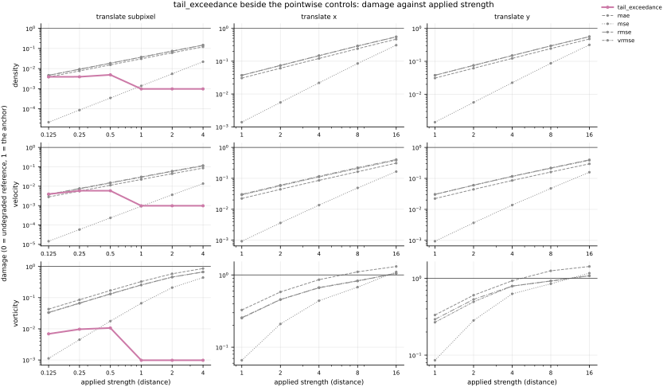

Median damage over frames against the applied strength, log-log, for tail_exceedance (bold, in colour) and the pointwise controls mae, mse, rmse, vrmse (thin, grey), one column per displacement degradation and one row per field. The grey line is damage 1, the anchor (by default the field's own mean). Parallel lines charge in the same proportion at every strength; a steeper line charges relatively more for the larger shifts, which is what decides whether two metrics are interchangeable as training losses. These are the same numbers as the table beneath.

**Displacement, density, `translate_subpixel`** (strength: distance).

| metric | 0.125 | 0.25 | 0.5 | 1 | 2 | 4 |
|---|---|---|---|---|---|---|
| `tail_exceedance` | 0.00389 | 0.00392 | 0.00491 | 0.000978 | 0.000978 | 0.000978 |
| `mae` | 0.00383 | 0.00767 | 0.0153 | 0.0306 | 0.061 | 0.121 |
| `mse` | 2.17e-05 | 8.68e-05 | 0.000347 | 0.00138 | 0.00551 | 0.0219 |
| `rmse` | 0.00466 | 0.00931 | 0.0186 | 0.0372 | 0.0743 | 0.148 |
| `vrmse` | 0.00463 | 0.00926 | 0.0185 | 0.037 | 0.0738 | 0.147 |

**Displacement, density, `translate_x`** (strength: distance).

| metric | 1 | 2 | 4 | 8 | 16 |
|---|---|---|---|---|---|
| `tail_exceedance` | 0 | 0 | 0 | 0 | 0 |
| `mae` | 0.0306 | 0.061 | 0.121 | 0.24 | 0.469 |
| `mse` | 0.00138 | 0.00551 | 0.0219 | 0.0849 | 0.307 |
| `rmse` | 0.0372 | 0.0743 | 0.148 | 0.291 | 0.555 |
| `vrmse` | 0.037 | 0.0738 | 0.147 | 0.29 | 0.55 |

**Displacement, density, `translate_y`** (strength: distance).

| metric | 1 | 2 | 4 | 8 | 16 |
|---|---|---|---|---|---|
| `tail_exceedance` | 0 | 0 | 0 | 0 | 0 |
| `mae` | 0.031 | 0.0616 | 0.122 | 0.244 | 0.476 |
| `mse` | 0.00142 | 0.00565 | 0.0224 | 0.0869 | 0.316 |
| `rmse` | 0.0377 | 0.0752 | 0.15 | 0.295 | 0.562 |
| `vrmse` | 0.0376 | 0.075 | 0.149 | 0.294 | 0.56 |

**Displacement, velocity, `translate_subpixel`** (strength: distance).

| metric | 0.125 | 0.25 | 0.5 | 1 | 2 | 4 |
|---|---|---|---|---|---|---|
| `tail_exceedance` | 0.00392 | 0.00583 | 0.00583 | 0.000978 | 0.000978 | 0.000978 |
| `mae` | 0.00279 | 0.00559 | 0.0112 | 0.0223 | 0.0441 | 0.0859 |
| `mse` | 1.45e-05 | 5.81e-05 | 0.000232 | 0.000924 | 0.0036 | 0.0136 |
| `rmse` | 0.00381 | 0.00762 | 0.0152 | 0.0304 | 0.06 | 0.117 |
| `vrmse` | 0.00365 | 0.00729 | 0.0146 | 0.029 | 0.0574 | 0.111 |

**Displacement, velocity, `translate_x`** (strength: distance).

| metric | 1 | 2 | 4 | 8 | 16 |
|---|---|---|---|---|---|
| `tail_exceedance` | 0 | 0 | 0 | 0 | 0 |
| `mae` | 0.0223 | 0.0441 | 0.0859 | 0.163 | 0.31 |
| `mse` | 0.000924 | 0.0036 | 0.0136 | 0.0489 | 0.165 |
| `rmse` | 0.0304 | 0.06 | 0.117 | 0.221 | 0.406 |
| `vrmse` | 0.029 | 0.0574 | 0.111 | 0.209 | 0.383 |

**Displacement, velocity, `translate_y`** (strength: distance).

| metric | 1 | 2 | 4 | 8 | 16 |
|---|---|---|---|---|---|
| `tail_exceedance` | 0 | 0 | 0 | 0 | 0 |
| `mae` | 0.0223 | 0.0442 | 0.0856 | 0.16 | 0.295 |
| `mse` | 0.000935 | 0.00366 | 0.0138 | 0.0473 | 0.158 |
| `rmse` | 0.0306 | 0.0605 | 0.117 | 0.218 | 0.397 |
| `vrmse` | 0.0303 | 0.0599 | 0.115 | 0.212 | 0.384 |

**Displacement, vorticity, `translate_subpixel`** (strength: distance).

| metric | 0.125 | 0.25 | 0.5 | 1 | 2 | 4 |
|---|---|---|---|---|---|---|
| `tail_exceedance` | 0.00688 | 0.00967 | 0.0106 | 0.000978 | 0.000978 | 0.000978 |
| `mae` | 0.0428 | 0.0854 | 0.169 | 0.328 | 0.582 | 0.86 |
| `mse` | 0.00112 | 0.00448 | 0.0176 | 0.066 | 0.21 | 0.44 |
| `rmse` | 0.0335 | 0.0669 | 0.133 | 0.257 | 0.458 | 0.663 |
| `vrmse` | 0.0329 | 0.0656 | 0.13 | 0.253 | 0.455 | 0.671 |

**Displacement, vorticity, `translate_x`** (strength: distance).

| metric | 1 | 2 | 4 | 8 | 16 |
|---|---|---|---|---|---|
| `tail_exceedance` | 0 | 0 | 0 | 0 | 0 |
| `mae` | 0.328 | 0.582 | 0.86 | 1.1 | 1.31 |
| `mse` | 0.066 | 0.21 | 0.44 | 0.679 | 1.1 |
| `rmse` | 0.257 | 0.458 | 0.663 | 0.824 | 1.05 |
| `vrmse` | 0.253 | 0.455 | 0.671 | 0.832 | 1.05 |

**Displacement, vorticity, `translate_y`** (strength: distance).

| metric | 1 | 2 | 4 | 8 | 16 |
|---|---|---|---|---|---|
| `tail_exceedance` | 0 | 0 | 0 | 0 | 0 |
| `mae` | 0.333 | 0.603 | 0.93 | 1.25 | 1.43 |
| `mse` | 0.0858 | 0.283 | 0.628 | 0.849 | 1.17 |
| `rmse` | 0.293 | 0.532 | 0.793 | 0.922 | 1.08 |
| `vrmse` | 0.268 | 0.495 | 0.793 | 0.927 | 1.08 |

Median damage over frames at every strength, this metric in the first row and the pointwise controls beneath it, all on the same 0-to-1 scale where 0 is the undegraded reference and 1 the anchor (by default the field's own mean); a dash means no damage scale on that field. The rank correlations under *Compared with the other metrics* say whether two metrics put the strengths in the same order; this table says how much each one charges for the same strength, which decides whether two metrics are interchangeable as training losses.

<!-- END GENERATED results_damage_by_level -->

On displacement it charges almost nothing beside the pointwise controls: exactly 0 at every
whole-cell translation, which moves increments without changing their sizes, and a damage that
stays small and does not grow under a sub-pixel shift, against pointwise damages that grow with the
shift.


### The curve behind the number

<!-- GENERATED results_companion: written by `python -m fmeval.cards evidence tail_exceedance --results results/comparison_1793829127 --results results/comparison_1793811840 --results results/comparison_1793829231`, do not edit -->

**Curve `tail_exceedance`.**

**density, rank correlation, at each coordinate.**

| degradation | 0.1 | 0.2 | 0.3 | 0.4 | 0.5 | 0.6 | 0.7 | 0.8 | 0.9 | dominance |
|---|---|---|---|---|---|---|---|---|---|---|
| `additive_noise` | 1 | 1 | 1 | 1 | 1 | 1 | 1 | 1 | 1 | 0.776 |
| `band_attenuate` | 0.775 | 0.949 | 1 | 1 | 1 | 1 | 1 | 1 | 1 | 0.478 |
| `bias` | — | — | — | — | 0.258 | 0.258 | — | 0.775 | 0.775 | — |
| `box_blur` | — | — | — | — | 0.775 | 0.949 | 1 | 1 | 0.8 | 0.497 |
| `coarsen` | 0.8 | 0.8 | 0.8 | 0.8 | 0.8 | 0.4 | -0.4 | 0.8 | 1 | 0 |
| `coarsen_bandlimited` | 0.775 | 0.775 | 0.949 | 1 | 1 | 1 | 1 | 1 | 0.8 | 0.211 |
| `disk_blur` | — | — | — | — | — | 0.866 | 1 | 1 | 1 | 0.702 |
| `epanechnikov_blur` | — | — | — | — | 0.866 | 0.866 | 1 | 1 | 1 | 0.696 |
| `gain` | 1 | 1 | 1 | 1 | 1 | 1 | 1 | 1 | 1 | 1 |
| `gaussian_blur` | — | — | — | — | 0.775 | 0.775 | 0.949 | 1 | 1 | 0.559 |
| `highpass_butterworth` | 0.775 | 0.949 | 0.949 | 0.949 | 1 | 1 | 1 | 1 | 1 | 0.907 |
| `highpass_ideal` | 0.866 | 0.866 | 0.866 | 0.866 | 1 | 1 | 1 | 1 | 1 | 0.932 |
| `lowpass_butterworth` | — | — | — | — | — | — | 0.775 | 0.949 | 1 | 0.882 |
| `lowpass_ideal` | — | — | — | — | — | — | 0.866 | 1 | 1 | 0.876 |
| `median_blur` | 0.866 | 0.866 | 1 | 1 | 1 | 1 | 1 | 1 | 1 | 1 |
| `multiplicative_noise` | 1 | 1 | 1 | 1 | 1 | 1 | 1 | 1 | 1 | 1 |
| `subsample` | 1 | 0.949 | 0.8 | 0.8 | 0.8 | 0.4 | -0.4 | 0.8 | 1 | 0 |
| `translate_subpixel` | -0.522 | -0.577 | -0.541 | -0.698 | -0.698 | -0.698 | -0.759 | -0.698 | -0.759 | 0 |
| `translate_x` | — | — | — | — | — | — | — | — | — | — |
| `translate_y` | — | — | — | — | — | — | — | — | — | — |

**density, change from clean at the harshest strength, at each coordinate.**

| degradation | 0.1 | 0.2 | 0.3 | 0.4 | 0.5 | 0.6 | 0.7 | 0.8 | 0.9 |
|---|---|---|---|---|---|---|---|---|---|
| `additive_noise` | 1.19e+04 | 4.77e+03 | 1.71e+03 | 570 | 194 | 67.7 | 23.9 | 7.72 | 1.97 |
| `band_attenuate` | -1 | -1 | -0.893 | -0.671 | -0.154 | 0.0418 | -0.0225 | -0.00407 | 0.00136 |
| `bias` | 0 | 0 | 0 | 0 | 0 | 0 | 0 | 0 | 0 |
| `box_blur` | -1 | -1 | -1 | -1 | -1 | -1 | -1 | -0.359 | -0.0671 |
| `coarsen` | 343 | 138 | 50.1 | 16.5 | 5.44 | 1.51 | 0.0608 | -0.53 | -0.826 |
| `coarsen_bandlimited` | -1 | -1 | -1 | -1 | -1 | -0.151 | 0.12 | -0.102 | -0.0306 |
| `disk_blur` | -1 | -1 | -1 | -1 | -1 | -1 | -1 | -0.507 | -0.0575 |
| `epanechnikov_blur` | -1 | -1 | -1 | -1 | -1 | -1 | -1 | -0.239 | -0.0233 |
| `gain` | 195 | 79.4 | 29 | 9.75 | 3.35 | 1.33 | 0.923 | 0.635 | 0.424 |
| `gaussian_blur` | -1 | -1 | -1 | -1 | -1 | -1 | -1 | -1 | -0.244 |
| `highpass_butterworth` | -1 | -1 | -1 | -1 | -1 | -0.972 | -0.666 | -0.77 | -0.779 |
| `highpass_ideal` | -1 | -1 | -1 | -1 | -1 | -0.943 | -0.646 | -0.763 | -0.652 |
| `lowpass_butterworth` | -1 | -1 | -1 | -1 | -1 | -1 | -1 | -1 | -1 |
| `lowpass_ideal` | -1 | -1 | -1 | -1 | -1 | -1 | -1 | -1 | -1 |
| `median_blur` | -1 | -1 | -1 | -1 | -1 | -0.995 | -0.489 | -0.136 | -0.0582 |
| `multiplicative_noise` | 1.64e+04 | 6.54e+03 | 2.34e+03 | 769 | 255 | 83.2 | 26.8 | 8.19 | 2.03 |
| `subsample` | 357 | 142 | 51 | 16.6 | 5.28 | 1.53 | 0.183 | -0.545 | -0.825 |
| `translate_subpixel` | -0.125 | -0.05 | -0.0179 | -0.00588 | -0.00195 | -0.000644 | -0.000212 | -7.01e-05 | -2.31e-05 |
| `translate_x` | 0 | 0 | 0 | 0 | 0 | 0 | 0 | 0 | 0 |
| `translate_y` | 0 | 0 | 0 | 0 | 0 | 0 | 0 | 0 | 0 |

**velocity, rank correlation, at each coordinate.**

| degradation | 0.1 | 0.2 | 0.3 | 0.4 | 0.5 | 0.6 | 0.7 | 0.8 | 0.9 | dominance |
|---|---|---|---|---|---|---|---|---|---|---|
| `additive_noise` | 1 | 1 | 1 | 1 | 1 | 1 | 1 | 1 | 1 | 0.988 |
| `band_attenuate` | 0.545 | 0.775 | 0.775 | 0.949 | 0.949 | 1 | 1 | 1 | 1 | 0.143 |
| `bias` | 0.775 | 0.447 | 0.258 | 0.258 | 0.258 | 0.775 | 0.258 | 0.447 | 0.447 | — |
| `box_blur` | — | — | — | — | 0.775 | 0.775 | 0.775 | 0.949 | 1 | 0.851 |
| `coarsen` | 0.8 | 0.4 | 0.4 | 0.4 | 0.4 | -0.4 | -0.8 | 0.8 | 1 | 0.0248 |
| `coarsen_bandlimited` | 0.775 | 0.8 | 0.949 | 0.949 | 1 | 1 | 1 | 1 | 1 | 0.422 |
| `disk_blur` | — | — | — | — | — | — | 0.866 | 0.866 | 1 | 0.87 |
| `epanechnikov_blur` | — | — | — | — | — | 0.866 | 0.866 | 1 | 1 | 0.851 |
| `gain` | 1 | 1 | 1 | 1 | 1 | 1 | 1 | 1 | 1 | 1 |
| `gaussian_blur` | — | — | — | — | — | 0.775 | 0.775 | 0.949 | 1 | 0.807 |
| `highpass_butterworth` | 0.866 | 0.866 | 1 | 1 | 1 | 1 | 1 | 1 | 1 | 0.839 |
| `highpass_ideal` | 1 | 1 | 1 | 1 | 1 | 1 | 1 | 1 | 1 | 0.733 |
| `lowpass_butterworth` | — | — | — | — | — | — | — | 0.866 | 0.866 | 1 |
| `lowpass_ideal` | — | — | — | — | — | — | — | — | 1 | 1 |
| `median_blur` | 0.866 | 0.866 | 0.866 | 0.866 | 1 | 1 | 1 | 1 | 1 | 0.988 |
| `multiplicative_noise` | 1 | 1 | 1 | 1 | 1 | 1 | 1 | 1 | 1 | 0.211 |
| `subsample` | 0.4 | 0.4 | 0.4 | 0.4 | 0.2 | -0.4 | -0.8 | 0.8 | 1 | 0.00621 |
| `translate_subpixel` | -0.348 | -0.439 | -0.618 | -0.667 | -0.754 | -0.741 | -0.754 | -0.754 | -0.754 | 0 |
| `translate_x` | — | — | — | — | — | — | — | — | — | — |
| `translate_y` | — | — | — | — | — | — | — | — | — | — |

**velocity, change from clean at the harshest strength, at each coordinate.**

| degradation | 0.1 | 0.2 | 0.3 | 0.4 | 0.5 | 0.6 | 0.7 | 0.8 | 0.9 |
|---|---|---|---|---|---|---|---|---|---|
| `additive_noise` | 1.44e+04 | 5.78e+03 | 2.07e+03 | 689 | 232 | 76.8 | 25.2 | 7.88 | 1.99 |
| `band_attenuate` | -1 | -1 | -1 | -1 | -0.73 | -0.489 | -0.404 | -0.283 | 0.00925 |
| `bias` | 0 | 0 | 0 | 0 | 0 | 0 | 0 | 0 | 0 |
| `box_blur` | -1 | -1 | -1 | -1 | -1 | -1 | -1 | -1 | -0.981 |
| `coarsen` | 495 | 200 | 72.4 | 24.9 | 8.34 | 2.43 | 0.248 | -0.542 | -0.825 |
| `coarsen_bandlimited` | -1 | -1 | -1 | -1 | -1 | -0.905 | -0.446 | -0.354 | -0.0808 |
| `disk_blur` | -1 | -1 | -1 | -1 | -1 | -1 | -1 | -1 | -1 |
| `epanechnikov_blur` | -1 | -1 | -1 | -1 | -1 | -1 | -1 | -1 | -0.876 |
| `gain` | 224 | 96 | 38.4 | 14.6 | 5.6 | 2.71 | 1.49 | 0.816 | 0.348 |
| `gaussian_blur` | -1 | -1 | -1 | -1 | -1 | -1 | -1 | -1 | -1 |
| `highpass_butterworth` | -1 | -1 | -1 | -1 | -0.889 | -0.537 | -0.355 | -0.356 | -0.45 |
| `highpass_ideal` | -1 | -1 | -1 | -0.988 | -0.84 | -0.461 | -0.302 | -0.354 | -0.436 |
| `lowpass_butterworth` | -1 | -1 | -1 | -1 | -1 | -1 | -1 | -1 | -1 |
| `lowpass_ideal` | -1 | -1 | -1 | -1 | -1 | -1 | -1 | -1 | -1 |
| `median_blur` | -1 | -1 | -1 | -1 | -1 | -1 | -0.992 | -0.752 | -0.376 |
| `multiplicative_noise` | 1.26e+04 | 5.08e+03 | 1.83e+03 | 610 | 207 | 70 | 23.3 | 7.41 | 1.92 |
| `subsample` | 519 | 211 | 77.3 | 26.1 | 8.72 | 2.46 | 0.241 | -0.54 | -0.825 |
| `translate_subpixel` | -0.125 | -0.05 | -0.0179 | -0.00588 | -0.00195 | -0.000644 | -0.000212 | -7.01e-05 | -2.31e-05 |
| `translate_x` | 0 | 0 | 0 | 0 | 0 | 0 | 0 | 0 | 0 |
| `translate_y` | 0 | 0 | 0 | 0 | 0 | 0 | 0 | 0 | 0 |

**vorticity, rank correlation, at each coordinate.**

| degradation | 0.1 | 0.2 | 0.3 | 0.4 | 0.5 | 0.6 | 0.7 | 0.8 | 0.9 | dominance |
|---|---|---|---|---|---|---|---|---|---|---|
| `additive_noise` | 0.949 | 1 | 1 | 1 | 1 | 1 | 1 | 1 | 1 | 0.118 |
| `band_attenuate` | 0.775 | 0.775 | 0.775 | 0.775 | 0.949 | 1 | 1 | 1 | 1 | 0.64 |
| `bias` | -0.258 | -0.182 | 0.105 | -0.258 | 0 | 0 | 0 | 0 | 0.775 | — |
| `box_blur` | — | — | — | 0.775 | 0.949 | 0.775 | 0.949 | 1 | 0.8 | 0.559 |
| `coarsen` | -0.8 | -0.8 | -0.8 | -1 | -0.8 | 0.2 | 0.8 | 1 | 1 | 0 |
| `coarsen_bandlimited` | 0.775 | 0.775 | 0.775 | 0.775 | 0.949 | 0.949 | 1 | 1 | 0.8 | 0.609 |
| `disk_blur` | — | — | — | 0.866 | 0.866 | 0.866 | 0.866 | 1 | 1 | 0.627 |
| `epanechnikov_blur` | — | — | 0.866 | 0.866 | 0.866 | 0.866 | 1 | 1 | 1 | 0.547 |
| `gain` | 1 | 1 | 1 | 1 | 1 | 1 | 1 | 1 | 1 | 1 |
| `gaussian_blur` | — | — | 0.775 | 0.775 | 0.775 | 0.775 | 0.949 | 1 | 1 | 0.64 |
| `highpass_butterworth` | 0.775 | 0.775 | 0.8 | 0.949 | 1 | 1 | 1 | 1 | 0.4 | 0.342 |
| `highpass_ideal` | 0.775 | 0.775 | 0.8 | 0.8 | 1 | 1 | 1 | 1 | 0.8 | 0.248 |
| `lowpass_butterworth` | — | — | — | 0.775 | 0.775 | 0.775 | 0.775 | 1 | 1 | 0.789 |
| `lowpass_ideal` | — | — | 0.775 | 0.775 | 0.775 | 0.775 | 0.949 | 0.949 | 1 | 0.658 |
| `median_blur` | 0.866 | 0.866 | 1 | 1 | 1 | 1 | 1 | 1 | 1 | 0.857 |
| `multiplicative_noise` | 0.9 | 0.9 | 0.9 | 0.975 | 0.975 | 1 | 1 | 1 | 1 | 0.0435 |
| `subsample` | -0.4 | -0.4 | -0.4 | -0.8 | -0.8 | -0.8 | 0.4 | 1 | 1 | 0 |
| `translate_subpixel` | -0.577 | -0.667 | -0.676 | -0.706 | -0.725 | -0.754 | -0.754 | -0.754 | -0.754 | 0 |
| `translate_x` | — | — | — | — | — | — | — | — | — | — |
| `translate_y` | — | — | — | — | — | — | — | — | — | — |

**vorticity, change from clean at the harshest strength, at each coordinate.**

| degradation | 0.1 | 0.2 | 0.3 | 0.4 | 0.5 | 0.6 | 0.7 | 0.8 | 0.9 |
|---|---|---|---|---|---|---|---|---|---|
| `additive_noise` | 491 | 241 | 118 | 55.8 | 27.2 | 14.9 | 8.31 | 4.74 | 1.73 |
| `band_attenuate` | -1 | -1 | -1 | -1 | -1 | -0.976 | -0.921 | -0.844 | 0.084 |
| `bias` | 0 | 0 | 0 | 0 | 0 | 0 | 0 | 0 | 0 |
| `box_blur` | -1 | -1 | -1 | -1 | -1 | -1 | -1 | -0.967 | -0.824 |
| `coarsen` | 31 | 11.8 | 3.57 | 0.6 | -0.406 | -0.773 | -0.881 | -0.879 | -0.892 |
| `coarsen_bandlimited` | -1 | -1 | -1 | -1 | -1 | -1 | -1 | -0.976 | -0.841 |
| `disk_blur` | -1 | -1 | -1 | -1 | -1 | -1 | -1 | -0.979 | -0.849 |
| `epanechnikov_blur` | -1 | -1 | -1 | -1 | -1 | -1 | -1 | -0.952 | -0.776 |
| `gain` | 110 | 52.5 | 23.8 | 11.9 | 6.85 | 3.04 | 1.4 | 0.464 | 0.279 |
| `gaussian_blur` | -1 | -1 | -1 | -1 | -1 | -1 | -1 | -1 | -0.901 |
| `highpass_butterworth` | -1 | -1 | -1 | -1 | -1 | -0.981 | -0.927 | -0.621 | -0.0882 |
| `highpass_ideal` | -1 | -1 | -1 | -1 | -0.992 | -0.962 | -0.875 | -0.519 | 0.181 |
| `lowpass_butterworth` | -1 | -1 | -1 | -1 | -1 | -1 | -1 | -1 | -0.929 |
| `lowpass_ideal` | -1 | -1 | -1 | -1 | -1 | -1 | -1 | -1 | -0.946 |
| `median_blur` | -1 | -0.85 | -0.804 | -0.776 | -0.818 | -0.857 | -0.856 | -0.776 | -0.52 |
| `multiplicative_noise` | 649 | 277 | 109 | 42 | 15.5 | 5.71 | 1.95 | 0.5 | 0.208 |
| `subsample` | 105 | 45.4 | 17.6 | 6.34 | 1.91 | 0.0914 | -0.565 | -0.819 | -0.894 |
| `translate_subpixel` | -0.125 | -0.05 | -0.0179 | -0.00588 | -0.00195 | -0.000644 | -0.000212 | -7.01e-05 | -2.31e-05 |
| `translate_x` | 0 | 0 | 0 | 0 | 0 | 0 | 0 | 0 | 0 |
| `translate_y` | 0 | 0 | 0 | 0 | 0 | 0 | 0 | 0 | 0 |

**Curve `tail_exceedance.percentile`.**

**density, rank correlation, at each coordinate.**

| degradation | 90 | 95 | 99 | dominance |
|---|---|---|---|---|
| `additive_noise` | 1 | 1 | 1 | 0.894 |
| `band_attenuate` | 1 | 1 | 1 | 0.658 |
| `bias` | 0.775 | — | 0.258 | — |
| `box_blur` | 1 | 1 | 0.775 | 0.789 |
| `coarsen` | 0.8 | -0.8 | 0.8 | 0 |
| `coarsen_bandlimited` | 1 | 0.8 | 0.949 | 0.385 |
| `disk_blur` | 1 | 1 | 0.866 | 0.963 |
| `epanechnikov_blur` | 1 | 1 | 0.866 | 0.944 |
| `gain` | 1 | 1 | 1 | 1 |
| `gaussian_blur` | 1 | 1 | 0.775 | 0.925 |
| `highpass_butterworth` | 1 | 1 | 1 | 1 |
| `highpass_ideal` | 1 | 1 | 1 | 0.944 |
| `lowpass_butterworth` | 0.949 | 0.775 | — | 0.95 |
| `lowpass_ideal` | 1 | 0.866 | — | 0.938 |
| `median_blur` | 1 | 1 | 1 | 1 |
| `multiplicative_noise` | 1 | 1 | 1 | 1 |
| `subsample` | 0.8 | -0.8 | 0.8 | 0.0124 |
| `translate_subpixel` | -0.759 | -0.759 | -0.741 | 0 |
| `translate_x` | — | — | — | — |
| `translate_y` | — | — | — | — |

**density, change from clean at the harshest strength, at each coordinate.**

| degradation | 90 | 95 | 99 |
|---|---|---|---|
| `additive_noise` | 8.45 | 17.3 | 79.3 |
| `band_attenuate` | -0.00755 | -0.00168 | 0.0358 |
| `bias` | 0 | 0 | 0 |
| `box_blur` | -0.415 | -1 | -1 |
| `coarsen` | -0.495 | -0.148 | 1.88 |
| `coarsen_bandlimited` | -0.126 | 0.0377 | -0.284 |
| `disk_blur` | -0.592 | -1 | -1 |
| `epanechnikov_blur` | -0.285 | -1 | -1 |
| `gain` | 0.648 | 0.887 | 1.5 |
| `gaussian_blur` | -1 | -1 | -1 |
| `highpass_butterworth` | -0.761 | -0.682 | -0.998 |
| `highpass_ideal` | -0.754 | -0.667 | -0.986 |
| `lowpass_butterworth` | -1 | -1 | -1 |
| `lowpass_ideal` | -1 | -1 | -1 |
| `median_blur` | -0.154 | -0.35 | -0.999 |
| `multiplicative_noise` | 9 | 19 | 98.8 |
| `subsample` | -0.512 | -0.102 | 1.84 |
| `translate_subpixel` | -7.63e-05 | -0.000153 | -0.000762 |
| `translate_x` | 0 | 0 | 0 |
| `translate_y` | 0 | 0 | 0 |

**velocity, rank correlation, at each coordinate.**

| degradation | 90 | 95 | 99 | dominance |
|---|---|---|---|---|
| `additive_noise` | 1 | 1 | 1 | 1 |
| `band_attenuate` | 1 | 1 | 1 | 0.366 |
| `bias` | 0.704 | 0.775 | 0.775 | — |
| `box_blur` | 0.949 | 0.775 | 0.775 | 0.988 |
| `coarsen` | 0.4 | -0.8 | -0.2 | 0.00621 |
| `coarsen_bandlimited` | 1 | 1 | 1 | 0.596 |
| `disk_blur` | 0.866 | 0.866 | — | 1 |
| `epanechnikov_blur` | 0.866 | 0.866 | — | 1 |
| `gain` | 1 | 1 | 1 | 1 |
| `gaussian_blur` | 0.949 | 0.775 | 0.775 | 1 |
| `highpass_butterworth` | 1 | 1 | 1 | 0.963 |
| `highpass_ideal` | 1 | 1 | 1 | 0.957 |
| `lowpass_butterworth` | — | — | — | 1 |
| `lowpass_ideal` | — | — | — | 1 |
| `median_blur` | 1 | 1 | 1 | 1 |
| `multiplicative_noise` | 1 | 1 | 1 | 0.752 |
| `subsample` | 0.4 | -0.8 | -0.4 | 0 |
| `translate_subpixel` | -0.725 | -0.725 | -0.741 | 0 |
| `translate_x` | — | — | — | — |
| `translate_y` | — | — | — | — |

**velocity, change from clean at the harshest strength, at each coordinate.**

| degradation | 90 | 95 | 99 |
|---|---|---|---|
| `additive_noise` | 8.65 | 18 | 91 |
| `band_attenuate` | -0.295 | -0.379 | -0.501 |
| `bias` | 0 | 0 | 0 |
| `box_blur` | -1 | -1 | -1 |
| `coarsen` | -0.506 | -0.0723 | 3 |
| `coarsen_bandlimited` | -0.36 | -0.371 | -0.953 |
| `disk_blur` | -1 | -1 | -1 |
| `epanechnikov_blur` | -1 | -1 | -1 |
| `gain` | 0.849 | 1.23 | 2.99 |
| `gaussian_blur` | -1 | -1 | -1 |
| `highpass_butterworth` | -0.346 | -0.308 | -0.585 |
| `highpass_ideal` | -0.343 | -0.267 | -0.513 |
| `lowpass_butterworth` | -1 | -1 | -1 |
| `lowpass_ideal` | -1 | -1 | -1 |
| `median_blur` | -0.788 | -0.97 | -1 |
| `multiplicative_noise` | 8.12 | 16.6 | 82.7 |
| `subsample` | -0.507 | -0.0796 | 3.05 |
| `translate_subpixel` | -7.63e-05 | -0.000153 | -0.000762 |
| `translate_x` | 0 | 0 | 0 |
| `translate_y` | 0 | 0 | 0 |

**vorticity, rank correlation, at each coordinate.**

| degradation | 90 | 95 | 99 | dominance |
|---|---|---|---|---|
| `additive_noise` | 1 | 1 | 1 | 0.64 |
| `band_attenuate` | 1 | 1 | 1 | 0.839 |
| `bias` | 0 | 0 | 0.258 | — |
| `box_blur` | 1 | 1 | 0.775 | 0.957 |
| `coarsen` | 1 | 1 | 0.2 | 0 |
| `coarsen_bandlimited` | 1 | 1 | 0.949 | 0.913 |
| `disk_blur` | 1 | 1 | 0.866 | 0.963 |
| `epanechnikov_blur` | 1 | 1 | 0.866 | 0.95 |
| `gain` | 1 | 1 | 1 | 1 |
| `gaussian_blur` | 1 | 0.949 | 0.775 | 0.988 |
| `highpass_butterworth` | 1 | 1 | 1 | 0.683 |
| `highpass_ideal` | 1 | 1 | 1 | 0.522 |
| `lowpass_butterworth` | 0.949 | 0.949 | 0.775 | 0.975 |
| `lowpass_ideal` | 0.949 | 0.949 | 0.775 | 0.963 |
| `median_blur` | 1 | 1 | 1 | 1 |
| `multiplicative_noise` | 1 | 1 | 1 | 0.497 |
| `subsample` | 1 | 0.8 | -0.8 | 0 |
| `translate_subpixel` | -0.754 | -0.754 | -0.759 | 0 |
| `translate_x` | — | — | — | — |
| `translate_y` | — | — | — | — |

**vorticity, change from clean at the harshest strength, at each coordinate.**

| degradation | 90 | 95 | 99 |
|---|---|---|---|
| `additive_noise` | 5.01 | 7.03 | 16.4 |
| `band_attenuate` | -0.857 | -0.893 | -0.982 |
| `bias` | 0 | 0 | 0 |
| `box_blur` | -0.978 | -1 | -1 |
| `coarsen` | -0.884 | -0.885 | -0.744 |
| `coarsen_bandlimited` | -0.988 | -1 | -1 |
| `disk_blur` | -0.989 | -1 | -1 |
| `epanechnikov_blur` | -0.964 | -1 | -1 |
| `gain` | 0.509 | 1.06 | 3.43 |
| `gaussian_blur` | -1 | -1 | -1 |
| `highpass_butterworth` | -0.661 | -0.862 | -0.98 |
| `highpass_ideal` | -0.565 | -0.793 | -0.963 |
| `lowpass_butterworth` | -1 | -1 | -1 |
| `lowpass_ideal` | -1 | -1 | -1 |
| `median_blur` | -0.788 | -0.845 | -0.852 |
| `multiplicative_noise` | 0.534 | 1.35 | 6.63 |
| `subsample` | -0.808 | -0.668 | 0.256 |
| `translate_subpixel` | -7.63e-05 | -0.000153 | -0.000762 |
| `translate_x` | 0 | 0 | 0 |
| `translate_y` | 0 | 0 | 0 |

Each coordinate of the curve read as a metric of its own, with the same statistics as the tables above and no resampling interval. Neighbouring coordinates are strongly correlated, so a row localises the evidence and does not multiply it. **Dominance** is the fraction of frames in which, for the weakest pair of neighbouring strengths, the harsher strength's curve has moved at least as far as the milder one's at every coordinate, each in its own direction: near 1, any summary that grows with every coordinate's departure orders those strengths the same way, so the choice of summary cannot change the trend. None of these numbers enters the tables above.

<!-- END GENERATED results_companion -->

**The theta curve.** The registered number is the column 0.5. The curve shows where the saturation
of the blurs and low-pass filters ends. At the larger orders, a lower threshold, the blurs are
graded again where the dashes stop: on density the box blur reaches a rank correlation of 1 from
0.7 and the Gaussian blur from 0.8; on velocity they are graded only from 0.5, 0.6 or 0.7 and
reach 1 at 0.9; on vorticity the dashes stop at 0.3 or 0.4. The low-pass filters are graded on
density only from 0.7, and on velocity only at 0.8 and 0.9 (the ideal filter only at 0.9). Additive noise raises every order on every field,
most at the smallest orders, the rarest events. The direction of `coarsen` changes along the curve:
it raises the rare-event orders and lowers the common ones on every field, the block-edge mechanism
of the Resolution loss reading seen at every threshold. Dominance is 1 for the median blur on
density and 0.988 on velocity, so there any summary of the curve would order its strengths as the
registered point does; for the Gaussian blur it is 0.559, 0.807 and 0.64, and for additive noise on
vorticity 0.118, so there the registered point alone does not stand for the curve (`issues/118`).

**The frequency bias against threshold, read as its field reads it.** The verification
recommendations draw the bias against the event threshold and read where it leaves 1
([@wwrp2004], Section 5(c)); the percentile curves in Performance are that figure. The clean curve
is 1 at every percentile, as it must be. The mildest Gaussian blur keeps the bias near 1 up to
about the 98th percentile on density, holds it below 1 already at the 90th on velocity, and drops
it to 0 at the highest percentiles on both; each harsher strength moves the drop to a lower
percentile, the pattern "Reading the output" describes for a
prediction that has lost only its most extreme increments. The fake prediction with the right
spectrum has a bias above 1 at the 90th percentile on density and velocity and near 1 on
vorticity, and falls to 0 at the highest percentiles: it has as many moderate increments as the
reference or more, and none of the extreme ones.

**At the analysed percentiles 90, 95 and 99.** The linear blurs take density's bias to 0 at the 95th and
99th percentiles but leave part of it at the 90th (a change of -0.285 to -0.592 for the box, disk
and Epanechnikov blurs), and take velocity's to 0 at all three. The low-pass filters take the bias
to 0 at all three percentiles on every field. The high-pass filters lower it at all three, most at
the 99th (-0.986 and -0.998 on density). Additive noise raises it more the rarer the event: 8.45,
17.3 and 79.3 on density at the 90th, 95th and 99th, and 8.65, 18 and 91 on velocity. `coarsen`
lowers the bias at the 90th and 95th percentiles of density and velocity and raises it at the 99th
(1.88 and 3 on density and velocity), the block-edge mechanism again. Read over these three
percentiles, the Gaussian blur's dominance is 0.925, 1 and 0.988, higher than over the nine orders
of the theta curve; as for `tail_index`'s classical plot, fewer coordinates make dominance easier
to meet, so the difference is not a property of the percentile form (this card's reasoning).


### On `forecast_re5e4`

<!-- GENERATED results_on_forecast_re5e4: written by `python -m fmeval.cards evidence tail_exceedance --results results/comparison_1793829127 --results results/comparison_1793811840 --results results/comparison_1793829231`, do not edit -->

**Real predictions scored against their targets at each prediction step; who produced the predictions, a trained model or a coarser solver, is not recorded.**

Measured on `forecast_re5e4`, frames 0 to 59 (60 frames of real predictions scored against their targets at each prediction step; who produced the predictions, a trained model or a coarser solver, is not recorded), on the 64 analysis grid, seed 20260807, at commit `adbdc88e4950`. Run `comparison_1793811840`.

[mean_field](../../degradations/mean_field/card.md)

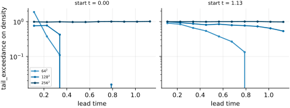

tail_exceedance on density against lead time, the physical time since the forecast started, one panel per start and one line per run, darker the finer the run's grid. Each point is one prediction step of one forecast.

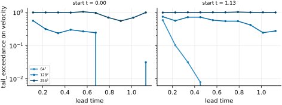

tail_exceedance on velocity against lead time, the physical time since the forecast started, one panel per start and one line per run, darker the finer the run's grid. Each point is one prediction step of one forecast.

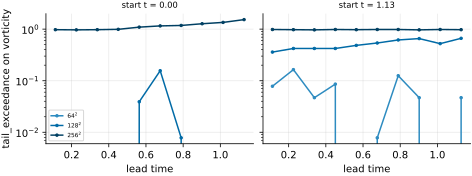

tail_exceedance on vorticity against lead time, the physical time since the forecast started, one panel per start and one line per run, darker the finer the run's grid. Each point is one prediction step of one forecast.

**density, tail_exceedance on the prediction, at each lead time.**

| lead time | 64², start 0 | 128², start 0 | 256², start 0 | 64², start 1.13 | 128², start 1.13 | 256², start 1.13 |
|---|---|---|---|---|---|---|
| 0.1128 | 1.88 | 0.758 | 0.984 | 0.898 | 0.992 | 0.992 |
| 0.2255 | 0.375 | 0.773 | 0.969 | 0.836 | 0.93 | 0.992 |
| 0.3383 | 0.109 | 0.422 | 0.984 | 0.656 | 0.867 | 0.992 |
| 0.4511 | 0 | 0 | 0.969 | 0.539 | 0.805 | 0.984 |
| 0.5638 | 0 | 0 | 0.969 | 0.375 | 0.844 | 0.992 |
| 0.6766 | 0 | 0 | 0.992 | 0.266 | 0.789 | 0.992 |
| 0.7893 | 0 | 0.0156 | 1 | 0.133 | 0.766 | 1 |
| 0.9021 | 0 | 0 | 0.992 | 0 | 0.727 | 1 |
| 1.015 | 0 | 0 | 0.992 | 0 | 0.641 | 0.984 |
| 1.128 | 0 | 0 | 1.01 | 0 | 0.531 | 0.977 |

**density, tail_exceedance damage, at each lead time.**

| lead time | 64², start 0 | 128², start 0 | 256², start 0 | 64², start 1.13 | 128², start 1.13 | 256², start 1.13 |
|---|---|---|---|---|---|---|
| 0.1128 | 0.304 | 0.138 | 0.00787 | 0.0535 | 0.00392 | 0.00392 |
| 0.2255 | 0.455 | 0.128 | 0.0159 | 0.0894 | 0.0364 | 0.00392 |
| 0.3383 | 0.803 | 0.407 | 0.00787 | 0.208 | 0.0711 | 0.00392 |
| 0.4511 | 1 | 1 | 0.0159 | 0.299 | 0.108 | 0.00787 |
| 0.5638 | 1 | 1 | 0.0159 | 0.455 | 0.0847 | 0.00392 |
| 0.6766 | 1 | 1 | 0.00392 | 0.58 | 0.118 | 0.00392 |
| 0.7893 | 1 | 0.969 | 0 | 0.766 | 0.133 | 0 |
| 0.9021 | 1 | 1 | 0.00392 | 1 | 0.158 | 0 |
| 1.015 | 1 | 1 | 0.00392 | 1 | 0.219 | 0.00787 |
| 1.128 | 1 | 1 | 0.00389 | 1 | 0.306 | 0.0119 |

**velocity, tail_exceedance on the prediction, at each lead time.**

| lead time | 64², start 0 | 128², start 0 | 256², start 0 | 64², start 1.13 | 128², start 1.13 | 256², start 1.13 |
|---|---|---|---|---|---|---|
| 0.1128 | 0 | 0.555 | 0.984 | 0.578 | 0.734 | 0.977 |
| 0.2255 | 0 | 0.312 | 0.984 | 0.102 | 0.555 | 0.984 |
| 0.3383 | 0 | 0.234 | 0.984 | 0.0312 | 0.711 | 0.992 |
| 0.4511 | 0 | 0.297 | 0.977 | 0.00781 | 0.711 | 0.992 |
| 0.5638 | 0 | 0.266 | 1.04 | 0 | 0.578 | 0.992 |
| 0.6766 | 0 | 0.242 | 0.953 | 0 | 0.539 | 0.992 |
| 0.7893 | 0 | 0 | 0.695 | 0 | 0.539 | 1.02 |
| 0.9021 | 0 | 0 | 0.547 | 0 | 0.414 | 0.992 |
| 1.015 | 0 | 0 | 0.688 | 0 | 0.242 | 0.992 |
| 1.128 | 0 | 0.0312 | 0.984 | 0 | 0.273 | 0.984 |

**velocity, tail_exceedance damage, at each lead time.**

| lead time | 64², start 0 | 128², start 0 | 256², start 0 | 64², start 1.13 | 128², start 1.13 | 256², start 1.13 |
|---|---|---|---|---|---|---|
| 0.1128 | 1 | 0.286 | 0.00787 | 0.267 | 0.153 | 0.0119 |
| 0.2255 | 1 | 0.524 | 0.00787 | 0.816 | 0.286 | 0.00787 |
| 0.3383 | 1 | 0.62 | 0.00787 | 0.939 | 0.169 | 0.00392 |
| 0.4511 | 1 | 0.542 | 0.0119 | 0.984 | 0.169 | 0.00392 |
| 0.5638 | 1 | 0.58 | 0.0192 | 1 | 0.267 | 0.00392 |
| 0.6766 | 1 | 0.61 | 0.024 | 1 | 0.299 | 0.00392 |
| 0.7893 | 1 | 1 | 0.18 | 1 | 0.299 | 0.00775 |
| 0.9021 | 1 | 1 | 0.293 | 1 | 0.414 | 0.00392 |
| 1.015 | 1 | 1 | 0.185 | 1 | 0.61 | 0.00392 |
| 1.128 | 1 | 0.939 | 0.00787 | 1 | 0.571 | 0.00787 |

**vorticity, tail_exceedance on the prediction, at each lead time.**

| lead time | 64², start 0 | 128², start 0 | 256², start 0 | 64², start 1.13 | 128², start 1.13 | 256², start 1.13 |
|---|---|---|---|---|---|---|
| 0.1128 | 0 | 0 | 0.977 | 0.0781 | 0.359 | 0.984 |
| 0.2255 | 0 | 0 | 0.969 | 0.164 | 0.422 | 0.977 |
| 0.3383 | 0 | 0 | 0.977 | 0.0469 | 0.422 | 0.969 |
| 0.4511 | 0 | 0 | 0.992 | 0.0859 | 0.422 | 0.984 |
| 0.5638 | 0 | 0.0391 | 1.09 | 0 | 0.484 | 0.977 |
| 0.6766 | 0 | 0.156 | 1.16 | 0.00781 | 0.539 | 0.984 |
| 0.7893 | 0 | 0.00781 | 1.18 | 0.125 | 0.617 | 0.984 |
| 0.9021 | 0 | 0 | 1.27 | 0.0469 | 0.656 | 0.969 |
| 1.015 | 0 | 0 | 1.35 | 0 | 0.523 | 0.984 |
| 1.128 | 0 | 0 | 1.53 | 0.0469 | 0.664 | 0.977 |

**vorticity, tail_exceedance damage, at each lead time.**

| lead time | 64², start 0 | 128², start 0 | 256², start 0 | 64², start 1.13 | 128², start 1.13 | 256², start 1.13 |
|---|---|---|---|---|---|---|
| 0.1128 | 1 | 1 | 0.0119 | 0.855 | 0.471 | 0.00787 |
| 0.2255 | 1 | 1 | 0.0159 | 0.718 | 0.407 | 0.0119 |
| 0.3383 | 1 | 1 | 0.0119 | 0.91 | 0.407 | 0.0159 |
| 0.4511 | 1 | 1 | 0.00392 | 0.842 | 0.407 | 0.00787 |
| 0.5638 | 1 | 0.925 | 0.0448 | 1 | 0.347 | 0.0119 |
| 0.6766 | 1 | 0.73 | 0.0725 | 0.984 | 0.299 | 0.00787 |
| 0.7893 | 1 | 0.984 | 0.0824 | 0.778 | 0.237 | 0.00787 |
| 0.9021 | 1 | 1 | 0.12 | 0.91 | 0.208 | 0.0159 |
| 1.015 | 1 | 1 | 0.15 | 1 | 0.313 | 0.00787 |
| 1.128 | 1 | 1 | 0.21 | 0.91 | 0.202 | 0.0119 |

Every prediction of every forecast, nothing pooled: a cell is one prediction step of one forecast, a row the lead time (the physical time since the forecast started) and a column the forecast, named by its run's native grid and its starting time (`64², start 0` is `F-906861_64_Re_50k_from_256_to_64/forecast_t0-0`; `128², start 0` is `F-906861_64_Re_50k_from_256_to128/forecast_t0-0`; `256², start 0` is `F-906861_64/forecast_t0-0`; `64², start 1.13` is `F-906861_64_Re_50k_from_256_to_64/forecast_t0-1250`; `128², start 1.13` is `F-906861_64_Re_50k_from_256_to128/forecast_t0-2500`; `256², start 1.13` is `F-906861_64/forecast_t0-5000`). **Damage** is the prediction's departure from the target as a fraction of the anchor's in the same frame, by default the target's own spatial mean, so each step is scaled by its own target. A dash means no value there.

<!-- END GENERATED results_on_forecast_re5e4 -->

Each cell is read as a verifier reads a frequency bias, against the target 1 [@jwgfvr]: below 1
the prediction has fewer increments at the target's extreme level than the target has, above 1
more. The damage is the distance from 1, $|v - 1|/(v + 1)$, since the anchor scores 0
(`judgements/008`), so a forecast with no extreme increment at all has damage 1, the anchor's. On
this 64 analysis grid the threshold is the target's 64th largest increment per channel and axis.
This card draws no frequency-bias curve from this run; the subsection reads the registered point
only.

- **The forecasts run on the 256² grid keep the target's count of extremes, with one exception.**
  From start 1.13 the bias stays between 0.969 and 1.02 at every step on every field, and from
  start 0 on density between 0.969 and 1.01. From start 0 on velocity it falls to 0.547 at lead
  0.9021 and returns to 0.984 at the last step, and on vorticity it rises at every step from lead
  0.5638 to 1.53 at the last, an over-forecast of extreme increments with damage 0.21.
- **The forecasts run on coarser grids under-forecast the extremes, down to none.** The 64²
  forecast from start 0 has no increment at the target's extreme level at any step on velocity and
  vorticity, and on density from lead 0.4511 on, after an over-forecast of 1.88 at the first step.
  The 128² forecast from start 0 reaches 0 on all three fields: from lead 0.4511 on density (0.0156
  at lead 0.7893 apart), from lead 0.7893 on velocity (0.0312 at the last step apart), and at the
  first four steps on vorticity. From start 1.13 the 128² forecast stays between 0.531 and 0.992
  on density, 0.242 and 0.734 on velocity and 0.359 and 0.664 on vorticity, while the 64² forecast
  falls to 0 on density and velocity before the last step and stays at or below 0.164 on vorticity.
- **Order.** At every one of the 60 steps the damage of the 64² forecast is at least the 128²'s
  and the 128²'s at least the 256²'s, with ties where two forecasts score the same, most often both
  0 (this card's check of the tables). A verifier would add a score of association such as SEDI
  for events this rare ("How its field reports it"); none is computed here.


### On `kinet_re1e6`

<!-- GENERATED results_on_kinet_re1e6: written by `python -m fmeval.cards evidence tail_exceedance --results results/comparison_1793829127 --results results/comparison_1793811840 --results results/comparison_1793829231`, do not edit -->

**Developed flow at Re = 1e6, twenty times the Reynolds number of kinet_re5e4, from the same initial condition.**

Measured on `kinet_re1e6`, frames 2000 to 10000 (161 frames of developed flow at Re = 1e6, twenty times the Reynolds number of kinet_re5e4, from the same initial condition), on the 128 analysis grid, seed 20260807, at commit `adbdc88e4950`. Run `comparison_1793829231`.

[additive_noise](../../degradations/additive_noise/card.md) ·
[band_attenuate](../../degradations/band_attenuate/card.md) ·
[bias](../../degradations/bias/card.md) ·
[box_blur](../../degradations/box_blur/card.md) ·
[coarsen](../../degradations/coarsen/card.md) ·
[coarsen_bandlimited](../../degradations/coarsen_bandlimited/card.md) ·
[disk_blur](../../degradations/disk_blur/card.md) ·
[epanechnikov_blur](../../degradations/epanechnikov_blur/card.md) ·
[gain](../../degradations/gain/card.md) ·
[gaussian_blur](../../degradations/gaussian_blur/card.md) ·
[gaussian_impostor](../../degradations/gaussian_impostor/card.md) ·
[highpass_butterworth](../../degradations/highpass_butterworth/card.md) ·
[highpass_ideal](../../degradations/highpass_ideal/card.md) ·
[lowpass_butterworth](../../degradations/lowpass_butterworth/card.md) ·
[lowpass_ideal](../../degradations/lowpass_ideal/card.md) ·
[mean_field](../../degradations/mean_field/card.md) ·
[median_blur](../../degradations/median_blur/card.md) ·
[multiplicative_noise](../../degradations/multiplicative_noise/card.md) ·
[subsample](../../degradations/subsample/card.md) ·
[translate_subpixel](../../degradations/translate_subpixel/card.md) ·
[translate_x](../../degradations/translate/card.md) ·
[translate_y](../../degradations/translate/card.md) ·
[uncorrelated](../../degradations/random_large_translation/card.md)

**Smoothing.**

| degradation | field | strengths | rank correlation | fraction of frames in the right order | weakest gap between neighbouring strengths |
|---|---|---|---|---|---|
| `box_blur` | density | 4 | 0.775 | 1 | 0.5 |
| `box_blur` | velocity | 4 | 0.775 | 1 | 0.5 |
| `box_blur` | vorticity | 2 | 1 | 1 | 0.529 |
| `disk_blur` | density | 3 | 0.866 | 1 | 0.5 |
| `disk_blur` | velocity | 3 | — | — | — |
| `disk_blur` | vorticity | 2 | 1 | 1 | 0.523 |
| `epanechnikov_blur` | density | 3 | 0.866 | 1 | 0.5 |
| `epanechnikov_blur` | velocity | 3 | — | — | — |
| `epanechnikov_blur` | vorticity | 2 | 1 | 1 | 0.535 |
| `gaussian_blur` | density | 4 | 0.775 | 1 | 0.5 |
| `gaussian_blur` | velocity | 4 | 0.775 | 1 | 0.5 |
| `gaussian_blur` | vorticity | 4 | 0.949 | 1 | 0.54 |
| `median_blur` | density | 3 | 1 | 1 | 1 |
| `median_blur` | velocity | 3 | 1 | 1 | 0.78 |
| `median_blur` | vorticity | 1 | — | — | — |

**Spectral filtering.**

| degradation | field | strengths | rank correlation | fraction of frames in the right order | weakest gap between neighbouring strengths |
|---|---|---|---|---|---|
| `band_attenuate` | density | 4 | 0.8 | 0.373 | 0.57 |
| `band_attenuate` | velocity | 4 | 1 | 0.745 | 0.528 |
| `band_attenuate` | vorticity | 4 | 0.949 | 0.957 | 0.55 |
| `highpass_butterworth` | density | 4 | 1 | 1 | 0.86 |
| `highpass_butterworth` | velocity | 3 | 1 | 0.981 | 0.928 |
| `highpass_butterworth` | vorticity | 4 | 1 | 0.994 | 0.829 |
| `highpass_ideal` | density | 3 | 1 | 1 | 0.994 |
| `highpass_ideal` | velocity | 2 | 1 | 0.975 | 0.933 |
| `highpass_ideal` | vorticity | 4 | 1 | 0.944 | 0.873 |
| `lowpass_butterworth` | density | 4 | — | — | — |
| `lowpass_butterworth` | velocity | 3 | — | — | — |
| `lowpass_butterworth` | vorticity | 4 | 0.775 | 0.994 | 0.506 |
| `lowpass_ideal` | density | 3 | — | — | — |
| `lowpass_ideal` | velocity | 3 | — | — | — |
| `lowpass_ideal` | vorticity | 4 | 0.775 | 1 | 0.512 |

**Displacement.**

| degradation | field | strengths | rank correlation | fraction of frames in the right order | weakest gap between neighbouring strengths |
|---|---|---|---|---|---|
| `translate_subpixel` | density | 6 | -0.577 | 0 | 0.132 |
| `translate_subpixel` | velocity | 6 | -0.667 | 0 | 0.0416 |
| `translate_subpixel` | vorticity | 6 | -0.698 | 0 | 0.0144 |
| `translate_x` | density | 5 | — | — | — |
| `translate_x` | velocity | 5 | — | — | — |
| `translate_x` | vorticity | 5 | — | — | — |
| `translate_y` | density | 5 | — | — | — |
| `translate_y` | velocity | 5 | — | — | — |
| `translate_y` | vorticity | 5 | — | — | — |

**Resolution loss.**

| degradation | field | strengths | rank correlation | fraction of frames in the right order | weakest gap between neighbouring strengths |
|---|---|---|---|---|---|
| `coarsen` | density | 4 | 0.2 | 0.00621 | 0.111 |
| `coarsen` | velocity | 4 | 0.4 | 0.00621 | 0.123 |
| `coarsen` | vorticity | 4 | 0.4 | 0.155 | 0.461 |
| `coarsen_bandlimited` | density | 4 | 1 | 0.776 | 0.757 |
| `coarsen_bandlimited` | velocity | 4 | 0.949 | 0.975 | 0.668 |
| `coarsen_bandlimited` | vorticity | 4 | 0.775 | 1 | 0.5 |
| `subsample` | density | 4 | 1 | 0.708 | 0.654 |
| `subsample` | velocity | 4 | 0.4 | 0.0124 | 0.182 |
| `subsample` | vorticity | 4 | -0.8 | 0 | 0.138 |

**Noise.**

| degradation | field | strengths | rank correlation | fraction of frames in the right order | weakest gap between neighbouring strengths |
|---|---|---|---|---|---|
| `additive_noise` | density | 4 | 1 | 0.745 | 0.761 |
| `additive_noise` | velocity | 4 | 1 | 0.876 | 0.882 |
| `additive_noise` | vorticity | 4 | 1 | 0.578 | 0.681 |
| `multiplicative_noise` | density | 5 | 1 | 1 | 0.998 |
| `multiplicative_noise` | velocity | 5 | 1 | 0.609 | 0.71 |
| `multiplicative_noise` | vorticity | 5 | 0.9 | 0.261 | 0.535 |

**Cell-value distortion.**

| degradation | field | strengths | rank correlation | fraction of frames in the right order | weakest gap between neighbouring strengths |
|---|---|---|---|---|---|
| `bias` | density | 4 | 0.775 | 0 | 0.5 |
| `bias` | velocity | 4 | 0.258 | 0 | 0.497 |
| `bias` | vorticity | 4 | -0.258 | 0 | 0.475 |
| `gain` | density | 4 | 1 | 1 | 1 |
| `gain` | velocity | 4 | 1 | 1 | 0.981 |
| `gain` | vorticity | 4 | 1 | 1 | 0.978 |

**Trap tests.**

| field | damage assigned to the fake prediction | closest real degradation | damage of the reference moved far away | value on the anchor |
|---|---|---|---|---|
| density | 1 | `box_blur=9.49658` | 0 | 0 |
| velocity | 0.992 | `box_blur=5.54896` | 0 | 0 |
| vorticity | 0.977 | `band_attenuate=0.5` | 0 | 0 |

The fake prediction here has exactly the reference field's amplitude spectrum and completely scrambled structure. Damage 1 is what the anchor scores, by default the reference's own spatial mean, a prediction that knows the mean and nothing else. The damage column therefore says how close to useless this metric considers that fake prediction: a low number means the metric was fooled. The third column translates the same number into an ordinary degradation whose damage the fake prediction matches, which is easier to picture. The fourth is the reference moved by a large random offset, the right statistics in the wrong place; where a field's energy sits in its largest scales that copy stays partly correlated with the reference, so it is not the score of an unrelated field.

<!-- END GENERATED results_on_kinet_re1e6 -->

The values here are on the 128 analysis grid, where $k = 128$ and the ceiling $n/k$ is 128, and
are not comparable with the main run's on 256 ("Reading the output"). What can be compared is the
direction and order of each response.

- **Smoothing and spectral filtering saturate as on `kinet_re5e4`.** Every blur and both low-pass
  filters take the value to 0 at the harshest strength (a change of -1), apart from the median blur
  on vorticity, which keeps one usable strength (-0.93). The Gaussian and box blurs read 0.775 on
  density and velocity, the one-graded-point tie pattern; the disk and Epanechnikov blurs on
  velocity and the low-pass filters on density and velocity are at 0 from their mildest strength
  and withheld. The high-pass filters lower the value with a rank correlation of 1 on every field,
  in 0.944 to 1 of frames. `band_attenuate` on density barely moves it here (a change of 0.00781,
  largest damage 0.094), where on `kinet_re5e4` it lowered it.
- **Resolution loss.** `coarsen` still raises the value on density and velocity, but is followed
  weakly (rank correlation 0.2 and 0.4, with 0.00621 of frames in order), and on vorticity it
  lowers it to 0 (a change of -1). `subsample` raises it on density and velocity (2.94 and 3.06)
  and lowers it on vorticity with a rank correlation of -0.8, as on `kinet_re5e4`.
  `coarsen_bandlimited` lowers it with rank correlations of 0.775 to 1.
- **Noise and gain raise it on every field** with a rank correlation of 1 (0.9 for multiplicative
  noise on vorticity). Multiplicative noise on density reaches 128, the ceiling (a change of 127);
  additive noise reaches a change of 72.2, 102 and 1.95.
- **Displacement.** Whole-cell translations leave the value at exactly 1. `translate_subpixel`
  gives negative rank correlations of -0.577 to -0.698 again, with a largest damage of 0.0492,
  0.123 and 0.21.
- **Trap tests.** The fake prediction with the right spectrum scores 0, 0.00391 and 0.0117 (damage
  1, 0.992 and 0.977), close to the anchor, as on `kinet_re5e4`, and the reference moved far away
  scores exactly 1.


## References

\bibliography
