## Definition

Let $f$ be one channel of a field on a periodic grid of $n$ cells and $\mathbf{e}_j$ the unit
step along spatial axis $j$. The one-cell increment is the one `increment_flatness` defines,

$$
(\delta_j f)_{\mathbf{m}} = f_{\mathbf{m} + \mathbf{e}_j} - f_{\mathbf{m}} \tag{1}
$$

read on the channel-and-axis pairs every increment metric reads (`increment_samples`): every
channel along every axis for a scalar field, and for velocity only the longitudinal pairs,
component $j$ along axis $j$. Along one pair its $n$ absolute values, sorted from largest to smallest, are
$X_{(1)} \ge X_{(2)} \ge \dots \ge X_{(n)}$. The Hill estimator from the $k$ largest of them is

$$
H_j^{(c)}(k) = \frac{1}{k} \sum_{i=1}^{k} \ln \frac{X_{(i)}}{X_{(k+1)}} \tag{2}
$$

Drees, de Haan and Resnick [@drees2000], Eq. (1.2), and the form printed by Boucheron and
Thomas [@boucheron2015], Section 1, of the estimator of Hill [@hill1975], which was read only
through its abstract and is not cited by equation. It is the mean
log-ratio of each of the $k$ largest values to one threshold, the $(k+1)$-th largest. When the
tail is a power law, $P(X > x) \propto x^{-\alpha}$, it estimates the extreme-value index
$\gamma = 1/\alpha$: Boucheron and Thomas state that $H(k)$ converges to $\gamma$ for every $k$
that grows with $n$ while $k/n$ shrinks, exactly when the tail lies in the domain of attraction
with $\gamma > 0$. It is the power-law maximum-likelihood estimator of Clauset, Shalizi and
Newman [@clauset2009], Eq. (3.1), $\hat\alpha_{\mathrm{C}} = 1 + m \bigl[\sum_i
\ln(x_i / x_{\min})\bigr]^{-1}$, rewritten. Their exponent is that of the density,
$p(x) \propto x^{-\alpha_{\mathrm{C}}}$ (their Eq. (1.1)), so $\alpha_{\mathrm{C}} = \alpha + 1$,
and with $x_{\min} = X_{(k+1)}$ and the $m = k$ values above it, $\hat\alpha_{\mathrm{C}} - 1 =
1/H(k)$; counting $x_{\min}$ itself among the $m$ values, as their "$x_i \ge x_{\min}$" allows,
gives $(k+1)/(k\,H(k))$ instead. When the tail is not a power law, Equation (2) is still defined
and still scale-free, but it no longer estimates a tail index; it is then the mean log-excess of
the $k$ largest values over the $(k+1)$-th, and depends on $k$.

The order $k$ is set on a logarithmic scale,

$$
k(\theta) = \min\bigl(\lceil n^{\theta} \rceil,\; n - 1\bigr), \qquad
\theta \in \{0.01, 0.02, \dots, 0.99\} \tag{3}
$$

the cap leaving an $X_{(k+1)}$ to divide by. $k(\theta)$ is computed exactly in integers, as the
least $k$ with $k^{100} \ge n^{100\theta}$, because a floating-point power can land just above an
exact root and make the ceiling one too large. The reported value is the mean of Equation (2) at
$\theta = 1/2$ over the set $A$ of channel-and-axis pairs whose $X_{(k+1)}$ is positive,

$$
T = \frac{1}{|A|} \sum_{(c, j) \in A} H_j^{(c)}\bigl(k(\tfrac{1}{2})\bigr) \tag{4}
$$

and is NaN when $A$ is empty, as on a constant field. $\theta = 1/2$ keeps the largest
$\sqrt{n}$ values. Clauset, Shalizi and Newman [@clauset2009], Section 3.5, describe this fixed
rule as an alternative approach common in quantitative finance, and recommend instead their
Kolmogorov-Smirnov method of Section 3.3, which they say gives estimates at least as good.
On the 256 by 256 analysis grid that is $k = 256$ of $n = 65536$ increments per axis.

**Choices made here, not by a source.** Which of the fixed rules to register is this bundle's
choice: the largest $\sqrt{n}$ satisfies the condition under which Equation (2) is consistent,
$k$ growing while $k/n$ shrinks, and the other rule Section 3.5 names, the largest $n/10$, does
not. The rule is fixed once for every field and every variant rather than chosen from each
field's data, as the Kolmogorov-Smirnov method of Clauset, Shalizi and Newman [@clauset2009],
Section 3.3 and Eq. (3.9), would choose it, so that the reference and every variant are read at
the same order. The quantity whose tail is read is the absolute one-cell increment, because
increment statistics are the physics criteria Granero-Belinchón and Cabeza Gallucci
[@granero2024] train a generative turbulence model against; both signs of increment are pooled
into one tail. Equation (4) averages per-pair estimates rather than estimating once from every
pair's increments pooled, so that each channel and axis has an equal say: pooled, the $k$
largest values come from whichever pair has the largest increments. When every velocity pair
was read, a single transverse pair of the four supplied all of them on kinet frames 2000 and
8000, and the four estimates differed by a factor of 4 to 7. The two longitudinal pairs read now
agree closely: at $\theta = 1/2$ on the 256 by 256 grid they score 0.0712 and 0.0703 at frame
2000, 0.0368 and 0.0356 at frame 5000, and 0.1543 and 0.1552 at frame 8000, and pooled they share
the $k$ largest values about evenly (53%, 53% and 48% from the first). The mean is still a mixture
on a field with several channels of different character. The coordinate $\theta = \log k / \log n$ of Equation (3) is the alternative Hill
plot's (next subsection); its spacing of a hundredth is this bundle's choice.

**The curves behind the number.** Two companions, the two Hill plots of the next subsection.
`tail_index` is Equation (2), averaged as in Equation (4), at every $\theta$ of Equation (3), the
alternative Hill plot; the registered number is its value at $\theta = 1/2$, and the analysis
reads it at the nine values $\theta = 0.1, 0.2, \dots, 0.9$. `tail_index.by_order` is the same
average at every $k$ from 1 to $\lfloor n/10 \rfloor$, the classical Hill plot, analysed at
$k = 10$, a value present on every grid the harness runs; it stops at $n/10$, the larger of the two
fixed rules of Clauset, Shalizi and Newman [@clauset2009], Section 3.5, beyond which the estimate
reads the bulk of the distribution. On the 256 by 256 grid that is $k$ up to 6553. Both curves are
stored whole on the frames `report.error_map` names and drawn with both axes linear, as Drees, de
Haan and Resnick [@drees2000] draw them.

### Boundary handling

Periodic wrap on every axis: the increment of the last cell along an axis is taken against the
first, as in `increment_flatness`. A pair whose $(k+1)$-th largest absolute increment is exactly
zero has no estimate at that $k$ and is left out of Equation (4) rather than given one; that rule
is discontinuous, as the Limitations say. A field holding NaN or an infinity is refused with an
error rather than scored. The metric
declares `requires_periodic`, so the harness does not run it on a dataset with a non-periodic
axis, such as the Sod shock tube.

### How its field reports it

The field is the statistics of extremes; the estimator is fitted to tails in finance, insurance,
hydrology and network data.

- **The object** is the Hill estimate $H(k)$ of Equation (2), an estimate of the extreme-value
  index $\gamma$ ([@drees2000], Eq. (1.2); [@clauset2009], Eq. (3.1), as the exponent
  $\hat\alpha_{\mathrm{C}} = 1 + 1/H$ of the density). Its normalisation is none: it is
  scale-free.
- **The figure is the Hill plot**, the estimate against the number of order statistics. Drees,
  de Haan and Resnick [@drees2000], Section 1, call the plot against $k$ on a linear axis "what is
  usually done in practice", and define beside it the alternative Hill plot against
  $\theta = \log k / \log n$ for $0 \le \theta < 1$, "a logarithmic scale for the $k$-axis",
  introduced by Resnick and Stărică [@resnick1997] (technical-report version, p. 3) so that the
  few largest order statistics are "shown more clearly". Drees et al. prove the alternative plot
  better for tails with a second-order term and the classical one better for an exact Pareto
  tail (Section 1, Theorems 2 and 3). Both are stored here (`tail_index.by_order` and
  `tail_index`). Their set notation plots $1/H$, an estimate of $\alpha$, and Resnick and
  Stărică's figures do too, while Drees et al.'s figures draw $H$, the estimate of $\gamma$; this
  bundle draws $H$, the number it registers. A reader expecting $\alpha$ reads the reciprocal.
- **The number** is read off where the plot is stable (Clauset, Shalizi and Newman
  [@clauset2009], Section 3.5), or at a fixed order, the largest $\sqrt{n}$ or $n/10$, which they
  call common in quantitative finance; their own method chooses the threshold by minimising a
  Kolmogorov-Smirnov distance (Section 3.3, Eq. (3.9)). This bundle registers the fixed
  $\sqrt{n}$ order, for the reason given above; the data-chosen threshold is
  [proposals/MTR-tail_index-ks-threshold.md](https://github.com/khegazy/pde_metrics/blob/main/proposals/MTR-tail_index-ks-threshold.md).
- **The statistics beside it** are an interval and a test of fit. For independent samples the
  estimate is asymptotically normal with variance $\gamma^2/k$ (Resnick and Stărică
  [@resnick1997], p. 2, as $\alpha^{-2}$; Clauset et al. [@clauset2009], Eq. (3.2) and Appendix B,
  $\sigma = (\hat\alpha - 1)/\sqrt{n}$ for independent, identically distributed data); the
  standard error $\gamma/\sqrt{k}$ follows from Drees et al.'s Theorem 1, Eq. (2.3), by this
  bundle's derivation. Clauset et al., Section 4, test whether a power law fits at all with a
  bootstrap Kolmogorov-Smirnov p-value. **Neither is reported here**: both assume independent
  samples, and one-cell increments of a flow field are strongly correlated in space (Limitations).
  Under serial dependence the Hill estimator stays consistent and asymptotically normal, but its
  variance is $\gamma^2/k$ times an inflation factor set by the dependence (Hsing 1991, Ann.
  Stat. 19(3), 1547-1569, read through its abstract and a secondary source; Drees 2008, Extremes
  11, 35-53, Section 2.2), and nothing read gives that factor for a spatial random field, so an
  interval of $\gamma/\sqrt{k}$ would be too narrow by an unknown amount
  ([issues/132](https://github.com/khegazy/pde_metrics/blob/main/issues/132-hill-estimator-interval-on-spatially-correlated-increments.md)).
- **The experiments** are samples with a known power-law tail, where the plot should settle on
  $1/\alpha$ (here the independent Pareto unit tests in `test_metric.py`), and real heavy-tailed
  data. Missing here: a degradation that injects a tail of known index
  ([proposals/EXP-tail_index-pareto-spike-injection.md](https://github.com/khegazy/pde_metrics/blob/main/proposals/EXP-tail_index-pareto-spike-injection.md)),
  one that alters only the tail
  ([proposals/EXP-energy_distance-tail-only-degradation.md](https://github.com/khegazy/pde_metrics/blob/main/proposals/EXP-energy_distance-tail-only-degradation.md)),
  and the intermittent increments of developed three-dimensional turbulence, where tails of the
  increment distribution are the object of study
  ([proposals/EXP-increment_flatness-isotropic-3d-turbulence-cutouts.md](https://github.com/khegazy/pde_metrics/blob/main/proposals/EXP-increment_flatness-isotropic-3d-turbulence-cutouts.md)).

## Performance

<!-- GENERATED performance: written by `python -m fmeval.cards evidence tail_index --results results/comparison_1793829127 --results results/comparison_1793811840 --results results/comparison_1793829231`, do not edit -->

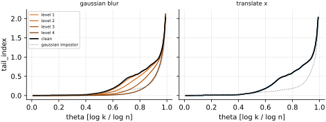

*As this metric's own field draws it.* The dense curve behind tail_index on density, at every coordinate the curve returns, on the frames and ladder entries report.error_map stored: the median over those frames at every stored strength, the clean curve in black, the anchor dashed and the impostor dotted where stored. Axes as the field draws them: linear x, linear y. Values are the literature's own, untransformed.

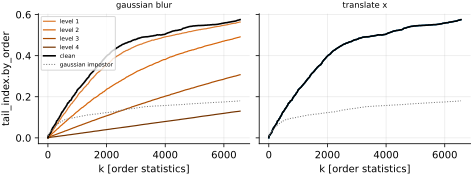

*As this metric's own field draws it.* The dense curve behind tail_index.by_order on density, at every coordinate the curve returns, on the frames and ladder entries report.error_map stored: the median over those frames at every stored strength, the clean curve in black, the anchor dashed and the impostor dotted where stored. Axes as the field draws them: linear x, linear y. Values are the literature's own, untransformed.

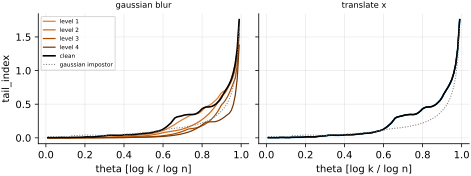

*As this metric's own field draws it.* The dense curve behind tail_index on velocity, at every coordinate the curve returns, on the frames and ladder entries report.error_map stored: the median over those frames at every stored strength, the clean curve in black, the anchor dashed and the impostor dotted where stored. Axes as the field draws them: linear x, linear y. Values are the literature's own, untransformed.

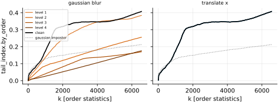

*As this metric's own field draws it.* The dense curve behind tail_index.by_order on velocity, at every coordinate the curve returns, on the frames and ladder entries report.error_map stored: the median over those frames at every stored strength, the clean curve in black, the anchor dashed and the impostor dotted where stored. Axes as the field draws them: linear x, linear y. Values are the literature's own, untransformed.

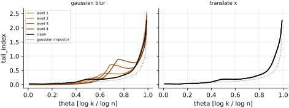

*As this metric's own field draws it.* The dense curve behind tail_index on vorticity, at every coordinate the curve returns, on the frames and ladder entries report.error_map stored: the median over those frames at every stored strength, the clean curve in black, the anchor dashed and the impostor dotted where stored. Axes as the field draws them: linear x, linear y. Values are the literature's own, untransformed.

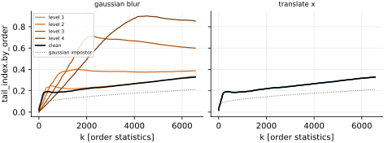

*As this metric's own field draws it.* The dense curve behind tail_index.by_order on vorticity, at every coordinate the curve returns, on the frames and ladder entries report.error_map stored: the median over those frames at every stored strength, the clean curve in black, the anchor dashed and the impostor dotted where stored. Axes as the field draws them: linear x, linear y. Values are the literature's own, untransformed.

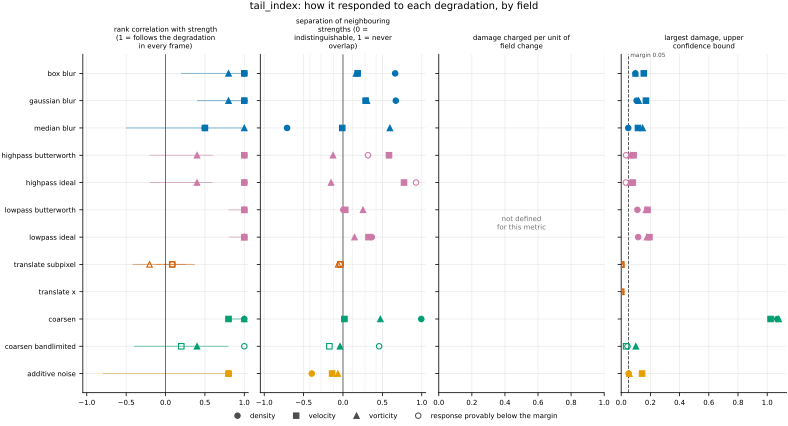

Four measured statistics for tail_index, one row per degradation grouped by family and one marker per field. From left: the rank correlation between the metric and the applied strength within a frame, with the line showing the resampling interval; the separation of neighbouring strengths as Cliff's delta, where 0 means the metric cannot tell one strength from the next and the faint ticks at 0.12, 0.28 and 0.42 are Vargha and Delaney's small, medium and large anchors, for scale and not as grades; the damage charged per unit of field change at the harshest strength; and the upper confidence bound on the largest damage, beside the fixed margin of 0.05. A hollow marker is a field and degradation on which that bound lies below the margin, so the response is provably small. A missing marker is a statistic the analysis withheld, as the rank correlation is on an axis the metric is invariant to.

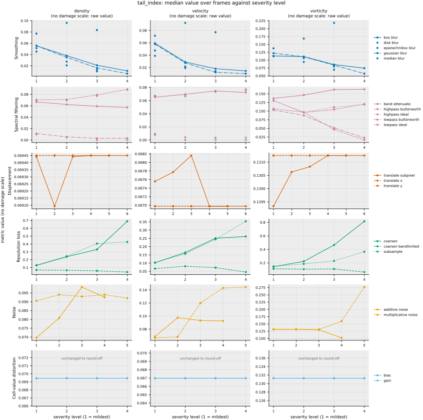

Median damage over frames against severity level for tail_index, one row per family of degradation and one column per field, on one shared scale. The solid grey line is damage 1, the anchor (by default the field's own mean); the dotted black line is the damage assigned to the fake prediction with the right spectrum, where the run included it. The hollow black ring marks the first level at which the metric has moved a tenth of the way to the anchor. Hollow grey markers are strengths excluded for repeating a milder one or for doing nothing. Degradations with three or fewer usable levels are drawn as markers only; points beyond 2 either side are drawn as triangles at the edge. Damage is negative where a degradation moves the metric away from the anchor, as noise raises a single-field quantity the field's mean sets to zero. No damage scale on density, velocity, vorticity: the grey panels show the raw value instead.

**Trend: does the response follow the degradation?**

| test family | field | degradations | rank correlation | fraction of frames in order | weakest gap between neighbouring strengths |
|---|---|---|---|---|---|
| Displacement | density | 3 | 0.0857 | 0.0124 | 0.479 |
| Displacement | velocity | 3 | 0.0286 | 0 | 0.466 |
| Displacement | vorticity | 3 | -0.203 | 0 | 0.469 |
| Cell-value distortion | density | 2 | — | — | — |
| Cell-value distortion | velocity | 2 | — | — | — |
| Cell-value distortion | vorticity | 2 | — | — | — |
| Resolution loss | density | 3 | 1 | 0.634 to 1 | 0.727 to 0.997 |
| Resolution loss | velocity | 3 | 0.4 to 1 | 0.323 to 0.894 | 0.39 to 0.86 |
| Resolution loss | vorticity | 3 | 0.4 to 1 | 0.273 to 0.689 | 0.481 to 0.737 |
| Smoothing | density | 5 | 0.5 to 1 | 0.0683 to 1 | 0.145 to 0.892 |
| Smoothing | velocity | 5 | 0.5 to 1 | 0.211 to 0.994 | 0.427 to 0.605 |
| Smoothing | vorticity | 5 | 0.8 to 1 | 0.429 to 0.82 | 0.583 to 0.798 |
| Spectral filtering | density | 5 | 1 | 0.646 to 1 | 0.502 to 0.964 |
| Spectral filtering | velocity | 5 | 0.2 to 1 | 0.199 to 1 | 0.464 to 0.608 |
| Spectral filtering | vorticity | 5 | 0.4 to 1 | 0.0559 to 0.634 | 0.424 to 0.627 |
| Noise | density | 2 | 0.1 to 0.8 | 0 to 0.137 | 0.302 to 0.466 |
| Noise | velocity | 2 | 0.4 to 0.9 | 0.161 to 0.329 | 0.478 to 0.513 |
| Noise | vorticity | 2 | 0.8 to 0.9 | 0.217 to 0.236 | 0.467 to 0.499 |

**Reactivity: how far does it move?**

| test family | field | change from clean at the harshest strength | elasticity | first strength detected |
|---|---|---|---|---|
| Displacement | density | -3.28e-13 to 0 | — | level — |
| Displacement | velocity | 0 | 0.963 | level — |
| Displacement | vorticity | 0 | -0.254 | level — |
| Cell-value distortion | density | -6.31e-15 to 0 | — | level — |
| Cell-value distortion | velocity | 0 | — | level — |
| Cell-value distortion | vorticity | 0 | — | level — |
| Resolution loss | density | -0.368 to 8.71 | 1.09 to 1.92 | level — |
| Resolution loss | velocity | -0.283 to 3.82 | 1.12 to 1.19 | level — |
| Resolution loss | vorticity | -0.444 to 4.86 | 0.137 to 2.06 | level — |
| Smoothing | density | -0.914 to 0.198 | 0.577 to 0.835 | level — |
| Smoothing | velocity | -0.868 to 0.187 | 0.481 to 1.64 | level — |
| Smoothing | vorticity | -0.558 to 0.67 | 0.864 to 2.18 | level — |
| Spectral filtering | density | -1 to 0.271 | 0.0777 to 3.28 | level — |
| Spectral filtering | velocity | -1 to 0.0463 | 0.0567 to 6.88 | level — |
| Spectral filtering | vorticity | -0.872 to 0.433 | 0.686 to 1.42 | level — |
| Noise | density | 0.329 to 0.347 | 0.0299 to 1.06 | level — |
| Noise | velocity | 0.39 to 1.17 | 0.894 | level — |
| Noise | vorticity | -0.154 to 1.03 | — | level — |
| trap test: fake prediction, right spectrum | density | — | — | damage — |
| trap test: fake prediction, right spectrum | velocity | — | — | damage — |
| trap test: fake prediction, right spectrum | vorticity | — | — | damage — |

**Consistency: how much does it vary from snapshot to snapshot?**

| test family | field | consistency, in the strength's units | snapshots per independent block |
|---|---|---|---|
| Displacement | density | 15 | 1 |
| Displacement | velocity | 7.18 | 1 |
| Displacement | vorticity | 15.4 | 1 |
| Cell-value distortion | density | — | 1 |
| Cell-value distortion | velocity | — | 1 |
| Cell-value distortion | vorticity | — | 1 |
| Resolution loss | density | 0.724 to 3.81 | 12 to 17 |
| Resolution loss | velocity | 1.6 to 7.24 | 14 to 20 |
| Resolution loss | vorticity | 2.62 to 9.17 | 19 to 22 |
| Smoothing | density | 0.00457 to 0.0449 | 16 to 21 |
| Smoothing | velocity | 0.0214 to 0.159 | 19 to 20 |
| Smoothing | vorticity | 0.0577 to 0.193 | 8 to 21 |
| Spectral filtering | density | 0.0251 to 0.209 | 12 to 21 |
| Spectral filtering | velocity | 0.0276 to 3.94 | 8 to 21 |
| Spectral filtering | vorticity | 0.0721 to 0.939 | 16 to 21 |
| Noise | density | 0.0347 to 0.662 | 16 to 17 |
| Noise | velocity | 0.0464 to 0.231 | 14 to 20 |
| Noise | vorticity | 0.0725 to 0.564 | 6 to 20 |

One row per family of degradation and physical field; a cell gives the range over the degradations in that family. **Trend.** The rank correlation is the Spearman correlation between the strength and how far the metric has moved from its value on the undegraded field of the same frame, in the one direction it moves under that degradation, computed inside a single frame. A value of 1 means every strength moved it further than the last in every frame, whichever way it moves; a response that scatters to both sides scores near 0. The fraction of frames in order counts the frames with no exception. The weakest gap is the smallest Mann-Whitney overlap between two neighbouring strengths across frames: 1 means they never overlap, 0.5 that they cannot be told apart. **Reactivity.** The change from clean is the median, at the harshest strength, of the departure from the undegraded value of the same frame over the size of that value: 0.3 means 30%. The elasticity is the percentage change of that departure per percentage change in strength over the mildest strengths. First strength detected is the mildest at which the metric has moved a tenth of the way to the anchor; **damage** reads that 0-to-1 scale as a number. A dash means the measurement is not defined there. A metric's reactivity scales with the power it is expressed in: mean squared error's elasticity is twice root-mean-square error's, though the two carry the same information, so compare magnitudes across metrics with that in mind. **Consistency** is how much the response varies from snapshot to snapshot relative to its size, in the strength's units; the snapshots of one trajectory are correlated, and the last column is how many consecutive snapshots one independent block spans.

These tables report what was measured and grade none of the measurements. What the numbers mean for this metric is written in the subsections below, beside the test that produced each number.

**Profile.**

| field | selectivity | charges most for | charges least for | response provably below 0.05 at 90% on | elasticity to a sub-pixel shift, against severity (distance) | compute cost (x cheapest in this run) |
|---|---|---|---|---|---|---|
| density | — | — | — | `band_attenuate` `bias` `coarsen_bandlimited` `gain` `highpass_butterworth` `highpass_ideal` `multiplicative_noise` `translate_subpixel` `translate_x` `translate_y` | — | 31.8 |
| velocity | — | — | — | `bias` `gain` `highpass_butterworth` `highpass_ideal` `translate_subpixel` `translate_x` `translate_y` | 0.963 | 31.7 |
| vorticity | — | — | — | `bias` `gain` `translate_subpixel` `translate_x` `translate_y` | -0.254 | 30.3 |

One row per physical field. **Selectivity** is how concentrated the metric's response is on a few degradations, measured per unit of field change: 0 means it charges every degradation the same, as mean squared error does by construction, and values toward 1 that one degradation carries most of it. **Charges most and least for** name the two ends of that profile. **Response provably below** lists degradations on which the upper confidence bound of the largest damage lies below the margin -- an equivalence test, so an entry says the response is provably small, not merely not significant; a dash means no degradation met the bound. **Elasticity** is the slope of log damage against log shift over the smallest shifts: 1 means damage grows in proportion to the shift, 2 with its square. **Compute cost** is wall-clock per evaluation over the cheapest metric and field in the same run.

<!-- END GENERATED performance -->

## Intuition

This metric asks how far the very largest jumps between neighbouring cells stand out from the
slightly smaller ones. It collects the size of every difference between a cell and its
neighbour, keeps the biggest few, as many as the square root of the number of cells, and takes
the average of how many times larger each of them is than the first size just below the kept
group, measured on a logarithmic scale. If the biggest jumps are all about the same size, the
answer is near zero. If a few jumps are many times larger than the rest of the biggest ones, the
answer is large. For independent values that follow a power law, where the chance of exceeding a
size falls as one over that size raised to some power, the answer is one over that power, so a
heavier tail scores higher.

What it reveals is a change in how the largest local gradients are spread out relative to one
another. On a real flow field the answer is not a simple heaviness score, because the largest
jumps sit side by side in a few sharp structures, and neighbours of similar size pull the answer
down. Replacing the field's structures by random values with the same spectrum, or adding noise,
can therefore raise it, so a value moving away from the reference's says that the largest
gradients changed, not which way the field's intermittency went.

A worked example, four cells by four cells. On the left, a sawtooth down each column: the values
0, 3, 2, 1, wrapping back to 0, so going down a column the field jumps up by 3 once and steps
down by 1 three times. On the right, rows alternate between 0 and 1, so every step has size 1.

```
sawtooth          alternating
0 0 0 0           0 0 0 0
3 3 3 3           1 1 1 1
2 2 2 2           0 0 0 0
1 1 1 1           1 1 1 1

1.0986            0
```

Sixteen cells means the four largest steps are kept. In the sawtooth those are the four jumps of
3, one per column, and the first step below them is 1, so each kept step is 3 times that
threshold and the answer is the natural logarithm of 3, 1.0986. In the alternating field the four largest steps and
the next one are all 1, so the answer is 0. Along the rows both fields are constant, so that
direction has no steps at all and is left out.

What it ignores: everything about the field except the sizes of its largest neighbour-to-neighbour
steps, including where those steps are and the shape of the rest of the distribution.

## Reading the output

Dimensionless, zero or positive, and unbounded above. There is no direction in which the number
is better: what is read is the drift of a prediction's value from the reference field's own value,
in either direction. A value above the reference's means the prediction's largest increments are
more spread out relative to one another than the reference's are; a value below means they are
more uniform. It does not mean a heavier or a lighter tail on a spatially correlated field: on
the evidence run on `kinet_re5e4` the reference scored below the fake prediction that keeps its
spectrum and scrambles its structure, on velocity (Results, "Trap tests").

Because Equation (2) uses only ratios of increments, multiplying a field by a constant or adding
one to it changes nothing, so values can be compared across fields of different magnitude. For a
sample whose tail is a power law the value estimates one over the power; for any other tail it is
the mean log-ratio at the stated $k$ and is not a tail index, and a value from one field should
not be read as an exponent without first checking that a power law fits (Clauset, Shalizi and
Newman [@clauset2009], Sections 4 and 5).

Values at different analysis-grid resolutions are not comparable, for two reasons: the increment
is one cell long, so its physical length changes with the grid, and $k$ is set by the number of
cells, so the order read changes too.

The companions are the two Hill plots: `tail_index[theta]`, Equation (4) at
$k = \lceil n^{\theta} \rceil$, and `tail_index.by_order[k]`, the same at each $k$ up to $n/10$.
Small $\theta$ or small $k$ reads the few largest increments and is noisy; large $\theta$ reaches
into the bulk of the distribution and stops being a statement about its tail. Where a plot is
flat over a range of orders, the estimate does not depend on the choice of $k$ there; where it
slopes, a different fixed rule would give a different number. No interval is drawn around either
curve (see "How its field reports it").

## Limitations

The estimator's guarantee is for a power-law tail, and a field whose increments are bounded or
fall off faster than any power has none to estimate. There the value at $k = \sqrt{n}$ measures
how the largest increments are spaced at that one order, and a change in it does not mean the
tail index changed. A reader who sees two values and reads off two exponents is misreading it.

The theory behind Equation (2) assumes independent samples, and the increments of a smooth field
are not: the largest increments of one frame tend to sit side by side across a few sharp
structures, so the largest few hundred are a handful of events counted many times. That lowers
the value even when the tail is a power law: on a 128 by 64 independent power-law field, a
two-cell blur halves it in the mean over eight seeds (a test in `test_metric.py` pins this),
while a blurred independent Gaussian field keeps its value. A value below that of independent Gaussian noise therefore does not show that the
tail is lighter than Gaussian; it may show only that the largest increments are clustered. For
the same reason the field's interval, $\gamma/\sqrt{k}$, and its goodness-of-fit p-value are
not reported: both assume independent samples, and under dependence the variance is larger by a
factor nothing read here gives for a spatial field
([issues/132](https://github.com/khegazy/pde_metrics/blob/main/issues/132-hill-estimator-interval-on-spatially-correlated-increments.md)). The
value is also a property of those few structures and can jump from frame to frame when one of
them grows or decays.

A channel and axis along which the field is exactly constant is left out of the mean, but the
same axis with round-off-sized variation is not, and because Equation (2) is scale-free it then
counts as much as any other pair. On a field that is constant along one axis, a perturbation of
one part in a million million can change the value by a third (`issues/103`). For the same
reason the derivative of the value with respect to the field grows without bound as the
$(k+1)$-th largest increment approaches zero, which matters if it is used as a training loss.

The number depends on $k$, and $\sqrt{n}$ is one rule among several. The stored curve shows how
the value moves with $k$; where the curve is steep, a different rule would give a different
number.

Its response to smoothing is not monotone, which the decorator declares and the contract test
checks: on that test's synthetic blur ladder the value rises and then falls. Ranking two
predictions by closeness to the reference's value can therefore put a more heavily smoothed
field ahead of a less smoothed one.

## Results

<!-- GENERATED run: written by `python -m fmeval.cards evidence tail_index --results results/comparison_1793829127 --results results/comparison_1793811840 --results results/comparison_1793829231`, do not edit -->

Measured on `kinet_re5e4`, frames 2000 to 10000 (161 frames of developed flow), on the 256 analysis grid, seed 20260807, at commit `adbdc88e4950`. Run `comparison_1793829127`.

Every number in this section comes from that run, except in the subsections headed with another experiment and in a figure whose caption names another run, each of which names its own run. Regenerate with `python -m fmeval.cards evidence <name> --results results/comparison_1793829127 --results results/comparison_1793811840 --results results/comparison_1793829231`.

<!-- END GENERATED run -->

<!-- GENERATED experiments: written by `python -m fmeval.cards catalog`, do not edit -->

**Across the experiments.**

| experiment | what a run on it is evidence of | on this card |
|---|---|---|
| `kinet_re5e4` | developed flow | measured, run `comparison_1793829127`: the main results |
| `kinet_re1e6` | developed flow at Re = 1e6, twenty times the Reynolds number of kinet_re5e4, from the same initial condition | measured, run `comparison_1793829231`: under *On `kinet_re1e6`* |
| `synthetic_ensemble` | a calibrated null: evidence that the estimator computes what it claims to compute, and nothing about turbulence | not applicable: every axis there leaves the member mean, the field this metric reads, unchanged (dispersion scales members about their mean; a bias cancels in an increment); measured 3.8e-14 relative |
| `sod_shock_tube` | an analytic check: evidence that the metric locates and scores a known shock correctly, and nothing about turbulence | not applicable: needs a periodic domain, and this dataset is not periodic |
| `forecast_re5e4` | real predictions scored against their targets at each prediction step; who produced the predictions, a trained model or a coarser solver, is not recorded | measured, run `comparison_1793811840`: under *On `forecast_re5e4`* |

One row per dataset a card may cite (`configs/cards/default.yaml`). *Measured* names the run the card cites: the main results are `## Performance` and the subsections below, and every other run has its own subsection headed with its dataset. *Not applicable* gives the reason: one that follows from what the metric declares and what the dataset offers, or one a person wrote on the card (`not_run` in `card.yaml`) because the result would carry no information. *Not yet run* means the metric can run there and the card cites no run on it yet.

<!-- END GENERATED experiments -->

### Smoothing

[gaussian_blur](../../degradations/gaussian_blur/card.md) ·
[box_blur](../../degradations/box_blur/card.md)

<!-- GENERATED results_smoothing: written by `python -m fmeval.cards evidence tail_index --results results/comparison_1793829127 --results results/comparison_1793811840 --results results/comparison_1793829231`, do not edit -->

| degradation | field | strengths | rank correlation | fraction of frames in the right order | weakest gap between neighbouring strengths |
|---|---|---|---|---|---|
| `box_blur` | density | 4 | 1 | 1 | 0.831 |
| `box_blur` | velocity | 4 | 1 | 0.932 | 0.539 |
| `box_blur` | vorticity | 4 | 0.8 | 0.491 | 0.583 |
| `disk_blur` | density | 3 | 1 | 1 | 0.842 |
| `disk_blur` | velocity | 3 | 1 | 0.807 | 0.558 |
| `disk_blur` | vorticity | 3 | 1 | 0.565 | 0.629 |
| `epanechnikov_blur` | density | 3 | 1 | 1 | 0.892 |
| `epanechnikov_blur` | velocity | 3 | 1 | 0.994 | 0.605 |
| `epanechnikov_blur` | vorticity | 3 | 1 | 0.522 | 0.618 |
| `gaussian_blur` | density | 4 | 1 | 1 | 0.835 |
| `gaussian_blur` | velocity | 4 | 1 | 0.714 | 0.535 |
| `gaussian_blur` | vorticity | 4 | 0.8 | 0.429 | 0.652 |
| `median_blur` | density | 3 | 0.5 | 0.0683 | 0.145 |
| `median_blur` | velocity | 3 | 0.5 | 0.211 | 0.427 |
| `median_blur` | vorticity | 3 | 1 | 0.82 | 0.798 |

<!-- END GENERATED results_smoothing -->

The four linear blurs (Gaussian, box, disk and Epanechnikov) lower the value on every field, which
by Equation (2) means the largest increments become more nearly equal. On density they are
followed in every frame (rank correlation 1, every frame in order), and on velocity with a rank
correlation of 1 in 0.714 to 0.994 of the frames; the harshest Gaussian blur lowers the value by
a fraction 0.914 on density and 0.868 on velocity (the `gaussian_blur` rows of the
change-from-clean tables under "The curve behind the number", column 0.5). On vorticity the fall
is smaller, 0.39 to 0.558 of the clean value at the harshest strength, with rank correlations of
0.8 to 1 and 0.429 to 0.565 of frames in order. The median blur moves the value the other way, up,
and is followed weakly on density and velocity (rank correlation 0.5, with 0.0683 and 0.211 of
frames in order) and on vorticity in 0.82 of frames (rank correlation 1).


### Spectral filtering

[lowpass_ideal](../../degradations/lowpass_ideal/card.md) ·
[highpass_ideal](../../degradations/highpass_ideal/card.md)

<!-- GENERATED results_spectral: written by `python -m fmeval.cards evidence tail_index --results results/comparison_1793829127 --results results/comparison_1793811840 --results results/comparison_1793829231`, do not edit -->

| degradation | field | strengths | rank correlation | fraction of frames in the right order | weakest gap between neighbouring strengths |
|---|---|---|---|---|---|
| `band_attenuate` | density | 4 | 1 | 0.814 | 0.577 |
| `band_attenuate` | velocity | 4 | 0.2 | 0.199 | 0.464 |
| `band_attenuate` | vorticity | 4 | 0.8 | 0.453 | 0.574 |
| `highpass_butterworth` | density | 4 | 1 | 0.776 | 0.659 |
| `highpass_butterworth` | velocity | 3 | 0.5 | 0.354 | 0.499 |
| `highpass_butterworth` | vorticity | 4 | 0.4 | 0.087 | 0.437 |
| `highpass_ideal` | density | 3 | 1 | 0.988 | 0.964 |
| `highpass_ideal` | velocity | 2 | 1 | 0.739 | 0.608 |
| `highpass_ideal` | vorticity | 4 | 0.4 | 0.0559 | 0.424 |
| `lowpass_butterworth` | density | 4 | 1 | 0.646 | 0.502 |
| `lowpass_butterworth` | velocity | 3 | 1 | 0.596 | 0.508 |
| `lowpass_butterworth` | vorticity | 4 | 1 | 0.634 | 0.627 |
| `lowpass_ideal` | density | 3 | 1 | 1 | 0.683 |
| `lowpass_ideal` | velocity | 2 | 1 | 1 | 0.584 |
| `lowpass_ideal` | vorticity | 4 | 1 | 0.559 | 0.573 |

<!-- END GENERATED results_spectral -->

Both low-pass filters lower the value on every field with a rank correlation of 1; on density and
velocity the harshest ideal low-pass takes it to zero (a change from clean of -1 at 0.5 in the
curve tables below), leaving the largest increments all but equal. The high-pass filters raise it.
On density both are followed (rank correlation 1). On velocity the ideal high-pass is followed
over its two usable strengths (1) and the Butterworth one weakly (0.5), and both move the value
little, a change of 0.0463 and 0.0338 at the harshest strength. On vorticity both are followed
weakly (0.4, with 0.087 and 0.0559 of frames in order). `band_attenuate` lowers the value on
density (rank correlation 1) and raises it on velocity and vorticity, followed weakly on velocity
(0.2) and more closely on vorticity (0.8).


### Displacement

[translate_x](../../degradations/translate/card.md) ·
[translate_subpixel](../../degradations/translate_subpixel/card.md)

<!-- GENERATED results_geometric: written by `python -m fmeval.cards evidence tail_index --results results/comparison_1793829127 --results results/comparison_1793811840 --results results/comparison_1793829231`, do not edit -->

| degradation | field | strengths | rank correlation | fraction of frames in the right order | weakest gap between neighbouring strengths |
|---|---|---|---|---|---|
| `translate_subpixel` | density | 6 | 0.0857 | 0.0124 | 0.479 |
| `translate_subpixel` | velocity | 6 | 0.0286 | 0 | 0.466 |
| `translate_subpixel` | vorticity | 6 | -0.203 | 0 | 0.469 |
| `translate_x` | density | 5 | — | — | — |
| `translate_x` | velocity | 5 | — | — | — |
| `translate_x` | vorticity | 5 | — | — | — |
| `translate_y` | density | 5 | — | — | — |
| `translate_y` | velocity | 5 | — | — | — |
| `translate_y` | vorticity | 5 | — | — | — |

<!-- END GENERATED results_geometric -->

An integer translation leaves the multiset of increments unchanged, so `translate_x` and
`translate_y` change the value by exactly 0, their rows are withheld, and the Profile lists both
among the degradations the response is provably small on, on every field. `translate_subpixel`
does not order: its rank correlations are 0.0857, 0.0286 and -0.203 on density, velocity and
vorticity, with 0.0124 of frames in order on density and none on the other two, and its harshest
strength, a whole number of cells, changes the value only by round-off (-3.28e-13 on density in
the reactivity table above).


### Resolution loss

[coarsen](../../degradations/coarsen/card.md) ·
[coarsen_bandlimited](../../degradations/coarsen_bandlimited/card.md)

<!-- GENERATED results_resolution: written by `python -m fmeval.cards evidence tail_index --results results/comparison_1793829127 --results results/comparison_1793811840 --results results/comparison_1793829231`, do not edit -->

| degradation | field | strengths | rank correlation | fraction of frames in the right order | weakest gap between neighbouring strengths |
|---|---|---|---|---|---|
| `coarsen` | density | 4 | 1 | 1 | 0.997 |
| `coarsen` | velocity | 4 | 1 | 0.528 | 0.579 |
| `coarsen` | vorticity | 4 | 1 | 0.689 | 0.737 |
| `coarsen_bandlimited` | density | 4 | 1 | 0.634 | 0.729 |
| `coarsen_bandlimited` | velocity | 4 | 0.4 | 0.323 | 0.39 |
| `coarsen_bandlimited` | vorticity | 4 | 0.4 | 0.273 | 0.481 |
| `subsample` | density | 4 | 1 | 0.708 | 0.727 |
| `subsample` | velocity | 4 | 1 | 0.894 | 0.86 |
| `subsample` | vorticity | 4 | 1 | 0.534 | 0.654 |

<!-- END GENERATED results_resolution -->

`coarsen` raises the value on every field with a rank correlation of 1, most on density, where
the change from clean at the harshest strength is 8.71 times the clean value (2.87 on velocity and
4.86 on vorticity). A staircase field has increments only at the block edges, so the largest
increments become a few block-edge jumps of very different sizes; at the two largest orders of the
curve, 0.8 and 0.9, too few increments are non-zero for an estimate, which is why those columns are
blank. `subsample` raises it the same way (rank correlation 1 on every field; a change of 5.16,
3.82 and 1.88). `coarsen_bandlimited` lowers the value instead, and is followed on density (rank correlation 1) and weakly on
velocity and vorticity (0.4 each).


### Noise

[additive_noise](../../degradations/additive_noise/card.md)

<!-- GENERATED results_stochastic: written by `python -m fmeval.cards evidence tail_index --results results/comparison_1793829127 --results results/comparison_1793811840 --results results/comparison_1793829231`, do not edit -->

| degradation | field | strengths | rank correlation | fraction of frames in the right order | weakest gap between neighbouring strengths |
|---|---|---|---|---|---|
| `additive_noise` | density | 4 | 0.8 | 0.137 | 0.302 |
| `additive_noise` | velocity | 4 | 0.4 | 0.161 | 0.478 |
| `additive_noise` | vorticity | 4 | 0.8 | 0.217 | 0.467 |
| `multiplicative_noise` | density | 5 | 0.1 | 0 | 0.466 |
| `multiplicative_noise` | velocity | 5 | 0.9 | 0.329 | 0.513 |
| `multiplicative_noise` | vorticity | 5 | 0.9 | 0.236 | 0.499 |

<!-- END GENERATED results_stochastic -->

Additive noise raises the value on density and velocity (direction +1 in the fingerprint, with a
change from clean at the harshest strength of 0.347 and 0.39) and lowers it on vorticity
(direction -1, change -0.154). The curve tables below show the pattern. At orders 0.1 to 0.4
additive noise raises the value on every field and at 0.6 to 0.9 it lowers it on every field, so
the direction at the registered order, 0.5, depends on where the clean field's value sits there.
By this card's reading, the noise-dominated field has a value of its own at each order, and at 0.5
the clean density and velocity (0.0695 and 0.067) sit below it and the clean vorticity (0.131)
above it; the run does not record the noise-dominated value itself, so this is an interpretation
of the signs, not a measurement. Sitting below does not mean a lighter tail than Gaussian
increments, since the clustering of the largest increments lowers the value (Limitations).

The response is not steady in the noise amplitude. Additive noise has a rank correlation of 0.8 on
density and vorticity and 0.4 on velocity, with 0.137 to 0.217 of frames in order. In the
per-level medians behind the response-curves figure (`_generated/response_curves.json`), the
third strength raises density further than the harshest one does, velocity barely moves after the
second strength while its quartiles lie on both sides of clean, and on vorticity the two mildest
strengths barely move the value before the harsher two lower it. Multiplicative noise raises the
value on every field. On density it moves the value by about the same amount from its mildest
strength on (rank correlation 0.1, no frame in order); on velocity and vorticity it rises with the
strength (rank correlation 0.9) to a change of 1.17 and 1.03 at the harshest.


### Trap tests

[gaussian_impostor](../../degradations/gaussian_impostor/card.md) ·
[uncorrelated](../../degradations/random_large_translation/card.md)

<!-- GENERATED results_canaries: written by `python -m fmeval.cards evidence tail_index --results results/comparison_1793829127 --results results/comparison_1793811840 --results results/comparison_1793829231`, do not edit -->

| field | damage assigned to the fake prediction | closest real degradation | damage of the reference moved far away | value on the anchor |
|---|---|---|---|---|
| density | — | — | — | — |
| velocity | — | — | — | — |
| vorticity | — | — | — | — |

The fake prediction here has exactly the reference field's amplitude spectrum and completely scrambled structure. Damage 1 is what the anchor scores, by default the reference's own spatial mean, a prediction that knows the mean and nothing else. The damage column therefore says how close to useless this metric considers that fake prediction: a low number means the metric was fooled. The third column translates the same number into an ordinary degradation whose damage the fake prediction matches, which is easier to picture. The fourth is the reference moved by a large random offset, the right statistics in the wrong place; where a field's energy sits in its largest scales that copy stays partly correlated with the reference, so it is not the score of an unrelated field.

<!-- END GENERATED results_canaries -->

The table is empty because the metric has no damage scale: the anchor is the field's spatial mean,
a constant, on which the value is NaN, as Equation (4) defines it. The fingerprint still records
the raw values. The fake prediction with the right spectrum scores 0.0500, 0.0849 and 0.0923 on
density, velocity and vorticity, against clean values of 0.0695, 0.067 and 0.131, a departure of
0.0365 to 0.0605 of the metric's largest response on the ladder; the reference moved far away
scores exactly its clean value, since a translation does not change the increments. On velocity
the fake prediction, which has no intermittency of its own, scores above the intermittent
reference, 0.0849 against 0.067: a higher value here is not a heavier-tailed or more
intermittent field. In the Hill plots of Performance (dotted) the fake prediction's curve rises
with the order as the reference's does, with no flat stretch of its own.


### Compared with the other metrics

<!-- GENERATED results_summary: written by `python -m fmeval.cards evidence tail_index --results results/comparison_1793829127 --results results/comparison_1793811840 --results results/comparison_1793829231`, do not edit -->

| compared with | density | velocity | vorticity |
|---|---|---|---|
| `palinstrophy` | — | — | 0.609 |
| `increment_flatness` | 0.583 | 0.517 | 0.17 |
| `enstrophy` | — | — | 0.477 |
| `kinetic_energy` | — | 0.306 | — |
| `h1_seminorm` | 0.306 | 0.168 | 0.0947 |
| `h1_relative` | 0.188 | 0.0627 | -0.0116 |
| `increment_w1` | 0.159 | 0.013 | -0.303 |
| `energy_distance` | 0.172 | 0.000524 | -0.294 |
| `max_error` | -0.0767 | -0.142 | 0.00949 |
| `max_error_channel_mean` | -0.0767 | -0.135 | 0.00949 |
| `wasserstein` | -0.0811 | — | — |
| `h_minus_one` | -0.0826 | -0.218 | -0.072 |
| `nrmse` | 0.0218 | -0.168 | -0.107 |
| `vrmse` | 0.0209 | -0.168 | -0.111 |
| `mse` | 0.0216 | -0.16 | -0.112 |
| `rmse` | 0.0219 | -0.16 | -0.112 |
| `rmse_channel_mean` | 0.0219 | -0.167 | -0.112 |
| `increment_w1_by_separation` | 0.0416 | -0.126 | -0.465 |
| `spectral_energy_flux` | — | -0.152 | — |
| `mae` | 0.0928 | -0.154 | -0.171 |
| `spectrum_l2` | -0.126 | -0.209 | -0.352 |
| `persistence_distance` | -0.237 | — | -0.312 |
| `tail_exceedance` | -0.313 | -0.277 | -0.516 |

Rank correlation over every degradation, computed separately for each physical field on the median value at each combination of degradation and strength, with the undegraded reference excluded. A dash marks a metric that does not run on that field. A metric with a target value enters by its distance from the target. Two metrics correlating near 1 put the degradations in the same order, but the two may still weight those degradations very differently. A correlation near 1 therefore means the two metrics are redundant for ranking models, not that the two are interchangeable as training losses.

<!-- END GENERATED results_summary -->

The tail index orders the degradations unlike most other metrics in the run. Its closest
correlates are other single-field statistics: `increment_flatness` on density and velocity, and
`palinstrophy` and `enstrophy` on vorticity, none of them close to 1. Its correlation with the
pointwise norms is weak and of either sign on every field, so the order it gives the ladder is not
theirs. With `tail_exceedance` it correlates negatively on every field; by this card's reading
that is mostly orientation, since `tail_exceedance` enters by its distance from 1, which rises
under the blurs and low-pass filters, while this raw value falls under them.


### Damage beside the other metrics

<!-- GENERATED results_damage_by_level: written by `python -m fmeval.cards evidence tail_index --results results/comparison_1793829127 --results results/comparison_1793811840 --results results/comparison_1793829231`, do not edit -->

No damage beside the pointwise controls figure: tail_index has no damage scale on any field for these degradations.

**Displacement, density, `translate_subpixel`** (strength: distance).

| metric | 0.125 | 0.25 | 0.5 | 1 | 2 | 4 |
|---|---|---|---|---|---|---|
| `tail_index` | — | — | — | — | — | — |
| `mae` | 0.00383 | 0.00767 | 0.0153 | 0.0306 | 0.061 | 0.121 |
| `mse` | 2.17e-05 | 8.68e-05 | 0.000347 | 0.00138 | 0.00551 | 0.0219 |
| `rmse` | 0.00466 | 0.00931 | 0.0186 | 0.0372 | 0.0743 | 0.148 |
| `vrmse` | 0.00463 | 0.00926 | 0.0185 | 0.037 | 0.0738 | 0.147 |

**Displacement, density, `translate_x`** (strength: distance).

| metric | 1 | 2 | 4 | 8 | 16 |
|---|---|---|---|---|---|
| `tail_index` | — | — | — | — | — |
| `mae` | 0.0306 | 0.061 | 0.121 | 0.24 | 0.469 |
| `mse` | 0.00138 | 0.00551 | 0.0219 | 0.0849 | 0.307 |
| `rmse` | 0.0372 | 0.0743 | 0.148 | 0.291 | 0.555 |
| `vrmse` | 0.037 | 0.0738 | 0.147 | 0.29 | 0.55 |

**Displacement, density, `translate_y`** (strength: distance).

| metric | 1 | 2 | 4 | 8 | 16 |
|---|---|---|---|---|---|
| `tail_index` | — | — | — | — | — |
| `mae` | 0.031 | 0.0616 | 0.122 | 0.244 | 0.476 |
| `mse` | 0.00142 | 0.00565 | 0.0224 | 0.0869 | 0.316 |
| `rmse` | 0.0377 | 0.0752 | 0.15 | 0.295 | 0.562 |
| `vrmse` | 0.0376 | 0.075 | 0.149 | 0.294 | 0.56 |

**Displacement, velocity, `translate_subpixel`** (strength: distance).

| metric | 0.125 | 0.25 | 0.5 | 1 | 2 | 4 |
|---|---|---|---|---|---|---|
| `tail_index` | — | — | — | — | — | — |
| `mae` | 0.00279 | 0.00559 | 0.0112 | 0.0223 | 0.0441 | 0.0859 |
| `mse` | 1.45e-05 | 5.81e-05 | 0.000232 | 0.000924 | 0.0036 | 0.0136 |
| `rmse` | 0.00381 | 0.00762 | 0.0152 | 0.0304 | 0.06 | 0.117 |
| `vrmse` | 0.00365 | 0.00729 | 0.0146 | 0.029 | 0.0574 | 0.111 |

**Displacement, velocity, `translate_x`** (strength: distance).

| metric | 1 | 2 | 4 | 8 | 16 |
|---|---|---|---|---|---|
| `tail_index` | — | — | — | — | — |
| `mae` | 0.0223 | 0.0441 | 0.0859 | 0.163 | 0.31 |
| `mse` | 0.000924 | 0.0036 | 0.0136 | 0.0489 | 0.165 |
| `rmse` | 0.0304 | 0.06 | 0.117 | 0.221 | 0.406 |
| `vrmse` | 0.029 | 0.0574 | 0.111 | 0.209 | 0.383 |

**Displacement, velocity, `translate_y`** (strength: distance).

| metric | 1 | 2 | 4 | 8 | 16 |
|---|---|---|---|---|---|
| `tail_index` | — | — | — | — | — |
| `mae` | 0.0223 | 0.0442 | 0.0856 | 0.16 | 0.295 |
| `mse` | 0.000935 | 0.00366 | 0.0138 | 0.0473 | 0.158 |
| `rmse` | 0.0306 | 0.0605 | 0.117 | 0.218 | 0.397 |
| `vrmse` | 0.0303 | 0.0599 | 0.115 | 0.212 | 0.384 |

**Displacement, vorticity, `translate_subpixel`** (strength: distance).

| metric | 0.125 | 0.25 | 0.5 | 1 | 2 | 4 |
|---|---|---|---|---|---|---|
| `tail_index` | — | — | — | — | — | — |
| `mae` | 0.0428 | 0.0854 | 0.169 | 0.328 | 0.582 | 0.86 |
| `mse` | 0.00112 | 0.00448 | 0.0176 | 0.066 | 0.21 | 0.44 |
| `rmse` | 0.0335 | 0.0669 | 0.133 | 0.257 | 0.458 | 0.663 |
| `vrmse` | 0.0329 | 0.0656 | 0.13 | 0.253 | 0.455 | 0.671 |

**Displacement, vorticity, `translate_x`** (strength: distance).

| metric | 1 | 2 | 4 | 8 | 16 |
|---|---|---|---|---|---|
| `tail_index` | — | — | — | — | — |
| `mae` | 0.328 | 0.582 | 0.86 | 1.1 | 1.31 |
| `mse` | 0.066 | 0.21 | 0.44 | 0.679 | 1.1 |
| `rmse` | 0.257 | 0.458 | 0.663 | 0.824 | 1.05 |
| `vrmse` | 0.253 | 0.455 | 0.671 | 0.832 | 1.05 |

**Displacement, vorticity, `translate_y`** (strength: distance).

| metric | 1 | 2 | 4 | 8 | 16 |
|---|---|---|---|---|---|
| `tail_index` | — | — | — | — | — |
| `mae` | 0.333 | 0.603 | 0.93 | 1.25 | 1.43 |
| `mse` | 0.0858 | 0.283 | 0.628 | 0.849 | 1.17 |
| `rmse` | 0.293 | 0.532 | 0.793 | 0.922 | 1.08 |
| `vrmse` | 0.268 | 0.495 | 0.793 | 0.927 | 1.08 |

Median damage over frames at every strength, this metric in the first row and the pointwise controls beneath it, all on the same 0-to-1 scale where 0 is the undegraded reference and 1 the anchor (by default the field's own mean); a dash means no damage scale on that field. The rank correlations under *Compared with the other metrics* say whether two metrics put the strengths in the same order; this table says how much each one charges for the same strength, which decides whether two metrics are interchangeable as training losses.

<!-- END GENERATED results_damage_by_level -->

There is no damage scale to place beside the others; see the trap tests above.


### The curve behind the number

<!-- GENERATED results_companion: written by `python -m fmeval.cards evidence tail_index --results results/comparison_1793829127 --results results/comparison_1793811840 --results results/comparison_1793829231`, do not edit -->

**Curve `tail_index`.**

**density, rank correlation, at each coordinate.**

| degradation | 0.1 | 0.2 | 0.3 | 0.4 | 0.5 | 0.6 | 0.7 | 0.8 | 0.9 | dominance |
|---|---|---|---|---|---|---|---|---|---|---|
| `additive_noise` | 0.8 | 0.8 | 0.8 | 0.8 | 0.8 | 0.8 | 1 | 1 | 1 | 0.00621 |
| `band_attenuate` | 0.4 | 0.4 | 0.8 | 1 | 1 | 1 | 1 | 0.8 | 0.4 | 0.0435 |
| `bias` | — | — | — | — | — | — | — | — | — | — |
| `box_blur` | 1 | 1 | 1 | 1 | 1 | 1 | 1 | 1 | 1 | 0.665 |
| `coarsen` | 0.738 | 0.4 | 0.4 | 0.2 | 1 | 1 | 1 | — | — | — |
| `coarsen_bandlimited` | 0.8 | 0.4 | 0.4 | 0.4 | 1 | 0.8 | 0.4 | 0.8 | 0.2 | 0.0124 |
| `disk_blur` | 1 | 1 | 1 | 1 | 1 | 1 | 1 | 1 | 1 | 0.776 |
| `epanechnikov_blur` | 1 | 1 | 1 | 1 | 1 | 1 | 1 | 1 | 1 | 0.944 |
| `gain` | — | — | — | — | — | — | — | — | — | — |
| `gaussian_blur` | 1 | 1 | 1 | 1 | 1 | 1 | 1 | 1 | 1 | 0.683 |
| `highpass_butterworth` | 0.6 | 0.8 | 0.8 | 1 | 1 | 1 | 1 | 0.8 | -0.6 | 0 |
| `highpass_ideal` | 0.5 | 1 | 1 | 1 | 1 | 1 | 1 | 0.5 | 1 | 0.0311 |
| `lowpass_butterworth` | 0.8 | 1 | 1 | 1 | 1 | 1 | 1 | 1 | 1 | 0.0435 |
| `lowpass_ideal` | 1 | 1 | 1 | 1 | 1 | 1 | 1 | 1 | 1 | 0.994 |
| `median_blur` | 1 | 1 | 1 | 1 | 0.5 | 1 | 1 | 1 | 1 | 0.0311 |
| `multiplicative_noise` | 0.3 | 0.5 | 0.4 | 0.5 | 0.1 | 0.5 | 0.6 | 0.6 | 0.6 | 0 |
| `subsample` | 0.949 | 0.8 | -0.2 | 1 | 1 | 1 | 1 | — | — | — |
| `translate_subpixel` | 0.0857 | -0.0286 | -0.0286 | 0.0286 | 0.0857 | -0.058 | -0.0286 | -0.0857 | 0.0857 | 0 |
| `translate_x` | — | — | — | — | — | — | — | — | — | — |
| `translate_y` | — | — | — | — | — | — | — | — | — | — |

**density, change from clean at the harshest strength, at each coordinate.**

| degradation | 0.1 | 0.2 | 0.3 | 0.4 | 0.5 | 0.6 | 0.7 | 0.8 | 0.9 |
|---|---|---|---|---|---|---|---|---|---|
| `additive_noise` | 5.69 | 4.65 | 3.18 | 1.68 | 0.347 | -0.395 | -0.643 | -0.625 | -0.511 |
| `band_attenuate` | -0.054 | -0.0788 | -0.129 | -0.175 | -0.189 | -0.119 | 0.0332 | 0.00342 | 0.000613 |
| `bias` | 0 | 0 | 0 | 0 | 0 | 0 | 0 | 7.67e-16 | 0 |
| `box_blur` | -0.931 | -0.916 | -0.873 | -0.828 | -0.843 | -0.834 | -0.76 | -0.49 | -0.203 |
| `coarsen` | -1 | -1 | -0.359 | 1.1 | 8.71 | 2.69 | 1.65 | — | — |
| `coarsen_bandlimited` | -0.637 | -0.449 | -0.308 | -0.205 | -0.368 | -0.395 | -0.204 | 0.0505 | -0.000206 |
| `disk_blur` | -0.93 | -0.914 | -0.877 | -0.848 | -0.851 | -0.842 | -0.786 | -0.555 | -0.262 |
| `epanechnikov_blur` | -0.927 | -0.9 | -0.85 | -0.793 | -0.813 | -0.807 | -0.743 | -0.474 | -0.182 |
| `gain` | 0 | 1.17e-13 | 6.94e-14 | 1.75e-14 | -6.31e-15 | -2.61e-15 | 1.24e-14 | 6.77e-16 | -8.84e-15 |
| `gaussian_blur` | -0.952 | -0.933 | -0.924 | -0.9 | -0.914 | -0.918 | -0.89 | -0.761 | -0.468 |
| `highpass_butterworth` | 0.335 | 0.316 | 0.273 | 0.267 | 0.271 | 0.474 | 0.975 | 0.382 | 0.158 |
| `highpass_ideal` | 0.325 | 0.296 | 0.249 | 0.238 | 0.262 | 0.454 | 0.762 | 0.0988 | -0.321 |
| `lowpass_butterworth` | -0.974 | -0.971 | -0.965 | -0.959 | -0.955 | -0.951 | -0.932 | -0.844 | -0.606 |
| `lowpass_ideal` | -1 | -1 | -1 | -1 | -1 | -1 | -0.998 | -0.985 | -0.881 |
| `median_blur` | 2.61 | 1.95 | 1.48 | 0.807 | 0.198 | -0.189 | -0.328 | -0.217 | -0.0688 |
| `multiplicative_noise` | 5.36 | 4.44 | 3.03 | 1.72 | 0.329 | -0.393 | -0.644 | -0.625 | -0.513 |
| `subsample` | -1 | -1 | 0.156 | 6.56 | 5.16 | 2.73 | 1.4 | — | — |
| `translate_subpixel` | 1.09e-12 | 8.95e-13 | -7.89e-13 | -1.77e-13 | -3.28e-13 | 2.68e-13 | 5.03e-15 | 1.5e-14 | -7.26e-15 |
| `translate_x` | 0 | 0 | 0 | 0 | 0 | 0 | 0 | 0 | 0 |
| `translate_y` | 0 | 0 | 0 | 0 | 0 | 0 | 0 | 0 | 0 |

**velocity, rank correlation, at each coordinate.**

| degradation | 0.1 | 0.2 | 0.3 | 0.4 | 0.5 | 0.6 | 0.7 | 0.8 | 0.9 | dominance |
|---|---|---|---|---|---|---|---|---|---|---|
| `additive_noise` | 0.8 | 0.8 | 0.8 | 0.8 | 0.4 | 0.8 | 0.8 | 0.8 | 0.8 | 0.00621 |
| `band_attenuate` | 0.2 | 0.2 | 0.2 | 0.4 | 0.2 | 0.2 | 1 | 0.4 | 1 | 0 |
| `bias` | — | — | — | — | — | — | — | — | — | — |
| `box_blur` | 0.8 | 0.8 | 1 | 1 | 1 | 1 | 1 | 1 | 1 | 0.248 |
| `coarsen` | 0.738 | 0.8 | 0.4 | 0.8 | 1 | 1 | 1 | — | — | — |
| `coarsen_bandlimited` | 0.8 | 0.8 | 0.8 | 0.8 | 0.4 | 0.4 | 0.4 | 0.2 | 1 | 0.00621 |
| `disk_blur` | 0.5 | 1 | 1 | 1 | 1 | 1 | 1 | 1 | 1 | 0.217 |
| `epanechnikov_blur` | 1 | 1 | 1 | 1 | 1 | 1 | 1 | 1 | 1 | 0.665 |
| `gain` | — | — | — | — | — | — | — | — | — | — |
| `gaussian_blur` | 1 | 1 | 1 | 1 | 1 | 1 | 1 | 1 | 1 | 0.261 |
| `highpass_butterworth` | 0.5 | 0.5 | 0.5 | 0.5 | 0.5 | -0.5 | 0.5 | 1 | 1 | 0.0186 |
| `highpass_ideal` | 1 | 1 | 1 | 1 | 1 | 1 | 1 | 1 | 1 | 0.0683 |
| `lowpass_butterworth` | 0.5 | 1 | 0.5 | 1 | 1 | 0.5 | 0.5 | 0.5 | 0.5 | 0.0186 |
| `lowpass_ideal` | 1 | 1 | 1 | 1 | 1 | 1 | 1 | 1 | 1 | 1 |
| `median_blur` | 0.5 | 0.5 | 0.5 | 0.5 | 0.5 | -0.5 | 1 | 1 | 1 | 0.0311 |
| `multiplicative_noise` | 0.9 | 0.9 | 0.9 | 0.9 | 0.9 | 0.8 | 0.8 | 0.9 | 0.9 | 0.0124 |
| `subsample` | 0.738 | 0.4 | -0.2 | 0.8 | 1 | 1 | 1 | — | — | — |
| `translate_subpixel` | -0.029 | -0.0286 | -0.143 | -0.0857 | 0.0286 | -0.0857 | 0.0857 | -0.0857 | 0.058 | 0 |
| `translate_x` | — | — | — | — | — | — | — | — | — | — |
| `translate_y` | — | — | — | — | — | — | — | — | — | — |

**velocity, change from clean at the harshest strength, at each coordinate.**

| degradation | 0.1 | 0.2 | 0.3 | 0.4 | 0.5 | 0.6 | 0.7 | 0.8 | 0.9 |
|---|---|---|---|---|---|---|---|---|---|
| `additive_noise` | 5.44 | 3.25 | 1.65 | 0.836 | 0.39 | -0.165 | -0.411 | -0.465 | -0.493 |
| `band_attenuate` | 0.104 | -0.0906 | -0.2 | -0.217 | 0.0175 | 0.0968 | 0.172 | -0.0164 | -0.127 |
| `bias` | 0 | 0 | 0 | 0 | 0 | 0 | 0 | 0 | 0 |
| `box_blur` | -0.865 | -0.865 | -0.854 | -0.834 | -0.78 | -0.705 | -0.626 | -0.49 | -0.348 |
| `coarsen` | -1 | -1 | -0.321 | 1.23 | 2.87 | 2.47 | 2.63 | — | — |
| `coarsen_bandlimited` | -0.472 | -0.451 | -0.455 | -0.464 | -0.283 | -0.254 | 0.0327 | 0.117 | -0.246 |
| `disk_blur` | -0.861 | -0.869 | -0.847 | -0.84 | -0.806 | -0.748 | -0.673 | -0.568 | -0.348 |
| `epanechnikov_blur` | -0.906 | -0.901 | -0.878 | -0.869 | -0.828 | -0.771 | -0.68 | -0.56 | -0.369 |
| `gain` | 0 | 0 | 0 | 0 | 0 | 0 | 0 | -3.15e-15 | -1.69e-15 |
| `gaussian_blur` | -0.932 | -0.925 | -0.898 | -0.883 | -0.868 | -0.86 | -0.793 | -0.668 | -0.581 |
| `highpass_butterworth` | 0.11 | 0.155 | 0.166 | 0.106 | 0.0338 | -0.00156 | 0.0837 | 0.258 | 0.281 |
| `highpass_ideal` | 0.201 | 0.205 | 0.169 | 0.136 | 0.0463 | 0.0179 | 0.0734 | 0.227 | 0.12 |
| `lowpass_butterworth` | -0.973 | -0.969 | -0.958 | -0.951 | -0.94 | -0.926 | -0.892 | -0.79 | -0.6 |
| `lowpass_ideal` | -1 | -1 | -1 | -1 | -1 | -0.999 | -0.996 | -0.979 | -0.874 |
| `median_blur` | 2.98 | 1.53 | 0.97 | 0.261 | 0.187 | 0.0119 | -0.212 | -0.157 | -0.218 |
| `multiplicative_noise` | 9.91 | 5.7 | 3.35 | 1.91 | 1.17 | 0.329 | -0.0802 | -0.232 | -0.294 |
| `subsample` | -1 | -1 | 0.307 | 1.81 | 3.82 | 2.71 | 3.14 | — | — |
| `translate_subpixel` | 5.9e-14 | 0 | 0 | -8.86e-15 | 0 | 0 | 0 | 2.21e-15 | -1.11e-15 |
| `translate_x` | 0 | 0 | 0 | 0 | 0 | 0 | 0 | 0 | 0 |
| `translate_y` | 0 | 0 | 0 | 0 | 0 | 0 | 0 | 0 | 0 |

**vorticity, rank correlation, at each coordinate.**

| degradation | 0.1 | 0.2 | 0.3 | 0.4 | 0.5 | 0.6 | 0.7 | 0.8 | 0.9 | dominance |
|---|---|---|---|---|---|---|---|---|---|---|
| `additive_noise` | 0.8 | 0.8 | 0.8 | 0.8 | 0.8 | 0.8 | 0.8 | 1 | 1 | 0.00621 |
| `band_attenuate` | 0.6 | 0.8 | 0.8 | 0.8 | 0.8 | 0.8 | 0.8 | 0.8 | 1 | 0.0124 |
| `bias` | — | — | — | — | — | — | — | — | — | — |
| `box_blur` | 0.8 | 0.8 | 0.8 | 0.8 | 0.8 | 0.4 | 0.8 | 0.8 | 0.8 | 0.087 |
| `coarsen` | 0.949 | 0.8 | 0.4 | 0.6 | 1 | 1 | 1 | — | — | — |
| `coarsen_bandlimited` | 0.8 | 0.8 | 0.8 | 0.8 | 0.4 | 0.4 | 0.8 | 0.2 | 1 | 0.0311 |
| `disk_blur` | 0.5 | 1 | 1 | 1 | 1 | 0.5 | 1 | 0.5 | 0.5 | 0.0373 |
| `epanechnikov_blur` | 1 | 1 | 1 | 1 | 1 | 0.5 | 1 | 0.5 | 0.5 | 0.0435 |
| `gain` | — | — | — | — | — | — | — | — | — | — |
| `gaussian_blur` | 1 | 1 | 1 | 1 | 0.8 | 0.2 | 0.8 | 0.4 | 0.8 | 0.00621 |
| `highpass_butterworth` | 0.8 | 0.8 | 0.6 | 0.4 | 0.4 | 0.4 | 0.4 | 0.4 | 1 | 0 |
| `highpass_ideal` | 0.8 | 0.8 | 0.6 | 0.4 | 0.4 | -0.2 | 0.2 | 0.8 | 1 | 0.00621 |
| `lowpass_butterworth` | 1 | 1 | 1 | 1 | 1 | 0.8 | 0.2 | 0.8 | 0.4 | 0 |
| `lowpass_ideal` | 1 | 1 | 1 | 1 | 1 | 0.8 | 0.2 | 0.8 | 0.2 | 0 |
| `median_blur` | 0.5 | 0.5 | 0.866 | 1 | 1 | 1 | 1 | 1 | 1 | 0.0994 |
| `multiplicative_noise` | 0.9 | 0.9 | 0.9 | 0.9 | 0.9 | 0.7 | 0.9 | 0.6 | 0.7 | 0.00621 |
| `subsample` | 0.949 | 0.8 | 0.4 | 0.8 | 1 | 1 | 1 | — | — | — |
| `translate_subpixel` | -0.058 | -0.029 | 0.0304 | 0.0304 | -0.203 | -0.0857 | 0.0286 | 0.029 | 0.029 | 0 |
| `translate_x` | — | — | — | — | — | — | — | — | — | — |
| `translate_y` | — | — | — | — | — | — | — | — | — | — |

**vorticity, change from clean at the harshest strength, at each coordinate.**

| degradation | 0.1 | 0.2 | 0.3 | 0.4 | 0.5 | 0.6 | 0.7 | 0.8 | 0.9 |
|---|---|---|---|---|---|---|---|---|---|
| `additive_noise` | 2 | 1.41 | 0.769 | 0.189 | -0.154 | -0.22 | -0.301 | -0.492 | -0.656 |
| `band_attenuate` | 0.865 | 0.679 | 0.514 | 0.234 | 0.433 | 0.385 | 0.202 | -0.225 | -0.481 |
| `bias` | 0 | 0 | 0 | 0 | 0 | 0 | 0 | 0 | 0 |
| `box_blur` | -0.77 | -0.737 | -0.645 | -0.594 | -0.425 | 0.325 | 1.01 | 0.307 | -0.13 |
| `coarsen` | -1 | -1 | -0.452 | 0.805 | 4.86 | 2.81 | 4.21 | — | — |
| `coarsen_bandlimited` | -0.78 | -0.684 | -0.555 | -0.549 | -0.444 | 0.00184 | 1.31 | 0.276 | -0.473 |
| `disk_blur` | -0.771 | -0.73 | -0.664 | -0.644 | -0.443 | 0.254 | 1.4 | 0.154 | -0.0396 |
| `epanechnikov_blur` | -0.826 | -0.794 | -0.722 | -0.658 | -0.39 | 0.542 | 1.2 | 0.0144 | -0.148 |
| `gain` | 0 | 0 | 0 | 0 | 0 | -2.96e-15 | 3.67e-15 | -1.62e-15 | -4.3e-16 |
| `gaussian_blur` | -0.892 | -0.857 | -0.809 | -0.75 | -0.558 | 0.105 | 1.49 | 0.518 | -0.346 |
| `highpass_butterworth` | 0.76 | 0.636 | 0.453 | 0.168 | 0.0296 | 0.0202 | 0.107 | -0.065 | -0.173 |
| `highpass_ideal` | 0.752 | 0.664 | 0.447 | 0.179 | 0.0629 | -0.00802 | 0.0318 | -0.129 | -0.332 |
| `lowpass_butterworth` | -0.952 | -0.937 | -0.907 | -0.885 | -0.835 | -0.595 | -0.12 | 0.455 | -0.305 |
| `lowpass_ideal` | -0.952 | -0.933 | -0.92 | -0.904 | -0.872 | -0.719 | -0.393 | 0.0245 | -0.364 |
| `median_blur` | 0.305 | 0.387 | 0.479 | 0.447 | 0.67 | 0.694 | 0.607 | 0.387 | 0.556 |
| `multiplicative_noise` | 4.14 | 3.01 | 2.2 | 1.24 | 1.03 | 1.71 | 0.918 | 0.491 | 0.255 |
| `subsample` | -1 | -1 | -0.503 | 2.44 | 1.88 | 2.55 | 6.44 | — | — |
| `translate_subpixel` | 0 | 0 | 0 | 0 | 0 | 0 | 0 | 0 | 0 |
| `translate_x` | 0 | 0 | 0 | 0 | 0 | 0 | 0 | 0 | 0 |
| `translate_y` | 0 | 0 | 0 | 0 | 0 | 0 | 0 | 0 | 0 |

**Curve `tail_index.by_order`.**

**density, rank correlation, at each coordinate.**

| degradation | 10 | dominance |
|---|---|---|
| `additive_noise` | 0.8 | 0.379 |
| `band_attenuate` | 0.4 | 0.509 |
| `bias` | — | — |
| `box_blur` | 1 | 0.963 |
| `coarsen` | 0.4 | 0.267 |
| `coarsen_bandlimited` | 0.4 | 0.335 |
| `disk_blur` | 1 | 0.963 |
| `epanechnikov_blur` | 1 | 1 |
| `gain` | — | — |
| `gaussian_blur` | 1 | 0.957 |
| `highpass_butterworth` | 0.8 | 0.478 |
| `highpass_ideal` | 1 | 0.671 |
| `lowpass_butterworth` | 1 | 0.54 |
| `lowpass_ideal` | 1 | 1 |
| `median_blur` | 1 | 0.739 |
| `multiplicative_noise` | 0.5 | 0.429 |
| `subsample` | 0.8 | 0.534 |
| `translate_subpixel` | -0.0286 | 0.466 |
| `translate_x` | — | — |
| `translate_y` | — | — |

**density, change from clean at the harshest strength, at each coordinate.**

| degradation | 10 |
|---|---|
| `additive_noise` | 4.65 |
| `band_attenuate` | -0.0788 |
| `bias` | 0 |
| `box_blur` | -0.916 |
| `coarsen` | -1 |
| `coarsen_bandlimited` | -0.449 |
| `disk_blur` | -0.914 |
| `epanechnikov_blur` | -0.9 |
| `gain` | 1.17e-13 |
| `gaussian_blur` | -0.933 |
| `highpass_butterworth` | 0.316 |
| `highpass_ideal` | 0.296 |
| `lowpass_butterworth` | -0.971 |
| `lowpass_ideal` | -1 |
| `median_blur` | 1.95 |
| `multiplicative_noise` | 4.44 |
| `subsample` | -1 |
| `translate_subpixel` | 8.95e-13 |
| `translate_x` | 0 |
| `translate_y` | 0 |

**velocity, rank correlation, at each coordinate.**

| degradation | 10 | dominance |
|---|---|---|
| `additive_noise` | 0.8 | 0.466 |
| `band_attenuate` | 0.2 | 0.441 |
| `bias` | — | — |
| `box_blur` | 0.8 | 0.602 |
| `coarsen` | 0.8 | 0.453 |
| `coarsen_bandlimited` | 0.8 | 0.311 |
| `disk_blur` | 1 | 0.646 |
| `epanechnikov_blur` | 1 | 0.919 |
| `gain` | — | — |
| `gaussian_blur` | 1 | 0.814 |
| `highpass_butterworth` | 0.5 | 0.596 |
| `highpass_ideal` | 1 | 0.658 |
| `lowpass_butterworth` | 1 | 0.571 |
| `lowpass_ideal` | 1 | 1 |
| `median_blur` | 0.5 | 0.516 |
| `multiplicative_noise` | 0.9 | 0.484 |
| `subsample` | 0.4 | 0.36 |
| `translate_subpixel` | -0.0286 | 0.466 |
| `translate_x` | — | — |
| `translate_y` | — | — |

**velocity, change from clean at the harshest strength, at each coordinate.**

| degradation | 10 |
|---|---|
| `additive_noise` | 3.25 |
| `band_attenuate` | -0.0906 |
| `bias` | 0 |
| `box_blur` | -0.865 |
| `coarsen` | -1 |
| `coarsen_bandlimited` | -0.451 |
| `disk_blur` | -0.869 |
| `epanechnikov_blur` | -0.901 |
| `gain` | 0 |
| `gaussian_blur` | -0.925 |
| `highpass_butterworth` | 0.155 |
| `highpass_ideal` | 0.205 |
| `lowpass_butterworth` | -0.969 |
| `lowpass_ideal` | -1 |
| `median_blur` | 1.53 |
| `multiplicative_noise` | 5.7 |
| `subsample` | -1 |
| `translate_subpixel` | 0 |
| `translate_x` | 0 |
| `translate_y` | 0 |

**vorticity, rank correlation, at each coordinate.**

| degradation | 10 | dominance |
|---|---|---|
| `additive_noise` | 0.8 | 0.578 |
| `band_attenuate` | 0.8 | 0.578 |
| `bias` | — | — |
| `box_blur` | 0.8 | 0.596 |
| `coarsen` | 0.8 | 0.491 |
| `coarsen_bandlimited` | 0.8 | 0.497 |
| `disk_blur` | 1 | 0.739 |
| `epanechnikov_blur` | 1 | 0.888 |
| `gain` | — | — |
| `gaussian_blur` | 1 | 0.882 |
| `highpass_butterworth` | 0.8 | 0.553 |
| `highpass_ideal` | 0.8 | 0.565 |
| `lowpass_butterworth` | 1 | 0.894 |
| `lowpass_ideal` | 1 | 0.963 |
| `median_blur` | 0.5 | 0.596 |
| `multiplicative_noise` | 0.9 | 0.522 |
| `subsample` | 0.8 | 0.366 |
| `translate_subpixel` | -0.029 | 0.491 |
| `translate_x` | — | — |
| `translate_y` | — | — |

**vorticity, change from clean at the harshest strength, at each coordinate.**

| degradation | 10 |
|---|---|
| `additive_noise` | 1.41 |
| `band_attenuate` | 0.679 |
| `bias` | 0 |
| `box_blur` | -0.737 |
| `coarsen` | -1 |
| `coarsen_bandlimited` | -0.684 |
| `disk_blur` | -0.73 |
| `epanechnikov_blur` | -0.794 |
| `gain` | 0 |
| `gaussian_blur` | -0.857 |
| `highpass_butterworth` | 0.636 |
| `highpass_ideal` | 0.664 |
| `lowpass_butterworth` | -0.937 |
| `lowpass_ideal` | -0.933 |
| `median_blur` | 0.387 |
| `multiplicative_noise` | 3.01 |
| `subsample` | -1 |
| `translate_subpixel` | 0 |
| `translate_x` | 0 |
| `translate_y` | 0 |

Each coordinate of the curve read as a metric of its own, with the same statistics as the tables above and no resampling interval. Neighbouring coordinates are strongly correlated, so a row localises the evidence and does not multiply it. **Dominance** is the fraction of frames in which, for the weakest pair of neighbouring strengths, the harsher strength's curve has moved at least as far as the milder one's at every coordinate, each in its own direction: near 1, any summary that grows with every coordinate's departure orders those strengths the same way, so the choice of summary cannot change the trend. None of these numbers enters the tables above.

<!-- END GENERATED results_companion -->

**The Hill plots, read as the field reads them.** The field looks along a Hill plot for a range of
orders over which it is flat and reads the estimate there (Clauset, Shalizi and Newman
[@clauset2009], Section 3.5; Drees, de Haan and Resnick [@drees2000], Section 1). In the six Hill
plots of Performance, drawn on the frames the run stores whole, the clean curve has no such range
on density or velocity: it rises steadily from the few largest increments to the largest order
drawn, in the alternative plot against $\theta$ and in the classical plot against $k$ alike. On
vorticity the classical plot is nearly flat over a short stretch of $k$ just above the registered
order, $\sqrt{n} = 256$, and rises again beyond it. Read that way, the registered number on density
and velocity is not an estimate of a tail index but the mean log-excess at one order (Definition),
and a different fixed order would give a different number. The degraded curves are drawn on the
same axes: every strength of the Gaussian blur lies below the clean classical plot on density and
velocity at every order we read off the figure's data, and the fake prediction's curve rises as
the reference's does.

**The alternative plot at its nine analysed orders.** The registered number is the column 0.5, and
the other columns show how much the reading depends on that choice. Where a degradation moves every
order the same way, the order does not matter: the low-pass filters and the Gaussian and box blurs
lower the value at every order on density and velocity, and `lowpass_ideal` has a dominance of
0.994 on density and 1 on velocity. Where the direction changes along the curve, it does:
additive noise raises the small orders and lowers the large ones on every field, as do
multiplicative noise and the median blur on density and velocity, and on vorticity the Gaussian and
box blurs and both low-pass filters lower the orders up to 0.5 and raise at least one of the orders
0.6 to 0.8. Dominance is near zero for most degradations on vorticity, so there the registered
number alone does not stand for the curve.

**The classical plot at $k = 10$.** On the 256 by 256 grid $k = 10$ is also the order the
alternative plot reads at $\theta = 0.2$, since $\lceil 65536^{0.2} \rceil = 10$ (this card's
computation), so its rank correlations and changes from clean repeat the 0.2 column of the
alternative plot. Its dominance is read over that one order rather than nine, and is higher:
0.267 to 1 on density, 0.311 to 1 on velocity and 0.366 to 0.963 on vorticity. Fewer coordinates
can only make dominance easier to meet, so this difference says nothing about the classical plot
being the steadier of the two (this card's reasoning).


### On `forecast_re5e4`

<!-- GENERATED results_on_forecast_re5e4: written by `python -m fmeval.cards evidence tail_index --results results/comparison_1793829127 --results results/comparison_1793811840 --results results/comparison_1793829231`, do not edit -->

**Real predictions scored against their targets at each prediction step; who produced the predictions, a trained model or a coarser solver, is not recorded.**

Measured on `forecast_re5e4`, frames 0 to 59 (60 frames of real predictions scored against their targets at each prediction step; who produced the predictions, a trained model or a coarser solver, is not recorded), on the 64 analysis grid, seed 20260807, at commit `adbdc88e4950`. Run `comparison_1793811840`.

[mean_field](../../degradations/mean_field/card.md)

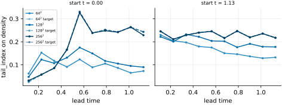

tail_index on density against lead time, the physical time since the forecast started, one panel per start and one line per run, darker the finer the run's grid. Dashed lighter lines are the target's own value. Each point is one prediction step of one forecast.

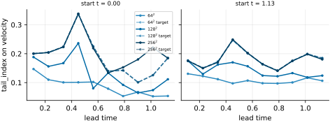

tail_index on velocity against lead time, the physical time since the forecast started, one panel per start and one line per run, darker the finer the run's grid. Dashed lighter lines are the target's own value. Each point is one prediction step of one forecast.

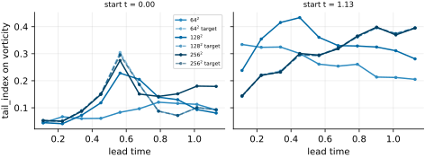

tail_index on vorticity against lead time, the physical time since the forecast started, one panel per start and one line per run, darker the finer the run's grid. Dashed lighter lines are the target's own value. Each point is one prediction step of one forecast.

**density, tail_index on the prediction, at each lead time.**

| lead time | 64², start 0 | 128², start 0 | 256², start 0 | 64², start 1.13 | 128², start 1.13 | 256², start 1.13 |
|---|---|---|---|---|---|---|
| 0.1128 | 0.0622 | 0.0478 | 0.0317 | 0.23 | 0.222 | 0.245 |
| 0.2255 | 0.153 | 0.123 | 0.0577 | 0.204 | 0.201 | 0.211 |
| 0.3383 | 0.117 | 0.107 | 0.0861 | 0.197 | 0.232 | 0.229 |
| 0.4511 | 0.091 | 0.131 | 0.166 | 0.18 | 0.222 | 0.24 |
| 0.5638 | 0.124 | 0.175 | 0.326 | 0.175 | 0.204 | 0.246 |
| 0.6766 | 0.0892 | 0.15 | 0.239 | 0.151 | 0.202 | 0.216 |
| 0.7893 | 0.105 | 0.117 | 0.248 | 0.146 | 0.176 | 0.247 |
| 0.9021 | 0.0865 | 0.105 | 0.242 | 0.137 | 0.191 | 0.219 |
| 1.015 | 0.0654 | 0.0952 | 0.264 | 0.129 | 0.179 | 0.236 |
| 1.128 | 0.0732 | 0.0899 | 0.229 | 0.132 | 0.178 | 0.218 |

**density, tail_index on the target, at each lead time.**

| lead time | 64², start 0 | 128², start 0 | 256², start 0 | 64², start 1.13 | 128², start 1.13 | 256², start 1.13 |
|---|---|---|---|---|---|---|
| 0.1128 | 0.0246 | 0.0275 | 0.0317 | 0.245 | 0.245 | 0.245 |
| 0.2255 | 0.0571 | 0.0575 | 0.0575 | 0.212 | 0.211 | 0.211 |
| 0.3383 | 0.086 | 0.0857 | 0.0853 | 0.228 | 0.229 | 0.229 |
| 0.4511 | 0.166 | 0.165 | 0.165 | 0.24 | 0.24 | 0.24 |
| 0.5638 | 0.33 | 0.33 | 0.331 | 0.245 | 0.245 | 0.245 |
| 0.6766 | 0.238 | 0.238 | 0.238 | 0.217 | 0.217 | 0.217 |
| 0.7893 | 0.252 | 0.252 | 0.252 | 0.245 | 0.246 | 0.246 |
| 0.9021 | 0.243 | 0.243 | 0.243 | 0.22 | 0.22 | 0.22 |
| 1.015 | 0.264 | 0.263 | 0.263 | 0.236 | 0.236 | 0.235 |
| 1.128 | 0.242 | 0.243 | 0.243 | 0.217 | 0.217 | 0.217 |

**density, tail_index damage, at each lead time.**

| lead time | 64², start 0 | 128², start 0 | 256², start 0 | 64², start 1.13 | 128², start 1.13 | 256², start 1.13 |
|---|---|---|---|---|---|---|
| 0.1128 | — | — | — | — | — | — |
| 0.2255 | — | — | — | — | — | — |
| 0.3383 | — | — | — | — | — | — |
| 0.4511 | — | — | — | — | — | — |
| 0.5638 | — | — | — | — | — | — |
| 0.6766 | — | — | — | — | — | — |
| 0.7893 | — | — | — | — | — | — |
| 0.9021 | — | — | — | — | — | — |
| 1.015 | — | — | — | — | — | — |
| 1.128 | — | — | — | — | — | — |

**velocity, tail_index on the prediction, at each lead time.**

| lead time | 64², start 0 | 128², start 0 | 256², start 0 | 64², start 1.13 | 128², start 1.13 | 256², start 1.13 |
|---|---|---|---|---|---|---|
| 0.1128 | 0.147 | 0.188 | 0.2 | 0.131 | 0.175 | 0.175 |
| 0.2255 | 0.11 | 0.156 | 0.204 | 0.122 | 0.13 | 0.15 |
| 0.3383 | 0.101 | 0.167 | 0.223 | 0.112 | 0.162 | 0.17 |
| 0.4511 | 0.101 | 0.236 | 0.338 | 0.0974 | 0.17 | 0.249 |
| 0.5638 | 0.102 | 0.0802 | 0.219 | 0.107 | 0.157 | 0.202 |
| 0.6766 | 0.0789 | 0.134 | 0.134 | 0.098 | 0.124 | 0.164 |
| 0.7893 | 0.0533 | 0.0921 | 0.153 | 0.0971 | 0.122 | 0.141 |
| 0.9021 | 0.0674 | 0.0645 | 0.18 | 0.101 | 0.133 | 0.175 |
| 1.015 | 0.0526 | 0.0739 | 0.221 | 0.117 | 0.118 | 0.198 |
| 1.128 | 0.0537 | 0.111 | 0.185 | 0.106 | 0.124 | 0.18 |

**velocity, tail_index on the target, at each lead time.**

| lead time | 64², start 0 | 128², start 0 | 256², start 0 | 64², start 1.13 | 128², start 1.13 | 256², start 1.13 |
|---|---|---|---|---|---|---|
| 0.1128 | 0.2 | 0.2 | 0.2 | 0.177 | 0.176 | 0.175 |
| 0.2255 | 0.204 | 0.205 | 0.205 | 0.15 | 0.151 | 0.15 |
| 0.3383 | 0.223 | 0.224 | 0.225 | 0.174 | 0.171 | 0.17 |
| 0.4511 | 0.337 | 0.337 | 0.337 | 0.245 | 0.247 | 0.248 |
| 0.5638 | 0.226 | 0.225 | 0.225 | 0.201 | 0.202 | 0.203 |
| 0.6766 | 0.139 | 0.139 | 0.14 | 0.163 | 0.164 | 0.164 |
| 0.7893 | 0.142 | 0.142 | 0.143 | 0.141 | 0.142 | 0.142 |
| 0.9021 | 0.102 | 0.101 | 0.101 | 0.175 | 0.175 | 0.175 |
| 1.015 | 0.126 | 0.126 | 0.126 | 0.199 | 0.199 | 0.199 |
| 1.128 | 0.184 | 0.185 | 0.186 | 0.185 | 0.185 | 0.184 |

**velocity, tail_index damage, at each lead time.**

| lead time | 64², start 0 | 128², start 0 | 256², start 0 | 64², start 1.13 | 128², start 1.13 | 256², start 1.13 |
|---|---|---|---|---|---|---|
| 0.1128 | — | — | — | — | — | — |
| 0.2255 | — | — | — | — | — | — |
| 0.3383 | — | — | — | — | — | — |
| 0.4511 | — | — | — | — | — | — |
| 0.5638 | — | — | — | — | — | — |
| 0.6766 | — | — | — | — | — | — |
| 0.7893 | — | — | — | — | — | — |
| 0.9021 | — | — | — | — | — | — |
| 1.015 | — | — | — | — | — | — |
| 1.128 | — | — | — | — | — | — |

**vorticity, tail_index on the prediction, at each lead time.**

| lead time | 64², start 0 | 128², start 0 | 256², start 0 | 64², start 1.13 | 128², start 1.13 | 256², start 1.13 |
|---|---|---|---|---|---|---|
| 0.1128 | 0.0442 | 0.045 | 0.0528 | 0.334 | 0.238 | 0.144 |
| 0.2255 | 0.067 | 0.0412 | 0.0507 | 0.324 | 0.354 | 0.22 |
| 0.3383 | 0.0602 | 0.0726 | 0.087 | 0.325 | 0.415 | 0.233 |
| 0.4511 | 0.061 | 0.118 | 0.149 | 0.301 | 0.434 | 0.301 |
| 0.5638 | 0.0834 | 0.228 | 0.275 | 0.261 | 0.361 | 0.295 |
| 0.6766 | 0.0966 | 0.205 | 0.151 | 0.254 | 0.33 | 0.318 |
| 0.7893 | 0.121 | 0.139 | 0.142 | 0.261 | 0.329 | 0.366 |
| 0.9021 | 0.116 | 0.13 | 0.152 | 0.214 | 0.325 | 0.398 |
| 1.015 | 0.113 | 0.0933 | 0.18 | 0.212 | 0.311 | 0.369 |
| 1.128 | 0.0918 | 0.0806 | 0.179 | 0.205 | 0.281 | 0.395 |

**vorticity, tail_index on the target, at each lead time.**

| lead time | 64², start 0 | 128², start 0 | 256², start 0 | 64², start 1.13 | 128², start 1.13 | 256², start 1.13 |
|---|---|---|---|---|---|---|
| 0.1128 | 0.0525 | 0.0527 | 0.0528 | 0.142 | 0.143 | 0.144 |
| 0.2255 | 0.0506 | 0.0504 | 0.0503 | 0.222 | 0.22 | 0.22 |
| 0.3383 | 0.0894 | 0.0888 | 0.0887 | 0.237 | 0.233 | 0.231 |
| 0.4511 | 0.151 | 0.151 | 0.152 | 0.294 | 0.295 | 0.297 |
| 0.5638 | 0.305 | 0.298 | 0.295 | 0.295 | 0.293 | 0.293 |
| 0.6766 | 0.188 | 0.186 | 0.186 | 0.321 | 0.32 | 0.322 |
| 0.7893 | 0.0879 | 0.0878 | 0.0873 | 0.363 | 0.362 | 0.363 |
| 0.9021 | 0.0721 | 0.0713 | 0.0714 | 0.396 | 0.396 | 0.397 |
| 1.015 | 0.0996 | 0.101 | 0.101 | 0.375 | 0.374 | 0.373 |
| 1.128 | 0.0932 | 0.093 | 0.0931 | 0.396 | 0.396 | 0.395 |

**vorticity, tail_index damage, at each lead time.**

| lead time | 64², start 0 | 128², start 0 | 256², start 0 | 64², start 1.13 | 128², start 1.13 | 256², start 1.13 |
|---|---|---|---|---|---|---|
| 0.1128 | — | — | — | — | — | — |
| 0.2255 | — | — | — | — | — | — |
| 0.3383 | — | — | — | — | — | — |
| 0.4511 | — | — | — | — | — | — |
| 0.5638 | — | — | — | — | — | — |
| 0.6766 | — | — | — | — | — | — |
| 0.7893 | — | — | — | — | — | — |
| 0.9021 | — | — | — | — | — | — |
| 1.015 | — | — | — | — | — | — |
| 1.128 | — | — | — | — | — | — |

Every prediction of every forecast, nothing pooled: a cell is one prediction step of one forecast, a row the lead time (the physical time since the forecast started) and a column the forecast, named by its run's native grid and its starting time (`64², start 0` is `F-906861_64_Re_50k_from_256_to_64/forecast_t0-0`; `128², start 0` is `F-906861_64_Re_50k_from_256_to128/forecast_t0-0`; `256², start 0` is `F-906861_64/forecast_t0-0`; `64², start 1.13` is `F-906861_64_Re_50k_from_256_to_64/forecast_t0-1250`; `128², start 1.13` is `F-906861_64_Re_50k_from_256_to128/forecast_t0-2500`; `256², start 1.13` is `F-906861_64/forecast_t0-5000`). **Damage** is the prediction's departure from the target as a fraction of the anchor's in the same frame, by default the target's own spatial mean, so each step is scaled by its own target. A dash means no value there.

<!-- END GENERATED results_on_forecast_re5e4 -->

`tail_index` scores one field, so on a forecast it is read as each prediction's drift from its
target's value at the same lead time, the way "Reading the output" reads a prediction against its
reference; the damage rows are empty because the anchor, a constant field, has no value (see
"Trap tests"). The statistics-of-extremes sources cited under "How its field reports it" estimate
the tail of one sample and, as read here, do not score forecasts, so the comparison with the
target is this repository's use of the estimator. This card draws no Hill plot from this run; the
subsection reads the registered point only. The target's own value changes along the rollout by
more than a factor of ten (on density from start 0, 0.0246 at the first step and 0.33 at lead
0.5638), so each prediction is read against its own step's target.

- **The forecasts run on the 256² grid stay on their targets' values.** From start 1.13 the two
  values agree at every step on every field (at the last step 0.218 against 0.217 on density,
  0.18 against 0.184 on velocity and 0.395 against 0.395 on vorticity). From start 0 they agree on
  density throughout (0.229 against 0.243 at the last step is the widest gap), on velocity up to
  lead 0.6766, and on vorticity up to lead 0.4511. Later the prediction's value sits above the
  target's on velocity at leads 0.9021 and 1.015 (0.18 against 0.101 and 0.221 against 0.126)
  before agreeing again at the last step. On vorticity it falls below the target at leads 0.5638
  and 0.6766 (0.151 against 0.186 at the second) and sits above it at every step from lead 0.7893
  (0.179 against 0.0931 at the last).
- **The forecasts run on the coarser grids score below their targets on density and velocity.**
  On velocity the 64² and 128² forecasts are below the target at every step from both starts (from
  start 0, 0.0537 and 0.111 against 0.184 and 0.185 at the last step). On density they are below
  from lead 0.4511 from start 0 (0.0732 and 0.0899 against 0.242 and 0.243 at the last step), after
  three steps above it, and below at all but one step from start 1.13. By Equation (2) a lower
  value means their largest increments are more nearly equal than the target's, the direction the
  blurs and low-pass filters move it on the ladder; reading the forecasts' lower value as
  smoothing is this card's interpretation, not something the run measures.
- **On vorticity the coarser forecasts depart in both directions.** From start 1.13 they begin
  above the target (0.334 and 0.238 against 0.142 and 0.143 at the first step) and end below it
  (0.205 and 0.281 against 0.396 and 0.396); from start 0 they cross the target's value several
  times.


### On `kinet_re1e6`

<!-- GENERATED results_on_kinet_re1e6: written by `python -m fmeval.cards evidence tail_index --results results/comparison_1793829127 --results results/comparison_1793811840 --results results/comparison_1793829231`, do not edit -->

**Developed flow at Re = 1e6, twenty times the Reynolds number of kinet_re5e4, from the same initial condition.**

Measured on `kinet_re1e6`, frames 2000 to 10000 (161 frames of developed flow at Re = 1e6, twenty times the Reynolds number of kinet_re5e4, from the same initial condition), on the 128 analysis grid, seed 20260807, at commit `adbdc88e4950`. Run `comparison_1793829231`.

[additive_noise](../../degradations/additive_noise/card.md) ·
[band_attenuate](../../degradations/band_attenuate/card.md) ·
[bias](../../degradations/bias/card.md) ·
[box_blur](../../degradations/box_blur/card.md) ·
[coarsen](../../degradations/coarsen/card.md) ·
[coarsen_bandlimited](../../degradations/coarsen_bandlimited/card.md) ·
[disk_blur](../../degradations/disk_blur/card.md) ·
[epanechnikov_blur](../../degradations/epanechnikov_blur/card.md) ·
[gain](../../degradations/gain/card.md) ·
[gaussian_blur](../../degradations/gaussian_blur/card.md) ·
[gaussian_impostor](../../degradations/gaussian_impostor/card.md) ·
[highpass_butterworth](../../degradations/highpass_butterworth/card.md) ·
[highpass_ideal](../../degradations/highpass_ideal/card.md) ·
[lowpass_butterworth](../../degradations/lowpass_butterworth/card.md) ·
[lowpass_ideal](../../degradations/lowpass_ideal/card.md) ·
[mean_field](../../degradations/mean_field/card.md) ·
[median_blur](../../degradations/median_blur/card.md) ·
[multiplicative_noise](../../degradations/multiplicative_noise/card.md) ·
[subsample](../../degradations/subsample/card.md) ·
[translate_subpixel](../../degradations/translate_subpixel/card.md) ·
[translate_x](../../degradations/translate/card.md) ·
[translate_y](../../degradations/translate/card.md) ·
[uncorrelated](../../degradations/random_large_translation/card.md)

**Smoothing.**

| degradation | field | strengths | rank correlation | fraction of frames in the right order | weakest gap between neighbouring strengths |
|---|---|---|---|---|---|
| `box_blur` | density | 4 | 1 | 1 | 0.823 |
| `box_blur` | velocity | 4 | 1 | 0.925 | 0.567 |
| `box_blur` | vorticity | 2 | -1 | 0.435 | 0.521 |
| `disk_blur` | density | 3 | 1 | 1 | 0.795 |
| `disk_blur` | velocity | 3 | 1 | 0.82 | 0.587 |
| `disk_blur` | vorticity | 2 | 1 | 0.534 | 0.573 |
| `epanechnikov_blur` | density | 3 | 1 | 1 | 0.902 |
| `epanechnikov_blur` | velocity | 3 | 1 | 0.969 | 0.653 |
| `epanechnikov_blur` | vorticity | 2 | 1 | 0.727 | 0.662 |
| `gaussian_blur` | density | 4 | 1 | 1 | 0.804 |
| `gaussian_blur` | velocity | 4 | 1 | 0.963 | 0.585 |
| `gaussian_blur` | vorticity | 4 | 0.8 | 0.137 | 0.329 |
| `median_blur` | density | 3 | 0.5 | 0.429 | 0.615 |
| `median_blur` | velocity | 3 | -0.5 | 0.087 | 0.358 |
| `median_blur` | vorticity | 1 | — | — | — |

**Spectral filtering.**

| degradation | field | strengths | rank correlation | fraction of frames in the right order | weakest gap between neighbouring strengths |
|---|---|---|---|---|---|
| `band_attenuate` | density | 4 | 1 | 0.783 | 0.581 |
| `band_attenuate` | velocity | 4 | -0.2 | 0.199 | 0.477 |
| `band_attenuate` | vorticity | 4 | 1 | 0.547 | 0.557 |
| `highpass_butterworth` | density | 4 | 1 | 0.839 | 0.694 |
| `highpass_butterworth` | velocity | 3 | -0.5 | 0.342 | 0.517 |
| `highpass_butterworth` | vorticity | 4 | 0.8 | 0.242 | 0.523 |
| `highpass_ideal` | density | 3 | 1 | 0.963 | 0.89 |
| `highpass_ideal` | velocity | 2 | -1 | 0.466 | 0.499 |
| `highpass_ideal` | vorticity | 4 | 0.8 | 0.261 | 0.513 |
| `lowpass_butterworth` | density | 4 | 1 | 0.522 | 0.498 |
| `lowpass_butterworth` | velocity | 3 | 1 | 0.814 | 0.538 |
| `lowpass_butterworth` | vorticity | 4 | 0.4 | 0.13 | 0.264 |
| `lowpass_ideal` | density | 3 | 1 | 1 | 0.626 |
| `lowpass_ideal` | velocity | 3 | 1 | 0.938 | 0.557 |
| `lowpass_ideal` | vorticity | 4 | 0.4 | 0.087 | 0.216 |

**Displacement.**

| degradation | field | strengths | rank correlation | fraction of frames in the right order | weakest gap between neighbouring strengths |
|---|---|---|---|---|---|
| `translate_subpixel` | density | 6 | 0.0286 | 0.0124 | 0.478 |
| `translate_subpixel` | velocity | 6 | -0.029 | 0 | 0.472 |
| `translate_subpixel` | vorticity | 6 | 0.406 | 0 | 0.422 |
| `translate_x` | density | 5 | — | — | — |
| `translate_x` | velocity | 5 | — | — | — |
| `translate_x` | vorticity | 5 | — | — | — |
| `translate_y` | density | 5 | — | — | — |
| `translate_y` | velocity | 5 | — | — | — |
| `translate_y` | vorticity | 5 | — | — | — |

**Resolution loss.**

| degradation | field | strengths | rank correlation | fraction of frames in the right order | weakest gap between neighbouring strengths |
|---|---|---|---|---|---|
| `coarsen` | density | 4 | 1 | 0.988 | 0.913 |
| `coarsen` | velocity | 4 | 1 | 0.534 | 0.684 |
| `coarsen` | vorticity | 4 | 1 | 0.671 | 0.632 |
| `coarsen_bandlimited` | density | 4 | 1 | 0.957 | 0.926 |
| `coarsen_bandlimited` | velocity | 4 | 1 | 0.596 | 0.575 |
| `coarsen_bandlimited` | vorticity | 4 | 0.8 | 0.199 | 0.243 |
| `subsample` | density | 4 | 1 | 0.671 | 0.651 |
| `subsample` | velocity | 4 | 0.4 | 0.124 | 0.181 |
| `subsample` | vorticity | 4 | 1 | 0.894 | 0.827 |

**Noise.**

| degradation | field | strengths | rank correlation | fraction of frames in the right order | weakest gap between neighbouring strengths |
|---|---|---|---|---|---|
| `additive_noise` | density | 4 | 0.4 | 0.0807 | 0.189 |
| `additive_noise` | velocity | 4 | 0.6 | 0.149 | 0.298 |
| `additive_noise` | vorticity | 4 | 0.4 | 0.18 | 0.48 |
| `multiplicative_noise` | density | 5 | 0.7 | 0.155 | 0.499 |
| `multiplicative_noise` | velocity | 5 | 0.8 | 0.186 | 0.525 |
| `multiplicative_noise` | vorticity | 5 | 0.7 | 0.217 | 0.494 |

**Cell-value distortion.**

| degradation | field | strengths | rank correlation | fraction of frames in the right order | weakest gap between neighbouring strengths |
|---|---|---|---|---|---|
| `bias` | density | 4 | — | — | — |
| `bias` | velocity | 4 | — | — | — |
| `bias` | vorticity | 4 | — | — | — |
| `gain` | density | 4 | — | — | — |
| `gain` | velocity | 4 | — | — | — |
| `gain` | vorticity | 4 | — | — | — |

**Trap tests.**

| field | damage assigned to the fake prediction | closest real degradation | damage of the reference moved far away | value on the anchor |
|---|---|---|---|---|
| density | — | — | — | — |
| velocity | — | — | — | — |
| vorticity | — | — | — | — |

The fake prediction here has exactly the reference field's amplitude spectrum and completely scrambled structure. Damage 1 is what the anchor scores, by default the reference's own spatial mean, a prediction that knows the mean and nothing else. The damage column therefore says how close to useless this metric considers that fake prediction: a low number means the metric was fooled. The third column translates the same number into an ordinary degradation whose damage the fake prediction matches, which is easier to picture. The fourth is the reference moved by a large random offset, the right statistics in the wrong place; where a field's energy sits in its largest scales that copy stays partly correlated with the reference, so it is not the score of an unrelated field.

<!-- END GENERATED results_on_kinet_re1e6 -->

The values here are on the 128 analysis grid and are not comparable with the main run's on 256:
both the increment's length and $k$ change with the grid ("Reading the output"). What can be
compared is the direction and order of each response.

- **Density and velocity respond as on `kinet_re5e4`.** The four linear blurs and both low-pass
  filters lower the value with a rank correlation of 1, in 0.82 to 1 of frames for the blurs, and
  `coarsen` and `subsample` raise it (`coarsen` with rank correlation 1 on every field, a change of
  5.28, 2.62 and 7.82 from clean). `coarsen_bandlimited` lowers it, now followed on velocity as
  well as density (rank correlation 1 on both).
- **Vorticity responds differently to smoothing.** The blurs raise its value here (direction +1, a
  change of 0.446 to 0.82 at the harshest strength) where on `kinet_re5e4` they lower it; the box,
  disk and Epanechnikov blurs keep only two usable strengths, and the box blur's rank correlation
  is -1. Both low-pass filters lower it but are followed weakly (rank correlation 0.4, with 0.13 and
  0.087 of frames in order).
- **Noise moves the registered order the other way on every field.** Additive noise lowers the
  value on density and velocity (a change of -0.268 and -0.118) and raises it on vorticity
  (0.0934), the opposite of `kinet_re5e4`, with rank correlations of 0.4 to 0.6 and at most 0.18 of
  frames in order. This fits the reading under "Noise", that the sign at $\theta = 1/2$ depends on
  where the clean field's value sits, but this run does not record the noise-dominated value
  either, so it is not checked here. Multiplicative noise lowers density (-0.277) and raises
  velocity and vorticity (0.437 and 1.68).
- **The high-pass filters on velocity** are followed backwards (rank correlation -0.5 and -1) and
  move the value little (0.000657 and -0.0189).
- **Translations.** Whole-cell shifts change nothing, as on `kinet_re5e4`; `translate_subpixel`
  does not order (rank correlations 0.0286, -0.029 and 0.406, with at most 0.0124 of frames in
  order).
- **Trap tests.** The fake prediction with the right spectrum scores 0.0669, 0.101 and 0.106
  against clean values of 0.145, 0.119 and 0.115, below the reference on every field, where on
  `kinet_re5e4` it scored above the reference on velocity; whether it lands above or below the
  reference is therefore not a property of the metric alone. The reference moved far away scores
  exactly its clean value.


## References

\bibliography
