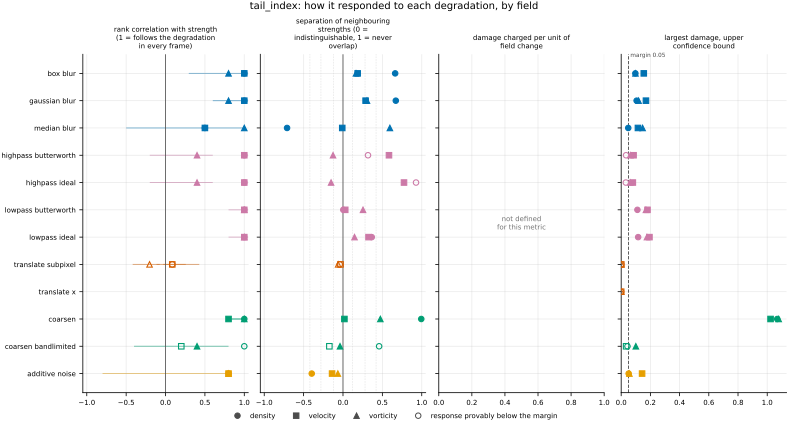
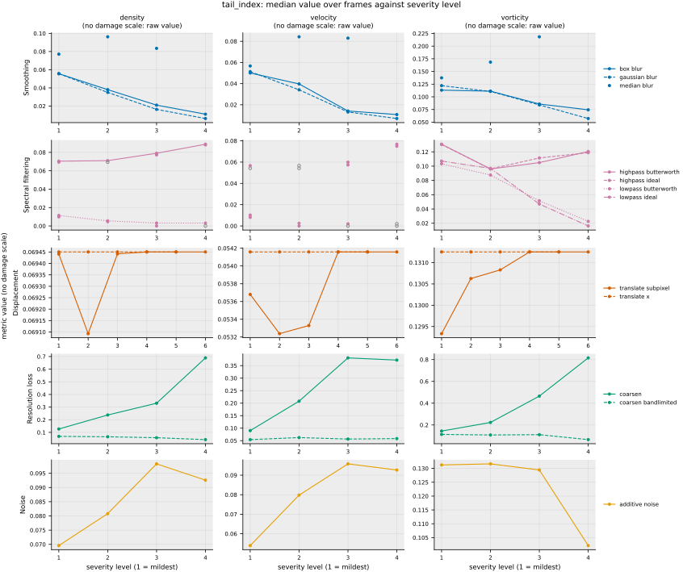

## Definition

Let $f$ be one channel of a field on a periodic grid of $n$ cells and $\mathbf{e}_j$ the unit
step along spatial axis $j$. The one-cell increment is the one `increment_flatness` defines,

$$
(\delta_j f)_{\mathbf{m}} = f_{\mathbf{m} + \mathbf{e}_j} - f_{\mathbf{m}} \tag{1}
$$

and its $n$ absolute values, sorted from largest to smallest, are
$X_{(1)} \ge X_{(2)} \ge \dots \ge X_{(n)}$. The Hill estimator from the $k$ largest of them is

$$
H_j^{(c)}(k) = \frac{1}{k} \sum_{i=1}^{k} \ln \frac{X_{(i)}}{X_{(k+1)}} \tag{2}
$$

the form printed by Boucheron and Thomas [@boucheron2015], Section 1, of the estimator of Hill
[@hill1975]; the copy of the first that was read shows no number on the definition, and the
second was read only through its abstract, so neither is cited by equation. It is the mean
log-ratio of each of the $k$ largest values to one threshold, the $(k+1)$-th largest. When the
tail is a power law, $P(X > x) \propto x^{-\alpha}$, it estimates the extreme-value index
$\gamma = 1/\alpha$: Boucheron and Thomas state that $H(k)$ converges to $\gamma$ for every $k$
that grows with $n$ while $k/n$ shrinks, exactly when the tail lies in the domain of attraction
with $\gamma > 0$. It is the power-law maximum-likelihood estimator of Clauset, Shalizi and
Newman [@clauset2009], Eq. (3.1), $\hat\alpha_{\mathrm{C}} = 1 + m \bigl[\sum_i
\ln(x_i / x_{\min})\bigr]^{-1}$, rewritten. Their exponent is that of the density,
$p(x) \propto x^{-\alpha_{\mathrm{C}}}$ (their Eq. (1.1)), so $\alpha_{\mathrm{C}} = \alpha + 1$,
and with $x_{\min} = X_{(k+1)}$ and the $m = k$ values above it, $\hat\alpha_{\mathrm{C}} - 1 =
1/H(k)$; counting $x_{\min}$ itself among the $m$ values, as their "$x_i \ge x_{\min}$" allows,
gives $(k+1)/(k\,H(k))$ instead. When the tail is not a power law, Equation (2) is still defined
and still scale-free, but it no longer estimates a tail index; it is then the mean log-excess of
the $k$ largest values over the $(k+1)$-th, and depends on $k$.

The order $k$ is set on a logarithmic scale,

$$
k(\theta) = \min\bigl(\lceil n^{\theta} \rceil,\; n - 1\bigr), \qquad
\theta \in \{0.1, 0.2, \dots, 0.9\} \tag{3}
$$

the cap leaving an $X_{(k+1)}$ to divide by. $k(\theta)$ is computed exactly in integers, as the
least $k$ with $k^{10} \ge n^{10\theta}$, because a floating-point power can land just above an
exact root and make the ceiling one too large. The reported value is the mean of Equation (2) at
$\theta = 1/2$ over the set $A$ of channel-and-axis pairs whose $X_{(k+1)}$ is positive,

$$
T = \frac{1}{|A|} \sum_{(c, j) \in A} H_j^{(c)}\bigl(k(\tfrac{1}{2})\bigr) \tag{4}
$$

and is NaN when $A$ is empty, as on a constant field. $\theta = 1/2$ keeps the largest
$\sqrt{n}$ values, one of the two fixed rules Clauset, Shalizi and Newman [@clauset2009] name in
Section 3.5 as an alternative to choosing $k$ from the data. On the 256 by 256 analysis grid that
is $k = 256$ of $n = 65536$ increments per axis.

**Choices made here, not by a source.** Which of the fixed rules to register is this bundle's
choice: the largest $\sqrt{n}$ satisfies the condition under which Equation (2) is consistent,
$k$ growing while $k/n$ shrinks, and the other rule Section 3.5 names, the largest $n/10$, does
not. The rule is fixed once for every field and every variant rather than chosen from each
field's data, as the Kolmogorov-Smirnov method of Clauset, Shalizi and Newman [@clauset2009],
Section 3.3 and Eq. (3.9), would choose it, so that the reference and every variant are read at
the same order. The quantity whose tail is read is the absolute one-cell increment, because
increment statistics are the physics criteria Granero-Belinchón and Cabeza Gallucci
[@granero2024] train a generative turbulence model against; both signs of increment are pooled
into one tail. Equation (4) averages per-pair estimates rather than estimating once from every
pair's increments pooled, so that each channel and axis has an equal say: pooled, the $k$
largest values come from whichever pair has the largest increments, and on kinet velocity at
frames 2000 and 8000 a single pair of the four supplies all of them. The mean is itself a
mixture of pairs whose estimates differ, by a factor of 4 to 7 across the four velocity pairs of
those frames. The coordinate $\theta$ of Equation (3), which puts $k$ on a logarithmic scale, and
its nine values a tenth apart, are this bundle's choice. Boucheron and Thomas [@boucheron2015],
Section 2.3, mention "alternative Hill plots", but the source that defines one was not read, so
the coordinate is not attributed to it.

**The curve behind the number** is Equation (2), averaged as in Equation (4), at every $\theta$
of Equation (3): a Hill plot, as Section 3.5 of Clauset, Shalizi and Newman [@clauset2009] names
the estimate plotted against its threshold, here with $k$ on a logarithmic scale. It is stored
on every row; the registered number is its value at $\theta = 1/2$.

### Boundary handling

Periodic wrap on every axis: the increment of the last cell along an axis is taken against the
first, as in `increment_flatness`. A pair whose $(k+1)$-th largest absolute increment is exactly
zero has no estimate at that $k$ and is left out of Equation (4) rather than given one; that rule
is discontinuous, as the Limitations say. A field holding NaN or an infinity is refused with an
error rather than scored. The metric
declares `requires_periodic`, so the harness does not run it on a dataset with a non-periodic
axis, such as the Sod shock tube.

## Performance

<!-- GENERATED performance: written by `python -m fmeval.cards evidence tail_index --results results/tail_index_1793350342`, do not edit -->



Four measured statistics for tail_index, one row per degradation grouped by family and one marker per field. From left: the rank correlation between the metric and the applied strength within a frame, with the line showing the resampling interval; the separation of neighbouring strengths as Cliff's delta, where 0 means the metric cannot tell one strength from the next and the faint ticks at 0.12, 0.28 and 0.42 are Vargha and Delaney's small, medium and large anchors, for scale and not as grades; the damage charged per unit of field change at the harshest strength; and the upper confidence bound on the largest damage, beside the fixed margin of 0.05. A hollow marker is a field and degradation on which that bound lies below the margin, so the response is provably small. A missing marker is a statistic the analysis withheld, as the rank correlation is on an axis the metric is invariant to.



Median damage over frames against severity level for tail_index, one row per family of degradation and one column per field, on one shared scale. The solid grey line is damage 1, the anchor (by default the field's own mean); the dotted black line is the damage assigned to the fake prediction with the right spectrum, where the run included it. The hollow black ring marks the first level at which the metric has moved a tenth of the way to the anchor. Hollow grey markers are strengths excluded for repeating a milder one or for doing nothing. Degradations with three or fewer usable levels are drawn as markers only; points beyond 2 either side are drawn as triangles at the edge. Damage is negative where a degradation moves the metric away from the anchor, as noise raises a single-field quantity the field's mean sets to zero. No damage scale on density, velocity, vorticity: the grey panels show the raw value instead.

**Trend: does the response follow the degradation?**

| test family | field | degradations | rank correlation | fraction of frames in order | weakest gap between neighbouring strengths |
|---|---|---|---|---|---|
| Displacement | density | 2 | 0.0857 | 0.0124 | 0.479 |
| Displacement | velocity | 2 | 0.0857 | 0 | 0.484 |
| Displacement | vorticity | 2 | -0.203 | 0 | 0.469 |
| Resolution loss | density | 2 | 1 | 0.634 to 1 | 0.729 to 0.997 |
| Resolution loss | velocity | 2 | 0.2 to 0.8 | 0.0559 to 0.497 | 0.413 to 0.509 |
| Resolution loss | vorticity | 2 | 0.4 to 1 | 0.273 to 0.689 | 0.481 to 0.737 |
| Smoothing | density | 3 | 0.5 to 1 | 0.0683 to 1 | 0.145 to 0.835 |
| Smoothing | velocity | 3 | 0.5 to 1 | 0.416 to 0.994 | 0.495 to 0.644 |
| Smoothing | vorticity | 3 | 0.8 to 1 | 0.429 to 0.82 | 0.583 to 0.798 |
| Spectral filtering | density | 4 | 1 | 0.646 to 1 | 0.502 to 0.964 |
| Spectral filtering | velocity | 4 | 1 | 0.733 to 1 | 0.514 to 0.887 |
| Spectral filtering | vorticity | 4 | 0.4 to 1 | 0.0559 to 0.634 | 0.424 to 0.627 |
| Noise | density | 1 | 0.8 | 0.137 | 0.302 |
| Noise | velocity | 1 | 0.8 | 0.217 | 0.431 |
| Noise | vorticity | 1 | 0.8 | 0.217 | 0.467 |

**Reactivity: how far does it move?**

| test family | field | change from clean at the harshest strength | elasticity | first strength detected |
|---|---|---|---|---|
| Displacement | density | -3.28e-13 to 0 | — | level — |
| Displacement | velocity | 0 | — | level — |
| Displacement | vorticity | 0 | -0.254 | level — |
| Resolution loss | density | -0.368 to 8.71 | 1.09 to 1.92 | level — |
| Resolution loss | velocity | 0.0551 to 5.64 | 1.63 | level — |
| Resolution loss | vorticity | -0.444 to 4.86 | 0.137 to 2.06 | level — |
| Smoothing | density | -0.914 to 0.198 | 0.577 to 0.835 | level — |
| Smoothing | velocity | -0.882 to 0.603 | 1.59 to 2.41 | level — |
| Smoothing | vorticity | -0.558 to 0.67 | 0.864 to 2.18 | level — |
| Spectral filtering | density | -1 to 0.271 | 0.0777 to 3.28 | level — |
| Spectral filtering | velocity | -1 to 0.415 | 0.11 to 2.96 | level — |
| Spectral filtering | vorticity | -0.872 to 0.0629 | 0.686 to 0.871 | level — |
| Noise | density | 0.347 | 1.06 | level — |
| Noise | velocity | 0.73 | 1.02 | level — |
| Noise | vorticity | -0.154 | — | level — |
| trap test: fake prediction, right spectrum | density | — | — | damage — |
| trap test: fake prediction, right spectrum | velocity | — | — | damage — |
| trap test: fake prediction, right spectrum | vorticity | — | — | damage — |

**Consistency: how much does it vary from snapshot to snapshot?**

| test family | field | consistency, in the strength's units | snapshots per independent block |
|---|---|---|---|
| Displacement | density | 15 | 1 |
| Displacement | velocity | 14.2 | 1 |
| Displacement | vorticity | 19.9 | 1 |
| Resolution loss | density | 0.817 to 3.81 | 12 to 17 |
| Resolution loss | velocity | 0.923 to 10.4 | 12 to 19 |
| Resolution loss | vorticity | 2.62 to 6.84 | 19 to 21 |
| Smoothing | density | 0.00457 to 0.0449 | 16 to 21 |
| Smoothing | velocity | 0.0136 to 0.937 | 19 to 20 |
| Smoothing | vorticity | 0.0569 to 0.193 | 8 to 21 |
| Spectral filtering | density | 0.0251 to 0.122 | 12 to 21 |
| Spectral filtering | velocity | 0.0172 to 0.368 | 8 to 18 |
| Spectral filtering | vorticity | 0.0708 to 0.482 | 20 to 21 |
| Noise | density | 0.0347 | 16 |
| Noise | velocity | 0.0654 | 18 |
| Noise | vorticity | 0.585 | 20 |

One row per family of degradation and physical field; a cell gives the range over the degradations in that family. **Trend.** The rank correlation is the Spearman correlation between the strength and how far the metric has moved from its value on the undegraded field of the same frame, in the one direction it moves under that degradation, computed inside a single frame. A value of 1 means every strength moved it further than the last in every frame, whichever way it moves; a response that scatters to both sides scores near 0. The fraction of frames in order counts the frames with no exception. The weakest gap is the smallest Mann-Whitney overlap between two neighbouring strengths across frames: 1 means they never overlap, 0.5 that they cannot be told apart. **Reactivity.** The change from clean is the median, at the harshest strength, of the departure from the undegraded value of the same frame over the size of that value: 0.3 means 30%. The elasticity is the percentage change of that departure per percentage change in strength over the mildest strengths. First strength detected is the mildest at which the metric has moved a tenth of the way to the anchor; **damage** reads that 0-to-1 scale as a number. A dash means the measurement is not defined there. A metric's reactivity scales with the power it is expressed in: mean squared error's elasticity is twice root-mean-square error's, though the two carry the same information, so compare magnitudes across metrics with that in mind. **Consistency** is how much the response varies from snapshot to snapshot relative to its size, in the strength's units; the snapshots of one trajectory are correlated, and the last column is how many consecutive snapshots one independent block spans.

These tables report what was measured and grade none of the measurements. What the numbers mean for this metric is written in the subsections below, beside the test that produced each number.

**Profile.**

| field | selectivity | charges most for | charges least for | response provably below 0.05 at 90% on | elasticity to a sub-pixel shift, against severity (distance) | compute cost (x cheapest in this run) |
|---|---|---|---|---|---|---|
| density | — | — | — | `coarsen_bandlimited` `highpass_butterworth` `highpass_ideal` `translate_subpixel` `translate_x` | — | 1.01 |
| velocity | — | — | — | `coarsen_bandlimited` `translate_subpixel` `translate_x` | — | 1.94 |
| vorticity | — | — | — | `translate_subpixel` `translate_x` | -0.254 | 1 |

One row per physical field. **Selectivity** is how concentrated the metric's response is on a few degradations, measured per unit of field change: 0 means it charges every degradation the same, as mean squared error does by construction, and values toward 1 that one degradation carries most of it. **Charges most and least for** name the two ends of that profile. **Response provably below** lists degradations on which the upper confidence bound of the largest damage lies below the margin -- an equivalence test, so an entry says the response is provably small, not merely not significant; a dash means no degradation met the bound. **Elasticity** is the slope of log damage against log shift over the smallest shifts: 1 means damage grows in proportion to the shift, 2 with its square. **Compute cost** is wall-clock per evaluation over the cheapest metric and field in the same run.

<!-- END GENERATED performance -->

## Intuition

This metric asks how far the very largest jumps between neighbouring cells stand out from the
slightly smaller ones. It collects the size of every difference between a cell and its
neighbour, keeps the biggest few, as many as the square root of the number of cells, and takes
the average of how many times larger each of them is than the first size just below the kept
group, measured on a logarithmic scale. If the biggest jumps are all about the same size, the
answer is near zero. If a few jumps are many times larger than the rest of the biggest ones, the
answer is large. For independent values that follow a power law, where the chance of exceeding a
size falls as one over that size raised to some power, the answer is one over that power, so a
heavier tail scores higher.

What it reveals is a change in how the largest local gradients are spread out relative to one
another. On a real flow field the answer is not a simple heaviness score, because the largest
jumps sit side by side in a few sharp structures, and neighbours of similar size pull the answer
down. Replacing the field's structures by random values with the same spectrum, or adding noise,
can therefore raise it, so a value moving away from the reference's says that the largest
gradients changed, not which way the field's intermittency went.

A worked example, four cells by four cells. On the left, a sawtooth down each column: the values
0, 3, 2, 1, wrapping back to 0, so going down a column the field jumps up by 3 once and steps
down by 1 three times. On the right, rows alternate between 0 and 1, so every step has size 1.

```
sawtooth          alternating
0 0 0 0           0 0 0 0
3 3 3 3           1 1 1 1
2 2 2 2           0 0 0 0
1 1 1 1           1 1 1 1

1.0986            0
```

Sixteen cells means the four largest steps are kept. In the sawtooth those are the four jumps of
3, one per column, and the first step below them is 1, so each kept step is 3 times that
threshold and the answer is the natural logarithm of 3, 1.0986. In the alternating field the four largest steps and
the next one are all 1, so the answer is 0. Along the rows both fields are constant, so that
direction has no steps at all and is left out.

What it ignores: everything about the field except the sizes of its largest neighbour-to-neighbour
steps, including where those steps are and the shape of the rest of the distribution.

## Reading the output

Dimensionless, zero or positive, and unbounded above. There is no direction in which the number
is better: what is read is the drift of a prediction's value from the reference field's own value,
in either direction. A value above the reference's means the prediction's largest increments are
more spread out relative to one another than the reference's are; a value below means they are
more uniform. It does not mean a heavier or a lighter tail on a spatially correlated field: on the
evidence run the reference scores below the fake prediction that keeps its spectrum and scrambles
its structure, on velocity (see the trap tests under Results).

Because Equation (2) uses only ratios of increments, multiplying a field by a constant or adding
one to it changes nothing, so values can be compared across fields of different magnitude. For a
sample whose tail is a power law the value estimates one over the power; for any other tail it is
the mean log-ratio at the stated $k$ and is not a tail index, and a value from one field should
not be read as an exponent without first checking that a power law fits (Clauset, Shalizi and
Newman [@clauset2009], Sections 4 and 5).

Values at different analysis-grid resolutions are not comparable, for two reasons: the increment
is one cell long, so its physical length changes with the grid, and $k$ is set by the number of
cells, so the order read changes too.

The companion is the curve `tail_index[theta]`: Equation (4) at $k = \lceil n^{\theta} \rceil$ for
$\theta$ from 0.1 to 0.9. Small $\theta$ reads the few largest increments and is noisy; large
$\theta$ reaches into the bulk of the distribution and stops being a statement about its tail.

## Limitations

The estimator's guarantee is for a power-law tail, and a field whose increments are bounded or
fall off faster than any power has none to estimate. There the value at $k = \sqrt{n}$ measures
how the largest increments are spaced at that one order, and a change in it does not mean the
tail index changed. A reader who sees two values and reads off two exponents is misreading it.

The theory behind Equation (2) assumes independent samples, and the increments of a smooth field
are not: the largest increments of one frame tend to sit side by side across a few sharp
structures, so the largest few hundred are a handful of events counted many times. That lowers
the value even when the tail is a power law: on a 128 by 64 independent power-law field, a
two-cell blur halves it in the mean over eight seeds (a test in `test_metric.py` pins this),
while a blurred independent Gaussian field keeps its value. A value below that of independent Gaussian noise therefore does not show that the
tail is lighter than Gaussian; it may show only that the largest increments are clustered. The
value is also a property of those few structures and can jump from frame to frame when one of
them grows or decays.

A channel and axis along which the field is exactly constant is left out of the mean, but the
same axis with round-off-sized variation is not, and because Equation (2) is scale-free it then
counts as much as any other pair. On a field that is constant along one axis, a perturbation of
one part in a million million can change the value by a third (`issues/103`). For the same
reason the derivative of the value with respect to the field grows without bound as the
$(k+1)$-th largest increment approaches zero, which matters if it is used as a training loss.

The number depends on $k$, and $\sqrt{n}$ is one rule among several. The stored curve shows how
the value moves with $k$; where the curve is steep, a different rule would give a different
number.

Its response to smoothing is not monotone, which the decorator declares and the contract test
checks: on that test's synthetic blur ladder the value rises and then falls. Ranking two
predictions by closeness to the reference's value can therefore put a more heavily smoothed
field ahead of a less smoothed one.

## Results

<!-- GENERATED run: written by `python -m fmeval.cards evidence tail_index --results results/tail_index_1793350342`, do not edit -->

Measured on `kinet_re5e4`, frames 2000 to 10000 (161 frames of developed flow), on the 256 analysis grid, seed 20260807, at commit `59dce73a8af3`. Run `tail_index_1793350342`.

Every number in this section comes from that one run. Regenerate with `python -m fmeval.cards evidence <name> --results results/tail_index_1793350342`.

<!-- END GENERATED run -->

### Smoothing

[gaussian_blur](../../degradations/gaussian_blur/card.md) ·
[box_blur](../../degradations/box_blur/card.md)

<!-- GENERATED results_smoothing: written by `python -m fmeval.cards evidence tail_index --results results/tail_index_1793350342`, do not edit -->

| degradation | field | strengths | rank correlation | fraction of frames in the right order | weakest gap between neighbouring strengths |
|---|---|---|---|---|---|
| `box_blur` | density | 4 | 1 | 1 | 0.831 |
| `box_blur` | velocity | 4 | 1 | 0.882 | 0.593 |
| `box_blur` | vorticity | 4 | 0.8 | 0.491 | 0.583 |
| `gaussian_blur` | density | 4 | 1 | 1 | 0.835 |
| `gaussian_blur` | velocity | 4 | 1 | 0.994 | 0.644 |
| `gaussian_blur` | vorticity | 4 | 0.8 | 0.429 | 0.652 |
| `median_blur` | density | 3 | 0.5 | 0.0683 | 0.145 |
| `median_blur` | velocity | 3 | 0.5 | 0.416 | 0.495 |
| `median_blur` | vorticity | 3 | 1 | 0.82 | 0.798 |

<!-- END GENERATED results_smoothing -->

The Gaussian and box blurs lower the value, which by Equation (2) means the largest increments
become more nearly equal. On density and velocity they are followed in 0.882 to 1 of the frames,
and the harshest Gaussian blur lowers the value by a fraction 0.914 on density and 0.882 on
velocity (the `gaussian_blur` row of the change-from-clean tables below, at 0.5). On vorticity the
rank correlation is 0.8 with 0.429 and 0.491 of frames in order. The median blur moves the value
the other way, up, and is followed weakly on density and velocity (rank correlation 0.5).


### Spectral filtering

[lowpass_ideal](../../degradations/lowpass_ideal/card.md) ·
[highpass_ideal](../../degradations/highpass_ideal/card.md)

<!-- GENERATED results_spectral: written by `python -m fmeval.cards evidence tail_index --results results/tail_index_1793350342`, do not edit -->

| degradation | field | strengths | rank correlation | fraction of frames in the right order | weakest gap between neighbouring strengths |
|---|---|---|---|---|---|
| `highpass_butterworth` | density | 4 | 1 | 0.776 | 0.659 |
| `highpass_butterworth` | velocity | 3 | 1 | 0.733 | 0.792 |
| `highpass_butterworth` | vorticity | 4 | 0.4 | 0.087 | 0.437 |
| `highpass_ideal` | density | 3 | 1 | 0.988 | 0.964 |
| `highpass_ideal` | velocity | 2 | 1 | 0.913 | 0.887 |
| `highpass_ideal` | vorticity | 4 | 0.4 | 0.0559 | 0.424 |
| `lowpass_butterworth` | density | 4 | 1 | 0.646 | 0.502 |
| `lowpass_butterworth` | velocity | 3 | 1 | 0.969 | 0.514 |
| `lowpass_butterworth` | vorticity | 4 | 1 | 0.634 | 0.627 |
| `lowpass_ideal` | density | 3 | 1 | 1 | 0.683 |
| `lowpass_ideal` | velocity | 2 | 1 | 1 | 0.662 |
| `lowpass_ideal` | vorticity | 4 | 1 | 0.559 | 0.573 |

<!-- END GENERATED results_spectral -->

Both low-pass filters lower the value on every field with a rank correlation of 1; on density and
velocity the harshest ideal low-pass takes it to zero (a change from clean of -1 at 0.5 in the
tables below), leaving the largest increments all but equal. The high-pass filters raise it, followed on
density and velocity (rank correlation 1) and barely on vorticity (0.4, with 0.087 and 0.0559 of
frames in order).


### Displacement

[translate_x](../../degradations/translate/card.md) ·
[translate_subpixel](../../degradations/translate_subpixel/card.md)

<!-- GENERATED results_geometric: written by `python -m fmeval.cards evidence tail_index --results results/tail_index_1793350342`, do not edit -->

| degradation | field | strengths | rank correlation | fraction of frames in the right order | weakest gap between neighbouring strengths |
|---|---|---|---|---|---|
| `translate_subpixel` | density | 6 | 0.0857 | 0.0124 | 0.479 |
| `translate_subpixel` | velocity | 6 | 0.0857 | 0 | 0.484 |
| `translate_subpixel` | vorticity | 6 | -0.203 | 0 | 0.469 |
| `translate_x` | density | 5 | — | — | — |
| `translate_x` | velocity | 5 | — | — | — |
| `translate_x` | vorticity | 5 | — | — | — |

<!-- END GENERATED results_geometric -->

An integer translation leaves the multiset of increments unchanged, so `translate_x` is withheld
as round-off and is among the blind axes on every field, as declared. `translate_subpixel` does
not order: its rank correlations are 0.0857, 0.0857 and -0.203, and its harshest strength, a whole
number of cells, changes the value only by round-off (-3.28e-13 on density in the reactivity table
above).


### Resolution loss

[coarsen](../../degradations/coarsen/card.md) ·
[coarsen_bandlimited](../../degradations/coarsen_bandlimited/card.md)

<!-- GENERATED results_resolution: written by `python -m fmeval.cards evidence tail_index --results results/tail_index_1793350342`, do not edit -->

| degradation | field | strengths | rank correlation | fraction of frames in the right order | weakest gap between neighbouring strengths |
|---|---|---|---|---|---|
| `coarsen` | density | 4 | 1 | 1 | 0.997 |
| `coarsen` | velocity | 4 | 0.8 | 0.497 | 0.509 |
| `coarsen` | vorticity | 4 | 1 | 0.689 | 0.737 |
| `coarsen_bandlimited` | density | 4 | 1 | 0.634 | 0.729 |
| `coarsen_bandlimited` | velocity | 4 | 0.2 | 0.0559 | 0.413 |
| `coarsen_bandlimited` | vorticity | 4 | 0.4 | 0.273 | 0.481 |

<!-- END GENERATED results_resolution -->

`coarsen` raises the value on every field, most on density, where the change from clean at the
harshest strength is 8.71 times the clean value. A staircase field has increments only at the block edges, so
the largest increments become a few block-edge jumps of very different sizes; at the two largest
orders of the curve, 0.8 and 0.9, too few increments are non-zero for an estimate, which is why
those columns are blank. `coarsen_bandlimited` is followed on density (rank correlation 1) and
barely on velocity and vorticity (0.2 and 0.4).


### Noise

[additive_noise](../../degradations/additive_noise/card.md)

<!-- GENERATED results_stochastic: written by `python -m fmeval.cards evidence tail_index --results results/tail_index_1793350342`, do not edit -->

| degradation | field | strengths | rank correlation | fraction of frames in the right order | weakest gap between neighbouring strengths |
|---|---|---|---|---|---|
| `additive_noise` | density | 4 | 0.8 | 0.137 | 0.302 |
| `additive_noise` | velocity | 4 | 0.8 | 0.217 | 0.431 |
| `additive_noise` | vorticity | 4 | 0.8 | 0.217 | 0.467 |

<!-- END GENERATED results_stochastic -->

This is the axis the metric was declared on, before the run: the value was to rise with the noise
on every field. It rose on density and velocity (direction +1 in the fingerprint, with a change
from clean at the harshest strength of 0.347 and 0.73) and fell on vorticity (direction -1, change
-0.154), so **the declaration holds on two fields and is contradicted on vorticity.** The
curve tables below show the pattern. At orders 0.1 to 0.4 noise raises the value on every field
and at 0.6 to 0.9 it lowers it on every field, so the direction at an order depends on which side
of the noise-dominated value the clean field sits there. The registered order, 0.5, lies between:
density and velocity (clean values 0.0695 and 0.0542) sit below the noise-dominated value and
vorticity (0.131) above it, which is why noise lowers it on vorticity. Sitting below does not mean
a lighter tail than Gaussian increments, since the clustering of the largest increments lowers
the value (Limitations). The declaration was made from two frames whose vorticity values lay
below the noise-dominated value; over the 161 frames the median lies above.

The response is also not steady in the noise amplitude. The rank correlation is 0.8 on every field,
with 0.137 to 0.217 of frames in order. On density and velocity, in most frames the third strength
raises the value further than the fourth: it overshoots the noise-dominated value and the
harshest strength brings it back, so the declared rise holds in direction there but not as a
steady rise. On vorticity the two mildest strengths barely move the value and leave it above
clean in about half the frames, before the harsher two lower it.


### Trap tests

[gaussian_impostor](../../degradations/gaussian_impostor/card.md) ·
[uncorrelated](../../degradations/random_large_translation/card.md)

<!-- GENERATED results_canaries: written by `python -m fmeval.cards evidence tail_index --results results/tail_index_1793350342`, do not edit -->

| field | damage assigned to the fake prediction | closest real degradation | damage of the reference moved far away | value on the anchor |
|---|---|---|---|---|
| density | — | — | — | — |
| velocity | — | — | — | — |
| vorticity | — | — | — | — |

The fake prediction here has exactly the reference field's amplitude spectrum and completely scrambled structure. Damage 1 is what the anchor scores, by default the reference's own spatial mean, a prediction that knows the mean and nothing else. The damage column therefore says how close to useless this metric considers that fake prediction: a low number means the metric was fooled. The third column translates the same number into an ordinary degradation whose damage the fake prediction matches, which is easier to picture. The fourth is the reference moved by a large random offset, the right statistics in the wrong place; where a field's energy sits in its largest scales that copy stays partly correlated with the reference, so it is not the score of an unrelated field.

<!-- END GENERATED results_canaries -->

The table is empty because the metric has no damage scale: the anchor is the field's spatial mean,
a constant, on which the value is NaN, as Equation (4) defines it. The fingerprint still records
the raw values. The fake prediction with the right spectrum scores 0.0500, 0.0807 and 0.0923 on
density, velocity and vorticity, against clean values of 0.0695, 0.0542 and 0.131, a departure of
0.0365 to 0.0767 of the metric's largest response on the ladder; the reference moved far away
scores exactly its clean value, since a translation does not change the increments. On velocity
the fake prediction, which has no intermittency of its own, scores above the intermittent
reference, 0.0807 against 0.0542: a higher value here is not a heavier-tailed or more
intermittent field.


### Compared with the other metrics

<!-- GENERATED results_summary: written by `python -m fmeval.cards evidence tail_index --results results/tail_index_1793350342`, do not edit -->

No measurements for this test in the recorded run.

<!-- END GENERATED results_summary -->

The evidence run scored this metric alone, so there is no comparison to report.


### Damage beside the other metrics

<!-- GENERATED results_damage_by_level: written by `python -m fmeval.cards evidence tail_index --results results/tail_index_1793350342`, do not edit -->

Only one metric in the recorded run; there is nothing to place this one beside.

<!-- END GENERATED results_damage_by_level -->

There is no damage scale to place beside the others; see the trap tests above.


### The curve behind the number

<!-- GENERATED results_companion: written by `python -m fmeval.cards evidence tail_index --results results/tail_index_1793350342`, do not edit -->

**density, rank correlation, at each coordinate.**

| degradation | 0.1 | 0.2 | 0.3 | 0.4 | 0.5 | 0.6 | 0.7 | 0.8 | 0.9 | dominance |
|---|---|---|---|---|---|---|---|---|---|---|
| `additive_noise` | 0.8 | 0.8 | 0.8 | 0.8 | 0.8 | 0.8 | 1 | 1 | 1 | 0.00621 |
| `box_blur` | 1 | 1 | 1 | 1 | 1 | 1 | 1 | 1 | 1 | 0.665 |
| `coarsen` | 0.738 | 0.4 | 0.4 | 0.2 | 1 | 1 | 1 | — | — | — |
| `coarsen_bandlimited` | 0.8 | 0.4 | 0.4 | 0.4 | 1 | 0.8 | 0.4 | 0.8 | 0.2 | 0.0124 |
| `gaussian_blur` | 1 | 1 | 1 | 1 | 1 | 1 | 1 | 1 | 1 | 0.683 |
| `highpass_butterworth` | 0.6 | 0.8 | 0.8 | 1 | 1 | 1 | 1 | 0.8 | -0.6 | 0 |
| `highpass_ideal` | 0.5 | 1 | 1 | 1 | 1 | 1 | 1 | 0.5 | 1 | 0.0311 |
| `lowpass_butterworth` | 0.8 | 1 | 1 | 1 | 1 | 1 | 1 | 1 | 1 | 0.0435 |
| `lowpass_ideal` | 1 | 1 | 1 | 1 | 1 | 1 | 1 | 1 | 1 | 0.994 |
| `median_blur` | 1 | 1 | 1 | 1 | 0.5 | 1 | 1 | 1 | 1 | 0.0311 |
| `translate_subpixel` | 0.0857 | -0.0286 | -0.0286 | 0.0286 | 0.0857 | -0.058 | -0.0286 | -0.0857 | 0.0857 | 0 |
| `translate_x` | — | — | — | — | — | — | — | — | — | — |

**density, change from clean at the harshest strength, at each coordinate.**

| degradation | 0.1 | 0.2 | 0.3 | 0.4 | 0.5 | 0.6 | 0.7 | 0.8 | 0.9 |
|---|---|---|---|---|---|---|---|---|---|
| `additive_noise` | 5.69 | 4.65 | 3.18 | 1.68 | 0.347 | -0.395 | -0.643 | -0.625 | -0.511 |
| `box_blur` | -0.931 | -0.916 | -0.873 | -0.828 | -0.843 | -0.834 | -0.76 | -0.49 | -0.203 |
| `coarsen` | -1 | -1 | -0.359 | 1.1 | 8.71 | 2.69 | 1.65 | — | — |
| `coarsen_bandlimited` | -0.637 | -0.449 | -0.308 | -0.205 | -0.368 | -0.395 | -0.204 | 0.0505 | -0.000206 |
| `gaussian_blur` | -0.952 | -0.933 | -0.924 | -0.9 | -0.914 | -0.918 | -0.89 | -0.761 | -0.468 |
| `highpass_butterworth` | 0.335 | 0.316 | 0.273 | 0.267 | 0.271 | 0.474 | 0.975 | 0.382 | 0.158 |
| `highpass_ideal` | 0.325 | 0.296 | 0.249 | 0.238 | 0.262 | 0.454 | 0.762 | 0.0988 | -0.321 |
| `lowpass_butterworth` | -0.974 | -0.971 | -0.965 | -0.959 | -0.955 | -0.951 | -0.932 | -0.844 | -0.606 |
| `lowpass_ideal` | -1 | -1 | -1 | -1 | -1 | -1 | -0.998 | -0.985 | -0.881 |
| `median_blur` | 2.61 | 1.95 | 1.48 | 0.807 | 0.198 | -0.189 | -0.328 | -0.217 | -0.0688 |
| `translate_subpixel` | 1.09e-12 | 8.95e-13 | -7.89e-13 | -1.77e-13 | -3.28e-13 | 2.68e-13 | 5.03e-15 | 1.5e-14 | -7.26e-15 |
| `translate_x` | 0 | 0 | 0 | 0 | 0 | 0 | 0 | 0 | 0 |

**velocity, rank correlation, at each coordinate.**

| degradation | 0.1 | 0.2 | 0.3 | 0.4 | 0.5 | 0.6 | 0.7 | 0.8 | 0.9 | dominance |
|---|---|---|---|---|---|---|---|---|---|---|
| `additive_noise` | 0.8 | 0.8 | 0.8 | 0.8 | 0.8 | 0.8 | 1 | 1 | 1 | 0 |
| `box_blur` | 0.8 | 1 | 1 | 1 | 1 | 1 | 1 | 1 | 1 | 0.435 |
| `coarsen` | 0.738 | 0.8 | 0.4 | 1 | 0.8 | 1 | 1 | — | — | — |
| `coarsen_bandlimited` | 0.8 | 0.8 | 0.8 | 0.8 | 0.2 | 0.6 | 0.4 | 0.4 | 1 | 0 |
| `gaussian_blur` | 1 | 1 | 1 | 1 | 1 | 1 | 1 | 1 | 1 | 0.795 |
| `highpass_butterworth` | 1 | 1 | 1 | 1 | 1 | 0.5 | 1 | 1 | 1 | 0.0621 |
| `highpass_ideal` | 1 | 1 | 1 | 1 | 1 | -1 | 1 | 1 | 1 | 0.106 |
| `lowpass_butterworth` | 1 | 1 | 1 | 1 | 1 | 1 | 1 | 1 | 0.5 | 0.193 |
| `lowpass_ideal` | 1 | 1 | 1 | 1 | 1 | 1 | 1 | 1 | 1 | 1 |
| `median_blur` | 1 | 1 | 1 | 1 | 0.5 | 0.5 | 1 | 1 | 1 | 0.0248 |
| `translate_subpixel` | -0.0286 | -0.0857 | -0.143 | -0.0286 | 0.0857 | 0.0286 | -0.0857 | -0.0857 | 0.058 | 0 |
| `translate_x` | — | — | — | — | — | — | — | — | — | — |

**velocity, change from clean at the harshest strength, at each coordinate.**

| degradation | 0.1 | 0.2 | 0.3 | 0.4 | 0.5 | 0.6 | 0.7 | 0.8 | 0.9 |
|---|---|---|---|---|---|---|---|---|---|
| `additive_noise` | 7.77 | 4.56 | 2.69 | 1.44 | 0.73 | -0.16 | -0.57 | -0.52 | -0.409 |
| `box_blur` | -0.892 | -0.888 | -0.869 | -0.839 | -0.801 | -0.795 | -0.831 | -0.641 | -0.413 |
| `coarsen` | -1 | -1 | -0.299 | 8.21 | 5.64 | 2.36 | 1.06 | — | — |
| `coarsen_bandlimited` | -0.528 | -0.456 | -0.405 | -0.29 | 0.0551 | 0.102 | 0.0628 | 0.0862 | -0.189 |
| `gaussian_blur` | -0.953 | -0.94 | -0.918 | -0.897 | -0.882 | -0.886 | -0.878 | -0.744 | -0.658 |
| `highpass_butterworth` | 0.32 | 0.403 | 0.447 | 0.504 | 0.415 | 0.0768 | -0.135 | 0.219 | 0.572 |
| `highpass_ideal` | 0.31 | 0.417 | 0.456 | 0.454 | 0.382 | 0.0575 | -0.154 | 0.198 | 0.389 |
| `lowpass_butterworth` | -0.985 | -0.981 | -0.976 | -0.968 | -0.962 | -0.957 | -0.952 | -0.894 | -0.695 |
| `lowpass_ideal` | -1 | -1 | -1 | -1 | -1 | -0.999 | -0.997 | -0.981 | -0.853 |
| `median_blur` | 2.75 | 1.68 | 1.05 | 0.671 | 0.603 | 0.171 | -0.045 | -0.0896 | -0.192 |
| `translate_subpixel` | 2.87e-14 | 0 | 0 | -4.97e-15 | 0 | 0 | -4.18e-16 | 0 | 2.94e-16 |
| `translate_x` | 0 | 0 | 0 | 0 | 0 | 0 | 0 | 0 | 0 |

**vorticity, rank correlation, at each coordinate.**

| degradation | 0.1 | 0.2 | 0.3 | 0.4 | 0.5 | 0.6 | 0.7 | 0.8 | 0.9 | dominance |
|---|---|---|---|---|---|---|---|---|---|---|
| `additive_noise` | 0.8 | 0.8 | 0.8 | 0.8 | 0.8 | 0.8 | 0.8 | 1 | 1 | 0.00621 |
| `box_blur` | 0.8 | 0.8 | 0.8 | 0.8 | 0.8 | 0.4 | 0.8 | 0.8 | 0.8 | 0.087 |
| `coarsen` | 0.949 | 0.8 | 0.4 | 0.6 | 1 | 1 | 1 | — | — | — |
| `coarsen_bandlimited` | 0.8 | 0.8 | 0.8 | 0.8 | 0.4 | 0.4 | 0.8 | 0.2 | 1 | 0.0311 |
| `gaussian_blur` | 1 | 1 | 1 | 1 | 0.8 | 0.2 | 0.8 | 0.4 | 0.8 | 0.00621 |
| `highpass_butterworth` | 0.8 | 0.8 | 0.6 | 0.4 | 0.4 | 0.4 | 0.4 | 0.4 | 1 | 0 |
| `highpass_ideal` | 0.8 | 0.8 | 0.6 | 0.4 | 0.4 | -0.2 | 0.2 | 0.8 | 1 | 0.00621 |
| `lowpass_butterworth` | 1 | 1 | 1 | 1 | 1 | 0.8 | 0.2 | 0.8 | 0.4 | 0 |
| `lowpass_ideal` | 1 | 1 | 1 | 1 | 1 | 0.8 | 0.2 | 0.8 | 0.2 | 0 |
| `median_blur` | 0.5 | 0.5 | 0.866 | 1 | 1 | 1 | 1 | 1 | 1 | 0.0994 |
| `translate_subpixel` | -0.058 | -0.029 | 0.0304 | 0.0304 | -0.203 | -0.0857 | 0.0286 | 0.029 | 0.029 | 0 |
| `translate_x` | — | — | — | — | — | — | — | — | — | — |

**vorticity, change from clean at the harshest strength, at each coordinate.**

| degradation | 0.1 | 0.2 | 0.3 | 0.4 | 0.5 | 0.6 | 0.7 | 0.8 | 0.9 |
|---|---|---|---|---|---|---|---|---|---|
| `additive_noise` | 2 | 1.41 | 0.769 | 0.189 | -0.154 | -0.22 | -0.301 | -0.492 | -0.656 |
| `box_blur` | -0.77 | -0.737 | -0.645 | -0.594 | -0.425 | 0.325 | 1.01 | 0.307 | -0.13 |
| `coarsen` | -1 | -1 | -0.452 | 0.805 | 4.86 | 2.81 | 4.21 | — | — |
| `coarsen_bandlimited` | -0.78 | -0.684 | -0.555 | -0.549 | -0.444 | 0.00184 | 1.31 | 0.276 | -0.473 |
| `gaussian_blur` | -0.892 | -0.857 | -0.809 | -0.75 | -0.558 | 0.105 | 1.49 | 0.518 | -0.346 |
| `highpass_butterworth` | 0.76 | 0.636 | 0.453 | 0.168 | 0.0296 | 0.0202 | 0.107 | -0.065 | -0.173 |
| `highpass_ideal` | 0.752 | 0.664 | 0.447 | 0.179 | 0.0629 | -0.00802 | 0.0318 | -0.129 | -0.332 |
| `lowpass_butterworth` | -0.952 | -0.937 | -0.907 | -0.885 | -0.835 | -0.595 | -0.12 | 0.455 | -0.305 |
| `lowpass_ideal` | -0.952 | -0.933 | -0.92 | -0.904 | -0.872 | -0.719 | -0.393 | 0.0245 | -0.364 |
| `median_blur` | 0.305 | 0.387 | 0.479 | 0.447 | 0.67 | 0.694 | 0.607 | 0.387 | 0.556 |
| `translate_subpixel` | 0 | 0 | 0 | 0 | 0 | 0 | 0 | 0 | 0 |
| `translate_x` | 0 | 0 | 0 | 0 | 0 | 0 | 0 | 0 | 0 |

Each coordinate of the curve read as a metric of its own, with the same statistics as the tables above and no resampling interval. Neighbouring coordinates are strongly correlated, so a row localises the evidence and does not multiply it. **Dominance** is the fraction of frames in which, for the weakest pair of neighbouring strengths, the harsher strength's curve has moved at least as far as the milder one's at every coordinate, each in its own direction: near 1, any summary that grows with every coordinate's departure orders those strengths the same way, so the choice of summary cannot change the trend. None of these numbers enters the tables above.

<!-- END GENERATED results_companion -->

The registered number is the column 0.5, and the other columns show how much the reading depends
on that choice. Where a degradation moves every order the same way, the order does not matter:
the low-pass filters and the Gaussian and box blurs lower the value at every order on density and
velocity, and `lowpass_ideal` has a dominance of 0.994 on density and 1 on velocity. Where the
direction changes along the curve, it does: noise raises the small orders and lowers the large
ones on every field, the median blur does the same on density and velocity, and on vorticity the
Gaussian and box blurs and both low-pass filters lower the orders up to 0.5 and raise at least one
of the orders 0.6 to 0.8. Dominance is near zero for most degradations
on vorticity, so there the registered number alone does not stand for the curve.


## References

\bibliography
