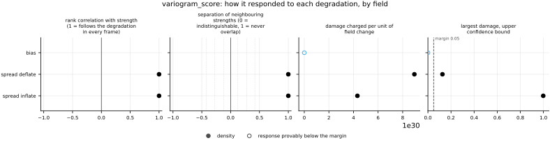
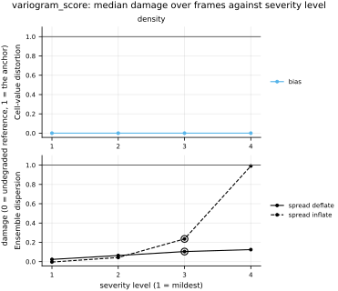

## Definition

For one channel of the reference with cell values $y_1 \dots y_d$, a forecast distribution $F$
of the field, an order $p$ and weights $w_{ij} \ge 0$, the variogram score of order $p$ is
[@scheuererhamill2015]

$$
\mathrm{VS}_p(F, \mathbf{y}) = \sum_{i=1}^{d}\sum_{j=1}^{d} w_{ij}
\Bigl( |y_i - y_j|^p - \mathbb{E}_F\,|X_i - X_j|^p \Bigr)^2
\tag{1}
$$

which is Scheuerer and Hamill's Equation (3). The quantity $\tfrac{1}{2}\mathbb{E}|Y_i - Y_j|^p$
is the variogram of order $p$ of geostatistics, so Equation (1) compares the reference's
variogram, estimated from one realization, with the forecast's, pair by pair. It depends on
the means, variances and correlations of the cells together, which is why it is sensitive to
a wrong correlation structure where the energy score is not [@scheuererhamill2015]. Lower is
better.

**The ensemble estimate.** Scheuerer and Hamill replace the expectation by the members' average
of $u_k = |x^{(k)}_i - x^{(k)}_j|^p$ (their Equation (4)). Inside the square that average adds
the members' variance of $u$ divided by $M$ to every term in expectation, because
$\mathbb{E}(v - \bar u)^2 = (v - \mathbb{E}u)^2 + \mathrm{Var}(u)/M$ for members drawn
independently of the reference (a derivation of this card's). The extra term shrinks as the
members narrow, so at a fixed small ensemble the plug-in estimate rewards an overconfident
forecast, and it falls as the ensemble grows; Scheuerer and Hamill observe the latter
(Section 3a) [@scheuererhamill2015]. Pacchiardi and colleagues call the plug-in estimate
unbiased (Appendix C.1.3) [@pacchiardi2024]; for the reason just given it is not. The
variogram score is a kernel score [@allen2023], and the unbiased estimate of a kernel score
averages its pair term over distinct members only [@pacchiardi2024]; written out, each term
becomes

$$
\bigl(|y_i - y_j|^p - \bar u_{ij}\bigr)^2 - \frac{s^2_{ij}}{M},
\qquad
\bar u_{ij} = \frac{1}{M}\sum_{k=1}^{M} u_k,\quad
s^2_{ij} = \frac{1}{M-1}\sum_{k=1}^{M} \bigl(u_k - \bar u_{ij}\bigr)^2
\tag{2}
$$

the *fair* estimate, the same choice `crps` and `energy_score` make. At $M = 1$ the correction
is empty and the term is Scheuerer and Hamill's estimate. The choice of Equation (2) over
their Equation (4) is recorded in `judgements/004`; with it, a calibrated process scores the
same in expectation at any ensemble size of two or more, and a narrowed ensemble no longer
beats the calibrated one (both pinned by this bundle's tests). The fair estimate can fall
slightly below zero on one draw.

The choices this bundle makes, each fixed and none tuned:

- **Order** $p = 0.5$. Among 0.5, 1 and 2, Scheuerer and Hamill find 0.5 discriminates best
  in their Sections 3a, 3c and 3d, equal with $p = 1$ in Section 3b, and use it alone when
  comparing weights in Section 3e [@scheuererhamill2015].
- **Weights** $w_{ij} = 1/r_{ij}$, the inverse distance between the centres of cells $i$ and
  $j$ in the grid's physical units, with $w_{ii} = 0$. Scheuerer and Hamill propose it as a
  pragmatic choice when correlations fall with distance (Section 2) and find it a good
  compromise when nothing more is known about them (Section 3e) [@scheuererhamill2015]. The
  score therefore carries an inverse length.
- **Distance on the domain's own geometry.** Along an axis the grid declares periodic the
  separation is the shorter way round the domain; along a bounded axis it is the straight line
  inside the domain. Pacchiardi and colleagues likewise measure the distance of their weights
  on the globe, which wraps in longitude (Appendix E.4.1) [@pacchiardi2024].
- **Every ordered pair** in the domain, as Equation (1) is written; no neighbourhood cut-off,
  which Scheuerer and Hamill reserve for prior knowledge of the correlations (Section 3e).
- **Channels separately, then summed.** For a vector field the pairs never mix two
  components; Scheuerer and Hamill call a score across variables of different kinds doubtful
  (Section 2), and a distance between one component at one cell and another component at
  another has no meaning. This is this bundle's choice.

The score is proper but not strictly proper: it sees the distribution only through the
$p$-th moments of pairwise differences, and every term depends only on the size of a
difference, so a bias common to every cell is invisible [@scheuererhamill2015] and so is a
sign flip of the whole field [@pacchiardi2024]. Pacchiardi and colleagues use the same score,
their Equation (11), on spatial fields of a generative weather model, with inverse-distance
weights and order $p = 1$ (Section 3.2.1, Appendix E.4.1) [@pacchiardi2024].

The per-cell map, the metric's companion, charges every ordered pair $(i, j)$ to cell $i$, so
cell $i$ holds its row of Equation (1) summed over channels, and the map sums to the score.
The computation visits each ordered pair once, $O(M d^2)$ for $d$ cells: measured on a NERSC
login node with sixteen members, 0.12 s at 32 by 32, 1.4 s at 64 by 64 and 18 s at 128 by 128.

### Boundary handling

Along a periodic axis a pair's partner wraps round the domain and its distance is the shorter
way round, so every cell has the same set of distances to the others and a cyclic shift of
reference and members together leaves the score unchanged (pinned by a test). Along a
non-periodic axis pairs are formed only between cells inside the domain, at their straight-line
distance; cells near such an edge have fewer and farther partners, so their entries in the
per-cell map are smaller for the same mismatch. No stencil or transform is involved, and the
metric runs on any boundary the grid declares.

## Performance

<!-- GENERATED performance: written by `python -m fmeval.cards evidence variogram_score --results results/variogram_score_1793396098`, do not edit -->



Four measured statistics for variogram_score, one row per degradation grouped by family and one marker per field. From left: the rank correlation between the metric and the applied strength within a frame, with the line showing the resampling interval; the separation of neighbouring strengths as Cliff's delta, where 0 means the metric cannot tell one strength from the next and the faint ticks at 0.12, 0.28 and 0.42 are Vargha and Delaney's small, medium and large anchors, for scale and not as grades; the damage charged per unit of field change at the harshest strength; and the upper confidence bound on the largest damage, beside the fixed margin of 0.05. A hollow marker is a field and degradation on which that bound lies below the margin, so the response is provably small. A missing marker is a statistic the analysis withheld, as the rank correlation is on an axis the metric is invariant to.



Median damage over frames against severity level for variogram_score, one row per family of degradation and one column per field, on one shared scale. The solid grey line is damage 1, the anchor (by default the field's own mean); the dotted black line is the damage assigned to the fake prediction with the right spectrum, where the run included it. The hollow black ring marks the first level at which the metric has moved a tenth of the way to the anchor. Hollow grey markers are strengths excluded for repeating a milder one or for doing nothing. Degradations with three or fewer usable levels are drawn as markers only; points beyond 2 either side are drawn as triangles at the edge. Damage is negative where a degradation moves the metric away from the anchor, as noise raises a single-field quantity the field's mean sets to zero.

**Trend: does the response follow the degradation?**

| test family | field | degradations | rank correlation | fraction of frames in order | weakest gap between neighbouring strengths |
|---|---|---|---|---|---|
| Ensemble dispersion | density | 2 | 1 | 1 | 1 |
| Cell-value distortion | density | 1 | — | — | — |

**Reactivity: how far does it move?**

| test family | field | change from clean at the harshest strength | elasticity | first strength detected |
|---|---|---|---|---|
| Ensemble dispersion | density | 0.216 to 1.71 | 1.47 | level 3 |
| Cell-value distortion | density | 0 | — | level — |

**Consistency: how much does it vary from snapshot to snapshot?**

| test family | field | consistency, in the strength's units | snapshots per independent block |
|---|---|---|---|
| Ensemble dispersion | density | 0.00246 to 0.00956 | 1 |
| Cell-value distortion | density | — | 1 |

One row per family of degradation and physical field; a cell gives the range over the degradations in that family. **Trend.** The rank correlation is the Spearman correlation between the strength and how far the metric has moved from its value on the undegraded field of the same frame, in the one direction it moves under that degradation, computed inside a single frame. A value of 1 means every strength moved it further than the last in every frame, whichever way it moves; a response that scatters to both sides scores near 0. The fraction of frames in order counts the frames with no exception. The weakest gap is the smallest Mann-Whitney overlap between two neighbouring strengths across frames: 1 means they never overlap, 0.5 that they cannot be told apart. **Reactivity.** The change from clean is the median, at the harshest strength, of the departure from the undegraded value of the same frame over the size of that value: 0.3 means 30%. The elasticity is the percentage change of that departure per percentage change in strength over the mildest strengths. First strength detected is the mildest at which the metric has moved a tenth of the way to the anchor; **damage** reads that 0-to-1 scale as a number. A dash means the measurement is not defined there. A metric's reactivity scales with the power it is expressed in: mean squared error's elasticity is twice root-mean-square error's, though the two carry the same information, so compare magnitudes across metrics with that in mind. **Consistency** is how much the response varies from snapshot to snapshot relative to its size, in the strength's units; the snapshots of one trajectory are correlated, and the last column is how many consecutive snapshots one independent block spans.

These tables report what was measured and grade none of the measurements. What the numbers mean for this metric is written in the subsections below, beside the test that produced each number.

**Profile.**

| field | selectivity | charges most for | charges least for | response provably below 0.05 at 90% on | elasticity to a sub-pixel shift | compute cost (x cheapest in this run) |
|---|---|---|---|---|---|---|
| density | 0.406 | `spread_deflate` | `bias` | `bias` | — | 1 |

One row per physical field. **Selectivity** is how concentrated the metric's response is on a few degradations, measured per unit of field change: 0 means it charges every degradation the same, as mean squared error does by construction, and values toward 1 that one degradation carries most of it. **Charges most and least for** name the two ends of that profile. **Response provably below** lists degradations on which the upper confidence bound of the largest damage lies below the margin -- an equivalence test, so an entry says the response is provably small, not merely not significant; a dash means no degradation met the bound. **Elasticity** is the slope of log damage against log shift over the smallest shifts: 1 means damage grows in proportion to the shift, 2 with its square. **Compute cost** is wall-clock per evaluation over the cheapest metric and field in the same run.

<!-- END GENERATED performance -->

## Intuition

This metric asks whether an ensemble gets the *differences* between places right. For every
pair of cells it looks at how different the true field is between the two, and at how
different each member is between the same two on average, and charges the squared mismatch.
Nearby pairs are weighted more than distant ones. An ensemble whose members are too rough or
too smooth from place to place, too strongly or too weakly tied between neighbouring cells,
gets the differences wrong and is charged for it, even when each cell on its own has the right
spread of values.

The differences are taken to the power one half before they are compared, which keeps a few
very large differences from dominating and steadies the score from one forecast to the next.
Because the members' average is itself uncertain when there are few of them, the score
subtracts that uncertainty from each mismatch, so that a small ensemble is neither flattered
nor penalised for its size and cannot gain by huddling together.

A worked example, with a row of three cells on a periodic domain (so the end cells are
neighbours too), unit spacing and two members:

```
reference        member 1        member 2        result
0, 4, 0          0, 1, 0         0, 0, 0         8
```

The reference's neighbouring cells differ by 4, whose square root is 2; its end cells do not
differ. Member one's neighbours differ by 1 and member two's by nothing, so the members
average a square root of 0.5 for each neighbouring pair, and the squared mismatch is the square
of 2 − 0.5, which is 2.25. The two members disagree about that pair, and the correction for
their uncertainty takes 0.25 off, leaving 2. The end pair matches exactly and costs nothing.
The score counts every pair in both orders, so it is 2 × (2 + 2) = 8.

What it ignores is level and sign: adding the same number to every member, or turning the
whole field upside down, changes the size of no difference and leaves the score exactly where
it was.

## Reading the output

The score is in the field's units per unit length, and lower is better. Zero means every
member's differences between every pair of cells matched the reference's; the fair estimate can
fall slightly below zero on one draw, which means only that the score is at its floor. There is
no absolute threshold for a good value. The score is a sum over every pair of cells: on a
periodic two-dimensional grid each cell's inverse-distance weights add up to about 3.5 times
the side length in cells (measured, 3.46 at 64 by 64), so with a similar mismatch everywhere
the score grows as the number of cells to the power three halves at a fixed spacing, and as the
square of the number of cells when the same domain is refined, because the spacing in the
weights shrinks too (measured ratios 8.05 and 16.1 per doubling of the side; derivations and
measurements of this card's). Compare models only on the same analysis grid and field.
Comparisons across ensemble sizes of two or more are valid because the estimate is fair. The
score is defined for a single member, where it compares one prediction's pairwise differences
with the reference's, but its propriety is a statement about ensembles: for a deterministic
prediction it is a structure comparison, not a check of calibration.

Because it is blind to a common offset and to a sign flip, read it beside a score that sees
them, such as `crps` or `energy_score`. On a periodic grid the per-cell map has no built-in
pattern: a cell with a large value belongs to many pairs whose differences the ensemble gets
wrong. Along a non-periodic axis, cells near the edge have smaller weight sums, so a smaller
value there is partly geometry (Boundary handling).

## Limitations

The score cannot see an error that shifts every cell by the same amount, or one that flips the
sign of the whole field. An ensemble that is right in every detail but uniformly too warm, too
dense or too fast scores exactly as well as the correct one; read alone it would rank them
equal.

It is not strictly proper, so different errors can cancel: an ensemble whose cells are too
variable and too strongly correlated with their neighbours can produce the same pairwise
differences as the truth and score as well as a correct forecast. Scheuerer and Hamill show
such cancellation between a wrong trend and underdispersion and recommend checking the
cell-by-cell distributions first [@scheuererhamill2015].

The cost grows with the square of the number of cells. On a 512 by 512 analysis grid the score
would sum about seventy billion ordered pairs per member, over an hour per evaluation by
the measured growth, and the
harness's only cost warning concerns the number of frames, not the grid; choose a coarse
`analysis_grid.resolution` for this metric. A neighbourhood cut-off, which Scheuerer and Hamill
describe for when the correlation range is known, would change what the score sees and is not
implemented.

## Results

<!-- GENERATED run: written by `python -m fmeval.cards evidence variogram_score --results results/variogram_score_1793396098`, do not edit -->

Measured on `synthetic_ensemble`, frames 0 to 11 (12 frames of a calibrated null: evidence that the estimator computes what it claims to compute, and nothing about turbulence), on the 64 analysis grid, seed 20260807, at commit `b88d49060f06`. Run `variogram_score_1793396098`.

Every number in this section comes from that one run. Regenerate with `python -m fmeval.cards evidence <name> --results results/variogram_score_1793396098`.

<!-- END GENERATED run -->

### Ensemble dispersion

[spread_inflate](../../degradations/spread_inflate/card.md) ·
[spread_deflate](../../degradations/spread_deflate/card.md)

<!-- GENERATED results_ensemble: written by `python -m fmeval.cards evidence variogram_score --results results/variogram_score_1793396098`, do not edit -->

| degradation | field | strengths | rank correlation | fraction of frames in the right order | weakest gap between neighbouring strengths |
|---|---|---|---|---|---|
| `spread_deflate` | density | 4 | 1 | 1 | 1 |
| `spread_inflate` | density | 4 | 1 | 1 | 1 |

<!-- END GENERATED results_ensemble -->

Both directions raise the score in every frame, at every strength but the mildest inflation,
whose per-frame median in the run's results sits slightly below the clean value; it is still
ranked first, because the ordering is of departures from clean. The same dip appears on the
`energy_score` card and has the same cause: `spread_inflate` scales the members about their
own sample mean, which carries error of its own, so a fair score's expected minimum lies a
little above the calibrated width at sixteen members. Inflation costs far more than deflation
at the harshest strengths, 1.71 of the clean value against 0.216 in the reactivity table; a
widened member adds its excess scatter to every pairwise difference, while a narrowed one can
lose at most the scatter it had (this card's reading, not a separate measurement).

The profile row above ranks the degradations by damage per unit of field change, but the two
dispersion axes leave the ensemble mean, and so the measured field change, unchanged to
round-off; its "charges most for" and selectivity are therefore not meaningful for this
metric ([issue 111](https://github.com/khegazy/pde_metrics/blob/main/issues/111-damage-per-change-divides-by-round-off-on-ensemble-axes.md)).

On this dataset each cell's noise is independent of every other cell's, so these axes change
the members' pairwise differences only through their spread; the run shows that the
estimator responds to dispersion in both directions, not that it detects a wrong spatial
correlation, which no experiment in the repository changes.

### Cell-value distortion

[bias](../../degradations/bias/card.md)

<!-- GENERATED results_pointwise: written by `python -m fmeval.cards evidence variogram_score --results results/variogram_score_1793396098`, do not edit -->

| degradation | field | strengths | rank correlation | fraction of frames in the right order | weakest gap between neighbouring strengths |
|---|---|---|---|---|---|
| `bias` | density | 4 | — | — | — |

<!-- END GENERATED results_pointwise -->

A uniform offset of the members leaves the score unchanged at every strength: the change
from clean is 0 and the analysis lists `bias` among the degradations to which the response is
provably below the margin. This is the blindness stated in the Definition, measured, and it is
why this score is read beside `crps` or `energy_score`, which both rise on this axis.

## References

\bibliography
