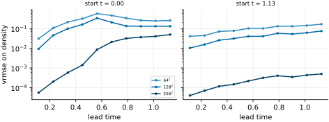
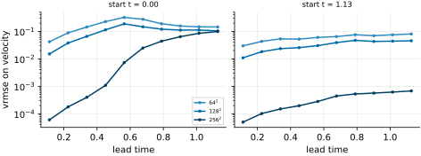
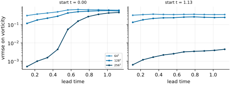
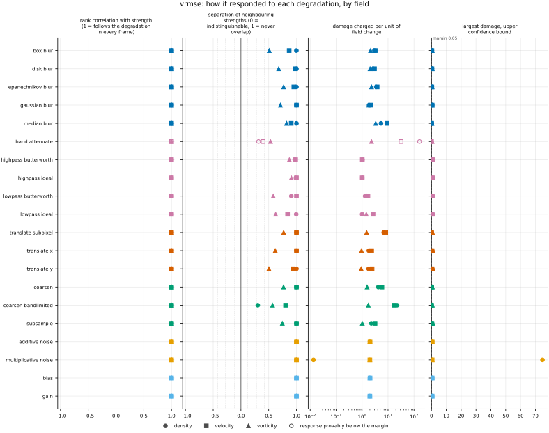
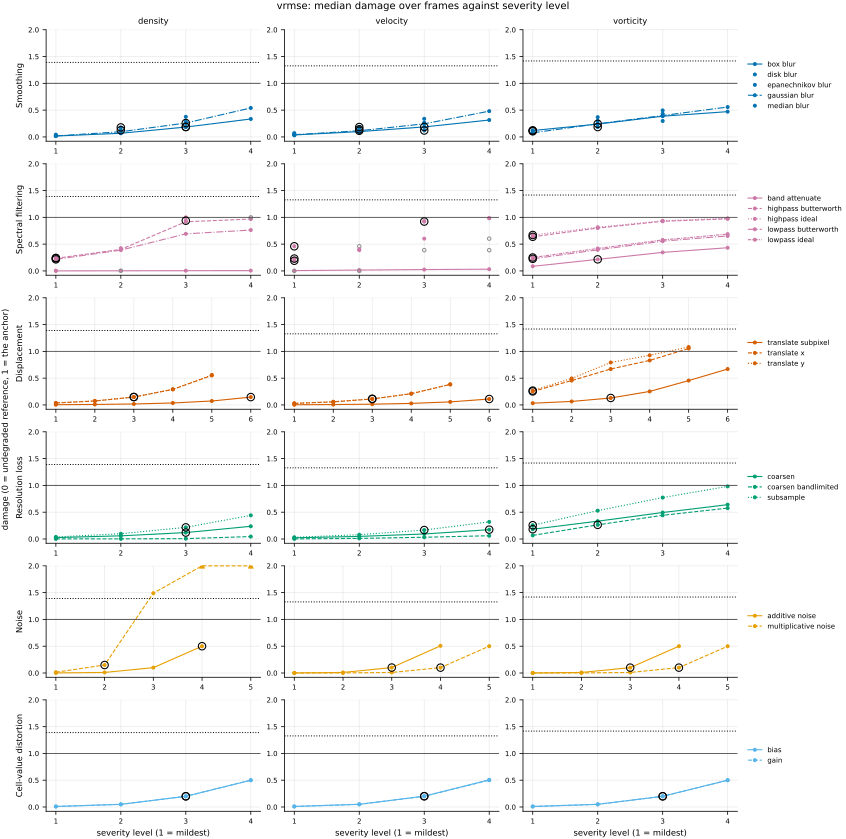
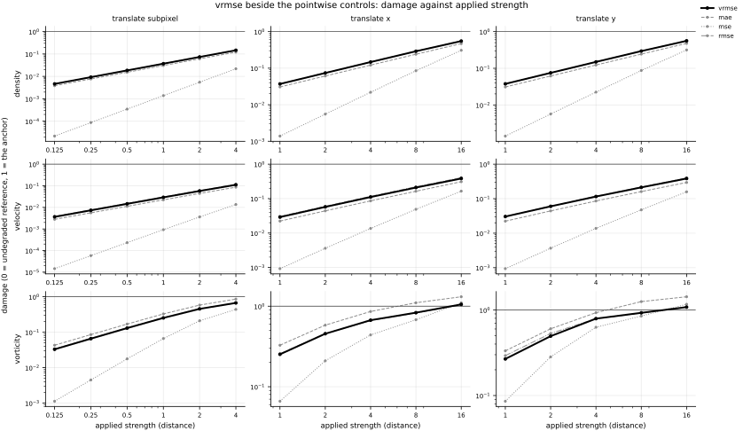

## Definition

For fields $f$ (reference) and $g$ (candidate) on the same analysis grid, with $C$ channels and
$N$ cells per channel, write $\bar f_c$ for the spatial mean of channel $c$ of the reference and

$$
s_c^2 = \frac{1}{N - 1} \sum_{i=1}^{N} \bigl( f_{c,i} - \bar f_c \bigr)^2 \tag{1}
$$

for its variance. The variance-scaled root mean squared error of The Well [@ohana2024] divides
each channel's mean squared error by that variance plus a constant, takes the square root, and
averages over channels:

$$
\mathrm{VRMSE}(f, g) = \frac{1}{C} \sum_{c=1}^{C}
\sqrt{\frac{\frac{1}{N} \sum_{i} \bigl( f_{c,i} - g_{c,i} \bigr)^2}{s_c^2 + \epsilon}} ,
\qquad \epsilon = 10^{-7} \tag{2}
$$

The paper writes VRMSE as $\bigl(\langle |u - v|^2 \rangle / (\langle |u - \bar u|^2 \rangle +
\epsilon)\bigr)^{1/2}$ with $u$ the truth, $\langle \cdot \rangle$ the spatial mean and
$\epsilon = 10^{-7}$ (App. E.3, unnumbered). Equation (2) follows its code in the two places the
code is more specific: the variance is `torch.std(y) ** 2`, which divides by $N - 1$, and
$\epsilon$ is added to the variance, not to its square root
(`the_well/benchmark/metrics/spatial.py`, `VRMSE` through `NMSE` with `norm_mode="std"`). The code
returns one value per field; the library logs each and their mean over fields, and the paper's
tables report that mean (`the_well/benchmark/trainer/training.py`, `split_up_losses`, the `full`
entry; Sect. 4, Table 2: "averaged over all physical fields"). The mean over channels in Equation
(2) is that mean, for the channels of one field.

Predicting the reference's own spatial mean everywhere scores
$\sqrt{(N-1)/N \cdot s_c^2 / (s_c^2 + \epsilon)}$, just under one; The Well reads its tables
against that landmark (Table 2 caption: "predicting the mean value of the target field results in
a score of 1"). That prediction is this repository's damage anchor (`judgements/001`), so on a
one-channel field the value and the damage differ only by that factor.

$\epsilon$ is in the square of the field's units, so it is not scale-free. On a channel whose
variance is far above $10^{-7}$ it changes nothing; on one whose variance is comparable it lowers
the value by $\sqrt{s_c^2 / (s_c^2 + \epsilon)}$. On `kinet_re5e4` density's fluctuation root mean
square is $2.1 \times 10^{-3}$ to $6.7 \times 10^{-3}$ over frames 2000 to 10000 (`AGENTS.md` §4),
a variance of $4.5 \times 10^{-6}$ to $4.5 \times 10^{-5}$, so the factor is 0.989 to 0.9989; the
stored vorticity's fluctuation is of the same order ($2.1 \times 10^{-3}$ to $3.1 \times 10^{-3}$
at frames 2000, 6000 and 10000, measured from the files on 2026-11-04). That is The Well's
behaviour, kept so that the number is the one its tables report. On a one-channel field the factor
cancels from damage. On the development dataset, whose density fluctuation is about $10^{-8}$ of
its mean, $\epsilon$ is the whole denominator.

The reference alone sets the denominator, so Equation (2) is not symmetric, and because each term
of a triangle is scaled by a different reference it does not satisfy the triangle inequality
(`test_metric.py` gives a three-field example). A uniform reference channel has $s_c = 0$ and is
divided by $\sqrt{\epsilon}$, so the value is always finite.

### Boundary handling

None. The operation is local to each cell, and the mean and variance are taken over the whole
field, so no neighbourhood and no boundary condition enter.

### How its field reports it

The name and the definition are The Well's. PDEBench's normalisation, by the raw root mean square
with no mean removed, is the bundle [nrmse](../../metrics/nrmse/card.md); on density here the two differ by
two to three orders of magnitude.

- **The Well** [@ohana2024]. The object is Equation (2) per field and prediction step, averaged
  over the test trajectories and over fields. Its tables report the one-step value on sliding
  windows of the test set (Sect. 4, Table 2) and the value averaged over the prediction-step
  windows 6 to 12 and 13 to 30 of rollouts started from the beginning of each simulation
  (Table 3). Its figure sets the VRMSE of each state variable side by side for several models,
  beside the growth along the rollout of a binned spectral error (Sect. 4.1, Fig. 6). Its library
  also logs the value of each field against prediction step (`split_up_losses`, `time_logs`).
  The experiment is a test split of a tenth of each dataset's trajectories (Sect. 3, the
  0.8/0.1/0.1 split), predicted one step at a time and as rollouts.
- **PDEBench** [@takamoto2022] normalises without removing the mean: [nrmse](../../metrics/nrmse/card.md).
- **Numerical analysis and weather verification** report unnormalised norms:
  [rmse](../../metrics/rmse/card.md) and [max_error](../../metrics/max_error/card.md).

**The experiments here.** Neither of The Well's two settings exists as it does there.
`forecast_re5e4` (`docs/datasets/reynolds_ladder_2d.md`, "Forecast pairs") gives one model's
rollouts from two starting times, ten prediction steps each, in three runs; the error is drawn
against lead time, and the steps cover part of the 6-to-12 window and none of the 13-to-30 one.
Many test trajectories are written up in
[EXP-nrmse-rollouts-over-many-initial-conditions](https://github.com/khegazy/pde_metrics/blob/main/proposals/EXP-nrmse-rollouts-over-many-initial-conditions.md).
The metric also runs on the degradation ladder on `kinet_re5e4`, on `sod_shock_tube`, on the
member mean of `synthetic_ensemble` and on the Reynolds ladder: it needs nothing but two fields
on one grid.

## Performance

<!-- GENERATED performance: written by `python -m fmeval.cards evidence vrmse --results results/comparison_1793829127 --results results/comparison_1793812304 --results results/comparison_1793812401 --results results/comparison_1793811840 --results results/comparison_1793829231`, do not edit -->



*As this metric's own field draws it, from run `comparison_1793811840`.* vrmse on density against lead time, the physical time since the forecast started, one panel per start and one line per run, darker the finer the run's grid. Each point is one prediction step of one forecast.



*As this metric's own field draws it, from run `comparison_1793811840`.* vrmse on velocity against lead time, the physical time since the forecast started, one panel per start and one line per run, darker the finer the run's grid. Each point is one prediction step of one forecast.



*As this metric's own field draws it, from run `comparison_1793811840`.* vrmse on vorticity against lead time, the physical time since the forecast started, one panel per start and one line per run, darker the finer the run's grid. Each point is one prediction step of one forecast.



Four measured statistics for vrmse, one row per degradation grouped by family and one marker per field. From left: the rank correlation between the metric and the applied strength within a frame, with the line showing the resampling interval; the separation of neighbouring strengths as Cliff's delta, where 0 means the metric cannot tell one strength from the next and the faint ticks at 0.12, 0.28 and 0.42 are Vargha and Delaney's small, medium and large anchors, for scale and not as grades; the damage charged per unit of field change at the harshest strength; and the upper confidence bound on the largest damage, beside the fixed margin of 0.05. A hollow marker is a field and degradation on which that bound lies below the margin, so the response is provably small. A missing marker is a statistic the analysis withheld, as the rank correlation is on an axis the metric is invariant to.



Median damage over frames against severity level for vrmse, one row per family of degradation and one column per field, on one shared scale. The solid grey line is damage 1, the anchor (by default the field's own mean); the dotted black line is the damage assigned to the fake prediction with the right spectrum, where the run included it. The hollow black ring marks the first level at which the metric has moved a tenth of the way to the anchor. Hollow grey markers are strengths excluded for repeating a milder one or for doing nothing. Degradations with three or fewer usable levels are drawn as markers only; points beyond 2 either side are drawn as triangles at the edge. Damage is negative where a degradation moves the metric away from the anchor, as noise raises a single-field quantity the field's mean sets to zero.

**Trend: does the response follow the degradation?**

| test family | field | degradations | rank correlation | fraction of frames in order | weakest gap between neighbouring strengths |
|---|---|---|---|---|---|
| Displacement | density | 3 | 1 | 1 | 1 |
| Displacement | velocity | 3 | 1 | 1 | 0.97 to 1 |
| Displacement | vorticity | 3 | 1 | 1 | 0.752 to 0.885 |
| Cell-value distortion | density | 2 | 1 | 1 | 1 |
| Cell-value distortion | velocity | 2 | 1 | 1 | 1 |
| Cell-value distortion | vorticity | 2 | 1 | 1 | 1 |
| Resolution loss | density | 3 | 1 | 0.714 to 1 | 0.652 to 1 |
| Resolution loss | velocity | 3 | 1 | 1 | 0.902 to 1 |
| Resolution loss | vorticity | 3 | 1 | 1 | 0.785 to 0.884 |
| Smoothing | density | 5 | 1 | 1 | 0.999 to 1 |
| Smoothing | velocity | 5 | 1 | 1 | 0.934 to 1 |
| Smoothing | vorticity | 5 | 1 | 1 | 0.755 to 0.911 |
| Spectral filtering | density | 5 | 1 | 1 | 0.659 to 0.998 |
| Spectral filtering | velocity | 5 | 1 | 1 | 0.7 to 1 |
| Spectral filtering | vorticity | 5 | 1 | 1 | 0.766 to 0.954 |
| Noise | density | 2 | 1 | 1 | 1 |
| Noise | velocity | 2 | 1 | 1 | 1 |
| Noise | vorticity | 2 | 1 | 1 | 1 |

**Reactivity: how far does it move?**

| test family | field | change from clean at the harshest strength | elasticity | first strength detected |
|---|---|---|---|---|
| Displacement | density | — | 0.994 to 1 | level 3 |
| Displacement | velocity | — | 0.963 to 0.999 | level 3 |
| Displacement | vorticity | — | 0.704 to 0.994 | level 1 |
| Cell-value distortion | density | — | 1 | level 3 |
| Cell-value distortion | velocity | — | 1 | level 3 |
| Cell-value distortion | vorticity | — | 1 | level 3 |
| Resolution loss | density | — | 0.948 to 1.27 | level 3 |
| Resolution loss | velocity | — | 1.04 to 2.19 | level 3 |
| Resolution loss | vorticity | — | 0.721 to 1.36 | level 1 |
| Smoothing | density | — | 1.54 to 1.86 | level 2 |
| Smoothing | velocity | — | 1.08 to 1.14 | level 2 |
| Smoothing | vorticity | — | 0.822 to 1.15 | level 1 |
| Spectral filtering | density | — | 0.639 to 7.31 | level 1 |
| Spectral filtering | velocity | — | 0.647 to 1 | level 1 |
| Spectral filtering | vorticity | — | 0.467 to 1 | level 1 |
| Noise | density | — | 1 | level 2 |
| Noise | velocity | — | 1 | level 3 |
| Noise | vorticity | — | 1 | level 3 |
| trap test: fake prediction, right spectrum | density | — | — | damage 1.39 |
| trap test: fake prediction, right spectrum | velocity | — | — | damage 1.33 |
| trap test: fake prediction, right spectrum | vorticity | — | — | damage 1.42 |

**Consistency: how much does it vary from snapshot to snapshot?**

| test family | field | consistency, in the strength's units | snapshots per independent block |
|---|---|---|---|
| Displacement | density | 0.074 to 0.498 | 15 to 18 |
| Displacement | velocity | 0.0727 to 0.773 | 21 |
| Displacement | vorticity | 0.134 to 0.927 | 21 to 22 |
| Cell-value distortion | density | 0.0265 | 20 |
| Cell-value distortion | velocity | 0.00667 to 0.0371 | 19 to 21 |
| Cell-value distortion | vorticity | 0.00868 | 21 |
| Resolution loss | density | 0.616 to 1.41 | 17 to 20 |
| Resolution loss | velocity | 0.785 to 1.49 | 21 to 22 |
| Resolution loss | vorticity | 0.838 to 1.06 | 22 |
| Smoothing | density | 0.00777 to 0.017 | 14 |
| Smoothing | velocity | 0.0073 to 0.0264 | 21 to 22 |
| Smoothing | vorticity | 0.0115 to 0.0264 | 21 to 22 |
| Spectral filtering | density | 0.025 to 0.0976 | 15 to 20 |
| Spectral filtering | velocity | 0.00751 to 0.0942 | 1 to 22 |
| Spectral filtering | vorticity | 0.0321 to 0.0671 | 20 to 22 |
| Noise | density | 0.00022 to 0.0159 | 1 to 20 |
| Noise | velocity | 0.00219 to 0.0222 | 19 to 21 |
| Noise | vorticity | 0.00297 to 0.00519 | 21 |

One row per family of degradation and physical field; a cell gives the range over the degradations in that family. **Trend.** The rank correlation is the Spearman correlation between the strength and how far the metric has moved from its value on the undegraded field of the same frame, in the one direction it moves under that degradation, computed inside a single frame. A value of 1 means every strength moved it further than the last in every frame, whichever way it moves; a response that scatters to both sides scores near 0. The fraction of frames in order counts the frames with no exception. The weakest gap is the smallest Mann-Whitney overlap between two neighbouring strengths across frames: 1 means they never overlap, 0.5 that they cannot be told apart. **Reactivity.** The change from clean is the median, at the harshest strength, of the departure from the undegraded value of the same frame over the size of that value: 0.3 means 30%. It does not exist for this metric, whose undegraded value is exactly zero; the damage below is its relative reading. The elasticity is the percentage change of that departure per percentage change in strength over the mildest strengths. First strength detected is the mildest at which the metric has moved a tenth of the way to the anchor; **damage** reads that 0-to-1 scale as a number. A dash means the measurement is not defined there. A metric's reactivity scales with the power it is expressed in: mean squared error's elasticity is twice root-mean-square error's, though the two carry the same information, so compare magnitudes across metrics with that in mind. **Consistency** is how much the response varies from snapshot to snapshot relative to its size, in the strength's units; the snapshots of one trajectory are correlated, and the last column is how many consecutive snapshots one independent block spans.

These tables report what was measured and grade none of the measurements. What the numbers mean for this metric is written in the subsections below, beside the test that produced each number.

**Profile.**

| field | selectivity | charges most for | charges least for | response provably below 0.05 at 90% on | elasticity to a sub-pixel shift, against severity (distance) | compute cost (x cheapest in this run) |
|---|---|---|---|---|---|---|
| density | 0.904 | `band_attenuate` | `multiplicative_noise` | `band_attenuate` | 1 | 3.12 |
| velocity | 0.639 | `band_attenuate` | `highpass_ideal` | `band_attenuate` | 0.999 | 5.22 |
| vorticity | 0.102 | `median_blur` | `translate_y` | — | 0.994 | 2.92 |

One row per physical field. **Selectivity** is how concentrated the metric's response is on a few degradations, measured per unit of field change: 0 means it charges every degradation the same, as mean squared error does by construction, and values toward 1 that one degradation carries most of it. **Charges most and least for** name the two ends of that profile. **Response provably below** lists degradations on which the upper confidence bound of the largest damage lies below the margin -- an equivalence test, so an entry says the response is provably small, not merely not significant; a dash means no degradation met the bound. **Elasticity** is the slope of log damage against log shift over the smallest shifts: 1 means damage grows in proportion to the shift, 2 with its square. **Compute cost** is wall-clock per evaluation over the cheapest metric and field in the same run.

<!-- END GENERATED performance -->

## Intuition

The variance-scaled root mean squared error is the root mean squared error expressed as a
fraction of how much the reference field actually varies about its own average. An error of one
unit means something different in a field that swings by a thousand and in one that swings by
two, and dividing by the swing is what makes the two produce the same number.

The swing is measured about the field's mean, not from zero, which decides what happens on a
field sitting on a large constant background. On a four-by-four grid, the same displaced square
scored as it stands and on a background of a thousand:

```
                            rmse      vrmse      nrmse
as it stands                0.5       1.118      1.0
on a background of 1000     0.5       1.118      0.0005
```

The background changes neither the error nor the swing about the mean, so this metric does not
move; PDEBench's form, in the last column, measures the size from zero and reads the second row as
nearly perfect. The value 1.118 says the error is a little larger than the swing itself, which is
worse than predicting the field's average everywhere: that prediction scores just under one, and
it is the landmark The Well's tables are read against. Each component of a field is scaled by its
own swing before the components are averaged.

What this metric ignores is where the errors sit, as every cell-by-cell error does, and the
absolute size of the error.

## Reading the output

The value runs from zero upwards with no upper limit and is dimensionless. Lower is better, and
zero means the fields are identical. One is the landmark: predicting the reference's own mean
everywhere scores just under one, so a value above one means the prediction is worse than that.

Because it is dimensionless and measured about each field's mean, it is the cell-by-cell error
whose values can be set side by side across fields: a value of 0.1 means an error a tenth of the
field's swing, on density, velocity or vorticity alike. The reference must be the trusted field:
the metric is asymmetric. On a one-channel field it orders candidates exactly as `rmse` does.

## Limitations

The normalisation hides absolute magnitude. Two predictions with the same value on fields whose
fluctuations differ by three orders of magnitude have very different absolute errors, and if the
downstream use cares about absolute error the number will not say so.

The denominator is measured from the reference on each frame. As a decaying flow loses its
fluctuation the same absolute error scores higher, so a value rising along a trajectory does not
by itself mean the prediction got worse.

The constant $10^{-7}$ is in the field's own units squared. On a field whose variance is near or
below it, such as density on the development dataset, the value no longer measures the error
against the field's swing at all, and on `kinet_re5e4` it lowers the value by up to about one
percent on density and vorticity, more on frames where the fluctuation is smallest.

It shares every cell-by-cell metric's blindness to position and its quadratic response to sub-cell
displacement.

## Results

<!-- GENERATED run: written by `python -m fmeval.cards evidence vrmse --results results/comparison_1793829127 --results results/comparison_1793812304 --results results/comparison_1793812401 --results results/comparison_1793811840 --results results/comparison_1793829231`, do not edit -->

Measured on `kinet_re5e4`, frames 2000 to 10000 (161 frames of developed flow), on the 256 analysis grid, seed 20260807, at commit `adbdc88e4950`. Run `comparison_1793829127`.

Every number in this section comes from that run, except in the subsections headed with another experiment and in a figure whose caption names another run, each of which names its own run. Regenerate with `python -m fmeval.cards evidence <name> --results results/comparison_1793829127 --results results/comparison_1793812304 --results results/comparison_1793812401 --results results/comparison_1793811840 --results results/comparison_1793829231`.

<!-- END GENERATED run -->

Each subsection links to the degradations that subsection reports. What those degradations
do, and what their strength numbers mean, is documented on their own pages.

<!-- GENERATED experiments: written by `python -m fmeval.cards catalog`, do not edit -->

**Across the experiments.**

| experiment | what a run on it is evidence of | on this card |
|---|---|---|
| `kinet_re5e4` | developed flow | measured, run `comparison_1793829127`: the main results |
| `kinet_re1e6` | developed flow at Re = 1e6, twenty times the Reynolds number of kinet_re5e4, from the same initial condition | measured, run `comparison_1793829231`: under *On `kinet_re1e6`* |
| `synthetic_ensemble` | a calibrated null: evidence that the estimator computes what it claims to compute, and nothing about turbulence | measured, run `comparison_1793812401`: under *On `synthetic_ensemble`*; on this dataset the metric scores the member mean of the ensemble |
| `sod_shock_tube` | an analytic check: evidence that the metric locates and scores a known shock correctly, and nothing about turbulence | measured, run `comparison_1793812304`: under *On `sod_shock_tube`* |
| `forecast_re5e4` | real predictions scored against their targets at each prediction step; who produced the predictions, a trained model or a coarser solver, is not recorded | measured, run `comparison_1793811840`: under *On `forecast_re5e4`* |

One row per dataset a card may cite (`configs/cards/default.yaml`). *Measured* names the run the card cites: the main results are `## Performance` and the subsections below, and every other run has its own subsection headed with its dataset. *Not applicable* gives the reason: one that follows from what the metric declares and what the dataset offers, or one a person wrote on the card (`not_run` in `card.yaml`) because the result would carry no information. *Not yet run* means the metric can run there and the card cites no run on it yet.

<!-- END GENERATED experiments -->

### Smoothing

[gaussian_blur](../../degradations/gaussian_blur/card.md) ·
[box_blur](../../degradations/box_blur/card.md) ·
[median_blur](../../degradations/median_blur/card.md)

<!-- GENERATED results_smoothing: written by `python -m fmeval.cards evidence vrmse --results results/comparison_1793829127 --results results/comparison_1793812304 --results results/comparison_1793812401 --results results/comparison_1793811840 --results results/comparison_1793829231`, do not edit -->

| degradation | field | strengths | rank correlation | fraction of frames in the right order | weakest gap between neighbouring strengths |
|---|---|---|---|---|---|
| `box_blur` | density | 4 | 1 | 1 | 0.999 |
| `box_blur` | velocity | 4 | 1 | 1 | 0.934 |
| `box_blur` | vorticity | 4 | 1 | 1 | 0.755 |
| `disk_blur` | density | 3 | 1 | 1 | 1 |
| `disk_blur` | velocity | 3 | 1 | 1 | 0.992 |
| `disk_blur` | vorticity | 3 | 1 | 1 | 0.84 |
| `epanechnikov_blur` | density | 3 | 1 | 1 | 1 |
| `epanechnikov_blur` | velocity | 3 | 1 | 1 | 0.976 |
| `epanechnikov_blur` | vorticity | 3 | 1 | 1 | 0.885 |
| `gaussian_blur` | density | 4 | 1 | 1 | 1 |
| `gaussian_blur` | velocity | 4 | 1 | 1 | 1 |
| `gaussian_blur` | vorticity | 4 | 1 | 1 | 0.856 |
| `median_blur` | density | 3 | 1 | 1 | 1 |
| `median_blur` | velocity | 3 | 1 | 1 | 0.953 |
| `median_blur` | vorticity | 3 | 1 | 1 | 0.911 |

<!-- END GENERATED results_smoothing -->

Every blur is ordered in every frame on every field, with a rank correlation of 1. On density
neighbouring strengths are almost never confused (weakest gap 0.999 or 1), on velocity the weakest
gaps are 0.934 to 1, and on vorticity 0.755 to 0.911. Our reading: dividing each frame by its own
reference's spread removes the change in the size of the fluctuation along the window, which
otherwise spreads one strength's values across frames; the unnormalised errors overlap more on
density. No blur reaches The Well's landmark of 1: the largest value is 0.656 on density, 0.599
on velocity and 0.632 on vorticity, all under `gaussian_blur`.

### Spectral filtering

[lowpass_ideal](../../degradations/lowpass_ideal/card.md) ·
[lowpass_butterworth](../../degradations/lowpass_butterworth/card.md) ·
[highpass_ideal](../../degradations/highpass_ideal/card.md) ·
[highpass_butterworth](../../degradations/highpass_butterworth/card.md)

<!-- GENERATED results_spectral: written by `python -m fmeval.cards evidence vrmse --results results/comparison_1793829127 --results results/comparison_1793812304 --results results/comparison_1793812401 --results results/comparison_1793811840 --results results/comparison_1793829231`, do not edit -->

| degradation | field | strengths | rank correlation | fraction of frames in the right order | weakest gap between neighbouring strengths |
|---|---|---|---|---|---|
| `band_attenuate` | density | 4 | 1 | 1 | 0.659 |
| `band_attenuate` | velocity | 4 | 1 | 1 | 0.7 |
| `band_attenuate` | vorticity | 4 | 1 | 1 | 0.766 |
| `highpass_butterworth` | density | 4 | 1 | 1 | 0.985 |
| `highpass_butterworth` | velocity | 3 | 1 | 1 | 0.992 |
| `highpass_butterworth` | vorticity | 4 | 1 | 1 | 0.936 |
| `highpass_ideal` | density | 3 | 1 | 1 | 0.994 |
| `highpass_ideal` | velocity | 2 | 1 | 1 | 1 |
| `highpass_ideal` | vorticity | 4 | 1 | 1 | 0.954 |
| `lowpass_butterworth` | density | 4 | 1 | 1 | 0.954 |
| `lowpass_butterworth` | velocity | 3 | 1 | 1 | 1 |
| `lowpass_butterworth` | vorticity | 4 | 1 | 1 | 0.791 |
| `lowpass_ideal` | density | 3 | 1 | 1 | 0.998 |
| `lowpass_ideal` | velocity | 2 | 1 | 1 | 0.92 |
| `lowpass_ideal` | vorticity | 4 | 1 | 1 | 0.813 |

<!-- END GENERATED results_spectral -->

Every filter is ordered in every frame, with a rank correlation of 1. The weakest gaps run from
0.659 on density and 0.7 on velocity under `band_attenuate` to 0.998 on density under
`lowpass_ideal`. At their harshest the ideal filters bring the value up to the landmark: the
largest value is 0.999 on density under `lowpass_ideal` and 0.994 on vorticity under
`highpass_ideal`, as large as the score of the field's mean. `band_attenuate` barely registers on
density and velocity, with a largest value of 0.014 and 0.0452, and the Profile table lists it
among the degradations on which the response is provably below 0.05; on vorticity it reaches
0.531.

### Displacement

[translate_x](../../degradations/translate/card.md) ·
[translate_subpixel](../../degradations/translate_subpixel/card.md)

<!-- GENERATED results_geometric: written by `python -m fmeval.cards evidence vrmse --results results/comparison_1793829127 --results results/comparison_1793812304 --results results/comparison_1793812401 --results results/comparison_1793811840 --results results/comparison_1793829231`, do not edit -->

| degradation | field | strengths | rank correlation | fraction of frames in the right order | weakest gap between neighbouring strengths |
|---|---|---|---|---|---|
| `translate_subpixel` | density | 6 | 1 | 1 | 1 |
| `translate_subpixel` | velocity | 6 | 1 | 1 | 1 |
| `translate_subpixel` | vorticity | 6 | 1 | 1 | 0.885 |
| `translate_x` | density | 5 | 1 | 1 | 1 |
| `translate_x` | velocity | 5 | 1 | 1 | 1 |
| `translate_x` | vorticity | 5 | 1 | 1 | 0.809 |
| `translate_y` | density | 5 | 1 | 1 | 1 |
| `translate_y` | velocity | 5 | 1 | 1 | 0.97 |
| `translate_y` | vorticity | 5 | 1 | 1 | 0.752 |

<!-- END GENERATED results_geometric -->

Every shift is ordered in every frame, with a rank correlation of 1. On density and velocity
neighbouring strengths are almost never confused (0.97 to 1); on vorticity the weakest gaps are
0.752 to 0.885. The value grows linearly with a small displacement, the square root of the
squared error's quadratic response: the elasticity to a sub-pixel shift in the Profile table is
1, 0.999 and 0.994 on density, velocity and vorticity. Over whole-cell shifts it falls to 0.704 on
vorticity. On vorticity the largest shifts pass the landmark, with a largest value of 1.16 under
`translate_x` and 1.4 under `translate_y`: a vorticity field moved that far scores worse than its
own mean, because a displaced copy is wrong both where its structure was and where it arrived.

### Resolution loss

[coarsen](../../degradations/coarsen/card.md) ·
[coarsen_bandlimited](../../degradations/coarsen_bandlimited/card.md)

<!-- GENERATED results_resolution: written by `python -m fmeval.cards evidence vrmse --results results/comparison_1793829127 --results results/comparison_1793812304 --results results/comparison_1793812401 --results results/comparison_1793811840 --results results/comparison_1793829231`, do not edit -->

| degradation | field | strengths | rank correlation | fraction of frames in the right order | weakest gap between neighbouring strengths |
|---|---|---|---|---|---|
| `coarsen` | density | 4 | 1 | 1 | 1 |
| `coarsen` | velocity | 4 | 1 | 1 | 1 |
| `coarsen` | vorticity | 4 | 1 | 1 | 0.884 |
| `coarsen_bandlimited` | density | 4 | 1 | 0.714 | 0.652 |
| `coarsen_bandlimited` | velocity | 4 | 1 | 1 | 0.902 |
| `coarsen_bandlimited` | vorticity | 4 | 1 | 1 | 0.785 |
| `subsample` | density | 4 | 1 | 1 | 1 |
| `subsample` | velocity | 4 | 1 | 1 | 1 |
| `subsample` | vorticity | 4 | 1 | 1 | 0.873 |

<!-- END GENERATED results_resolution -->

Every coarsening is ordered with a rank correlation of 1. The largest value under `coarsen` is
0.314, 0.265 and 0.71 on density, velocity and vorticity, and under `coarsen_bandlimited` 0.0933,
0.147 and 0.686. The two operators keep the same block means, so on the smooth fields most of
what `coarsen` charges is its staircase; on vorticity, whose structure the coarse grid cannot
hold, they nearly agree, and `subsample` reaches 1.29. Under the band-limited operator density is
in the right order in only 0.714 of frames, with a weakest gap of 0.652, as for the other
cell-by-cell errors; its cause is not established, and `issues/039` records what was ruled out.

### Noise

[additive_noise](../../degradations/additive_noise/card.md)

<!-- GENERATED results_stochastic: written by `python -m fmeval.cards evidence vrmse --results results/comparison_1793829127 --results results/comparison_1793812304 --results results/comparison_1793812401 --results results/comparison_1793811840 --results results/comparison_1793829231`, do not edit -->

| degradation | field | strengths | rank correlation | fraction of frames in the right order | weakest gap between neighbouring strengths |
|---|---|---|---|---|---|
| `additive_noise` | density | 4 | 1 | 1 | 1 |
| `additive_noise` | velocity | 4 | 1 | 1 | 1 |
| `additive_noise` | vorticity | 4 | 1 | 1 | 1 |
| `multiplicative_noise` | density | 5 | 1 | 1 | 1 |
| `multiplicative_noise` | velocity | 5 | 1 | 1 | 1 |
| `multiplicative_noise` | vorticity | 5 | 1 | 1 | 1 |

<!-- END GENERATED results_stochastic -->

Both noises are ordered in every frame on every field, and neighbouring strengths never overlap
(weakest gap 1). The elasticity is 1 throughout: either noise adds an error proportional to its
amplitude. On density and vorticity additive noise reaches a largest value of 0.503 and 0.501, on
velocity 1.19; `bias` also reaches 1.19 on velocity, where `gain` stays at 0.5. Our reading, not a
measured decomposition: those two operators add an error sized to the velocity field as a whole,
and the mean over components then weights a component whose own spread is small as heavily as the
other, so the same error is a larger fraction of that component's spread. Multiplicative noise on
density reaches a largest value of 233: it scales the whole density, whose mean is near 1, while
the denominator is the fluctuation about that mean, two to three orders of magnitude smaller
(*Definition*).

### Cell-value distortion

[gain](../../degradations/gain/card.md) ·
[bias](../../degradations/bias/card.md)

<!-- GENERATED results_pointwise: written by `python -m fmeval.cards evidence vrmse`, do not edit -->

Not generated yet. Run `python -m fmeval.cards evidence vrmse`.

<!-- END GENERATED results_pointwise -->

### Trap tests

[gaussian_impostor](../../degradations/gaussian_impostor/card.md) ·
[uncorrelated](../../degradations/random_large_translation/card.md)

<!-- GENERATED results_canaries: written by `python -m fmeval.cards evidence vrmse --results results/comparison_1793829127 --results results/comparison_1793812304 --results results/comparison_1793812401 --results results/comparison_1793811840 --results results/comparison_1793829231`, do not edit -->

| field | damage assigned to the fake prediction | closest real degradation | damage of the reference moved far away | value on the anchor |
|---|---|---|---|---|
| density | 1.39 | `multiplicative_noise=0.01` | 1.28 | 0.999 |
| velocity | 1.33 | `highpass_ideal=4.02293` | 1.71 | 1 |
| vorticity | 1.42 | `translate_y=16` | 1.5 | 0.992 |

The fake prediction here has exactly the reference field's amplitude spectrum and completely scrambled structure. Damage 1 is what the anchor scores, by default the reference's own spatial mean, a prediction that knows the mean and nothing else. The damage column therefore says how close to useless this metric considers that fake prediction: a low number means the metric was fooled. The third column translates the same number into an ordinary degradation whose damage the fake prediction matches, which is easier to picture. The fourth is the reference moved by a large random offset, the right statistics in the wrong place; where a field's energy sits in its largest scales that copy stays partly correlated with the reference, so it is not the score of an unrelated field.

<!-- END GENERATED results_canaries -->

The fake prediction with the right spectrum scores above the landmark on every field, with a
value of 1.39, 1.33 and 1.41 on density, velocity and vorticity: worse than the field's own
mean. Our derivation, ignoring $\epsilon$ and $N-1$: a field with the reference's mean and
variance and no relation to it has a mean squared error of twice the variance, so its value is
about the square root of 2, and the fake prediction sits near that. The reference moved far away
scores 1.28, 1.71 and 1.49. The mean itself scores 0.999, 1 and 0.992, just under one as the
*Definition* gives, the shortfall on vorticity being the constant $\epsilon$ against that field's
small variance.

### Compared with the other metrics

<!-- GENERATED results_summary: written by `python -m fmeval.cards evidence vrmse --results results/comparison_1793829127 --results results/comparison_1793812304 --results results/comparison_1793812401 --results results/comparison_1793811840 --results results/comparison_1793829231`, do not edit -->

| compared with | density | velocity | vorticity |
|---|---|---|---|
| `nrmse` | 1 | 1 | 1 |
| `rmse_channel_mean` | 1 | 1 | 0.999 |
| `mse` | 1 | 0.999 | 0.999 |
| `rmse` | 1 | 0.999 | 0.999 |
| `mae` | 0.988 | 0.995 | 0.974 |
| `max_error` | 0.956 | 0.93 | 0.947 |
| `max_error_channel_mean` | 0.956 | 0.935 | 0.947 |
| `wasserstein` | 0.887 | — | — |
| `h_minus_one` | 0.862 | 0.847 | 0.901 |
| `h1_relative` | 0.812 | 0.725 | 0.753 |
| `h1_seminorm` | 0.702 | 0.605 | 0.697 |
| `spectral_energy_flux` | — | 0.414 | — |
| `persistence_distance` | 0.376 | — | 0.184 |
| `increment_w1_by_separation` | 0.337 | 0.263 | 0.112 |
| `spectrum_l2` | 0.26 | 0.374 | 0.171 |
| `energy_distance` | 0.251 | 0.174 | -0.016 |
| `increment_w1` | 0.26 | 0.159 | 0.00999 |
| `tail_exceedance` | 0.22 | 0.138 | -0.0613 |
| `palinstrophy` | — | — | -0.0813 |
| `increment_flatness` | -0.208 | -0.104 | 0.106 |
| `tail_index` | 0.0209 | -0.168 | -0.111 |
| `enstrophy` | — | — | -0.243 |
| `kinetic_energy` | — | -0.261 | — |

Rank correlation over every degradation, computed separately for each physical field on the median value at each combination of degradation and strength, with the undegraded reference excluded. A dash marks a metric that does not run on that field. A metric with a target value enters by its distance from the target. Two metrics correlating near 1 put the degradations in the same order, but the two may still weight those degradations very differently. A correlation near 1 therefore means the two metrics are redundant for ranking models, not that the two are interchangeable as training losses.

<!-- END GENERATED results_summary -->

On every field this metric orders the degradations exactly as `nrmse` does and almost exactly as
`rmse_channel_mean`, `mse` and `rmse` do; `mae` sits a little lower, the two maximum errors lower
again, and the metrics that compare spectra, increments or distributions order the degradations
differently. Within one frame of a one-channel field it orders candidates as `rmse` does
(*Reading the output*), so what separates them here is, in our reading, the per-frame
normalisation before the median over frames and, on velocity, the mean over components. For
ranking models these cell-by-cell errors are near duplicates.

### Damage beside the other metrics

<!-- GENERATED results_damage_by_level: written by `python -m fmeval.cards evidence vrmse --results results/comparison_1793829127 --results results/comparison_1793812304 --results results/comparison_1793812401 --results results/comparison_1793811840 --results results/comparison_1793829231`, do not edit -->



Median damage over frames against the applied strength, log-log, for vrmse (bold, in colour) and the pointwise controls mae, mse, rmse (thin, grey), one column per displacement degradation and one row per field. The grey line is damage 1, the anchor (by default the field's own mean). Parallel lines charge in the same proportion at every strength; a steeper line charges relatively more for the larger shifts, which is what decides whether two metrics are interchangeable as training losses. These are the same numbers as the table beneath.

**Displacement, density, `translate_subpixel`** (strength: distance).

| metric | 0.125 | 0.25 | 0.5 | 1 | 2 | 4 |
|---|---|---|---|---|---|---|
| `vrmse` | 0.00463 | 0.00926 | 0.0185 | 0.037 | 0.0738 | 0.147 |
| `mae` | 0.00383 | 0.00767 | 0.0153 | 0.0306 | 0.061 | 0.121 |
| `mse` | 2.17e-05 | 8.68e-05 | 0.000347 | 0.00138 | 0.00551 | 0.0219 |
| `rmse` | 0.00466 | 0.00931 | 0.0186 | 0.0372 | 0.0743 | 0.148 |

**Displacement, density, `translate_x`** (strength: distance).

| metric | 1 | 2 | 4 | 8 | 16 |
|---|---|---|---|---|---|
| `vrmse` | 0.037 | 0.0738 | 0.147 | 0.29 | 0.55 |
| `mae` | 0.0306 | 0.061 | 0.121 | 0.24 | 0.469 |
| `mse` | 0.00138 | 0.00551 | 0.0219 | 0.0849 | 0.307 |
| `rmse` | 0.0372 | 0.0743 | 0.148 | 0.291 | 0.555 |

**Displacement, density, `translate_y`** (strength: distance).

| metric | 1 | 2 | 4 | 8 | 16 |
|---|---|---|---|---|---|
| `vrmse` | 0.0376 | 0.075 | 0.149 | 0.294 | 0.56 |
| `mae` | 0.031 | 0.0616 | 0.122 | 0.244 | 0.476 |
| `mse` | 0.00142 | 0.00565 | 0.0224 | 0.0869 | 0.316 |
| `rmse` | 0.0377 | 0.0752 | 0.15 | 0.295 | 0.562 |

**Displacement, velocity, `translate_subpixel`** (strength: distance).

| metric | 0.125 | 0.25 | 0.5 | 1 | 2 | 4 |
|---|---|---|---|---|---|---|
| `vrmse` | 0.00365 | 0.00729 | 0.0146 | 0.029 | 0.0574 | 0.111 |
| `mae` | 0.00279 | 0.00559 | 0.0112 | 0.0223 | 0.0441 | 0.0859 |
| `mse` | 1.45e-05 | 5.81e-05 | 0.000232 | 0.000924 | 0.0036 | 0.0136 |
| `rmse` | 0.00381 | 0.00762 | 0.0152 | 0.0304 | 0.06 | 0.117 |

**Displacement, velocity, `translate_x`** (strength: distance).

| metric | 1 | 2 | 4 | 8 | 16 |
|---|---|---|---|---|---|
| `vrmse` | 0.029 | 0.0574 | 0.111 | 0.209 | 0.383 |
| `mae` | 0.0223 | 0.0441 | 0.0859 | 0.163 | 0.31 |
| `mse` | 0.000924 | 0.0036 | 0.0136 | 0.0489 | 0.165 |
| `rmse` | 0.0304 | 0.06 | 0.117 | 0.221 | 0.406 |

**Displacement, velocity, `translate_y`** (strength: distance).

| metric | 1 | 2 | 4 | 8 | 16 |
|---|---|---|---|---|---|
| `vrmse` | 0.0303 | 0.0599 | 0.115 | 0.212 | 0.384 |
| `mae` | 0.0223 | 0.0442 | 0.0856 | 0.16 | 0.295 |
| `mse` | 0.000935 | 0.00366 | 0.0138 | 0.0473 | 0.158 |
| `rmse` | 0.0306 | 0.0605 | 0.117 | 0.218 | 0.397 |

**Displacement, vorticity, `translate_subpixel`** (strength: distance).

| metric | 0.125 | 0.25 | 0.5 | 1 | 2 | 4 |
|---|---|---|---|---|---|---|
| `vrmse` | 0.0329 | 0.0656 | 0.13 | 0.253 | 0.455 | 0.671 |
| `mae` | 0.0428 | 0.0854 | 0.169 | 0.328 | 0.582 | 0.86 |
| `mse` | 0.00112 | 0.00448 | 0.0176 | 0.066 | 0.21 | 0.44 |
| `rmse` | 0.0335 | 0.0669 | 0.133 | 0.257 | 0.458 | 0.663 |

**Displacement, vorticity, `translate_x`** (strength: distance).

| metric | 1 | 2 | 4 | 8 | 16 |
|---|---|---|---|---|---|
| `vrmse` | 0.253 | 0.455 | 0.671 | 0.832 | 1.05 |
| `mae` | 0.328 | 0.582 | 0.86 | 1.1 | 1.31 |
| `mse` | 0.066 | 0.21 | 0.44 | 0.679 | 1.1 |
| `rmse` | 0.257 | 0.458 | 0.663 | 0.824 | 1.05 |

**Displacement, vorticity, `translate_y`** (strength: distance).

| metric | 1 | 2 | 4 | 8 | 16 |
|---|---|---|---|---|---|
| `vrmse` | 0.268 | 0.495 | 0.793 | 0.927 | 1.08 |
| `mae` | 0.333 | 0.603 | 0.93 | 1.25 | 1.43 |
| `mse` | 0.0858 | 0.283 | 0.628 | 0.849 | 1.17 |
| `rmse` | 0.293 | 0.532 | 0.793 | 0.922 | 1.08 |

Median damage over frames at every strength, this metric in the first row and the pointwise controls beneath it, all on the same 0-to-1 scale where 0 is the undegraded reference and 1 the anchor (by default the field's own mean); a dash means no damage scale on that field. The rank correlations under *Compared with the other metrics* say whether two metrics put the strengths in the same order; this table says how much each one charges for the same strength, which decides whether two metrics are interchangeable as training losses.

<!-- END GENERATED results_damage_by_level -->

On every displacement and field this metric's line lies close to `rmse`'s and runs parallel to
`mae`'s, all three growing in proportion to a small shift, while `mse`'s has twice their slope. On
vorticity the lines converge near the anchor at the largest whole-cell shifts. It does not lie
exactly on `rmse`'s line, because this metric scales each frame, and on velocity each component,
by its own spread.

### On `sod_shock_tube`

<!-- GENERATED results_on_sod_shock_tube: written by `python -m fmeval.cards evidence vrmse --results results/comparison_1793829127 --results results/comparison_1793812304 --results results/comparison_1793812401 --results results/comparison_1793811840 --results results/comparison_1793829231`, do not edit -->

**An analytic check: evidence that the metric locates and scores a known shock correctly, and nothing about turbulence.**

Measured on `sod_shock_tube`, frames 0 to 9 (10 frames of an analytic check: evidence that the metric locates and scores a known shock correctly, and nothing about turbulence), on the 2048 analysis grid, seed 20260807, at commit `adbdc88e4950`. Run `comparison_1793812304`.

[additive_noise](../../degradations/additive_noise/card.md) ·
[band_attenuate](../../degradations/band_attenuate/card.md) ·
[bias](../../degradations/bias/card.md) ·
[box_blur](../../degradations/box_blur/card.md) ·
[coarsen](../../degradations/coarsen/card.md) ·
[coarsen_bandlimited](../../degradations/coarsen_bandlimited/card.md) ·
[disk_blur](../../degradations/disk_blur/card.md) ·
[epanechnikov_blur](../../degradations/epanechnikov_blur/card.md) ·
[gain](../../degradations/gain/card.md) ·
[gaussian_blur](../../degradations/gaussian_blur/card.md) ·
[gaussian_impostor](../../degradations/gaussian_impostor/card.md) ·
[highpass_butterworth](../../degradations/highpass_butterworth/card.md) ·
[highpass_ideal](../../degradations/highpass_ideal/card.md) ·
[lowpass_butterworth](../../degradations/lowpass_butterworth/card.md) ·
[lowpass_ideal](../../degradations/lowpass_ideal/card.md) ·
[mean_field](../../degradations/mean_field/card.md) ·
[median_blur](../../degradations/median_blur/card.md) ·
[multiplicative_noise](../../degradations/multiplicative_noise/card.md) ·
[subsample](../../degradations/subsample/card.md) ·
[translate_subpixel](../../degradations/translate_subpixel/card.md) ·
[translate_x](../../degradations/translate/card.md) ·
[uncorrelated](../../degradations/random_large_translation/card.md)

**Smoothing.**

| degradation | field | strengths | rank correlation | fraction of frames in the right order | weakest gap between neighbouring strengths |
|---|---|---|---|---|---|
| `box_blur` | density | 4 | 1 | 1 | 1 |
| `box_blur` | pressure | 4 | 1 | 1 | 1 |
| `box_blur` | velocity | 4 | 1 | 1 | 1 |
| `disk_blur` | density | 3 | 1 | 1 | 1 |
| `disk_blur` | pressure | 3 | 1 | 1 | 1 |
| `disk_blur` | velocity | 3 | 1 | 1 | 1 |
| `epanechnikov_blur` | density | 3 | 1 | 1 | 1 |
| `epanechnikov_blur` | pressure | 3 | 1 | 1 | 1 |
| `epanechnikov_blur` | velocity | 3 | 1 | 1 | 1 |
| `gaussian_blur` | density | 4 | 1 | 1 | 1 |
| `gaussian_blur` | pressure | 4 | 1 | 1 | 1 |
| `gaussian_blur` | velocity | 4 | 1 | 1 | 1 |

**Spectral filtering.**

| degradation | field | strengths | rank correlation | fraction of frames in the right order | weakest gap between neighbouring strengths |
|---|---|---|---|---|---|
| `band_attenuate` | density | 4 | 1 | 1 | 1 |
| `band_attenuate` | pressure | 4 | 1 | 1 | 1 |
| `band_attenuate` | velocity | 4 | 1 | 1 | 1 |
| `highpass_butterworth` | density | 2 | 1 | 1 | 1 |
| `highpass_butterworth` | pressure | 2 | 1 | 1 | 1 |
| `highpass_butterworth` | velocity | 4 | 1 | 1 | 1 |
| `highpass_ideal` | density | 1 | — | — | — |
| `highpass_ideal` | pressure | 1 | — | — | — |
| `highpass_ideal` | velocity | 4 | 1 | 1 | 1 |
| `lowpass_butterworth` | density | 1 | — | — | — |
| `lowpass_butterworth` | pressure | 2 | 1 | 1 | 1 |
| `lowpass_butterworth` | velocity | 4 | 1 | 1 | 1 |
| `lowpass_ideal` | density | 1 | — | — | — |
| `lowpass_ideal` | pressure | 2 | 1 | 1 | 1 |
| `lowpass_ideal` | velocity | 4 | 1 | 1 | 0.91 |

**Displacement.**

| degradation | field | strengths | rank correlation | fraction of frames in the right order | weakest gap between neighbouring strengths |
|---|---|---|---|---|---|
| `translate_subpixel` | density | 6 | 1 | 1 | 1 |
| `translate_subpixel` | pressure | 6 | 1 | 1 | 1 |
| `translate_subpixel` | velocity | 6 | 1 | 1 | 1 |
| `translate_x` | density | 5 | 1 | 1 | 1 |
| `translate_x` | pressure | 5 | 1 | 1 | 1 |
| `translate_x` | velocity | 5 | 1 | 1 | 1 |

**Resolution loss.**

| degradation | field | strengths | rank correlation | fraction of frames in the right order | weakest gap between neighbouring strengths |
|---|---|---|---|---|---|
| `coarsen` | density | 4 | 1 | 1 | 0.91 |
| `coarsen` | pressure | 4 | 1 | 1 | 0.82 |
| `coarsen` | velocity | 4 | 1 | 1 | 0.93 |
| `coarsen_bandlimited` | density | 4 | 1 | 1 | 1 |
| `coarsen_bandlimited` | pressure | 4 | 1 | 1 | 1 |
| `coarsen_bandlimited` | velocity | 4 | 1 | 1 | 1 |
| `subsample` | density | 4 | 1 | 1 | 0.79 |
| `subsample` | pressure | 4 | 1 | 1 | 0.79 |
| `subsample` | velocity | 4 | 1 | 1 | 0.59 |

**Noise.**

| degradation | field | strengths | rank correlation | fraction of frames in the right order | weakest gap between neighbouring strengths |
|---|---|---|---|---|---|
| `additive_noise` | density | 4 | 1 | 1 | 1 |
| `additive_noise` | pressure | 4 | 1 | 1 | 1 |
| `additive_noise` | velocity | 4 | 1 | 1 | 1 |
| `multiplicative_noise` | density | 5 | 1 | 1 | 1 |
| `multiplicative_noise` | pressure | 5 | 1 | 1 | 1 |
| `multiplicative_noise` | velocity | 5 | 1 | 1 | 1 |

**Cell-value distortion.**

| degradation | field | strengths | rank correlation | fraction of frames in the right order | weakest gap between neighbouring strengths |
|---|---|---|---|---|---|
| `bias` | density | 4 | 1 | 1 | 1 |
| `bias` | pressure | 4 | 1 | 1 | 1 |
| `bias` | velocity | 4 | 1 | 1 | 1 |
| `gain` | density | 4 | 1 | 1 | 1 |
| `gain` | pressure | 4 | 1 | 1 | 1 |
| `gain` | velocity | 4 | 1 | 1 | 1 |

**Trap tests.**

| field | damage assigned to the fake prediction | closest real degradation | damage of the reference moved far away | value on the anchor |
|---|---|---|---|---|
| density | 1.43 | `highpass_ideal=2.77538` | 1.86 | 1 |
| pressure | 1.31 | `highpass_butterworth=3.73482` | 1.87 | 1 |
| velocity | 1.49 | `highpass_ideal=17.1163` | 1.53 | 1 |

The fake prediction here has exactly the reference field's amplitude spectrum and completely scrambled structure. Damage 1 is what the anchor scores, by default the reference's own spatial mean, a prediction that knows the mean and nothing else. The damage column therefore says how close to useless this metric considers that fake prediction: a low number means the metric was fooled. The third column translates the same number into an ordinary degradation whose damage the fake prediction matches, which is easier to picture. The fourth is the reference moved by a large random offset, the right statistics in the wrong place; where a field's energy sits in its largest scales that copy stays partly correlated with the reference, so it is not the score of an unrelated field.

<!-- END GENERATED results_on_sod_shock_tube -->

On the exact Sod solution every degradation that keeps two or more distinct strengths is ordered
in every frame, with a rank correlation of 1. The narrowest gaps are under `subsample`: 0.59 on
velocity and 0.79 on density and pressure. On density and pressure several spectral filters keep a
single usable strength, the others being repeats of a milder one or no-ops, so those rows carry no
correlation.

The displacement result follows the jumps. Over the mildest whole-cell shifts of `translate_x`
the elasticity is 0.522, 0.537 and 0.503 on density, pressure and velocity, the square root of
the linear growth that a jump moved by whole cells gives the squared error (derived on
[mse](../../metrics/mse/card.md)'s card, under *On `sod_shock_tube`*); over the sub-cell shifts of
`translate_subpixel` it is 0.972, 0.972 and 0.971. The values stay small against the landmark,
because only the cells near the shock, the contact and the rarefaction change: the largest value
under `translate_x` is 0.0649, 0.0637 and 0.226, and under `coarsen` 0.0291, 0.0272 and 0.11. The
field's mean scores 1 to three figures on every field, as the *Definition* gives for a variance far
above $\epsilon$. The fake
prediction with the right spectrum scores 1.43, 1.31 and 1.49, above that landmark.

### On `synthetic_ensemble`

<!-- GENERATED results_on_synthetic_ensemble: written by `python -m fmeval.cards evidence vrmse --results results/comparison_1793829127 --results results/comparison_1793812304 --results results/comparison_1793812401 --results results/comparison_1793811840 --results results/comparison_1793829231`, do not edit -->

**A calibrated null: evidence that the estimator computes what it claims to compute, and nothing about turbulence.**

Measured on `synthetic_ensemble`, frames 0 to 11 (12 frames of a calibrated null: evidence that the estimator computes what it claims to compute, and nothing about turbulence), on the 64 analysis grid, seed 20260807, at commit `adbdc88e4950`. Run `comparison_1793812401`.

[bias](../../degradations/bias/card.md) ·
[mean_field](../../degradations/mean_field/card.md) ·
[spread_deflate](../../degradations/spread_deflate/card.md) ·
[spread_inflate](../../degradations/spread_inflate/card.md)

**Cell-value distortion.**

| degradation | field | strengths | rank correlation | fraction of frames in the right order | weakest gap between neighbouring strengths |
|---|---|---|---|---|---|
| `bias` | density | 4 | 1 | 1 | 1 |

**Ensemble dispersion.**

| degradation | field | strengths | rank correlation | fraction of frames in the right order | weakest gap between neighbouring strengths |
|---|---|---|---|---|---|
| `spread_deflate` | density | 4 | — | — | — |
| `spread_inflate` | density | 4 | — | — | — |

**Trap tests.**

| field | damage assigned to the fake prediction | closest real degradation | damage of the reference moved far away | value on the anchor |
|---|---|---|---|---|
| density | — | — | — | 1 |

The fake prediction here has exactly the reference field's amplitude spectrum and completely scrambled structure. Damage 1 is what the anchor scores, by default the reference's own spatial mean, a prediction that knows the mean and nothing else. The damage column therefore says how close to useless this metric considers that fake prediction: a low number means the metric was fooled. The third column translates the same number into an ordinary degradation whose damage the fake prediction matches, which is easier to picture. The fourth is the reference moved by a large random offset, the right statistics in the wrong place; where a field's energy sits in its largest scales that copy stays partly correlated with the reference, so it is not the score of an unrelated field.

<!-- END GENERATED results_on_synthetic_ensemble -->

On the synthetic ensemble this metric scores the member mean against the reference, so it is
already 0.248 before any degradation: the mean of a finite ensemble is not the reference. A bias
raises it in order in every frame, with a rank correlation of 1 and no overlap between
neighbouring strengths, to a largest value of 0.654 (damage 0.542). Narrowing or widening the
members (`spread_deflate`, `spread_inflate`) leaves the value unchanged in every frame, a largest
relative change of 0, which is why those rows carry no correlation: the dispersion of an ensemble
does not reach a metric of its mean. The ensemble metrics, such as `crps` and `spread_skill`, are
the ones that read it. The trap tests are not run on this dataset.

### On `forecast_re5e4`

<!-- GENERATED results_on_forecast_re5e4: written by `python -m fmeval.cards evidence vrmse --results results/comparison_1793829127 --results results/comparison_1793812304 --results results/comparison_1793812401 --results results/comparison_1793811840 --results results/comparison_1793829231`, do not edit -->

**Real predictions scored against their targets at each prediction step; who produced the predictions, a trained model or a coarser solver, is not recorded.**

Measured on `forecast_re5e4`, frames 0 to 59 (60 frames of real predictions scored against their targets at each prediction step; who produced the predictions, a trained model or a coarser solver, is not recorded), on the 64 analysis grid, seed 20260807, at commit `adbdc88e4950`. Run `comparison_1793811840`.

[mean_field](../../degradations/mean_field/card.md)


vrmse on density against lead time, the physical time since the forecast started, one panel per start and one line per run, darker the finer the run's grid. Each point is one prediction step of one forecast.


vrmse on velocity against lead time, the physical time since the forecast started, one panel per start and one line per run, darker the finer the run's grid. Each point is one prediction step of one forecast.


vrmse on vorticity against lead time, the physical time since the forecast started, one panel per start and one line per run, darker the finer the run's grid. Each point is one prediction step of one forecast.

**density, vrmse on the prediction, at each lead time.**

| lead time | 64², start 0 | 128², start 0 | 256², start 0 | 64², start 1.13 | 128², start 1.13 | 256², start 1.13 |
|---|---|---|---|---|---|---|
| 0.1128 | 0.031 | 0.00942 | 5.57e-05 | 0.0408 | 0.0104 | 3.98e-05 |
| 0.2255 | 0.108 | 0.0458 | 0.000201 | 0.045 | 0.0156 | 7e-05 |
| 0.3383 | 0.215 | 0.0999 | 0.000578 | 0.0717 | 0.0258 | 0.000117 |
| 0.4511 | 0.323 | 0.163 | 0.00142 | 0.0777 | 0.0313 | 0.000147 |
| 0.5638 | 0.582 | 0.342 | 0.00855 | 0.103 | 0.0407 | 0.000218 |
| 0.6766 | 0.465 | 0.209 | 0.0211 | 0.102 | 0.0408 | 0.000315 |
| 0.7893 | 0.342 | 0.135 | 0.032 | 0.133 | 0.0579 | 0.000405 |
| 0.9021 | 0.263 | 0.132 | 0.0367 | 0.132 | 0.0533 | 0.000347 |
| 1.015 | 0.247 | 0.132 | 0.0409 | 0.144 | 0.0619 | 0.000434 |
| 1.128 | 0.259 | 0.132 | 0.0498 | 0.168 | 0.0755 | 0.000498 |

**density, vrmse damage, at each lead time.**

| lead time | 64², start 0 | 128², start 0 | 256², start 0 | 64², start 1.13 | 128², start 1.13 | 256², start 1.13 |
|---|---|---|---|---|---|---|
| 0.1128 | 0.0345 | 0.0105 | 6.21e-05 | 0.0408 | 0.0104 | 3.99e-05 |
| 0.2255 | 0.13 | 0.0552 | 0.000241 | 0.0451 | 0.0157 | 7.01e-05 |
| 0.3383 | 0.227 | 0.105 | 0.000611 | 0.0717 | 0.0258 | 0.000117 |
| 0.4511 | 0.327 | 0.165 | 0.00144 | 0.0778 | 0.0314 | 0.000147 |
| 0.5638 | 0.584 | 0.343 | 0.00858 | 0.103 | 0.0407 | 0.000218 |
| 0.6766 | 0.466 | 0.209 | 0.0212 | 0.103 | 0.0409 | 0.000316 |
| 0.7893 | 0.342 | 0.136 | 0.032 | 0.133 | 0.058 | 0.000405 |
| 0.9021 | 0.264 | 0.132 | 0.0368 | 0.133 | 0.0533 | 0.000348 |
| 1.015 | 0.247 | 0.132 | 0.0409 | 0.144 | 0.0619 | 0.000435 |
| 1.128 | 0.259 | 0.132 | 0.0499 | 0.169 | 0.0756 | 0.000499 |

**velocity, vrmse on the prediction, at each lead time.**

| lead time | 64², start 0 | 128², start 0 | 256², start 0 | 64², start 1.13 | 128², start 1.13 | 256², start 1.13 |
|---|---|---|---|---|---|---|
| 0.1128 | 0.042 | 0.0151 | 6e-05 | 0.0297 | 0.0109 | 4.94e-05 |
| 0.2255 | 0.0887 | 0.0378 | 0.000178 | 0.0432 | 0.0182 | 0.000102 |
| 0.3383 | 0.144 | 0.066 | 0.000397 | 0.0534 | 0.0235 | 0.00015 |
| 0.4511 | 0.227 | 0.114 | 0.00108 | 0.0521 | 0.0255 | 0.000196 |
| 0.5638 | 0.324 | 0.188 | 0.00727 | 0.0603 | 0.0304 | 0.000281 |
| 0.6766 | 0.276 | 0.147 | 0.0248 | 0.0647 | 0.0391 | 0.000443 |
| 0.7893 | 0.189 | 0.12 | 0.0441 | 0.0754 | 0.0473 | 0.000526 |
| 0.9021 | 0.157 | 0.112 | 0.0641 | 0.0697 | 0.043 | 0.000566 |
| 1.015 | 0.147 | 0.112 | 0.0852 | 0.0752 | 0.044 | 0.000616 |
| 1.128 | 0.145 | 0.104 | 0.099 | 0.0806 | 0.0455 | 0.000678 |

**velocity, vrmse damage, at each lead time.**

| lead time | 64², start 0 | 128², start 0 | 256², start 0 | 64², start 1.13 | 128², start 1.13 | 256², start 1.13 |
|---|---|---|---|---|---|---|
| 0.1128 | 0.0422 | 0.0152 | 6.03e-05 | 0.0297 | 0.0109 | 4.95e-05 |
| 0.2255 | 0.089 | 0.0379 | 0.000178 | 0.0432 | 0.0182 | 0.000102 |
| 0.3383 | 0.144 | 0.0661 | 0.000398 | 0.0534 | 0.0235 | 0.00015 |
| 0.4511 | 0.227 | 0.114 | 0.00108 | 0.0521 | 0.0255 | 0.000196 |
| 0.5638 | 0.324 | 0.188 | 0.00727 | 0.0603 | 0.0304 | 0.000281 |
| 0.6766 | 0.276 | 0.147 | 0.0248 | 0.0647 | 0.0391 | 0.000443 |
| 0.7893 | 0.189 | 0.12 | 0.0441 | 0.0754 | 0.0473 | 0.000526 |
| 0.9021 | 0.157 | 0.112 | 0.0641 | 0.0697 | 0.043 | 0.000566 |
| 1.015 | 0.147 | 0.112 | 0.0852 | 0.0752 | 0.0441 | 0.000616 |
| 1.128 | 0.145 | 0.104 | 0.0991 | 0.0806 | 0.0455 | 0.000678 |

**vorticity, vrmse on the prediction, at each lead time.**

| lead time | 64², start 0 | 128², start 0 | 256², start 0 | 64², start 1.13 | 128², start 1.13 | 256², start 1.13 |
|---|---|---|---|---|---|---|
| 0.1128 | 0.312 | 0.117 | 0.000513 | 0.325 | 0.134 | 0.000641 |
| 0.2255 | 0.376 | 0.178 | 0.001 | 0.352 | 0.183 | 0.0012 |
| 0.3383 | 0.429 | 0.224 | 0.00158 | 0.372 | 0.218 | 0.00168 |
| 0.4511 | 0.498 | 0.287 | 0.00443 | 0.359 | 0.235 | 0.00221 |
| 0.5638 | 0.632 | 0.431 | 0.0549 | 0.353 | 0.238 | 0.00258 |
| 0.6766 | 0.672 | 0.507 | 0.155 | 0.362 | 0.257 | 0.00325 |
| 0.7893 | 0.647 | 0.539 | 0.274 | 0.367 | 0.265 | 0.00347 |
| 0.9021 | 0.641 | 0.569 | 0.364 | 0.355 | 0.252 | 0.00365 |
| 1.015 | 0.628 | 0.58 | 0.433 | 0.352 | 0.243 | 0.00394 |
| 1.128 | 0.616 | 0.557 | 0.459 | 0.353 | 0.248 | 0.0045 |

**vorticity, vrmse damage, at each lead time.**

| lead time | 64², start 0 | 128², start 0 | 256², start 0 | 64², start 1.13 | 128², start 1.13 | 256², start 1.13 |
|---|---|---|---|---|---|---|
| 0.1128 | 0.313 | 0.117 | 0.000515 | 0.328 | 0.135 | 0.000647 |
| 0.2255 | 0.378 | 0.179 | 0.00101 | 0.356 | 0.185 | 0.00121 |
| 0.3383 | 0.432 | 0.225 | 0.00158 | 0.376 | 0.22 | 0.00169 |
| 0.4511 | 0.5 | 0.288 | 0.00445 | 0.362 | 0.237 | 0.00223 |
| 0.5638 | 0.636 | 0.434 | 0.0553 | 0.357 | 0.241 | 0.0026 |
| 0.6766 | 0.676 | 0.511 | 0.156 | 0.366 | 0.26 | 0.00328 |
| 0.7893 | 0.651 | 0.542 | 0.276 | 0.371 | 0.268 | 0.00351 |
| 0.9021 | 0.646 | 0.574 | 0.367 | 0.359 | 0.255 | 0.00369 |
| 1.015 | 0.633 | 0.585 | 0.436 | 0.356 | 0.246 | 0.00399 |
| 1.128 | 0.621 | 0.562 | 0.463 | 0.358 | 0.251 | 0.00455 |

Every prediction of every forecast, nothing pooled: a cell is one prediction step of one forecast, a row the lead time (the physical time since the forecast started) and a column the forecast, named by its run's native grid and its starting time (`64², start 0` is `F-906861_64_Re_50k_from_256_to_64/forecast_t0-0`; `128², start 0` is `F-906861_64_Re_50k_from_256_to128/forecast_t0-0`; `256², start 0` is `F-906861_64/forecast_t0-0`; `64², start 1.13` is `F-906861_64_Re_50k_from_256_to_64/forecast_t0-1250`; `128², start 1.13` is `F-906861_64_Re_50k_from_256_to128/forecast_t0-2500`; `256², start 1.13` is `F-906861_64/forecast_t0-5000`). **Damage** is the prediction's departure from the target as a fraction of the anchor's in the same frame, by default the target's own spatial mean, so each step is scaled by its own target. A dash means no value there.

<!-- END GENERATED results_on_forecast_re5e4 -->

This is the experiment The Well evaluates on [@ohana2024]: the value of each field at each
prediction step of a rollout, read against the landmark of 1 that predicting the target's own
mean scores (Table 2 caption), and summarised over windows of prediction steps (Table 3, steps 6
to 12 and 13 to 30); PDEBench draws its error against the unrolled step in the same way
[@takamoto2022]. Read as those figures are read, in our summary, the run answers three questions:
how far each forecast stays from the landmark, how its error grows along the rollout, and whether
the runs keep their order at every lead time. Only steps 1 to 10 exist here, so the 6-to-12
window is covered by its first five steps, lead times 0.6766 to 1.128, and the 13-to-30 window
not at all.

- **Distance from the landmark.** No forecast reaches 1. The largest value in the tables is
  0.672, on vorticity at 64² from t = 0, against 0.582 on density and 0.324 on velocity in the
  same forecast. Over steps 6 to 10 that forecast's vorticity stays between 0.616 and 0.672, its
  error about two thirds of the target's own spread.
- **Growth.** From t = 0, while the flow develops out of its initial state, the coarse runs'
  values rise to a peak and fall back: on density at 64² from 0.031 at the first step to 0.582 at
  lead time 0.5638 and 0.259 at the last. The 256² run grows at every step, from 5.57e-05 to
  0.0498 on density. From t = 1.13, in the developed flow, the growth is slow: on vorticity at
  64² the value stays between 0.325 and 0.372 over all ten steps.
- **Order.** On every field, at every lead time and from both starts, the value falls as the
  run's grid is refined, 64² above 128² above 256², in value and in damage; no two curves cross.
  The 256² run predicts on the reference grid itself, and its first-step value is far below the
  others, so it is not a coarser solve, and the three runs are not a refinement sequence
  (issue 126).

**Value against damage.** On a forecast row the damage is the value over what the target's
mean scores in the same frame, so on a one-channel field the two differ only through $\epsilon$
and the $N-1$ of the *Definition*. From t = 1.13 they agree to within one percent on density and
vorticity (at the first step at 64², 0.0408 against 0.0408 and 0.325 against 0.328). From t = 0
the density columns of all three runs part over the first steps: at 64² the first step reads
0.031 as a value and 0.0345 as damage, about ten percent apart, and the second 0.108 against
0.13; from the fifth step on they agree again. Our reading: early in the trajectory, before the evidence window the *Definition* quotes,
density's variance is small enough that $\epsilon$ is a sizeable part of the denominator, which
lowers the value by the factor the *Definition* gives; the damage, read against the mean's own
value in that frame, is not lowered.

These are one model's forecasts from two starts. The Well averages each step over the
trajectories of its test split before reporting it
([EXP-nrmse-rollouts-over-many-initial-conditions](https://github.com/khegazy/pde_metrics/blob/main/proposals/EXP-nrmse-rollouts-over-many-initial-conditions.md)).

### On `kinet_re1e6`

<!-- GENERATED results_on_kinet_re1e6: written by `python -m fmeval.cards evidence vrmse --results results/comparison_1793829127 --results results/comparison_1793812304 --results results/comparison_1793812401 --results results/comparison_1793811840 --results results/comparison_1793829231`, do not edit -->

**Developed flow at Re = 1e6, twenty times the Reynolds number of kinet_re5e4, from the same initial condition.**

Measured on `kinet_re1e6`, frames 2000 to 10000 (161 frames of developed flow at Re = 1e6, twenty times the Reynolds number of kinet_re5e4, from the same initial condition), on the 128 analysis grid, seed 20260807, at commit `adbdc88e4950`. Run `comparison_1793829231`.

[additive_noise](../../degradations/additive_noise/card.md) ·
[band_attenuate](../../degradations/band_attenuate/card.md) ·
[bias](../../degradations/bias/card.md) ·
[box_blur](../../degradations/box_blur/card.md) ·
[coarsen](../../degradations/coarsen/card.md) ·
[coarsen_bandlimited](../../degradations/coarsen_bandlimited/card.md) ·
[disk_blur](../../degradations/disk_blur/card.md) ·
[epanechnikov_blur](../../degradations/epanechnikov_blur/card.md) ·
[gain](../../degradations/gain/card.md) ·
[gaussian_blur](../../degradations/gaussian_blur/card.md) ·
[gaussian_impostor](../../degradations/gaussian_impostor/card.md) ·
[highpass_butterworth](../../degradations/highpass_butterworth/card.md) ·
[highpass_ideal](../../degradations/highpass_ideal/card.md) ·
[lowpass_butterworth](../../degradations/lowpass_butterworth/card.md) ·
[lowpass_ideal](../../degradations/lowpass_ideal/card.md) ·
[mean_field](../../degradations/mean_field/card.md) ·
[median_blur](../../degradations/median_blur/card.md) ·
[multiplicative_noise](../../degradations/multiplicative_noise/card.md) ·
[subsample](../../degradations/subsample/card.md) ·
[translate_subpixel](../../degradations/translate_subpixel/card.md) ·
[translate_x](../../degradations/translate/card.md) ·
[translate_y](../../degradations/translate/card.md) ·
[uncorrelated](../../degradations/random_large_translation/card.md)

**Smoothing.**

| degradation | field | strengths | rank correlation | fraction of frames in the right order | weakest gap between neighbouring strengths |
|---|---|---|---|---|---|
| `box_blur` | density | 4 | 1 | 1 | 0.999 |
| `box_blur` | velocity | 4 | 1 | 1 | 0.93 |
| `box_blur` | vorticity | 2 | 1 | 1 | 0.961 |
| `disk_blur` | density | 3 | 1 | 1 | 1 |
| `disk_blur` | velocity | 3 | 1 | 1 | 0.991 |
| `disk_blur` | vorticity | 2 | 1 | 1 | 0.918 |
| `epanechnikov_blur` | density | 3 | 1 | 1 | 1 |
| `epanechnikov_blur` | velocity | 3 | 1 | 1 | 0.971 |
| `epanechnikov_blur` | vorticity | 2 | 1 | 1 | 0.945 |
| `gaussian_blur` | density | 4 | 1 | 1 | 1 |
| `gaussian_blur` | velocity | 4 | 1 | 1 | 1 |
| `gaussian_blur` | vorticity | 4 | 1 | 1 | 0.987 |
| `median_blur` | density | 3 | 1 | 1 | 1 |
| `median_blur` | velocity | 3 | 1 | 1 | 0.969 |
| `median_blur` | vorticity | 1 | — | — | — |

**Spectral filtering.**

| degradation | field | strengths | rank correlation | fraction of frames in the right order | weakest gap between neighbouring strengths |
|---|---|---|---|---|---|
| `band_attenuate` | density | 4 | 1 | 1 | 0.677 |
| `band_attenuate` | velocity | 4 | 1 | 1 | 0.762 |
| `band_attenuate` | vorticity | 4 | 1 | 1 | 0.893 |
| `highpass_butterworth` | density | 4 | 1 | 1 | 0.986 |
| `highpass_butterworth` | velocity | 3 | 1 | 1 | 0.993 |
| `highpass_butterworth` | vorticity | 4 | 1 | 1 | 0.86 |
| `highpass_ideal` | density | 3 | 1 | 1 | 0.991 |
| `highpass_ideal` | velocity | 2 | 1 | 1 | 1 |
| `highpass_ideal` | vorticity | 4 | 1 | 1 | 0.851 |
| `lowpass_butterworth` | density | 4 | 1 | 1 | 0.946 |
| `lowpass_butterworth` | velocity | 3 | 1 | 1 | 0.912 |
| `lowpass_butterworth` | vorticity | 4 | 1 | 1 | 0.862 |
| `lowpass_ideal` | density | 3 | 1 | 1 | 0.999 |
| `lowpass_ideal` | velocity | 3 | 1 | 1 | 0.637 |
| `lowpass_ideal` | vorticity | 4 | 1 | 1 | 0.874 |

**Displacement.**

| degradation | field | strengths | rank correlation | fraction of frames in the right order | weakest gap between neighbouring strengths |
|---|---|---|---|---|---|
| `translate_subpixel` | density | 6 | 1 | 1 | 1 |
| `translate_subpixel` | velocity | 6 | 1 | 1 | 1 |
| `translate_subpixel` | vorticity | 6 | 1 | 1 | 0.813 |
| `translate_x` | density | 5 | 1 | 1 | 1 |
| `translate_x` | velocity | 5 | 1 | 1 | 1 |
| `translate_x` | vorticity | 5 | 1 | 1 | 0.813 |
| `translate_y` | density | 5 | 1 | 1 | 1 |
| `translate_y` | velocity | 5 | 1 | 1 | 0.971 |
| `translate_y` | vorticity | 5 | 1 | 1 | 0.768 |

**Resolution loss.**

| degradation | field | strengths | rank correlation | fraction of frames in the right order | weakest gap between neighbouring strengths |
|---|---|---|---|---|---|
| `coarsen` | density | 4 | 1 | 1 | 1 |
| `coarsen` | velocity | 4 | 1 | 1 | 1 |
| `coarsen` | vorticity | 4 | 1 | 1 | 0.963 |
| `coarsen_bandlimited` | density | 4 | 1 | 1 | 1 |
| `coarsen_bandlimited` | velocity | 4 | 1 | 1 | 0.963 |
| `coarsen_bandlimited` | vorticity | 4 | 1 | 1 | 0.851 |
| `subsample` | density | 4 | 1 | 1 | 1 |
| `subsample` | velocity | 4 | 1 | 1 | 1 |
| `subsample` | vorticity | 4 | 1 | 1 | 0.948 |

**Noise.**

| degradation | field | strengths | rank correlation | fraction of frames in the right order | weakest gap between neighbouring strengths |
|---|---|---|---|---|---|
| `additive_noise` | density | 4 | 1 | 1 | 1 |
| `additive_noise` | velocity | 4 | 1 | 1 | 1 |
| `additive_noise` | vorticity | 4 | 1 | 1 | 1 |
| `multiplicative_noise` | density | 5 | 1 | 1 | 1 |
| `multiplicative_noise` | velocity | 5 | 1 | 1 | 1 |
| `multiplicative_noise` | vorticity | 5 | 1 | 1 | 1 |

**Cell-value distortion.**

| degradation | field | strengths | rank correlation | fraction of frames in the right order | weakest gap between neighbouring strengths |
|---|---|---|---|---|---|
| `bias` | density | 4 | 1 | 1 | 1 |
| `bias` | velocity | 4 | 1 | 1 | 1 |
| `bias` | vorticity | 4 | 1 | 1 | 1 |
| `gain` | density | 4 | 1 | 1 | 1 |
| `gain` | velocity | 4 | 1 | 1 | 1 |
| `gain` | vorticity | 4 | 1 | 1 | 1 |

**Trap tests.**

| field | damage assigned to the fake prediction | closest real degradation | damage of the reference moved far away | value on the anchor |
|---|---|---|---|---|
| density | 1.41 | `multiplicative_noise=0.01` | 1.29 | 0.999 |
| velocity | 1.29 | `highpass_ideal=4.08281` | 1.71 | 1 |
| vorticity | 1.4 | `subsample=16` | 1.49 | 0.906 |

The fake prediction here has exactly the reference field's amplitude spectrum and completely scrambled structure. Damage 1 is what the anchor scores, by default the reference's own spatial mean, a prediction that knows the mean and nothing else. The damage column therefore says how close to useless this metric considers that fake prediction: a low number means the metric was fooled. The third column translates the same number into an ordinary degradation whose damage the fake prediction matches, which is easier to picture. The fourth is the reference moved by a large random offset, the right statistics in the wrong place; where a field's energy sits in its largest scales that copy stays partly correlated with the reference, so it is not the score of an unrelated field.

<!-- END GENERATED results_on_kinet_re1e6 -->

At twenty times the Reynolds number, on a 128 analysis grid rather than 256, every degradation
with two or more usable strengths is again ordered in every frame with a rank correlation of 1,
and `coarsen_bandlimited` on density, in order in 0.714 of frames on `kinet_re5e4`, is in order in
every frame here. On vorticity several strengths of the blurs are excluded as repeats or no-ops,
leaving two strengths of `box_blur`, `disk_blur` and `epanechnikov_blur` and one of `median_blur`.
The field's mean scores 0.906 on vorticity here, against 0.992 on `kinet_re5e4`, and 0.999 and 1
on density and velocity. Our reading: the constant $\epsilon$ is a larger share of a smaller
vorticity variance on this run, as the *Definition* describes. For the same reason the fake
prediction with the right spectrum reads 1.27 as a value on vorticity and 1.4 as damage; on
density and velocity it scores 1.41 and 1.29, above the landmark as on `kinet_re5e4`.

## References

\bibliography
