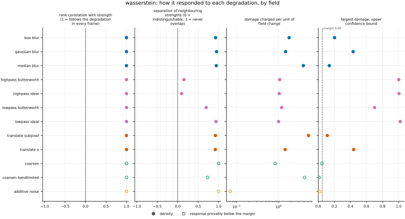
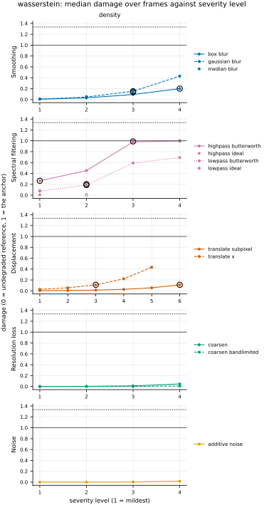

## Definition

Let $\rho_r$ and $\rho_c$ be the reference and candidate densities on a periodic box
$\Omega$ of $N$ cells with spacing $h_j$ along axis $j$, and $\langle \cdot \rangle$ the mean
over cells. Each is divided by its own mean, the constant scaling that gives two fields equal
mass [@engquist2014] (Sect. 2.2):

$$
f = \frac{\rho_r}{\langle \rho_r \rangle}, \qquad g = \frac{\rho_c}{\langle \rho_c \rangle} \tag{1}
$$

so that $f\,dx/|\Omega|$ and $g\,dx/|\Omega|$ are probability measures on the torus. The
metric is their quadratic Wasserstein distance, the square root of the least mean squared
distance the mass of $f$ must travel to become $g$ ([@peyrecuturi2019], Eq. (2.18), a
distance between probability measures by their Prop. 2.3; [@engquist2014], Sect. 1, for
this form):

$$
W_2(f, g)^2 = \inf_{T_{\#} f = g} \; \frac{1}{|\Omega|} \int_\Omega
\bigl| x - T(x) \bigr|^2 f(x) \, dx \tag{2}
$$

where $T_{\#} f = g$ means that $T$ carries the mass of $f$ onto $g$, and distances are taken
on the torus. For densities bounded away from zero the optimal map is
$T(x) = x + \nabla u(x)$ with $u$ periodic. [@saumier2015] state in Theorem 2.1, after
Cordero-Erausquin, that the optimal map is additive, $\nabla\Psi(x + p) = \nabla\Psi(x) + p$, and
in the remark after it that this makes $\nabla\Psi - x$ the gradient of a periodic function.
The test against the exact circle transport below, at shifts where the optimal rotation is
not zero, would fail if a uniform displacement were missing. $u$ solves the Monge–Ampère
equation ([@saumier2015], Eq. (4))

$$
g\bigl(x + \nabla u(x)\bigr) \, \det\bigl(I + D^2 u(x)\bigr) = f(x) \tag{3}
$$

so that Equation (2) becomes the mean over cells of a transport cost density, which is the
companion map:

$$
W_2(f, g) = \bigl\langle f \, |\nabla u|^2 \bigr\rangle^{1/2} \tag{4}
$$

**How Equation (3) is solved.** By the periodic damped Newton method of [@saumier2015]
(Eq. (6)), from $u_0 = 0$:

1. **Evaluate.** $f_n = g(x + \nabla u_n) \det(I + D^2 u_n)$, then replace $f_n$ by
   $f_n - \langle f_n \rangle + 1$ so that the residual $f - f_n$ has zero mean
   ([@saumier2015], Eq. (14)).
2. **Stop** when the root mean square of $f - f_n$ is at most $10^{-12}$, a fraction of the
   mean density, and report Equation (4) with $u_n$.
3. **Step.** Solve $\Delta \theta_n = (f - f_n)/g(x + \nabla u_n)$, re-centred to zero
   mean, by FFT.
4. **Damp.** Set $u_{n+1} = u_n + \theta_n/\tau$ with the first of $\tau = 1, 2, 4, \dots$
   (at most $2^{30}$) that lowers the root mean square residual and keeps $I + D^2 u$
   positive definite.

Step 3 replaces their linearised operator ([@saumier2015], Eq. (5)) by its leading term,
$g\,\Delta$, with $g$ divided out cell by cell. That is mine: their Sect. 3.3 says only that a
simpler equation can *sometimes* replace the full one, and their $\tau = 1$ in Sect. 5.1 was
obtained with the full operator. Step 4 chooses their damping $\tau$ adaptively, also mine:
their proof needs $\tau$ large enough and $I + D^2 u_n$ positive definite at every step
(Sect. 3.3) and gives no value. The answer is fixed by the residual of step 1, so these
choices change the number of iterations and not the value: on kinet density, the plain
Laplacian step and this one agree to a relative $4 \times 10^{-9}$, the size the tolerance
allows. Without step 3's division and step 4's damping the iteration overshoots, and
diverges, once the candidate density exceeds about twice its mean. Derivatives of $u$ are spectral, with the wavevectors
$k_j = 2\pi\,\mathrm{fftfreq}(N_j, h_j)$ that [h_minus_one](../../metrics/h_minus_one/card.md)
uses; [@saumier2015] also solve the linear step by FFT (Sect. 4.2). The candidate is
evaluated at the displaced points by a periodic cubic B-spline. That is my choice: they use
nearest-neighbour values and name linear interpolation as the common alternative (Sect. 4).
If the solve has not converged after 500 iterations, or no damping lowers the residual,
the value is NaN with a warning that says which. Kinet density needs 4 to 7 iterations.
Limitations gives the measured range in which the solve converges. A cell
that is not positive and finite in either field makes the value NaN: Equation (2) is
defined between measures, and any value given to a signed field would be one of the
signed-field formulations that `issues/047` leaves open.

`test_metric.py` checks the solve against an independent one. For a density that varies
along one axis only, the transport is one-dimensional, and on a circle its exact value is the
least, over a rotation of the mass levels, of the mean squared distance between the two
quantile functions ([@delon2010], Sect. 2). On two 256-cell profiles moved by an eighth of
the domain, one between 0.63 and 1.37 times its mean and one peaking at 2.33 times its mean
with a maximum ten times its minimum, the two agree to within the test's relative tolerance
of $2 \times 10^{-4}$.

**Why a continuous solve and not a transport between cells.** Treating each cell as a point
mass and solving the discrete problem exactly is the standard alternative, but on a density
whose displacements are smaller than a cell it measures the grid. Mass then moves a whole
cell or not at all, so the squared distance grows with the size of the change rather than
with its square. For a 1-D density $1 + \epsilon \cos(2\pi x)$ against the uniform one on
cells of size $h$, the discrete squared distance is about $h\epsilon/\pi^2$ against the
continuous $\epsilon^2/(8\pi^2)$, a ratio of $8h/\epsilon$, while the continuous displacement
$\epsilon/2\pi$ is below a cell. This derivation is mine. It is
also unaffordable here: one $256 \times 256$ pair is a $65\,536 \times 65\,536$ cost
matrix. Equation (3) has neither problem, because the displacement $\nabla u$ is a
continuous field.

**What it is close to on a near-uniform density.** For densities between $a$ and $b$ times
the volume measure, Theorem 5, Eq. (17) and Corollary 3 of [@peyre2018] bound it by the
$\dot H^{-1}$ seminorm $H$ of $f - g$, which `h_minus_one` computes as a root mean square:

$$
b^{-1/2} \, H \;\le\; W_2(f, g) \;\le\; 2\,a^{-1/2} \, H \tag{5}
$$

with the lower bound for the flat torus, where the Ricci curvature is zero. These bounds
alone are loose: on kinet density, whose normalised values lie between about 0.96 and 1.007,
they allow a ratio between about 1 and 2. What makes the two close is the linearisation:
as $f - g$ shrinks, $W_2$ equals the $\dot H^{-1}$ norm weighted by the reference density
([@peyre2018], Eq. (5)), and that weighted norm lies within $b^{-1/2}$ and $a^{-1/2}$ of $H$
([@peyre2018], Lemma 2), so to first order the factor 2 drops out. This step is my reading of
Peyre's results, not a theorem he states. `test_metric.py` checks Equation (5), which is a
consistency check and not a tight one. `h_minus_one` is not mass-normalised, so the two values
also differ by the factor $\langle\rho\rangle$, which is close to 1 on kinet density.

**Shift and background.** The property that recommends this distance for a displaced
feature is that $W_2^2$ of a signal moved by $s$ is $s^2$ whatever its profile
([@engquistyang2022], Sect. 1; [@engquist2014], Sect. 1). That holds for a signal on an empty
background. A density is a fluctuation on a large positive background. That is the "linear
normalisation" of [@yang2018] (section "Data normalization", Sect. 3.1 in the arXiv copy,
Eq. (27)), which they report makes the misfit non-convex in shifts. [@engquistyang2022]
(Theorem 4.6) show, for a compactly supported one-dimensional signal on a background $c$, that
$W_2^2$ is $O(s^2)$ only for shifts below about $1/c$ plus the width of the signal and $O(s)$
beyond. Their theorem does not cover a periodic field that fills the domain, as density does.
What applies here is the linearisation above. For a shift $s$ along $x$ small against the
density's scales, $f(x - s) - f \approx -s\,\partial_x f$, and the $\dot H^{-1}$ norm of
$\partial_x f$ is $(\sum_{\mathbf{k}} (k_x/|\mathbf{k}|)^2 |\hat f_{\mathbf{k}}|^2)^{1/2}$, at most the
root mean square of $f - 1$. So $W_2$ is about $s$ times a number no larger than the relative
fluctuation of the density, not $s$ itself (my derivation).

### Boundary handling

Periodic on every axis. The domain is the torus: the optimal map is $x$ plus the gradient of
a periodic function, derivatives are taken by FFT, and the candidate is interpolated with
wrap-around (`scipy.ndimage.map_coordinates`, `mode="grid-wrap"`), so mass leaving one side
enters the other. The metric therefore declares `requires_periodic`, and the harness does not
run it on a dataset with a non-periodic axis, such as the Sod shock tube.

## Performance

<!-- GENERATED performance: written by `python -m fmeval.cards evidence wasserstein --results results/wasserstein_1793495645`, do not edit -->



Four measured statistics for wasserstein, one row per degradation grouped by family and one marker per field. From left: the rank correlation between the metric and the applied strength within a frame, with the line showing the resampling interval; the separation of neighbouring strengths as Cliff's delta, where 0 means the metric cannot tell one strength from the next and the faint ticks at 0.12, 0.28 and 0.42 are Vargha and Delaney's small, medium and large anchors, for scale and not as grades; the damage charged per unit of field change at the harshest strength; and the upper confidence bound on the largest damage, beside the fixed margin of 0.05. A hollow marker is a field and degradation on which that bound lies below the margin, so the response is provably small. A missing marker is a statistic the analysis withheld, as the rank correlation is on an axis the metric is invariant to.



Median damage over frames against severity level for wasserstein, one row per family of degradation and one column per field, on one shared scale. The solid grey line is damage 1, the anchor (by default the field's own mean); the dotted black line is the damage assigned to the fake prediction with the right spectrum, where the run included it. The hollow black ring marks the first level at which the metric has moved a tenth of the way to the anchor. Hollow grey markers are strengths excluded for repeating a milder one or for doing nothing. Degradations with three or fewer usable levels are drawn as markers only; points beyond 2 either side are drawn as triangles at the edge. Damage is negative where a degradation moves the metric away from the anchor, as noise raises a single-field quantity the field's mean sets to zero.

**Trend: does the response follow the degradation?**

| test family | field | degradations | rank correlation | fraction of frames in order | weakest gap between neighbouring strengths |
|---|---|---|---|---|---|
| Displacement | density | 2 | 1 | 1 | 0.959 to 0.96 |
| Resolution loss | density | 2 | 1 | 1 | 0.865 to 1 |
| Smoothing | density | 3 | 1 | 1 | 0.963 to 0.974 |
| Spectral filtering | density | 4 | 1 | 1 | 0.548 to 0.968 |
| Noise | density | 1 | 1 | 1 | 1 |

**Reactivity: how far does it move?**

| test family | field | change from clean at the harshest strength | elasticity | first strength detected |
|---|---|---|---|---|
| Displacement | density | — | 0.999 to 1 | level 3 |
| Resolution loss | density | — | 2.03 to 2.14 | level — |
| Smoothing | density | — | 1.81 to 1.92 | level 3 |
| Spectral filtering | density | — | 1.12 to 6.71 | level 1 |
| Noise | density | — | 0.997 | level — |
| trap test: fake prediction, right spectrum | density | — | — | damage 1.33 |

**Consistency: how much does it vary from snapshot to snapshot?**

| test family | field | consistency, in the strength's units | snapshots per independent block |
|---|---|---|---|
| Displacement | density | 0.053 to 0.315 | 18 |
| Resolution loss | density | 0.582 to 1.72 | 19 to 21 |
| Smoothing | density | 0.00546 to 0.0138 | 19 to 20 |
| Spectral filtering | density | 0.0137 to 0.0325 | 1 to 20 |
| Noise | density | 0.00991 | 1 |

One row per family of degradation and physical field; a cell gives the range over the degradations in that family. **Trend.** The rank correlation is the Spearman correlation between the strength and how far the metric has moved from its value on the undegraded field of the same frame, in the one direction it moves under that degradation, computed inside a single frame. A value of 1 means every strength moved it further than the last in every frame, whichever way it moves; a response that scatters to both sides scores near 0. The fraction of frames in order counts the frames with no exception. The weakest gap is the smallest Mann-Whitney overlap between two neighbouring strengths across frames: 1 means they never overlap, 0.5 that they cannot be told apart. **Reactivity.** The change from clean is the median, at the harshest strength, of the departure from the undegraded value of the same frame over the size of that value: 0.3 means 30%. It does not exist for this metric, whose undegraded value is exactly zero; the damage below is its relative reading. The elasticity is the percentage change of that departure per percentage change in strength over the mildest strengths. First strength detected is the mildest at which the metric has moved a tenth of the way to the anchor; **damage** reads that 0-to-1 scale as a number. A dash means the measurement is not defined there. A metric's reactivity scales with the power it is expressed in: mean squared error's elasticity is twice root-mean-square error's, though the two carry the same information, so compare magnitudes across metrics with that in mind. **Consistency** is how much the response varies from snapshot to snapshot relative to its size, in the strength's units; the snapshots of one trajectory are correlated, and the last column is how many consecutive snapshots one independent block spans.

These tables report what was measured and grade none of the measurements. What the numbers mean for this metric is written in the subsections below, beside the test that produced each number.

**Profile.**

| field | selectivity | charges most for | charges least for | response provably below 0.05 at 90% on | elasticity to a sub-pixel shift, against severity (distance) | compute cost (x cheapest in this run) |
|---|---|---|---|---|---|---|
| density | 0.38 | `translate_subpixel` | `additive_noise` | `additive_noise` `coarsen` `coarsen_bandlimited` | 1 | 1 |

One row per physical field. **Selectivity** is how concentrated the metric's response is on a few degradations, measured per unit of field change: 0 means it charges every degradation the same, as mean squared error does by construction, and values toward 1 that one degradation carries most of it. **Charges most and least for** name the two ends of that profile. **Response provably below** lists degradations on which the upper confidence bound of the largest damage lies below the margin -- an equivalence test, so an entry says the response is provably small, not merely not significant; a dash means no degradation met the bound. **Elasticity** is the slope of log damage against log shift over the smallest shifts: 1 means damage grows in proportion to the shift, 2 with its square. **Compute cost** is wall-clock per evaluation over the cheapest metric and field in the same run.

<!-- END GENERATED performance -->

## Intuition

The metric treats each density as a pile of mass spread over the domain and asks how far,
on average, that mass would have to travel to turn one pile into the other, moving it as
cheaply as possible. A prediction that has the right structures in slightly the wrong places
needs only short moves and scores little. A prediction whose mass is spread quite
differently needs long moves and scores a lot. Each density is first divided by its own
average, so only the arrangement of mass counts, not how much there is.

It works by finding the cheapest way of moving the mass. That plan has a special form: every
small parcel moves in a straight line, along the slope of a single smooth function. The
metric solves for that function a few times over, each pass correcting where the moved
reference still differs from the candidate. It reports the root mean square distance moved,
in the grid's units of length.

Worked example: on a four-by-four grid, the reference's four columns hold 1.5, 1, 0.5 and 1
times the average density, and the candidate is uniform.

```
reference            candidate      result
1.5  1  0.5  1       1  1  1  1
1.5  1  0.5  1       1  1  1  1     0.225 cells
1.5  1  0.5  1       1  1  1  1
1.5  1  0.5  1       1  1  1  1
```

Mass slides sideways out of the
heavy column and into the light one. The parcels halfway between them travel furthest,
about a third of a cell, and the parcels at the centres of the heavy and light columns do
not move. The root mean square distance moved, weighted by mass, is 0.225 cells.

It ignores the total amount of mass, and it has no value where either field is zero or
negative, because neither is then a pile of mass.

## Reading the output

- **Range and units.** From zero up to at most half the domain's diagonal, in the grid's
  units of length: cells on kinet, whose spacing is 1.
- **Direction.** Lower is better. Zero means the two normalised densities are identical.
- **What is a good value.** A distance moved, so compare it with the scales of the flow: a
  value far below a cell means the prediction has the mass in nearly the right places. On a
  density whose fluctuation is a small fraction of its mean, the value is also small next
  to the spatial scales of the structures, for the reason under Limitations.
- **Valid comparisons.** Models on the same grid and domain, directly. Across grids with
  different spacing the number is in the same physical units and comparable, unless the
  coarser grid has averaged away structure. Across datasets it is not comparable: the size
  of the domain and the relative size of the fluctuation both set it.
- **The companion.** A per-cell map, $f\,|\nabla u|^2$ in length squared: the reference's
  normalised density times the squared distance its mass travels. Its mean is the square of
  the metric. It shows where mass has to move, not the error at each cell.

## Limitations

- **The total mass is invisible.** Both densities are divided by their own mean, so a
  prediction with the right arrangement and the wrong total scores zero (pinned in
  `test_metric.py`). Pair it with a metric that sees the mean or the amplitude.
- **On a density with a large mean it is close to `h_minus_one`.** To first order in the
  difference the two are within $b^{-1/2}$ and $a^{-1/2}$ of each other (Definition), and on a
  field like kinet's density, whose values lie within a few percent of its mean, those factors
  are close to 1. Read "Compared with the other metrics" before using both in one panel.
- **It does not measure the size of a shift.** The background makes the growth with a
  displacement far weaker than "distance squared": a large shift of the whole density costs
  only the transport needed to rearrange its small fluctuation, so the value is much smaller
  than the shift (Definition, "Shift and background"). Reading the
  number as "how far the features are displaced" is wrong here. That reading is also less
  clean in two dimensions than in one, because the optimal map can move different parts of
  the field in different directions.
- **A non-positive cell gives NaN, not a large value.** A surrogate that predicts a negative
  density anywhere is scored NaN, which an average over frames can hide.
- **At high contrast the solve can fail, and the value is then NaN.** [@saumier2015]
  (Sect. 3.3) note that the damping their convergence needs grows as the source density
  approaches zero or as either density becomes rough. Measured against the exact circle
  transport on 128-cell profiles moved by 1, 8 and 32 cells (my measurement, not a run of the
  harness): the solve converges and agrees to $10^{-4}$ for every shift when the density
  peaks at 2.33 times its mean, and for shifts up to 8 cells at 2.94 times; it fails at 2.94
  times its mean for a 32-cell shift and at 3.53 times for every shift, because no damping of
  its step then lowers the residual. A strong shock compresses density by more than that, so
  a shock-dominated field can score NaN with a warning. A full Newton step, solving their
  linearised operator (Eq. (5)) iteratively as their Sect. 4.2 does, would be the remedy.
- **Not exactly symmetric.** $W_2$ is symmetric, but solving from the other side gives a value
  that differs by the discretisation error, so the metric declares `symmetric=False`.

## Results

<!-- GENERATED run: written by `python -m fmeval.cards evidence wasserstein --results results/wasserstein_1793495645`, do not edit -->

Measured on `kinet_re5e4`, frames 2000 to 10000 (161 frames of developed flow), on the 256 analysis grid, seed 20260807, at commit `ed1970a573e0`. Run `wasserstein_1793495645`.

Every number in this section comes from that one run. Regenerate with `python -m fmeval.cards evidence <name> --results results/wasserstein_1793495645`.

<!-- END GENERATED run -->

### Smoothing

[gaussian_blur](../../degradations/gaussian_blur/card.md) ·
[box_blur](../../degradations/box_blur/card.md) ·
[median_blur](../../degradations/median_blur/card.md)

<!-- GENERATED results_smoothing: written by `python -m fmeval.cards evidence wasserstein --results results/wasserstein_1793495645`, do not edit -->

| degradation | field | strengths | rank correlation | fraction of frames in the right order | weakest gap between neighbouring strengths |
|---|---|---|---|---|---|
| `box_blur` | density | 4 | 1 | 1 | 0.963 |
| `gaussian_blur` | density | 4 | 1 | 1 | 0.974 |
| `median_blur` | density | 3 | 1 | 1 | 0.971 |

<!-- END GENERATED results_smoothing -->

Every blur moves mass from the density's peaks into its troughs, and the distance follows the width on every frame, as pre-registered, with neighbouring widths almost never overlapping (weakest gap 0.963). The largest damage, 0.455 under `gaussian_blur`, is under half of what the spatial mean scores. The elasticity of 1.81 to 1.92 says the distance grows nearly as the square of the kernel width at the mildest widths. That is what a narrow blur does to a field carried by a few large-scale modes, each of which it damps by an amount proportional to the square of the width (my reading, not a source's).

### Spectral filtering

[lowpass_ideal](../../degradations/lowpass_ideal/card.md) ·
[lowpass_butterworth](../../degradations/lowpass_butterworth/card.md) ·
[highpass_ideal](../../degradations/highpass_ideal/card.md) ·
[highpass_butterworth](../../degradations/highpass_butterworth/card.md)

<!-- GENERATED results_spectral: written by `python -m fmeval.cards evidence wasserstein --results results/wasserstein_1793495645`, do not edit -->

| degradation | field | strengths | rank correlation | fraction of frames in the right order | weakest gap between neighbouring strengths |
|---|---|---|---|---|---|
| `highpass_butterworth` | density | 4 | 1 | 1 | 0.576 |
| `highpass_ideal` | density | 3 | 1 | 1 | 0.548 |
| `lowpass_butterworth` | density | 4 | 1 | 1 | 0.848 |
| `lowpass_ideal` | density | 3 | 1 | 1 | 0.968 |

<!-- END GENERATED results_spectral -->

All four filters follow the fraction of energy removed on every frame. The high-pass pair separates neighbouring strengths least well (weakest gap 0.548 for `highpass_ideal`), because removing density's large-scale modes takes most of its fluctuation at once, and the harshest high-pass and low-pass strengths go slightly past the anchor (largest damage 1.08 for `lowpass_ideal`, `highpass_ideal` and `highpass_butterworth`).
### Displacement

[translate_x](../../degradations/translate/card.md) ·
[translate_subpixel](../../degradations/translate_subpixel/card.md)

<!-- GENERATED results_geometric: written by `python -m fmeval.cards evidence wasserstein --results results/wasserstein_1793495645`, do not edit -->

| degradation | field | strengths | rank correlation | fraction of frames in the right order | weakest gap between neighbouring strengths |
|---|---|---|---|---|---|
| `translate_subpixel` | density | 6 | 1 | 1 | 0.96 |
| `translate_x` | density | 5 | 1 | 1 | 0.959 |

<!-- END GENERATED results_geometric -->

Both axes follow the shift on every frame, as pre-registered, and the elasticity of 0.999 to 1 says the distance is proportional to the shift over these ranges. That is not the property the idea was built for. The largest whole-domain shift on the ladder scores a damage of 0.468, and the anchor it is measured against is itself only 0.172 cells: moving the whole density by many cells costs a transport of a small fraction of a cell, because only its fluctuation, well under a percent of its mean in root mean square, has to be rearranged, not the whole mass. This is the background effect described in the Definition ("Shift and background"), measured; the run shows the size of the effect, not the non-convexity that the seismic papers describe.

### Resolution loss

[coarsen](../../degradations/coarsen/card.md) ·
[coarsen_bandlimited](../../degradations/coarsen_bandlimited/card.md)

<!-- GENERATED results_resolution: written by `python -m fmeval.cards evidence wasserstein --results results/wasserstein_1793495645`, do not edit -->

| degradation | field | strengths | rank correlation | fraction of frames in the right order | weakest gap between neighbouring strengths |
|---|---|---|---|---|---|
| `coarsen` | density | 4 | 1 | 1 | 1 |
| `coarsen_bandlimited` | density | 4 | 1 | 1 | 0.865 |

<!-- END GENERATED results_resolution -->

Both coarsenings follow the factor on every frame, but their response is small: the profile table lists both, and noise, among the degradations whose damage is provably below 0.05. Block averaging redistributes mass only within a block, and density's fluctuation sits in the largest scales, so little mass moves far.

### Noise

[additive_noise](../../degradations/additive_noise/card.md)

<!-- GENERATED results_stochastic: written by `python -m fmeval.cards evidence wasserstein --results results/wasserstein_1793495645`, do not edit -->

| degradation | field | strengths | rank correlation | fraction of frames in the right order | weakest gap between neighbouring strengths |
|---|---|---|---|---|---|
| `additive_noise` | density | 4 | 1 | 1 | 1 |

<!-- END GENERATED results_stochastic -->

Ordered perfectly, with no overlap between neighbouring amplitudes, and with an elasticity of 0.997, so the distance is proportional to the noise amplitude. The damage stays tiny (largest 0.0204): independent noise in each cell is evened out by moving mass over about a cell, which costs little next to the anchor. Noise is what this metric charges least for.

### Trap tests

[gaussian_impostor](../../degradations/gaussian_impostor/card.md) ·
[uncorrelated](../../degradations/random_large_translation/card.md)

<!-- GENERATED results_canaries: written by `python -m fmeval.cards evidence wasserstein --results results/wasserstein_1793495645`, do not edit -->

| field | damage assigned to the fake prediction | closest real degradation | damage of the reference moved far away | value on the anchor |
|---|---|---|---|---|
| density | 1.33 | `lowpass_ideal=1.4029` | 1.11 | 0.172 |

The fake prediction here has exactly the reference field's amplitude spectrum and completely scrambled structure. Damage 1 is what the anchor scores, by default the reference's own spatial mean, a prediction that knows the mean and nothing else. The damage column therefore says how close to useless this metric considers that fake prediction: a low number means the metric was fooled. The third column translates the same number into an ordinary degradation whose damage the fake prediction matches, which is easier to picture. The fourth is the reference moved by a large random offset, the right statistics in the wrong place; where a field's energy sits in its largest scales that copy stays partly correlated with the reference, so it is not the score of an unrelated field.

<!-- END GENERATED results_canaries -->

The fake prediction with the right spectrum scores a damage of 1.33, more than the spatial mean: the metric is not fooled by it, because the phases decide where the mass sits. The reference moved far away scores 1.11, close to the anchor.

### Compared with the other metrics

<!-- GENERATED results_summary: written by `python -m fmeval.cards evidence wasserstein --results results/wasserstein_1793495645`, do not edit -->

No measurements for this test in the recorded run.

<!-- END GENERATED results_summary -->

This run held only this metric, so the generated cross-metric table is empty. Placed beside the committed fingerprint of [h_minus_one](../../metrics/h_minus_one/card.md) on the same frames, every axis's largest damage and elasticity, and both probes, agree to within about one percent, as the first-order relation in the Definition predicts for a density this close to uniform; Equation (5) alone would allow a factor of two. On kinet density the two metrics carry the same information, and this one costs 0.214 s per evaluation (the fingerprint) where `h_minus_one` takes one FFT. A run of both together would put the correlation in this table.

### Damage beside the other metrics

<!-- GENERATED results_damage_by_level: written by `python -m fmeval.cards evidence wasserstein --results results/wasserstein_1793495645`, do not edit -->

Only one metric in the recorded run; there is nothing to place this one beside.

<!-- END GENERATED results_damage_by_level -->

Only one metric was in the run, so there is nothing to place beside it here; see the comparison with `h_minus_one` above.

## References

\bibliography
